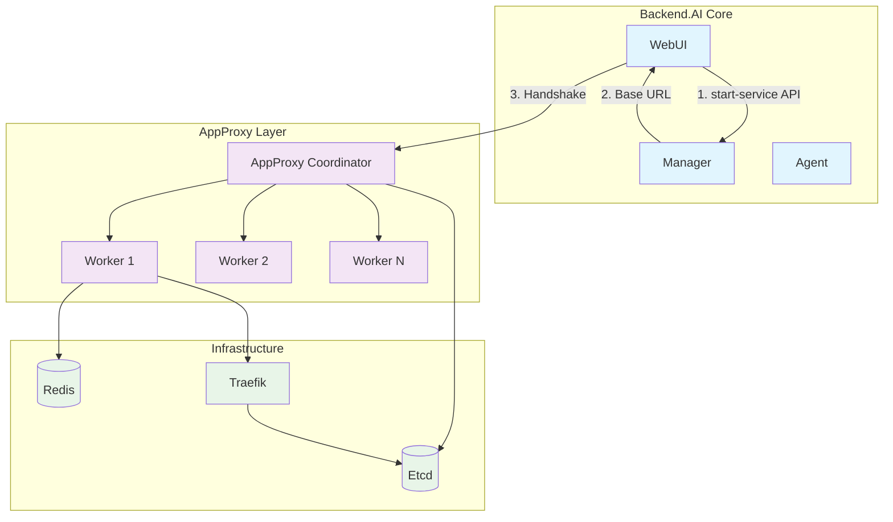
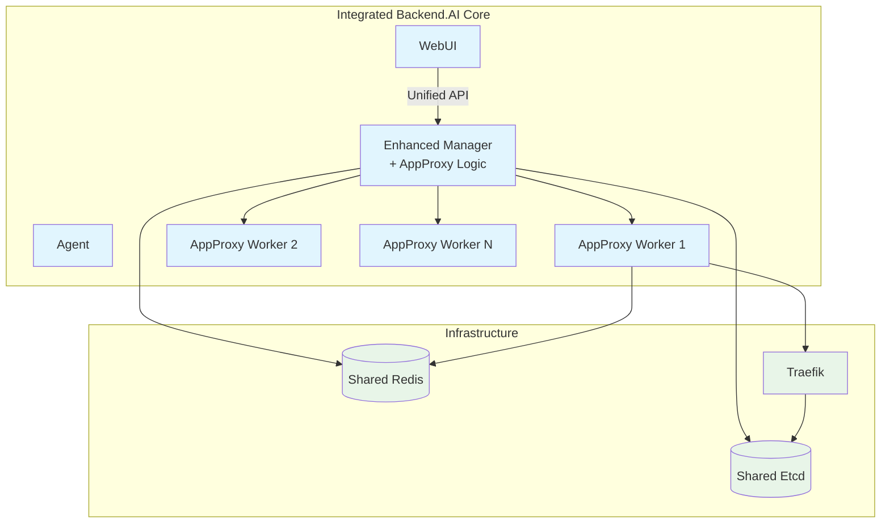
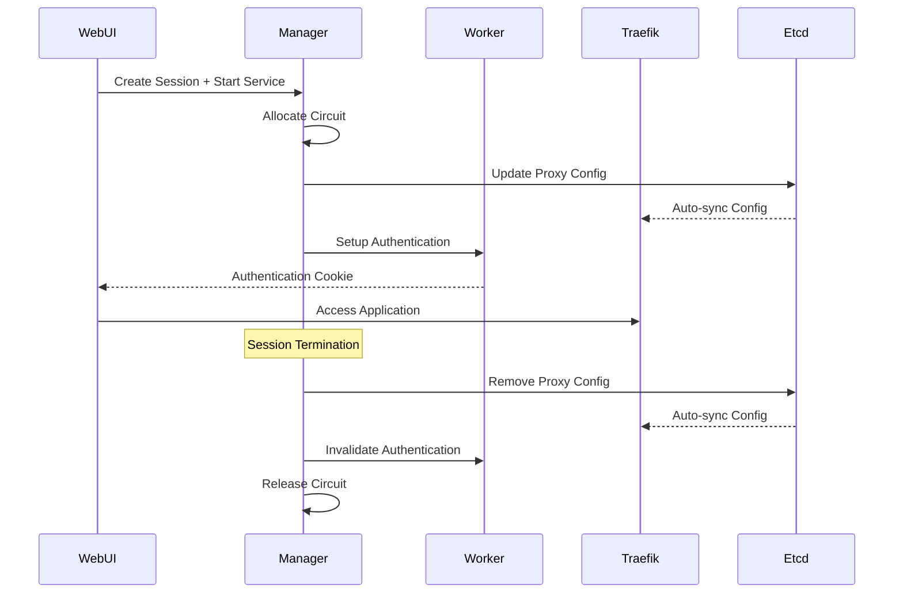

# Backend.AI App Proxy 아키텍처 개선

## 요약

이 BEP(Backend.AI Enhancement Proposal)는 Backend.AI App Proxy 아키텍처의 전반적인 개선안을 제시한다. 세션과 circuit 의 lifecycle 동기화, 인증 통합, TCP idle timeout 기능, App Proxy 컴포넌트 오픈소스화 같은 중요한 문제를 다룬다. 제안 아키텍처는 App Proxy Coordinator 기능을 Backend.AI Manager 로 합쳐 자원 관리를 개선하고 현재의 연결 제약을 없애는 것을 목표로 한다.

## 동기

현재 App Proxy 아키텍처는 시스템 신뢰성과 유지보수성에 영향을 주는 구조적 한계를 여럿 가진다. 원래 Backend.AI Core 와 App Proxy 를 분리한 것은 추상화 경계를 분명히 유지하려는 의도적인 설계 결정이었다. 그러나 Model Service 도입으로 이 추상화 경계가 무너져 현재 아키텍처로는 제대로 다루기 어려운 혼합 요구 사항이 생겼다.

또한 App Proxy 는 현재 Backend.AI Core 와 분리된 private 저장소로 관리하므로 기술 유지보수, 엔터프라이즈 안정성 보장, 보안 이슈 관리에 어려움이 있다. 계속 드는 유지보수 비용, 엔터프라이즈 안정성 요구, 오픈소스 생태계에서 나온 보안 이슈 보고를 고려하면 App Proxy 를 오픈소스화하고 통합하는 편이 더 지속 가능한 방식이다.

주요 기술 문제는 Manager 와 App Proxy 사이의 연결 제약 때문에 세션과 circuit 의 lifecycle 을 동기화할 수 없다는 점이다. 세션이 scheduler 에서 TERMINATING 상태로 들어갈 때 이 연결 제한 때문에 circuit 회수 요청을 App Proxy 에 보낼 수 없다. 또 SameSite cookie 제한과 Redis 계층 추상화 자체는 문제가 아니지만, 이 때문에 Webserver 와 App Proxy 가 session cookie 를 하나로 관리하지 못해 인증 동기화 문제가 생긴다.

TCP circuit 관리는 문제가 더 있다. Traefik 기반 App Proxy Worker 는 TCP idle timeout 기능을 구현할 수 없다. 유휴 연결을 감지하고 timeout 방식을 구현하려면 비 HTTP TCP proxy 를 위한 TCP access log 지원과 TCP plugin 기능이 필요한데, Traefik 에 둘 다 없다. 이런 Traefik 한계 때문에 TCP 자원 관리와 모니터링을 효과적으로 하기 어렵다.

현재 아키텍처는 inference circuit lifecycle 관리도 복잡하게 만든다. 세션 생성, 종료, health 상태 갱신을 위해 Manager 가 Coordinator REST API 를 직접 호출하며 추상화 경계를 넘어야 한다.

## 현재 구조

### 현재 아키텍처 개요

### 대화형 앱 생성 흐름

현재 대화형 앱 생성 과정은 다음 단계를 따른다.

1. WebUI 가 Manager 의 `/session/{id}/start-service` API 를 호출한다.
2. Manager 가 App Proxy Coordinator 의 Base URL 로 응답한다(Manager 와 Coordinator 사이에 handshake 가 없다).
3. WebUI 가 받은 Base URL 로 Coordinator 와 handshake 과정을 진행한다.
4. Coordinator 가 circuit 할당과 worker 배정을 관리한다.

### 컴포넌트 역할

#### Coordinator 기능

- **Worker lifecycle 관리**: worker health check 를 관리하고 응답이 없는 worker 를 port pool 에서 제외한다.
- **앱 할당**: browser 에서 circuit 생성 요청을 받고 worker 가 보고한 port pool 에서 유휴 port 를 할당한다.
  - port 기반 worker: 사용 가능한 값 중 가장 작은 값을 할당한다.
  - wildcard 기반 worker: 6자리 무작위 hex 를 생성한다.
- **설정 관리**: 유휴 port 설정, proxy backend, 인증 정보를 Etcd 에 푸시해 Traefik 이 실시간으로 사용하게 한다.
- **인증**: 미리 공유한 secret 으로 JWT token 을 생성하고 browser 를 Worker 의 `/setup` API 로 리다이렉트한다.
- **inference circuit 관리**: Manager 에서 REST API 호출로 세션 생성, 종료, health 상태 갱신을 받는다.

#### Worker 기능

- **인증 cookie 주입**: browser 인증을 위해 `/setup` API 를 처리한다.
- **트래픽 모니터링**: Traefik 에서 Unix Domain Socket 으로 circuit 트래픽 이력을 받고 Redis 를 갱신한다.

### 현재 한계

기존 아키텍처에는 구조적 문제가 여럿 있다.

**연결 제약**: Backend.AI Manager 와 App Proxy 는 원래 별도의 추상화 경계로 설계됐지만 Model Service 도입으로 이 경계가 깨져 일관되지 않은 아키텍처 패턴이 생겼다. 지금은 양방향 통신을 할 수 없어 세션과 circuit lifecycle 을 제대로 동기화하지 못한다.

**분리된 인증 시스템**: Webserver 와 App Proxy 가 각각 인증 주체를 유지한다. SameSite cookie 제한과 Redis 계층 추상화 자체는 문제가 아니지만, 이 때문에 두 시스템이 session cookie 를 하나로 관리하지 못해 인증 동기화 문제가 생긴다.

**TCP circuit 한계**: Traefik 기반 App Proxy Worker 는 Traefik 자체의 한계 때문에 TCP idle timeout 기능을 구현할 수 없다. 비 HTTP TCP proxy 를 위한 TCP access log 지원이 없고 TCP plugin 기능도 없다. 이 기능이 없어 유휴 TCP 연결을 감지하지 못하고 자동 timeout 방식을 구현하지 못한다.

## 제안 아키텍처

### 통합 아키텍처 개요

### 세션과 circuit lifecycle 동기화

### 주요 아키텍처 변경

#### App Proxy 를 Manager 에 통합

제안 아키텍처는 Coordinator 기능을 모두 Backend.AI Manager 로 합쳐 다음을 가능하게 한다.

**통합 lifecycle 관리**: 세션과 circuit 이 같은 lifecycle 을 공유해 세션이 종료될 때 자원이 제대로 정리되도록 보장한다.

**실시간 backend 갱신**: 추상화 경계를 깨지 않고 inference circuit 의 proxy backend 를 실시간으로 갱신할 수 있다.

**개선된 세션 관리**: 통합으로 컴포넌트 사이에서 세션 무효화를 조정할 수 있다(자세한 내용은 개선된 세션 관리 절에 있다).

#### 공유 인프라 요구 사항

통합 아키텍처에서는 Manager 와 Worker 가 같은 Redis 와 Etcd cluster 에 접근해야 하므로 공유 인프라 기반이 필요하다.

**중요한 네트워크 요구 사항**: 제안 아키텍처는 Backend.AI Manager 와 Backend.AI App Proxy Worker(Traefik 포함) 사이의 **East-West 트래픽 도달성**을 요구한다. 이는 고객 배포 환경에 큰 인프라 요구 사항 변경이다. 현재와 앞으로의 고객 환경은 이 컴포넌트 사이의 양방향 통신을 보장해야 하며, network policy, firewall, service mesh 설정을 갱신해야 할 수 있다.

#### 개선된 세션 관리

**자동 세션 무효화**: Webserver logout 시 logout URI 관리를 조정해 App Proxy 세션을 자동으로 무효화한다.

**동적 logout URI 설정**: account manager 가 logout 과정에서 browser 를 이동시킬 logout URI 목록을 동적으로 설정할 수 있게 유지한다.

## 구현 계획

### 1단계: 인프라 준비

#### 공유 database 접근

- App Proxy Redis 와 Etcd cluster 에 접근하도록 Manager 를 설정한다.
- 연결 pooling 과 failover 방식을 구현한다.
- 공유 인프라 모니터링과 알림을 구축한다.

#### 인증 시스템 통합

- 통합 인증 token 시스템을 설계한다.
- 컴포넌트 사이의 세션 검증을 구현한다.
- account manager 에 logout URI 관리 시스템을 생성한다.

### 2단계: Manager 통합

#### App Proxy 로직 이전

#### 세션 통합

- 세션 시작 시 circuit 생성을 구현한다.
- 세션 정리 절차에 circuit 종료를 추가한다.
- 세션 health check 와 연동되는 circuit health 모니터링을 생성한다.

### 3단계: TCP idle timeout 개선

#### Traefik 확장 검토

**lifecycle 동기화 우선 방식**

Traefik 을 fork 하는 일은 기술적으로 복잡하고 유지보수가 계속 필요하므로, 주된 전략은 세션과 circuit lifecycle 동기화에 두어야 한다. circuit 은 연결된 세션이 끝나면 자동으로 종료되므로 이 방식으로 TCP idle timeout 기능 자체가 필요 없어질 수 있다.

**조건부 Traefik 개선**

lifecycle 동기화로 자원 관리 요구를 충족하기 어렵다고 확인될 때만 TCP idle timeout 기능을 추진한다.

**선택지 1: plugin 개발** (필요하다면 선호하는 방식)

- TCP idle timeout 감지를 위한 Traefik plugin 을 개발한다.
- TCP 연결 access log 를 구현한다.
- circuit 활동 모니터링 시스템을 생성한다.

**선택지 2: Traefik fork** (최후 수단)

- plugin 방식으로 충분하지 않을 때만 TCP 지원을 강화한 Traefik 을 fork 한다.
- 장기 유지보수 비용과 upgrade 호환성을 고려한다.
- lifecycle 동기화의 이점과 trade-off 를 비교 검토한다.

**선택지 3: 대체 모니터링** (임시 방안)

- Worker 수준에서 연결 모니터링을 구현한다.
- system 수준 연결 추적을 사용한다.
- 주기적인 circuit health 검증을 생성한다.

### 4단계: 오픈소스 준비

#### 코드 정리와 문서화

- 독점 의존성을 제거한다.
- 포괄적인 API 문서를 작성한다.
- 설정 예제와 배포 가이드를 작성한다.

#### 커뮤니티 통합

- 기여 지침을 마련한다.
- 이슈 template 과 개발 workflow 를 생성한다.
- 오픈소스 저장소의 지속적 통합을 구축한다.

## 이전 전략

### 하위 호환성

전환 기간에는 기존 아키텍처와 새 아키텍처가 함께 존재해야 한다.

**feature flag 구현**: 기존 동작을 유지하면서 feature flag 로 새 App Proxy 기능을 활성화한다.

**점진적 이전**: 기존 circuit 을 유지하면서 새 세션부터 서비스를 점진적으로 이전한다.

**롤백 수단**: 문제가 생기면 이전 아키텍처로 되돌릴 수 있게 유지한다.

### 테스트 전략

**통합 테스트**: Manager 와 Worker 사이 통신과 lifecycle 동기화를 전반적으로 테스트한다.

**부하 테스트**: circuit 동시 부하가 높을 때 성능을 검증한다.

**failover 테스트**: 인프라 장애와 컴포넌트 재시작 시 동작을 테스트한다.

## 이점과 trade-off

### 이점

**단순해진 아키텍처**: 컴포넌트 사이의 추상화 경계와 연결 제약을 없앤다.

**개선된 자원 관리**: lifecycle 을 동기화해 자원을 제대로 정리하고 활용하도록 보장한다.

**강화된 모니터링**: 시스템을 통합해 로깅과 모니터링을 폭넓게 할 수 있다.

**나은 확장성**: 통합 아키텍처는 더 효율적인 확장과 부하 분산을 지원한다.

### trade-off

**Manager 복잡도 증가**: Manager 가 App Proxy 기능을 추가로 맡는다.

**고객 인프라 요구 사항**: Redis 와 Etcd cluster 공유 접근과 Manager 와 App Proxy Worker 사이의 **필수 East-West 트래픽 도달성**이 필요하다. 이 네트워크 연결 요구 사항 때문에 특히 network segmentation 정책이 엄격한 고객 환경에서는 인프라를 크게 변경해야 할 수 있다.

**이전 복잡도**: 기존 고객 배포를 전환하려면 특히 on-premise 환경의 network topology 변경에 신중한 계획과 실행이 필요하다.

### TCP idle timeout 고려 사항

TCP idle timeout 기능의 필요 여부는 구현 복잡도와 유지보수 비용과 견주어 신중히 검토해야 한다. Manager 와 App Proxy 사이의 원래 추상화 경계는 의도적으로 설계됐지만 Model Service 요구 사항 때문에 훼손됐으므로, 제안한 세션과 circuit lifecycle 동기화만으로 복잡한 Traefik 수정 없이 자원 관리를 충분히 할 수 있다.

TCP circuit 은 보통 browser 기반 인증을 사용하지 않으므로 lifecycle 동기화 방식이 idle timeout 방식보다 더 효과적일 수 있다. Traefik fork 개발 추진 여부는 lifecycle 동기화 구현을 마치고 그 효과를 제대로 평가한 뒤로 미뤄야 한다.

## 계획

### 1단계: 오픈소스 준비 (1주차)

- App Proxy 코드베이스에서 독점 의존성을 제거한다.
- 포괄적인 API 문서를 작성한다.
- 설정 예제와 배포 가이드를 작성한다.
- 기여 지침과 개발 workflow 를 마련한다.
- 오픈소스 저장소의 지속적 통합을 구축한다.

### 2단계: 기반 구축과 통합 (2~3주차)

- 고객 환경의 **East-West 트래픽 도달성** 요구를 검증한다.
- 고객 인프라 팀을 위한 네트워크 연결 사전 조건을 문서화한다.
- 공유 인프라 접근(Redis 와 Etcd cluster)을 설정한다.
- 통합 인증 시스템을 구현한다.
- feature flag framework 를 생성한다.
- Coordinator 기능을 Manager 로 이전한다.
- circuit 과 세션 lifecycle 동기화를 구현한다.

### 3단계: 개선과 최적화 (4주차)

- 세션과 circuit lifecycle 동기화의 효과를 검증한다.
- 통합 뒤 TCP idle timeout 요구를 검토한다.
- 성능과 모니터링을 최적화한다.
- 통합 테스트를 마친다.
- 배포 설정을 준비한다.

**TCP idle timeout 참고**: Traefik fork 개발이 필요한지는 세션과 circuit lifecycle 동기화를 마친 뒤 다시 평가해야 한다. lifecycle 동기화 방식으로 자원 관리 기능을 충분히 제공해 복잡한 Traefik 수정과 그에 따른 유지보수 비용을 없앨 수 있다.

### 4단계: 테스트와 운영 배포 (5~6주차)

- 통합 시스템을 staging 환경에 배포한다.
- 통합, 부하, failover 테스트를 전반적으로 수행한다.
- 점진적 이전과 함께 운영 환경에 배포한다.
- 운영 성능을 모니터링하고 최적화한다.
