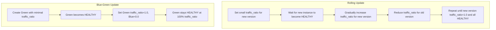

# Backend.AI 모델 서비스 배포 전략 개선

## 요약

이 제안은 다운타임이 0 이거나 거의 0 인 더 정교한 전략을 제공해 Backend.AI 모델 서비스 배포 과정을 개선한다. 구체적으로 서비스 중단을 최소화하도록 rolling update 와 blue-green deployment 를 구현하는 방법을 정리한다. 또한 환경 변수를 동적으로 변경하고 필요할 때 rollback 하는 방법을 제안한다.

## 동기

모델 서빙 사용량이 늘면서 Backend.AI 는 23.09 version 에 "모델 서비스"를 도입했고 Backend.AI FastTrack 은 25.09 에 "Model Serving Task"를 도입해 변화하는 시장 요구에 대응했다. 하지만 현재 배포 과정은 최종 사용자 대상 서비스에 중요한 요구 사항인 다운타임 없는 배포 전략을 충분히 지원하지 않는다. 이 한계를 해결하기 위해 다음을 제안한다.
• 일부 instance 를 계속 운영하면서 서비스를 점진적으로 갱신하는 rolling update 방식
• 격리된 테스트나 엄격한 규제 요구 사항이 있는 사례에 맞는 blue-green deployment 흐름
• 새 version 에 에러가 있을 때 서비스 연속성을 유지하는 rollback 기능

## 설계

### AS-IS

- 배포는 단순 교체나 upgrade 만 지원해 서비스가 짧게 중단된다.
- 환경 변수는 배포 시점에 고정되어 동적으로 변경할 수 없다.
- rollback 을 쉽게 하고 여러 version 을 함께 두기 위한 세밀한 versioning(예: `Routing` object 의 전용 "version" field)이 없다.

### TO-BE

1. Rolling Update 전략 도입:
- 사용자가 promotion 이나 update 를 실행하면 Backend.AI 는 새 모델 서비스 session 을 점진적으로 생성한다.
- 새 instance 를 실행하고 health check 를 통과해야 트래픽 일부를 받는다. 새 instance 가 healthy 로 판정되면 트래픽을 점차 옮긴다. 모든 instance 가 새 version 으로 실행될 때까지 이어가며 서비스 다운타임은 크지 않다.
- roll out 중 실패하면 자동 또는 수동으로 rollback 할 수 있다. 다만 자동 rollback 은 새로 배포한 version 에만 적용하고, timeout, error rate 임계값, 자원 제약 같은 구체적 규칙이 실행 시점을 정한다. 이렇게 하면 문제를 조기에 차단하면서 사용자가 rollback 정책을 제어할 수 있다.
- 수동 rollback 은 version 별 배포를 통해 항상 가능하며, 사용자는 중단을 최소화하면서 이전 안정 version 으로 되돌릴 수 있다.

2. Blue-Green Deployment 모드 도입:
- 사용자가 API 로 배포 update 를 시작한다(UI 와 CLI 지원은 계획 중).
- 기존 활성 배포를 "Blue", 새 배포를 "Green" 이라 한다.
- 시스템은 원하는 replica 수만큼 새 "Green" routing 을 생성하며 각 routing 의 초기 traffic ratio 는 0.0 이다.
- 새 "Green" routing 이 모두 healthy 가 되면(또는 사용자 정의 validation 검사를 통과하면) 시스템은 Green 의 `traffic_ratio` 를 1.0, 기존 Blue 를 0.0 으로 변경한다.
- Blue routing 은 rollback 용도로 잠시 유지하거나 안정적이라고 판단되면 완전히 제거한다.
- 모델 서비스는 `HEALTHY`(또는 "active") 상태로 돌아간다.

3. 환경 변수 변경 활성화:
- rolling 이나 blue-green update 중에 환경 변수(envs)를 변경할 수 있게 해 env 변경만을 위한 재배포가 필요 없게 한다.
- session 이 설정을 다시 읽고 정확성을 검증할 시간을 갖도록 env 변경을 원활하게 처리한다.

4. Versioning 강화:
- 각 `Routing` 에 `version` field 를 추가한다.
- 시스템이 현재 운영 중인 version(과 이전 안정 version)을 추적해 rollback 을 단순하게 만든다.

### 배포 전략의 상세 흐름

아래는 rolling update 와 blue-green deployment 를 모두 지원하는 통합 구조다. 단계는 공통 기반을 공유하지만 old version 과 new version 사이에서 트래픽을 옮기는 방식이 주로 다르다.

#### 공통 처리 개요
1. 사용자가 모델 서비스의 새 version 을 배포하도록 promotion 을 실행하거나 제출한다(API/UI/CLI).
2. 시스템이 자원 가용량을 검사한다(예: replica 수 × 필요한 자원). 부족하면 배포 요청을 거부한다.
3. 갱신된 version 을 참조하는 새 routing object 를 초기 traffic ratio 와 함께 생성한다.
4. 시스템이 각 새 instance 의 health 를 감시한다. health check 를 통과하면(또는 다른 validation 을 만족하면) 선택한 전략(rolling 또는 blue-green)에 따라 트래픽을 점진적으로 또는 전부 옮긴다.
5. 어느 시점에든 validation 이 실패하면 처리를 일시 중지하거나 안정 version 으로 rollback 할 수 있다.
6. 성공적으로 끝나면 새 version 이 트래픽 전부(또는 대부분)를 처리하고, old version 은 종료하거나 rollback 용도로 잠시 유지한다.

#### Rolling Update
1. 새 version 에 작은 초기 `traffic_ratio` 를 설정한다.
2. 각 새 instance 가 'HEALTHY' 가 될 때까지 기다린다.
3. 새 version 의 `traffic_ratio` 를 점차 높이면서 old version 의 값을 낮춘다.
4. 새 version 의 `traffic_ratio` 가 1.0 이 되고 모든 instance 가 'HEALTHY' 가 될 때까지 이어간다.

#### Blue-Green Update
1. 최소 `traffic_ratio`(예: 0.0 또는 매우 낮은 값)로 새 version(Green)을 생성한다.
2. Green 이 'HEALTHY' 가 되면 `traffic_ratio` 를 조정해 트래픽을 전부 Green 으로 보낸다.
3. 동시에 old(Blue) version 의 `traffic_ratio` 를 0.0 으로 낮춘다.
4. Green 이 100% `traffic_ratio` 에서 'HEALTHY' 를 유지하면 update 가 끝난다.

### Rollback 고려 사항

- rolling 과 blue-green 전략 모두 에러가 생기면 이전 안정 version 으로 되돌릴 수 있다.
- 최종 확인 전까지 old version(관련 환경 변수와 설정 포함)을 유지하면 끊김 없는 fallback 을 보장한다.

### Canary 지원 (향후 확장)

- 새 route 일부(예: 트래픽 5-10%)를 두어 운영과 유사한 조건에서 새 version 을 시험한다.
- error rate 가 정한 임계값을 넘으면 전면 배포 전에 canary 를 rollback 한다.
- 이 기능이 충분히 효과를 내려면 추가 모니터링과 알림 기능이 필요하다.

## 결론

rolling update 와 blue-green deployment 를 도입하면 다운타임을 거의 0 으로 줄이고 릴리스 위험을 낮추며 설정을 동적으로 변경할 수 있다. 이러한 개선은 Backend.AI 모델 서비스의 고객과 최종 사용자 모두에게 배포 경험을 크게 향상시킨다.

### 참고

- Kubernetes - Performing a Rolling Update: https://kubernetes.io/docs/tutorials/kubernetes-basics/update/update-intro/
> rolling update 는 Pod instance 를 새 instance 로 점진적으로 교체해 Deployment 를 다운타임 없이 진행하게 한다.

- Kubernetes - ReplicaSet: https://kubernetes.io/docs/concepts/workloads/controllers/replicaset/
