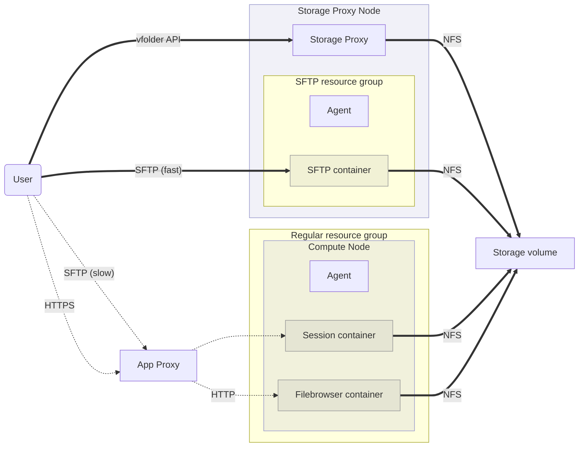
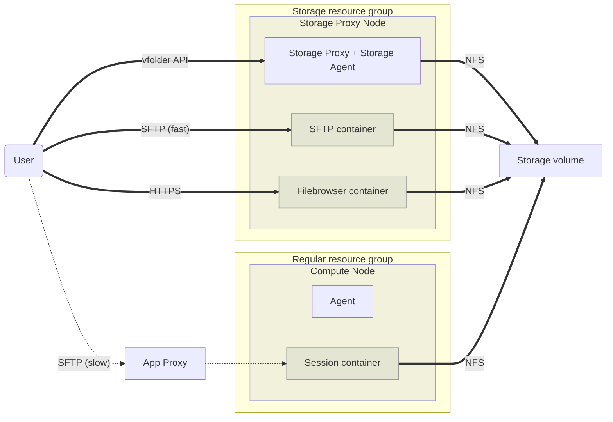

# Storage Agent

## 배경

이 제안은 큰 파일 전송의 fast-path 를 위해 "direct-access" session 을 호스팅하도록 storage-proxy 를 확장하는 방안을 정의한다:

- App Proxy 를 우회해 트래픽 전달 부담을 줄인다.
- storage volume mount 에 직접 접근해 data-plane 부담을 줄인다.
  위 조건을 가장 잘 만족하는 위치는 **Storage Proxy** 다.

이 이슈는 앞서 제안한 "DIRECT_ACCESS" session 개념을 대체한다.

## 현재 설계

지금까지는 위 그림처럼 "SFTP" 를 위한 특수한 형태의 resource group 과 session 을 구현했다.

* 일반 Agent 가 "SFTP session" 을 관리하는 특수한 "SFTP resource group" 이 있다.

* Redis 의 `keypair.concurrency_used.{access_key}` counter 외에 특수한 `keypair.sftp_concurrency_used.{access_key}` counter 가 있다.

* agent 는 수정하지 않았고 공개로 노출되는 container port 를 고려하는 추가 조치를 빠뜨렸다.

* 그래도 [Filebrowser](https://filebrowser.org/) session 은 _현재_ resource group 을 사용하는 일반 session 이다.
  WebUI 는 이들을 따로 보여 주는 특수 filter 를 두고 storage 폴더 목록 화면에서 실행한다.

  - ref) https://github.com/lablup/backend.ai-webui/blob/11ca13ffab4c0ef782b8c4a6d1971b20292ec5d3/src/components/backend-ai-folder-explorer.ts#L1488

## 제안 설계

### 목표

- storage agent 의 배포와 설정을 단순하게 만든다.
  사용자나 개발자가 Backend.AI 와 Storage Proxy 를 설치하면 "fast" SFTP session 을 사용하기 시작하는 데 _따로 할 일이 없어야 한다_.
  지금은 어떤 image 가 SFTP 용이고 filebrowser 용인지 알리려고 `docker pull` 과 agent, resource group 설정을 추가로 해야 한다.

- "SFTP" session 만을 위한, 버그가 나기 쉬운 특수 구현과 설정을 추가하지 않는다.

**설계**

* "SFTP resource group" 을 **Storage resource group** 으로 일반화한다.

  - Manager 는 storage resource group 안 container 의 점유 resource slot 을 _할당_(즉 배타적 예약)하지 않는다.

    대신 storage agent 당 container 총수를 제한해 storage 접근 container 의 초과 할당(oversubscription)을 허용한다. 총수는 `storage-agent.toml` 에 설정하고 heartbeat 로 보고한다.

  - 그래도 storage agent 는 container 별 cgroup resource limit 을 설정한다. 제안 기본값은 CPU core 1개, RAM 1 GiB 다.

* "sftp concurrency limit" 을 "resource group 당 user 당 최대 session 수"로 일반화한다.

* **Storage Proxy** 와 **Storage Agent** 를 합친다.

  - Storage Agent 는 기존 `DockerAgent` backend 를 재사용하되 container port 를 공개로 노출할 수 있는 보안 기능을 추가한다.

  - 하나의 Python process 안에서 Storage Proxy 의 aiohttp application 과 Storage Agent 의 RPC handler 가 나란히 실행된다.

  - `agent.toml` 과 거의 호환되는 `storage-agent.toml` 을 사용해서 일반 agent 와 storage agent 를 all-in-one 구성으로 쉽게 함께 둘 수 있다.

  - **Storage Agent** 가 Filebrowser session 도 관리하게 하고 같은 방식으로 더 빠르게 만든다.

### 예상 기술 문제

- Filebrowser container 를 공개 network 에 노출하면 HTTPS(자체 서명 인증서 또는 고객 제공 인증서)를 사용해야 한다.
  storage-agent 설정으로 인증서를 자동 생성하거나 주입하고 filebrowser container 에 마운트하도록 구현할 수 있다.

## 참고

- 원래 이슈: lablup/backend.ai#2791 (BA-86)
- lablup/backend.ai#1809
- lablup/backend.ai#2746
- lablup/backend.ai#1679
