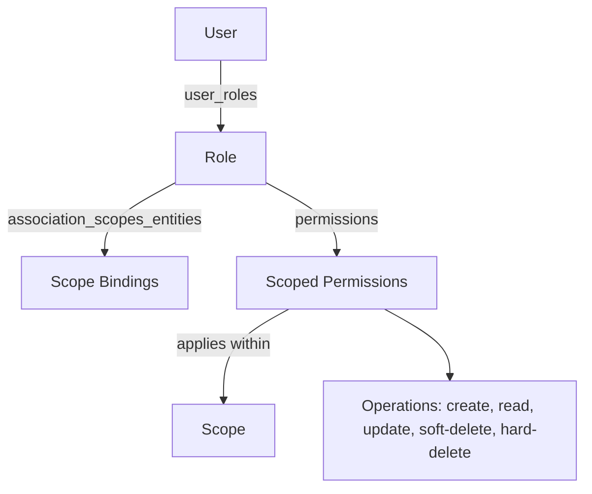

# Backend.AI 역할 기반 접근 제어(RBAC)

## 개요

이 BEP(Backend.AI Enhancement Proposal)는 Backend.AI 의 역할 기반 접근 제어(RBAC) 시스템을 소개한다. 이 시스템은 사용자와 프로젝트에 세밀한 권한 관리를 제공하고, 다양한 사용 사례에 맞는 유연한 접근 제어를 지원한다. RBAC 는 사용자 역할에 따라 API 접근 권한을 정의하므로 보안과 관리 효율을 높인다.

## 동기

Backend.AI 는 여러 사용자가 세션, vfolder, 이미지 같은 여러 엔티티에 다양한 연산을 실행하도록 허용하며, 사용자나 프로젝트 권한으로 제한된 권한을 부여한다. 그러나 현재 인증과 권한 관리 시스템은 특정 도메인 작업에 조각난 권한을 제공하고 세밀한 권한 관리가 없어 구체적인 권한을 설정하기 어렵다. 또한 사용자와 프로젝트의 권한 관리가 일관되지 않아 권한 검사 시점에 일관된 동작을 보장하지 못한다.

이 문제를 해결하려고 Backend.AI 는 RBAC 시스템을 도입한다. RBAC 시스템은 사용자 역할에 따라 시스템 전체의 여러 엔티티와 연산에 권한을 정의하고 권한을 일반화된 방식으로 관리한다. 그래서 세밀한 권한 설정과 일관된 권한 관리가 가능하다. 또한 RBAC 시스템은 모든 요청에 일관된 권한 검사를 보장해 보안과 관리 효율을 높인다.

## 설계

### 권한 구조



사용자는 하나 이상의 역할을 가질 수 있고, 각 역할은 여러 권한을 가진다. 역할은 권한을 묶으려고 도입했으며, 사용자는 역할을 통해 권한을 부여받는다. 이 구조는 권한 관리의 일관성을 높이고 사용자와 권한의 관계를 단순화한다.

역할은 `association_scopes_entities` 로 하나 이상의 스코프에 바인딩된다. 스코프 바인딩은 역할의 가시성, 관리 가능성, 사용자와 스코프의 멤버십을 결정한다. 권한은 독립적으로 스코프를 가지며 계층 스코프인 도메인, 프로젝트, 사용자나 엔티티 수준 스코프인 vfolder, 세션 등을 참조할 수 있다.

#### 스코프 권한

스코프 권한은 스코프 안의 특정 엔티티 타입에 대한 연산 권한을 정의한다. 연산은 다음과 같다.
- **일반 연산**: 'create', 'read', 'update', 'soft-delete', 'hard-delete' 등
- **권한 부여 연산**: 'grant:read', 'grant:update', 'grant:soft-delete', 'grant:hard-delete' 등

일반 권한을 가진 역할은 권한 스코프 안에서 접근할 수 있는 그 엔티티 타입의 모든 엔티티에 연산을 실행할 수 있다.

예를 들어 다음과 같다.
- Project-A 에 바인딩되고 'session' 엔티티 타입에 'read' 권한을 가진 역할은 Project-A 안의 모든 세션을 읽을 수 있다
- Project-A 와 Project-B 에 모두 바인딩된 역할은 스코프마다 다른 권한을 가질 수 있다

### 역할을 엔티티로 관리

역할 자체도 RBAC 시스템으로 관리할 수 있는 엔티티다. 그래서 여러 스코프에 역할 관리 책임을 통제된 방식으로 위임할 수 있다.

#### 역할 관리 연산

- **create**: 허용된 스코프 안에 새 역할을 생성한다
- **read**: 역할 정의와 권한을 조회한다
- **update**: 역할 이름, 설명, 권한을 수정한다
- **delete**: 역할 상태를 변경해 삭제로 표시한다
- **assign**: 허용된 스코프 안의 사용자에게 역할을 부여한다

#### 역할 스코프 계층

역할은 다른 권한과 같은 스코프 계층을 따른다.
- **도메인 역할**: 특정 도메인 안에서 사용할 수 있다
- **프로젝트 역할**: 특정 프로젝트 안에서 사용할 수 있다
- **사용자 역할**: 개별 사용자에게 속한다

역할은 여러 스코프에 바인딩되고 스코프마다 다른 권한을 가질 수 있다. 역할 관리 권한은 스코프 계층을 따른다. 예를 들어 도메인 관리자는 자기 도메인 스코프 안에서만 역할을 생성하고 관리할 수 있다.

### 권한 부여 규칙

1. **스코프 계층**: 권한은 같은 스코프나 더 좁은 스코프에만 부여할 수 있다
   - 도메인 스코프는 같은 도메인 안의 도메인, 프로젝트, 사용자 스코프에 부여할 수 있다
   - 프로젝트 스코프는 같은 프로젝트 안의 프로젝트, 사용자 스코프에 부여할 수 있다
   - 사용자 스코프는 사용자 스코프에만 부여할 수 있다

2. **부여 권한**: 'grant:X' 권한이 있으면 부여한 사용자 자신이 'X' 권한을 가지고 있는지와 관계없이 'X' 권한을 부여할 수 있다

3. **해지 권한**: 'grant:X' 권한이 있으면 자기가 부여한 'X' 권한을 해지할 수 있다

4. **권한 부여 위임 없음**: 복잡한 위임 연쇄를 방지하려고 'grant:grant' 권한은 두지 않는다

### 흐름

#### RBAC 검사 흐름

1. 사용자가 특정 REST API 나 GraphQL 을 호출해 연산을 요청한다.
2. 모든 요청은 Action Processor 에서 권한을 검사한다.
3. 요청한 Action 과 엔티티의 권한을 검사한다.
   1. 역할 권한이 있으면 그 역할 권한에 정의된 연산을 검사한다.
   2. 자원 권한이 있으면 그 엔티티 id 에 대한 자원 권한을 검사한다.
4. 권한이 있으면 요청을 처리하고, 없으면 알맞은 에러 메시지를 반환한다.

#### 권한 부여 흐름

1. 사용자가 특정 REST API 나 GraphQL 을 호출해 권한 부여 연산을 요청한다.
2. Action Processor 가 권한 부여 요청을 실행할 수 있는지 검사한다.
3. 요청한 권한을 부여할 수 있는지 확인한다.
   1. 부여하는 사용자에게 대응하는 권한 부여 권한이 있는지 검사한다. 예를 들어 'read' 를 부여하려면 'grant:read' 가 필요하다.
   2. 스코프 계층 규칙을 따르는지 검사한다.
   3. 자원 권한이면 부여하는 사용자가 그 자원에 접근할 수 있는지 검사한다.
4. 모든 검사를 통과하면 권한을 부여하고, 아니면 알맞은 에러 메시지를 반환한다.

#### 역할 관리 흐름

1. **역할 생성**:
   - 사용자는 대상 스코프 안에서 entity_type='role' 에 대한 'create' 권한이 있어야 한다
   - 새 역할은 생성한 사용자의 권한 스코프와 같거나 더 좁은 스코프로 생성된다

2. **역할 부여**:
   - 사용자는 특정 역할에 대한 'assign' 권한이 있어야 한다
   - 할당은 스코프 계층을 따른다. 같은 스코프나 더 좁은 스코프 안의 사용자에게만 부여할 수 있다
   - user_roles 테이블에 새 레코드를 생성한다

3. **역할 수정**:
   - 사용자는 역할 스코프 안에서 entity_type='role' 에 대한 'update' 권한이 있어야 한다
   - 역할 권한을 수정하면 그 역할을 가진 모든 사용자에게 즉시 반영된다

4. **역할 삭제**:
   - 사용자는 역할 스코프 안에서 entity_type='role' 에 대한 'delete' 권한이 있어야 한다
   - 'state' field 를 갱신하고 'deleted_at' 타임스탬프를 설정해 삭제로 표시한다
   - 기존 user_roles 할당은 감사를 위해 유지할 수 있다

### 데이터베이스 스키마

Backend.AI 의 RBAC 시스템은 기존 데이터베이스 구조를 확장해 구현한다. 새 RBAC 테이블은 기존 스코프 기반 권한 시스템과 통합한다.

#### 핵심 RBAC 테이블

##### 1. roles 테이블

```sql
CREATE TABLE roles (
    id UUID PRIMARY KEY DEFAULT gen_random_uuid(),
    name VARCHAR(64) NOT NULL,
    source VARCHAR(16) NOT NULL DEFAULT 'system', -- 'system' or 'custom'
    description TEXT,
    status VARCHAR(32) DEFAULT 'active',
    created_at TIMESTAMP WITH TIME ZONE DEFAULT NOW(),
    updated_at TIMESTAMP WITH TIME ZONE DEFAULT NOW(),
    deleted_at TIMESTAMP WITH TIME ZONE
);
```

roles 테이블은 시스템 안의 권한 묶음을 정의한다. 각 역할은 이름, source, 설명, 상태 등을 담는다. `status` field 는 삭제 표시와 역할 수명 주기 관리를 가능하게 한다. `source` field 는 역할이 시스템이 생성한 것인지 사용자가 생성한 것인지 나타낸다. 이 테이블 자체는 스코프 정보를 담지 않는다. 역할과 스코프의 바인딩은 `association_scopes_entities` 테이블로 관리한다.

##### 2. user_roles 테이블
```sql
CREATE TABLE user_roles (
    id UUID PRIMARY KEY DEFAULT gen_random_uuid(),
    user_id UUID NOT NULL REFERENCES users(uuid) ON DELETE CASCADE,
    role_id UUID NOT NULL REFERENCES roles(id) ON DELETE CASCADE,
    granted_by UUID REFERENCES users(uuid),
    granted_at TIMESTAMP WITH TIME ZONE DEFAULT NOW(),
    UNIQUE(user_id, role_id)
);
```

user_roles 테이블은 각 사용자와 역할의 관계를 정의한다. 사용자는 여러 역할을 가질 수 있다. 역할을 부여하거나 해지하면 시스템이 `association_scopes_entities` 의 사용자 스코프 멤버십 항목(`entity_type='user'`)을 자동으로 동기화하므로 단일 테이블로 멤버십을 조회할 수 있다. 이는 프로젝트 멤버십에 사용하던 `association_groups_users` 테이블을 대체한다.

##### 3. association_scopes_entities 테이블 (스코프와 엔티티 바인딩)
```sql
CREATE TABLE association_scopes_entities (
    id UUID PRIMARY KEY DEFAULT gen_random_uuid(),
    scope_type VARCHAR(32) NOT NULL,  -- 'domain', 'project', 'user'
    scope_id VARCHAR(64) NOT NULL,    -- Specific scope identifier
    entity_type VARCHAR(32) NOT NULL, -- 'role', 'user', 'vfolder', 'session', etc.
    entity_id VARCHAR(64) NOT NULL,   -- Entity identifier (e.g., role_id, user_id)
    relation_type VARCHAR(32) NOT NULL DEFAULT 'auto', -- 'auto' or 'ref'
    registered_at TIMESTAMP WITH TIME ZONE DEFAULT NOW(),
    UNIQUE(scope_type, scope_id, entity_id)
);
```

association_scopes_entities 테이블은 모든 엔티티 타입의 스코프 바인딩을 관리한다. 주요 용도는 다음과 같다.
- **역할**(`entity_type='role'`): 역할이 바인딩된 스코프를 정의하고 역할의 가시성과 관리 가능성을 결정한다.
- **사용자**(`entity_type='user'`): 사용자 스코프 멤버십을 저장하고 역할 부여와 해지 시 자동으로 동기화한다. 단일 테이블로 멤버십을 조회할 수 있다(`association_groups_users` 를 대체한다).
- **그 밖의 엔티티**(`entity_type='vfolder'`, `'session'` 등): 소유와 공유를 위한 엔티티와 스코프의 연결을 관리한다.

`relation_type` 은 `auto`(기본 스코프 바인딩)와 `ref`(가시성만 주는 바인딩, 예를 들어 스코프 간 공유)를 구분한다.

##### 4. permissions 테이블 (스코프 권한)
```sql
CREATE TABLE permissions (
    id UUID PRIMARY KEY DEFAULT gen_random_uuid(),
    role_id UUID NOT NULL REFERENCES roles(id) ON DELETE CASCADE,
    scope_type VARCHAR(32) NOT NULL,  -- 'domain', 'project', 'user'
    scope_id VARCHAR(64) NOT NULL,    -- Specific scope identifier
    entity_type VARCHAR(32) NOT NULL, -- 'session', 'vfolder', 'image', 'role', etc.
    operation VARCHAR(32) NOT NULL,   -- 'create', 'read', 'update', 'soft-delete', 'hard-delete', etc.
    created_at TIMESTAMP WITH TIME ZONE DEFAULT NOW(),
    UNIQUE(role_id, scope_type, scope_id, entity_type, operation)
);
```

permissions 테이블은 역할이 스코프 안의 특정 엔티티 타입에 실행할 수 있는 연산을 정의한다. 스코프는 계층 스코프인 도메인, 프로젝트, 사용자이거나, 자원 공유 같은 인스턴스 수준 접근 제어를 위한 엔티티 수준 스코프인 vfolder, 세션 등일 수 있다.

#### 기존 테이블에서 이전

**VFolder 초대 이전**:
- `vfolder_invitations` 를 `association_scopes_entities` 의 `ref` 간선과 초대받은 사용자의 User Owner 역할에 둔 스코프 권한으로 변환한다
- 기존 VFolder 초대 기능에서 권한 검사 로직을 제거한다
- service 계층에서 통합된 RBAC 권한 검사를 사용한다

**프로젝트 멤버십 이전**:
- `association_groups_users` 항목을 프로젝트 스코프 시스템 역할(Project Member, Project Admin)을 가진 역할 할당(`user_roles`)으로 변환한다. 이때 `association_scopes_entities` 의 사용자 스코프 항목이 자동으로 동기화된다
- `association_groups_users` 테이블을 폐기한다

## 미리 정의된 역할

시스템은 다음 미리 정의된 역할을 포함한다. 이 역할의 source 는 system 이다.

1. **super-admin**: 시스템 전체에 걸쳐 모든 권한을 가진 전역 관리자
   - 전역에서 모든 역할을 생성, 조회, 수정, 삭제, 부여할 수 있다
   - 모든 엔티티 타입에 모든 권한을 가진다

2. **domain-admin**: 자기 도메인 안에서 모든 권한을 가진 도메인 수준 관리자
   - 자기 도메인 안에서 역할을 생성, 조회, 수정, 삭제, 부여할 수 있다
   - 자기 도메인 스코프 안의 모든 엔티티 타입에 모든 권한을 가진다

3. **domain-member**: 도메인 스코프의 기본 구성원 역할
   - 도메인 수준 자원에 기본 읽기 권한을 가진다
   - 도메인을 생성할 때 자동으로 생성된다

4. **project-admin**: 자기 프로젝트 안에서 모든 권한을 가진 프로젝트 수준 관리자
   - 자기 프로젝트 안에서 역할을 생성, 조회, 수정, 삭제, 부여할 수 있다
   - 자기 프로젝트 스코프 안의 모든 엔티티 타입에 모든 권한을 가진다

5. **project-member**: 프로젝트 스코프의 기본 구성원 역할
   - 프로젝트 수준 자원에 기본 읽기 권한을 가진다
   - 프로젝트를 생성할 때 자동으로 생성된다
   - 사용자에게 이 역할을 부여하면 그 사용자는 프로젝트의 구성원이 된다

6. **user-owner**: 사용자 스코프의 기본 역할
   - 소유한 자원을 완전히 제어한다
   - 사용자를 생성할 때 자동으로 생성된다

각 역할의 자세한 권한 묶음은 구현 명세에서 정의한다.

## 결론

Backend.AI 의 RBAC 시스템은 사용자와 프로젝트에 세밀한 권한 관리를 제공하고 다양한 사용 사례에 맞는 유연한 접근 제어를 지원한다. 이 시스템은 역할을 기준으로 권한을 관리하며 역할 권한과 자원 권한으로 세밀한 권한을 설정할 수 있다. RBAC 시스템은 모든 요청에 일관된 권한 검사를 보장해 보안과 관리 효율을 높인다.
