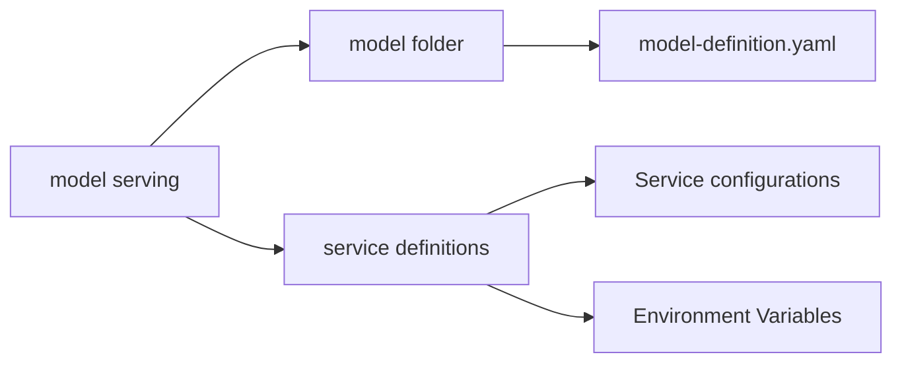
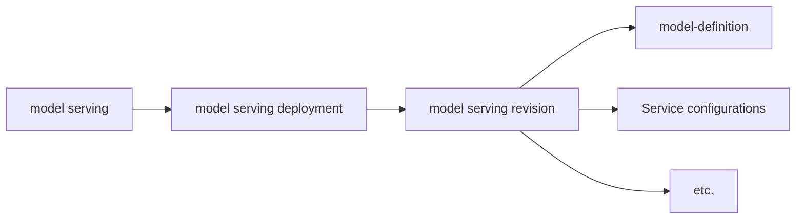

# 모델 서빙 레지스트리

이 문서는 모델 서빙 구성과 메타데이터를 한곳에 모으는 모델 서빙 레지스트리를 새 BEP 로 제안한다.

## 개요

이 문서는 모델 서빙 레지스트리의 개념을 정의하고, 이 레지스트리를 통해 모델 서빙을 관리하고 배포하는 방법을 제안한다. 모델 서빙 레지스트리는 모델 정의, 서비스 정의, 배포 정보, 그 밖의 관련 메타데이터를 담아 모델 서빙의 일관성과 재사용성을 높이는 것을 목표로 한다.

## 동기

지금 Backend.AI 는 모델 서빙에 다음 메타데이터를 사용한다.

- **모델 정의**: 모델의 구조와 메타데이터를 정의한다.
- **서비스 정의**: 모델을 서빙하는 서비스 구성을 정의한다.
    - 지금은 서비스 정의를 YAML 로 받는 방식이 제한적이고, 주로 입력 form 을 통해 정의한다.

이 구성은 모델 정의는 vfolder 로, 서비스 정의는 Web UI 로 관리한다. 그러나 이 방식에는 다음 한계가 있다.

1. **vfolder 의 변동성**: vfolder 에 저장한 모델 정의 파일은 사용자가 직접 변경할 수 있어 일관성을 유지하기 어렵다.
2. **서비스 정의의 재사용성 부족**: 지금의 서비스 정의는 주로 Web UI 로 입력하므로 재사용하거나 공유하기 어렵다.
3. **모델 서빙의 일관성 부족**: 모델 서빙 구성이 여러 출처에 흩어져 있어 관리와 배포가 복잡하다.

이 문제를 해결하려고 모델 서빙 레지스트리를 도입해 모델 서빙 메타데이터를 한곳에 모으고 일관되게 관리하는 방안을 제안한다.

## 현재 설계

지금 Backend.AI 는 모델 서빙의 모델 정의와 서비스 정의를 vfolder 와 Web UI 로 관리한다. 그러나 이 방식에는 다음 한계가 있다.



1. **배포 복잡성**
    - 모델 정의를 vfolder 에 두는 방식은 모델 배포 흐름과 이어지지 않아 배포가 복잡하다.
2. **배포 일관성 부족**
    - vfolder 에 저장한 모델 정의 파일을 사용자가 변경할 수 있어, 모델 서빙 동작이 vfolder 상태에 따라 달라진다.
3. **모델 서빙의 버전 관리 부족**
    - 지금은 vfolder 에 저장한 모델 정의 파일을 버전 관리하지 않아 이전 버전으로 되돌리기 어렵다.
    - 서비스 구성도 버전 관리하지 않아 이전 배포로 되돌리기 어렵다.

## 제안 설계

### 모델 서빙 리비전

지금 방식의 한계를 해결하려고 모델 서빙 레지스트리를 도입해 모델 서빙 메타데이터를 한곳에 모으고 일관되게 관리한다.



위 구조를 **모델 서빙 리비전**이라 정의한다. 모델 서빙 리비전은 모델 서빙의 특정 버전을 나타내며 다음 항목을 담는다.

- **모델 정의**: 모델의 구조와 메타데이터를 정의한다.
- **서비스 구성**: 모델을 서빙하는 서비스 구성을 정의한다.
- **그 밖의 항목**: 추가 구성이나 메타데이터를 담을 수 있다.

이 구조로 모델 서빙의 일관성을 높이고 재사용성을 강화할 수 있다. 모델 서빙 레지스트리는 다음 기능도 제공할 수 있다.

- **버전 관리**: 모델 서빙 리비전마다 고유한 버전이 있어 이전 버전으로 되돌릴 수 있다.
- **재사용성**: 모델 정의와 서비스 정의를 한곳에서 관리하므로 여러 사용자가 같은 모델 서빙 구성을 쉽게 재사용할 수 있다.
- **배포 관리**: 모델 서빙 구성을 vfolder 와 Web UI 로 관리하는 대신 모델 서빙 레지스트리를 통해 일관되게 관리할 수 있다.
- **구성 공유**: 모델 서빙 구성을 레지스트리에 저장하므로 다른 사용자가 쉽게 접근해 사용할 수 있다.

### 모델 서빙 레지스트리

모델 서빙 레지스트리는 모델 서빙 리비전을 관리하는 중앙 저장소이며 다음 기능을 제공한다.

- **모델 서빙 리비전 관리**: 모델 서빙 리비전을 생성, 변경, 삭제하는 API 를 제공한다.
- **모델 서빙 리비전 조회**: 특정 모델 서빙 리비전의 상세 정보를 조회하는 API 를 제공한다.
- **모델 서빙 리비전 검색**: 모델 서빙 리비전을 검색하는 기능을 제공한다.
- **모델 서빙 리비전 버전 관리**: 모델 서빙 리비전마다 버전을 관리하고 이전 버전으로 되돌리는 기능을 제공한다.
- **모델 서빙 리비전 공유**: 모델 서빙 리비전을 다른 사용자와 공유하는 기능을 제공한다.

Backend.AI 의 기본 모델 서빙 레지스트리는 위 인터페이스 요구사항을 만족하도록 데이터베이스 기반 방식으로 구현한다.

그러나 모델 서빙 레지스트리는 Backend.AI 의 확장성을 위해 여러 구현을 지원하도록 설계한다. 예를 들어 Remote Registry 를 통해 외부 출처에서 모델 서빙 구성을 가져오거나 다른 시스템과 연동하는 기능을 제공할 수 있다.

## 기술 구현

### 레지스트리 인터페이스

모델 서빙 레지스트리는 구현마다 일관성을 유지하도록 표준 인터페이스를 구현한다.

```python
class ModelServingRegistry(ABC):
    def create_revision(self, revision: ModelServingRevision) -> str:
        """Create a new model serving revision and return its ID"""
        pass
    
    def get_revision(self, revision_id: str) -> ModelServingRevision:
        """Retrieve a specific model serving revision"""
        pass
    
    def list_revisions(self, filters: dict[str, Any]) -> List[ModelServingRevision]:
        """List model serving revisions with optional filters"""
        pass
    
    def update_revision(self, revision_id: str, revision: ModelServingRevision) -> None:
        """Update an existing model serving revision"""
        pass
    
    def delete_revision(self, revision_id: str) -> None:
        """Delete a model serving revision"""
        pass
```

### 데이터 모델

모델 서빙 레지스트리의 핵심 데이터 구조는 다음과 같다.

```python
@dataclass
class ModelServingRevision:
    id: str
    name: str
    version: str
    model_definition: dict[str, Any] # TODO: Define model definition structure
    service_configuration: dict[str, Any] # TODO: Define service configuration structure
    metadata: dict[str, Any]
    created_at: datetime
    updated_at: datetime
    created_by: str
```

### 데이터베이스 스키마

기본 데이터베이스 기반 구현은 다음 스키마를 사용한다.

- 리비전 메타데이터를 담는 column 을 가진 `model_serving_revisions` table
- 모델 정의를 저장하는 `model_serving_definitions` table
- 서비스 구성을 저장하는 `model_serving_configurations` table
- 되돌리기를 위한 버전 이력 추적

## 사용자와 개발자에 미치는 영향

모델 서빙 레지스트리 도입은 Backend.AI 사용자와 개발자에게 다음 영향을 준다.

### 사용자
- **중앙 관리**: 사용자가 모델 서빙 구성을 한곳에서 관리하고 모델 서빙을 일관되게 배포하고 관리할 수 있다.
- **재사용성 향상**: 모델 서빙 구성을 여러 project 와 team 에서 쉽게 재사용하고 공유할 수 있다.
- **안정성 향상**: 버전 관리와 되돌리기 기능이 운영 배포의 안정성을 높인다.

### 개발자
- **확장 가능한 구조**: 레지스트리가 모델 서빙 구성을 관리하는 API 를 제공해 모델 서빙 기능을 확장하고 개선할 기반을 마련한다.
- **여러 구현 지원**: 여러 모델 서빙 레지스트리 구현을 지원하는 설계로 Backend.AI 의 확장성을 높인다.
- **연동 개선**: 외부 시스템과 Remote Registry 를 연동해 더 유연한 배포 시나리오를 지원한다.

## 참고

* https://github.com/lablup/beps/blob/main/drafts/BEP-1006-service-deployment-strategy.md
