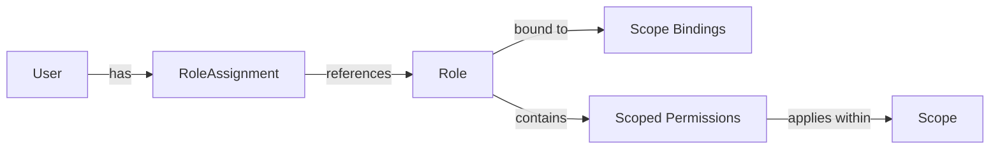
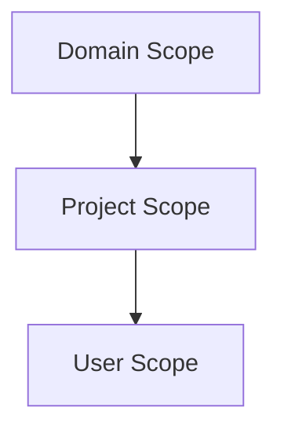
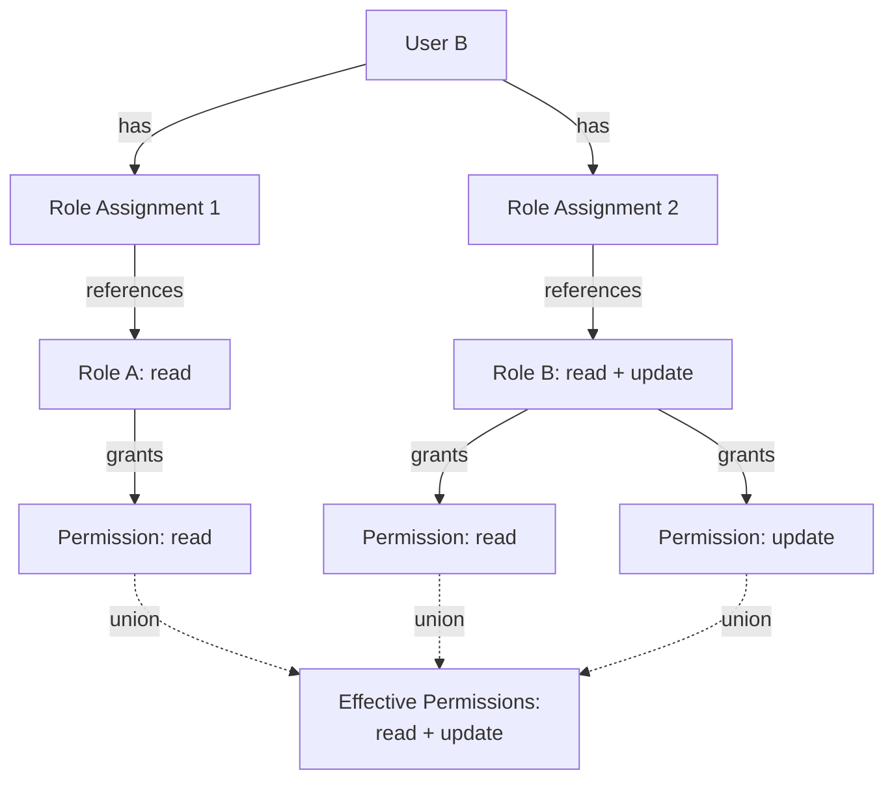
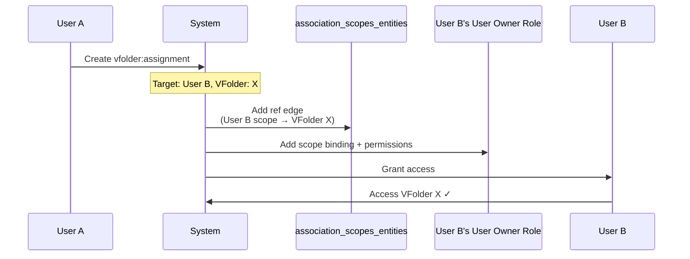

# Backend.AI 역할 기반 접근 제어(RBAC) 기능 명세

## 개요

이 문서는 Backend.AI 의 역할 기반 접근 제어(RBAC) 시스템의 기능 요구 사항을 정의한다. RBAC 시스템은 Backend.AI 의 모든 엔티티 타입에 통합되고 일관된 권한 관리 프레임워크를 제공해 지금의 조각난 권한 로직을 대체하는 것을 목표로 한다. 이 명세는 RBAC 시스템의 기능과 동작 정의에 집중하고, 기술 구현 세부 사항은 BEP-1008 에서 다룬다.

## 동기

현재 Backend.AI 권한 시스템은 유지하고 확장하기 어렵게 하는 몇 가지 중대한 한계가 있다.

1. **조각나고 일관되지 않은 권한 로직**: 엔티티 타입(세션, vfolder, 이미지, 배포 등)마다 자체 권한 검사 로직을 구현한다. 개발자는 권한이 어떻게 동작하는지 이해하려고 엔티티마다 코드를 살펴봐야 한다. 권한 처리 방식이 엔티티 타입마다 크게 달라 비슷한 연산에도 권한 모델이 다르고, 시스템 전반의 동작이 일관되지 않으며, 새 기능을 추가할 때 유지보수 부담이 크다.

2. **제한된 세밀도**: 현재 시스템은 유연한 권한 부여 기능 없이 기본 사용자 역할(superadmin, user)만 제공한다.

3. **낮은 확장성**: 새 엔티티 타입이 추가될 때마다 사용자 정의 권한 로직이 필요해 시스템 복잡도가 기하급수적으로 커진다.

4. **일관되지 않은 협업 지원**: vfolder 같은 일부 엔티티 타입은 초대 기반 공유 수단을 갖추지만, 세션, 배포 같은 다른 엔티티 타입에는 특정 권한으로 자원을 공유하는 체계적인 방법이 없다. 이 불일치 때문에 사용자가 여러 자원 타입에 걸쳐 효과적으로 협업하기 어렵다.

이 문제를 해결하려고 Backend.AI 는 다음을 제공하는 통합 RBAC 시스템을 도입한다.
- 모든 엔티티 타입에 일관된 권한 모델
- 유연한 역할 정의와 부여
- 타입 수준과 자원 수준 모두의 세밀한 권한 제어
- 협업 흐름을 더 잘 지원

## 현재 설계 (현행)

### 기존 사용자 역할

Backend.AI 는 현재 두 가지 사용자 역할을 지원한다.
- **superadmin**: 시스템 전체에 접근할 수 있는 전역 관리자
- **user**: 제한된 권한을 가진 일반 사용자

### 현재 권한 모델

Backend.AI 의 엔티티 타입마다 자체 권한 검사 로직을 구현한다.

- **세션**: 권한 검사가 세션 관리 코드 전반에 흩어져 있다
- **vfolder**: 사용자 정의 권한 로직을 가진 별도 초대 시스템으로 공유한다
- **이미지**: 사용자 소유와 가시성 설정을 기준으로 권한을 검사한다
- **배포**: 서비스별 권한 검증을 실행한다
- **도메인과 프로젝트**: 암묵적 권한을 가진 계층 소유 모델을 사용한다

### 문제

1. **코드 수준 권한 로직**: 권한이 데이터 기반이 아니라 애플리케이션 코드에 들어 있어 권한을 수정하려면 코드를 변경해야 한다.

2. **통합 인터페이스 없음**: 엔티티 타입마다 권한을 검사하는 방법이 달라 다음이 어렵다.
   - 전체 권한 구조를 이해하기
   - 시스템 전체의 권한을 감사하기
   - 일관된 권한 검사 구현하기

3. **제한된 위임**: vfolder 초대 같은 특정 기능 외에는 다른 사용자에게 권한을 위임하는 체계적인 방법이 없다.

4. **유지보수 부담**: 권한 로직을 변경하려면 엔티티별 구현을 이해해야 해 개발 시간이 늘고 에러 위험이 커진다.

## 제안 설계 (목표)

### 엔티티 타입

RBAC 시스템은 자원(vfolder, 세션, 이미지 등), 스코프(도메인, 프로젝트, 사용자), 메타 엔티티(역할, 할당)를 포함한 여러 엔티티 타입의 권한을 관리한다.

엔티티 타입 전체 목록과 세부 사항은 [BEP-1012 RBAC 엔티티와 필드 타입](./entity-types.md)을 참고한다.

### 필드 타입

필드 타입은 권한 검사를 자신이 속한 엔티티로 위임하는 객체다. 필드 객체는 독립된 권한을 갖지 않고 연결된 엔티티의 권한 검사 결과를 상속한다.

**주요 특성**:
- 필드 객체는 자체 권한을 두지 않는다
- 권한 검사를 연결된 엔티티로 위임한다
- 연산 타입은 그대로 유지한다(예: `kernel:read` → `session:read`)

**예**: 커널은 세션에 연결된 필드 타입이다. 사용자가 커널 X 를 읽을 수 있는지 검사할 때 시스템은 커널 X 를 담은 세션을 읽을 수 있는지 실제로 검사한다.

필드 타입 전체 목록과 연결된 엔티티는 [BEP-1012 RBAC 엔티티와 필드 타입](./entity-types.md)을 참고한다.

### 연산

모든 엔티티 타입은 같은 연산 묶음을 지원해 시스템 전반에 일관성을 준다.

| 연산 | 설명 |
|-----------|-------------|
| **create** | 이 타입의 새 엔티티를 생성한다 |
| **read** | 엔티티 정보와 메타데이터를 조회한다 |
| **update** | 엔티티 속성과 설정을 수정한다 |
| **soft-delete** | 데이터를 제거하지 않고 엔티티를 삭제로 표시한다(기본 삭제 동작) |
| **hard-delete** | 엔티티 데이터를 영구히 제거한다 |

**역할과 역할 할당의 삭제 연산 참고**:
역할과 역할 할당 엔티티는 첫 구현에서 soft-delete 와 hard-delete 연산을 지원한다. soft-delete 는 감사를 위해 엔티티를 비활성 상태로 보존하고 다시 활성화할 수 있게 한다. hard-delete 는 엔티티를 활성 사용에서 영구히 제거한다. 감사 추적을 위해 데이터베이스 레코드는 남길 수 있다.

**역할 할당 연산 참고**:
- **create**: 특정 스코프 안에서 사용자에게 역할을 부여한다(`role_assignment` 엔티티 타입에 `create` 권한 필요)
- **read**: 기존 역할 할당을 조회한다(`role_assignment` 엔티티 타입에 `read` 권한 필요)
- **update**: 만료 시간이나 상태 같은 역할 할당 메타데이터를 수정한다(`role_assignment` 엔티티 타입에 `update` 권한 필요)

스코프 안에서 역할 할당을 관리하려면 `role_assignment` 엔티티 타입에 해당 권한이 있어야 한다. 예를 들어 Project Admin 은 프로젝트 구성원의 역할을 부여하고 관리하려면 `role_assignment` 에 `create` 와 `update` 권한이 필요하다.

#### 삭제와 영구 삭제

- **soft-delete**: 기반 데이터를 제거하지 않고 데이터베이스에서 엔티티 상태를 변경한다
  - 예: vfolder 를 휴지통으로 옮긴다(파일은 그대로 남는다)
  - 역할: 비활성으로 표시해 새 역할 할당을 차단하고 기존 할당은 유지한다
  - 역할 할당: 상태를 비활성으로 변경해 권한을 일시 중지하지만 할당 레코드는 보존한다
  - 복구를 허용하고 참조 무결성을 유지한다
  - 권한이 있는 관리자는 soft-delete 된 엔티티를 다시 활성화할 수 있다

- **hard-delete**: 엔티티에 연결된 실제 데이터를 제거한다
  - 예: 휴지통에 있는 vfolder 의 파일을 영구히 삭제한다
  - 역할: 역할 정의를 제거한다(활성 역할 할당이 참조하지 않을 때만 허용한다)
  - 역할 할당: 할당 레코드를 영구히 제거한다
  - 참고: 감사를 위해 데이터베이스 레코드를 일정 기간 남길 수 있다

### 권한 위임

권한 위임은 역할과 역할 할당 관리로 이룬다.

**절차**:
1. 원하는 권한을 가진 역할을 생성하거나 찾는다
2. 대상 사용자와 그 역할을 잇는 역할 할당을 생성한다
3. 사용자는 역할에 정의된 모든 권한을 즉시 받는다

**보안**: 권한 상승을 방지하려고 역할 할당을 생성하려면 같은 스코프 안의 대상 역할에 `read` 권한이 필요하다. 그래서 Project Admin 은 자기 스코프에서 볼 수 있는 역할만 부여할 수 있고, Global Admin 이나 다른 스코프의 역할은 부여할 수 없다.

### 권한 타입

RBAC 시스템은 스코프 권한으로 접근 제어를 정의한다.

#### 스코프 권한(스코프 수준 권한)

특정 스코프 안의 **엔티티 타입**에 적용되는 연산 권한을 정의한다.

- 지정 항목: 스코프, 엔티티 타입(예: `vfolder`), 연산(예: `read`)
- 스코프 안에서 접근할 수 있는 그 타입의 모든 엔티티에 적용된다
- 예: Project-A 에 바인딩되고 `vfolder:read` 권한을 가진 역할은 Project-A 안의 모든 vfolder 를 읽을 수 있다

**다중 스코프 권한**:
역할 하나가 스코프마다 다른 권한을 가질 수 있다. 예를 들어 Project-A 와 Project-B 에 모두 바인딩된 "Cross-Project-Coordinator" 역할은 Project-A 에서 `vfolder:read`, Project-B 에서 `session:create` 를 가질 수 있다.

### 역할 구조

RBAC 시스템의 각 역할은 다음 구조를 가진다.

**속성**:
- **이름**: 사람이 읽는 역할 이름(예: "Project-A-Admin", "Cross-Project-Coordinator")
- **설명**: 역할 목적을 설명하는 선택 항목
- **스코프 바인딩**: 역할은 `association_scopes_entities` 로 하나 이상의 스코프(도메인, 프로젝트, 사용자)에 바인딩된다. 스코프 바인딩은 다음을 결정한다.
  1. 역할이 보이고 관리되는 위치(예: 어느 스코프 관리자가 역할을 보고 부여할 수 있는지)
  2. 이 역할을 부여받은 사용자가 구성원이 되는 스코프
- **source**: 역할을 시스템이 생성했는지 사용자가 생성했는지 나타낸다

**권한 구성 요소**:
- **스코프 권한**: 스코프 수준 권한(스코프, 엔티티 타입, 연산)의 묶음
  - 예: Project-A 에 바인딩된 역할은 Project-A 에서 `vfolder:read`, `compute_session:create` 를 가질 수 있다



### 역할 source

RBAC 시스템의 역할은 생성 방법을 나타내는 source 속성을 가진다.

| 역할 source | 설명 | 목적 | 관리 |
|-------------|-------------|---------|------------|
| **system** | 시스템이 자동으로 생성한다 | 스코프를 생성할 때 기본 관리자 역할을 제공한다 | 스코프와 수명 주기를 함께한다. 개별 삭제할 수 없다 |
| **custom** | 관리자가 직접 생성한다 | 특정 요구에 맞춘 사용자 정의 역할 | 알맞은 권한을 가진 사용자가 생성, 수정, 삭제할 수 있다 |

#### 시스템 source 역할

**목적**: 시스템 source 역할은 스코프를 생성할 때 자동으로 생성하는 기본 역할이다. 각 스코프가 기본 권한 구조를 갖추게 한다.

**자동으로 생성되는 시스템 source 역할**:
- **Domain Admin**: 도메인 스코프의 관리자 역할
- **Domain Member**: 도메인 스코프의 기본 구성원 역할(기본 읽기 접근)
- **Project Admin**: 프로젝트 스코프의 관리자 역할
- **Project Member**: 프로젝트 스코프의 기본 구성원 역할(기본 읽기 접근)
- **User Owner**: 사용자 스코프의 기본 역할(소유 자원용)

**특성**:
- 스코프의 기본 구조를 이루므로 개별 삭제할 수 없다
- 스코프를 삭제하면 자동으로 삭제된다
- 여러 사용자를 같은 시스템 source 역할에 부여할 수 있다(역할 할당 사용)

#### custom source 역할

**목적**: custom source 역할은 관리자가 조직의 특정 요구에 맞춰 권한을 조정하려고 직접 생성한다. 세밀한 권한 제어와 유연한 접근 관리를 가능하게 한다.

**사용 예**:
- "Project-A-Admin": 특정 프로젝트의 관리 권한을 가진 역할
- "Department-Viewer": 특정 부서의 모든 자원에 읽기 전용 권한을 가진 역할
- "Cross-Project-Coordinator": 여러 프로젝트에 걸쳐 자원에 접근하는 역할

**특성**:
- 관리자가 필요에 따라 자유롭게 생성, 수정, 삭제한다
- 하나 이상의 스코프에 바인딩되고 스코프마다 다른 권한을 가질 수 있다
- 특정 스코프나 조직 구조에 최적화된 권한 묶음을 정의할 수 있다

### 역할 할당 엔티티

역할 할당은 사용자를 역할에 매핑하는 별도 엔티티다. 이 설계는 여러 이점을 준다.

**주요 특성**:
- **관심사 분리**: 역할 정의가 역할 할당과 독립이다
- **유연한 관리**: 역할 자체를 수정하지 않고 역할 할당을 생성하고 관리한다
- **감사 추적**: 각 할당이 누가 언제 부여했는지 기록한다
- **일관된 연산**: 특수 목적 연산 대신 표준 create/read/update 연산을 사용한다
- **멤버십 결정**: 역할을 부여하거나 해지하면 사용자의 스코프 멤버십이 `association_scopes_entities` 에 자동으로 동기화된다

**역할 할당 속성**:
- `user_id`: 역할을 받는 사용자
- `role_id`: 부여하는 역할
- `granted_by`: 이 할당을 생성한 사용자
- `granted_at`: 할당을 생성한 시각

**역할 할당을 통한 스코프 멤버십**:
사용자에게 역할을 부여하면 시스템이 `association_scopes_entities` 의 사용자 스코프 멤버십 항목(`entity_type='user'`)을 자동으로 동기화한다. 그래서 기존 `association_groups_users` 테이블을 대체하고 모든 스코프 타입에 걸쳐 스코프 멤버십 조회를 통합한다.

- **역할 부여 시**: 역할이 바인딩된 스코프에 사용자 스코프 항목을 삽입한다(다른 역할과 겹치는 경우를 처리하려고 `ON CONFLICT DO NOTHING` 을 사용한다).
- **역할 해지 시**: 사용자 스코프 항목은 사용자의 남은 역할이 포함하지 않는 스코프에서만 삭제한다.

**스코프 안의 사용자 조회**:

모든 스코프 타입은 단일 테이블 조회를 사용한다.

```sql
SELECT entity_id AS user_id
FROM association_scopes_entities
WHERE scope_type = :scope_type   -- 'domain', 'project', 'user'
  AND scope_id = :scope_id
  AND entity_type = 'user'
```

이전에는 스코프 타입마다 다른 조회 경로가 필요했다(예: 프로젝트는 `association_groups_users`, 도메인은 `users.domain_name`). 새 방식은 모든 스코프 멤버십 조회를 JOIN 없이 단일 테이블 패턴으로 통합한다.

**예**:
- 역할: "Project-A-Member"(Project-A 스코프에 바인딩되고 기본 읽기 권한을 가진다)
- 역할 할당: 사용자 Alice → "Project-A-Member" 역할
- 결과: 시스템이 `(scope_type='project', scope_id='proj-A', entity_type='user', entity_id=alice_id)` 를 `association_scopes_entities` 에 삽입한다. Alice 는 Project-A 의 구성원이 되고 역할에 정의된 권한을 가진다.

**관리**: 스코프 관리자(Domain Admin, Project Admin)는 보통 자기 스코프의 모든 역할 할당 관리 권한을 가져 역할을 부여하고 할당을 해지하고 자기 스코프의 모든 할당을 조회할 수 있다.

### 스코프 계층

Backend.AI 는 3단계 스코프 계층을 사용한다.



**스코프 특성**:
- **도메인 스코프**: 시스템 안의 조직 단위
- **프로젝트 스코프**: 도메인 안의 협업 공간
- **사용자 스코프**: 개별 사용자의 개인 자원

**관리 원칙**:
각 스코프는 해당 관리자가 독립적으로 관리한다.
- **Domain Admin**: 자기 도메인 스코프 자원을 관리한다
- **Project Admin**: 자기 프로젝트 스코프 자원을 관리한다
- **User Owner**: 자기 사용자 스코프 자원을 관리한다

**중요: 권한 상속 없음**:
특정 스코프에 바인딩된 역할에 정의된 권한은 그 스코프 안의 동작에**만** 적용된다. 하위 스코프로 이어지지 **않는다**.

예:
- Domain-A 스코프에 바인딩되고 `vfolder:read` 권한을 가진 Domain Admin 역할은 **도메인 수준에서만** vfolder 를 읽을 수 있다
- 이 권한은 Domain-A 안 프로젝트의 vfolder 에 접근 권한을 자동으로 주지 **않는다**
- Domain-A 의 하위인 Project-A 자원에 접근하려면 Project-A 스코프에 바인딩된 별도 역할이 필요하다
- 아니면 스코프마다 알맞은 권한을 가진, 여러 스코프에 바인딩된 역할을 사용한다

**스코프 간 접근**:
- 스코프 관리자는 같은 수준의 다른 스코프 자원을 직접 관리할 수 없다
- 스코프 간 협업은 여러 스코프 바인딩 역할로 이룬다
- 스코프를 넘나들어 작업하려면 사용자에게 다음 중 하나가 필요하다
  1. 여러 역할 할당(스코프마다 역할 하나)
  2. 스코프별 권한을 가진, 여러 스코프에 바인딩된 역할 하나

### 관리 안전장치

RBAC 시스템은 운영 유연성을 유지하면서 실수로 관리 접근을 잃는 일을 방지하는 안전장치를 둔다.

#### 시스템 source 역할 보호

시스템 source 역할(Domain Admin, Project Admin, User Owner)은 스코프를 생성할 때 자동으로 생성되는 기본 관리자 역할이며 스코프의 기본 구조를 이룬다.

**삭제 제약**:

시스템 source 역할은 개별 삭제할 수 없다.

1. **개별 삭제 금지**: 시스템 source 역할을 삭제하려고 하면 에러를 반환한다. 시스템 source 역할은 대응하는 스코프를 삭제할 때만 제거한다.

2. **역할 할당은 관리 가능**: 시스템 source 역할은 삭제할 수 없지만 이 역할의 역할 할당은 정상적으로 생성하고 제거할 수 있다. 그래서 관리자는 누가 관리 접근을 가지는지 관리할 수 있다.

### 자원 소유

RBAC 시스템에서 자원 소유는 생성자의 "User Owner" 시스템 source 역할로 관리한다. 이 역할은 생성자 자신의 사용자 스코프에 바인딩된다.

**소유 모델**:

사용자가 자원(vfolder, 세션, 배포 등)을 생성하면 그 자원은 `association_scopes_entities` 로 생성자의 사용자 스코프에 연결된다. 생성자의 사용자 스코프에 바인딩된 "User Owner" 역할이 스코프 권한으로 소유 자원을 완전히 제어한다.

**예: vfolder 생성**:
```
1. User A creates VFolder-X in Project-A
2. VFolder-X is associated with User A's user scope via association_scopes_entities
3. User A's "User Owner" role (bound to user scope) grants full control:
   - vfolder:read, vfolder:update, vfolder:soft-delete, vfolder:hard-delete
4. User A can share VFolder-X with others via vfolder:assignment
```

**영향**:
- 소유는 자원의 사용자 스코프 연결로 결정한다
- "User Owner" 역할은 모든 소유 자원에 스코프 권한을 제공한다
- 자원 공유는 할당 엔티티와 역할-스코프 바인딩으로 관리한다

**스코프 수준 자원**:

자원은 여러 스코프 수준에서 소유할 수 있다.
- **사용자 스코프 자원**: 개인 자원(예: 개인 vfolder)
  - 개별 사용자가 생성하고 소유한다
  - 기본적으로 소유자만 접근할 수 있다
- **프로젝트 스코프 자원**: 프로젝트 안에서 공유하는 자원
  - 프로젝트 구성원이 생성하고 프로젝트 수준에서 소유한다
  - 프로젝트 구성원이 자기 역할에 따라 접근한다
- **도메인 스코프 자원**: 조직 전체 자원
  - 도메인 수준에서 소유한다
  - 도메인 구성원이 자기 역할에 따라 접근한다
  - *참고*: 모든 자원 타입이 아직 도메인 스코프 소유를 지원하지는 않는다

**자원 타입별 현재 스코프 지원**:

범례:
- ✅ **예**: 현재 지원한다
- ⏳ **아직 아님**: 향후 구현 예정이다
- ❌ **아니오**: 계획이 없거나 해당하지 않는다

| 자원 타입 | 사용자 스코프 | 프로젝트 스코프 | 도메인 스코프 |
|---------------|------------|---------------|--------------|
| vfolder | ✅ 예 | ✅ 예 | ⏳ 아직 아님 |
| 세션 | ✅ 예 | ✅ 예 | ⏳ 아직 아님 |
| 배포 | ✅ 예 | ✅ 예 | ⏳ 아직 아님 |
| 이미지 | ✅ 예 | ✅ 예 | ✅ 예 |

**향후 예: 도메인 수준 vfolder**:
도메인 수준 vfolder 를 구현하면 다음과 같다.
- Domain Admin 이 도메인 스코프에 vfolder 를 생성한다
- 그 도메인의 모든 사용자가 도메인 수준 권한에 따라 접근한다
- Domain Admin 역할이 도메인 스코프 vfolder 에 `vfolder:read` 권한을 포함한다

### 권한 충돌 해소

사용자가 같은 자원에 서로 다른 권한을 부여하는 여러 역할 할당을 가지면 RBAC 시스템은 **합집합(가산) 모델**을 사용한다.

- 모든 역할 할당의 권한을 합친다
- 어느 역할이든 권한을 부여하면 사용자는 그 권한을 가진다
- "거부" 수단은 없다

**예**: 역할 A(read)와 역할 B(read + update)를 가진 사용자 B 는 읽기와 수정 권한을 모두 가진다.



**참고**: 권한을 해지하려면 그 권한을 부여하는 역할 할당을 비활성화하거나 삭제해야 한다.

### 주요 사용 사례

#### 1. VFolder 공유

사용자 A 가 자기 vfolder 를 사용자 B 와 공유할 때의 흐름이다.

**공유 절차**:
1. 사용자 A 가 `vfolder:assignment` 엔티티를 생성한다
2. 시스템이 `association_scopes_entities` 에 사용자 B 의 스코프와 VFolder-X 를 잇는 `ref` 간선을 추가한다
3. 시스템이 VFolder-X 스코프의 스코프 권한을 사용자 B 의 "User Owner" 역할에 추가한다
   - `vfolder:read` (쓰기 권한을 포함하면 `vfolder:update` 도 추가한다)
4. 사용자 B 는 vfolder 에 즉시 접근할 수 있다



**공유 해지**:
- 사용자 A 가 `vfolder:assignment` 엔티티를 삭제한다
- 시스템이 `ref` 간선과 사용자 B 역할의 관련 권한을 제거한다

**하위 호환성**: 기존 공유와 초대 API 는 계속 동작하며 내부에서 이 RBAC 수단을 사용한다.

#### 2. 세션 접근 제어

Project Admin 은 다음 방법으로 세션 접근 권한을 부여할 수 있다.
- 프로젝트 스코프에 바인딩된 `session:read` 권한을 가진 역할을 부여한다
- 프로젝트 스코프에 알맞은 스코프 권한을 가진 custom 역할을 생성한다

#### 3. 사용자 정의 역할 생성

Project Admin 은 필요에 맞는 custom 역할을 생성할 수 있다.
1. custom 역할을 생성하고 스코프 바인딩을 선언한다(예: Project-A)
2. 선언한 스코프 안에 스코프 권한을 추가한다
3. 역할 할당으로 팀 구성원에게 역할을 부여한다
4. 권한을 수정하면 그 역할을 가진 모든 사용자에게 자동으로 적용된다

### 이전 전략

기존 권한을 RBAC 시스템으로 이전한다.

**이전 대상**:
- 사용자 역할(superadmin, user) → RBAC 역할과 역할 할당
- 프로젝트 멤버십(`association_groups_users`) → 프로젝트 스코프 역할을 가진 역할 할당(`association_groups_users` 폐기)
- 자원 소유 → User Owner 역할과 함께 `association_scopes_entities` 의 스코프 연결
- VFolder 초대 → `association_scopes_entities` 의 `ref` 간선과 `vfolder:assignment` 엔티티

**접근 방식**: 전환하는 동안 하위 호환성을 유지하며 엔티티 타입별로 점진적으로 이전한다.

### 감사와 규정 준수

모든 RBAC 연산은 규정 준수와 보안 모니터링을 위해 감사 로그에 기록한다.

## 사용자와 개발자에 미치는 영향

### 사용자

**개선 사항**:
- **통합 권한 모델**: 모든 엔티티 타입에 일관된 권한 동작
- **세밀한 제어**: 특정 자원을 특정 권한으로 공유하는 기능
- **나은 협업**: 유연한 권한 부여로 쉬워진 팀 작업 흐름
- **투명성**: 누가 어떤 자원에 접근하는지 분명히 볼 수 있다

**변경 사항**:
- 통합 모델에 맞추려고 일부 기존 권한 동작이 달라질 수 있다
- 사용자는 새 역할과 권한 개념을 이해해야 한다
- RBAC 관리를 지원하도록 관리 인터페이스를 수정한다

### 개발자

**개선 사항**:
- **단순해진 권한 검사**: 모든 권한 검증에 단일 인터페이스
- **데이터 기반 권한**: 권한 수정에 코드 변경이 필요 없다
- **쉬운 유지보수**: 모든 엔티티 타입에 일관된 권한 로직
- **나은 확장성**: 새 엔티티 타입이 RBAC 프레임워크를 자동으로 상속한다

**변경 사항**:
- 엔티티별 권한 코드를 RBAC API 호출로 교체한다
- 역할과 권한 관리 인터페이스를 추가한다

## 향후 기능

다음 기능은 향후 구현을 계획한다.

### 1. 만료가 있는 임시 역할 할당

자동 만료가 있는 기간 제한 접근 부여를 지원한다.
- 역할 할당에 `expires_at` 속성을 추가한다
- 만료 시간에 이르면 권한을 자동으로 해지한다
- 사용 예: 임시 계약자 접근, 기간 제한 체험 멤버십, 예정된 접근 해지

### 2. 역할 템플릿

여러 스코프에 인스턴스로 생성할 수 있는 미리 정의된 재사용 역할 정의다.
- 일반적인 역할 패턴을 위한 시스템 제공 템플릿과 custom 템플릿
- 수동 권한 설정 없이 빠른 역할 생성
- 일반 역할 패턴의 중앙 집중식 수정
- 조직 전체 역할 표준과 일관성

## 참고

- [BEP-1008: Backend.AI 역할 기반 접근 제어(RBAC)](./BEP-1008-RBAC.md): 기술 구현 세부 사항과 아키텍처
- [BEP-1012 RBAC 엔티티와 필드 타입](./entity-types.md): 엔티티 타입과 필드 타입 전체 목록
- [BEP-1012 RBAC 설계 결정](./design-decision.md): 명세를 개발하며 내린 주요 설계 결정
