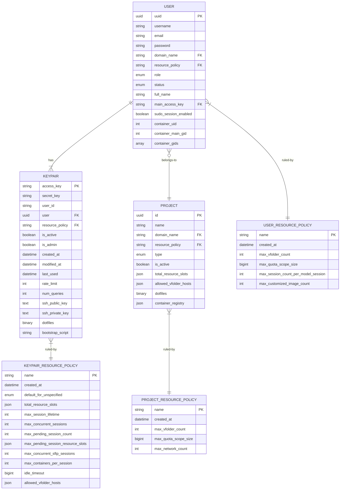
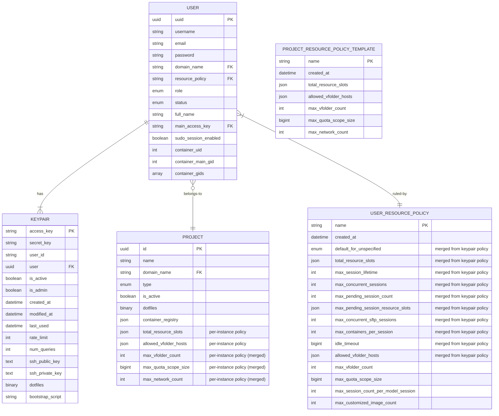
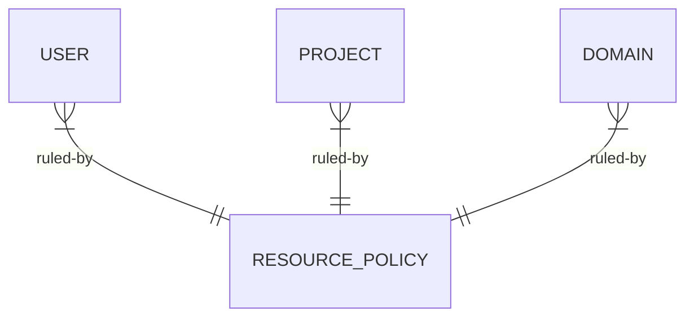

# keypair/사용자/프로젝트 자원 정책 재편

## 동기

**keypair** 는 Backend.AI Manager 에 프로그래밍 방식으로 접근할 때 사용하는 인증 token 이며, 일시적이고 교체와 rotation 이 가능하도록 의도했다.

초기 Backend.AI version 에는 keypair 만 있었고(CodeOnWeb 의 backend 로 배포하던 "Sorna" 시절), 사용자는 나중에 추가했다. 이런 역사적 순서 때문에 keypair 마다 묶이는 별도 자원 정책을 먼저 추가했고, 사용자별 자원 정책은 나중에 추가했다.

사용자 신원이 keypair 가 아니라 사용자에 대응하므로 이 설계는 시스템과 UI 설계에 혼란과 복잡성을 크게 만든다.
- keypair 를 자동 rotation 이 되게 해 달라는 고객 요청이 여러 번 있었다. 한 사용자의 quota 를 여러 keypair 가 나눠 사용하려면 버그가 생기기 쉬운 추가 database 질의와 예외 처리가 필요해 구현이 더 복잡해진다.
- 사용자가 keypair 를 여러 개 가지면 keypair 자원 정책에 지정한 자원 quota 가 중복으로 주어진다.
- 여러 keypair 기반 사용자 시나리오에서 표시할 keypair 를 지정하려면 "main" keypair 개념이 필요하다.

## 현재 설계

현재 자원 정책은 세 가지다.

* **keypair 자원 정책**(`keypair_resource_policies` 테이블): keypair 마다 묶인 세션 관련 quota 를 제어한다.
  - `total_resource_slots`: keypair 가 실행 중인 모든 세션에서 소비할 수 있는 최대 compute 자원(CPU, memory, GPU 등)이다.
  - `max_concurrent_sessions`: 동시에 실행할 수 있는 비 SFTP 세션의 최대 개수다.
  - `max_concurrent_sftp_sessions`: 허용하는 private SFTP 세션의 최대 개수다.
  - `max_pending_session_count`: pending 상태로 둘 수 있는 세션의 최대 개수다.
  - `max_pending_session_resource_slots`: pending 세션에 적용하는 자원 한도다.
  - `max_session_lifetime`: 세션이 실행될 수 있는 최대 시간이다(초 단위, 0 = 무제한).
  - `max_containers_per_session`: 세션당 최대 kernel/container 수다(여러 container 를 사용하는 세션에 적용).
  - `idle_timeout`: 세션 유휴 timeout 시간이다.
  - `allowed_vfolder_hosts`: 이 keypair 가 접근할 수 있는 스토리지 호스트와 그 권한 수준이다.
  - `default_for_unspecified`: 명시하지 않은 자원 유형에 적용하는 기본 동작이다(`LIMITED` 또는 `UNLIMITED`).

* **사용자 자원 정책**(`user_resource_policies` 테이블): 사용자마다 묶인 storage 와 model serving quota 를 제어한다.
  - `max_vfolder_count`: 사용자가 소유할 수 있는 vfolder 의 최대 개수다.
  - `max_quota_scope_size`: 사용자가 소유한 vfolder 의 최대 전체 storage 크기다.
  - `max_session_count_per_model_session`: 사용자가 소유한 model service 엔드포인트 하나에 허용하는 최대 동시 세션 수다.
  - `max_customized_image_count`: 사용자가 공개할 수 있는 커스텀 container image 의 최대 개수다.

* **프로젝트 자원 정책**(`project_resource_policies` 테이블): 프로젝트 수준 자원의 공유 quota 를 제어한다.
  - `max_vfolder_count`: 프로젝트가 소유할 수 있는 vfolder 의 최대 개수다.
  - `max_quota_scope_size`: 프로젝트가 소유한 vfolder 의 최대 전체 storage 크기다.
  - `max_network_count`: 프로젝트가 생성할 수 있는 container network 의 최대 개수다(-1 = 무제한).

`PROJECT`(`groups`) 테이블에는 `total_resource_slots` 와 `allowed_vfolder_hosts` column 이 직접 들어 있다. 이 column 은 이름 붙은 정책과 별도로 프로젝트 수준에서 총 자원 한도와 storage 접근을 강제하는 데 사용한다.

### 프로젝트와 프로젝트 자원 정책의 연관

자원 설정은 개별 프로젝트 인스턴스와 "이름 붙은" 프로젝트 자원 정책 객체, 두 가지 형태로 나뉜다.

#### 1. 프로젝트 인스턴스별 field: `groups` 테이블에 직접 둠

이 field 는 생성 시 **프로젝트 인스턴스마다 따로 설정**하며 개별로 수정할 수 있다.

| Field                   | 기본값                   | 출처                 | 목적                                                              |
| ----------------------- | ------------------------ | -------------------- | ----------------------------------------------------------------- |
| `total_resource_slots`  | `{}` (비어 있으면 제한 없음) | 생성 시 제공 | 이 프로젝트의 모든 세션에 적용하는 총 compute 자원 quota |
| `allowed_vfolder_hosts` | `{}` (비어 있으면 접근 불가) | 생성 시 제공 | 이 프로젝트에 한정된 스토리지 호스트 접근 권한          |

이 인스턴스별 field 로 같은 domain 안의 프로젝트가 이름이 같은 정책을 공유하더라도 compute 자원 상한과 storage 접근 설정을 서로 다르게 둘 수 있다.

#### 2. 정책을 참조하는 field: `resource_policy` FK 경유

`resource_policy` column 은 `project_resource_policies.name` 을 참조하는 foreign key 다(기본값 `"default"`). 여러 프로젝트가 이름이 같은 정책을 공유할 수 있고, 정책을 변경하면 이를 참조하는 모든 프로젝트에 적용된다.

| field (정책에 있음)    | 적용 방식  | 목적                                                    |
| ---------------------- | ---------- | ------------------------------------------------------- |
| `max_vfolder_count`    | FK 참조 | 프로젝트가 소유할 수 있는 vfolder 의 총 개수를 제한        |
| `max_quota_scope_size` | FK 참조 | 프로젝트의 모든 vfolder 의 총 storage 크기를 제한      |
| `max_network_count`    | FK 참조 | 프로젝트가 생성할 수 있는 container network 의 개수를 제한 |

#### 의미 구분

| 구분 | 프로젝트별 field | 정책을 참조하는 field |
|--------|-------------------|-------------------------|
| **적용 단위** | 프로젝트 인스턴스 단위 | 프로젝트 간 공유 |
| **수정 범위** | 이 프로젝트에만 적용 | 정책을 사용하는 모든 프로젝트에 적용 |
| **자원 유형** | compute 자원(CPU, memory, GPU) | storage quota 와 network 한도 |
| **강제 지점** | scheduler validator(`GroupResourceLimitValidator`) | vfolder, network 생성 handler |
| **상속** | 없음, 독립 설정 | 이름 붙은 정책에서 상속 |

이 설계 방식은 keypair 자원 정책과 사용자 자원 정책에는 ***적용하지 않았다***. 그 두 정책에서는 모든 quota field 를 이름 붙은 정책 참조로 관리한다.

## 제안 설계

### 1. keypair 자원 정책을 사용자 자원 정책으로 병합

자원 정책은 인증 token(= keypair)이 아니라 사용자 단위로 적용해야 하므로, keypair 자원 정책 전체를 사용자 자원 정책으로 병합한다.

### 2. 프로젝트 자원 정책을 개별 프로젝트 자원 설정으로 병합

프로젝트에 공유하거나 상속하는 이름 붙은 자원 정책을 따로 둘 이유가 없다. 프로젝트 자원 정책의 모든 field 를 개별 프로젝트 인스턴스로 병합해 옮긴다.

기존 프로젝트 자원 정책은 관리자가 새 프로젝트를 반복해서 생성할 때 사용하는 "프로젝트 자원 정책 template" 으로 용도를 변경할 수 있다.

### 1과 2: 다시 설계한 database schema

**변경 요약:**

1. **`KEYPAIR` 테이블**: `resource_policy` FK 를 제거한다. keypair 가 자원 정책을 직접 참조하지 않고, 모든 자원 제약을 사용자 수준에서 강제한다.

2. **`KEYPAIR_RESOURCE_POLICY` 테이블**: **제거한다**. 모든 field 를 `USER_RESOURCE_POLICY` 로 병합한다.

3. **`USER_RESOURCE_POLICY` 테이블**: 이전에 keypair 자원 정책에 있던 세션 관련 quota 와 기존 사용자 전용 quota 를 모두 담는다.
   - 세션 quota: `total_resource_slots`, `max_concurrent_sessions`, `max_session_lifetime`, `idle_timeout` 등
   - storage quota: `max_vfolder_count`, `max_quota_scope_size`, `allowed_vfolder_hosts`
   - model serving: `max_session_count_per_model_session`, `max_customized_image_count`

4. **`PROJECT` 테이블**: 모든 quota field 를 직접 담는다(정책을 참조하는 FK 없음).
   - `max_vfolder_count`, `max_quota_scope_size`, `max_network_count` 를 `PROJECT_RESOURCE_POLICY` 에서 병합
   - 기존 `total_resource_slots` 와 `allowed_vfolder_hosts` 는 인스턴스별 field 로 유지

5. **`PROJECT_RESOURCE_POLICY` → `PROJECT_RESOURCE_POLICY_TEMPLATE`**: 관리자가 미리 정한 값으로 새 프로젝트를 빠르게 설정하는 선택적 template 으로 용도를 변경한다. 프로젝트는 더 이상 FK 로 이를 참조하지 않고, 프로젝트 생성 시 기본값을 복사하는 편의 기능으로만 사용한다.

### 3. 사용자별 기본 프로젝트(workspace) 추가 또는 사용자와 프로젝트 자원 정책의 RBAC식 scoping 구현

> [!NOTE]
> **논의 필요**
> 
> 모든 사용자가 자기 "workspace" 프로젝트를 가지게 하면 **사용자별 자원 정책을 프로젝트별 자원으로 병합**할 수도 있다.
> 문제는 서로 다른 프로젝트에 속한 여러 사용자에게 자원 한도를 함께 적용하고 싶을 때가 있다는 점이다. 이런 경우에는 사용자마다 외부 자원 정책을 따로 참조하게 해야 할 수 있다.
> 
> 다시 말해 다음 두 개념을 조정해야 한다.
> 
> - 프로젝트 경계를 넘어 공유하는 사용자별 자원 정책
> - 사용자마다 자기 기본 workspace 프로젝트를 두는 프로젝트별 자원 정책

## 사용자와 개발자에게 미치는 영향 / 마이그레이션 계획
(TODO)
