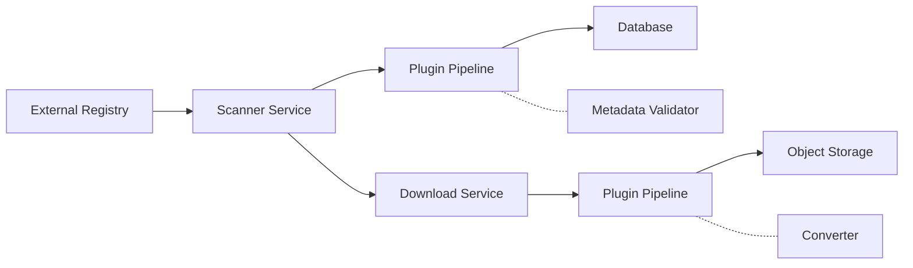
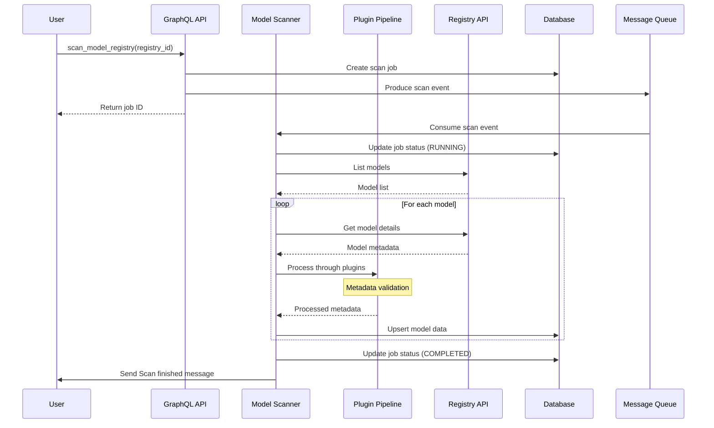
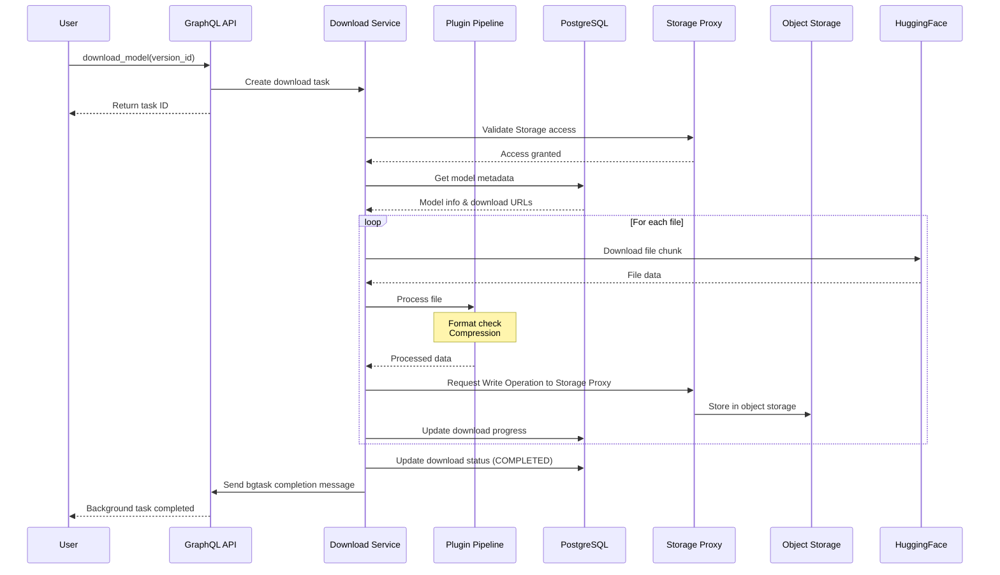

# 제목

외부 model hub 에서 model code 를 내려받는 model scanner 와 downloader

## 동기

Backend.AI 는 외부 model registry 의 ML 모델을 찾고, 목록화하고, 관리하는 체계적인 방법이 없다. 사용자는 HuggingFace 같은 source 에서 모델을 직접 내려받고, version 을 따로 관리하고, storage 에 업로드해야 한다.


## 현재 설계

현재 Backend.AI 는 다음 방식으로 모델을 다룬다.
- vfolder 체계: 모델 전용 metadata 가 없는 일반 file storage
- container registry: ML 모델이 아니라 Docker image
- model serving: 모델이 이미 vfolder 에 있다고 가정


## 제안 설계

### 상위 구조



### 시퀀스 다이어그램
#### plugin 을 사용하는 모델 스캔 흐름


#### plugin 을 사용하는 모델 다운로드 흐름



### 핵심 구성 요소

1. **model scanner service**
   - 외부 registry(HuggingFace, ModelHub, 사용자 정의)와 연동한다
   - 모델 metadata 를 가져와 정규화한다
   - 수동 스캔과 예약 스캔을 지원한다
   - metadata 는 DB 에 저장한다

2. **plugin 구조**
   - 스캔과 다운로드 workflow 에 확장 가능한 처리 pipeline 을 둔다
   - 기본 제공 plugin: license 검사, metadata 검증, format 변환

3. **download service**
   - 진행률 추적과 동시 다운로드를 지원한다
   - 큰 모델은 이어받기 다운로드를 지원한다
   - 내려받은 아티팩트는 Storage Proxy 를 거쳐 object storage 에 저장한다


## 기술 구현

### model scanner service
#### scanner service 인터페이스
```python
class ModelScannerService:
    """Core service for scanning model registries"""
    
    def __init__(self, db, cache, event_bus, plugin_pipeline):
        self.db = db
        self.plugin_pipeline = plugin_pipeline
        self.scanners: dict[str, BaseScanner] = {}
    
    async def scan_registry(
        self,
        registry_id: UUID,
        options: ScanOptions
    ) -> ScanJob:
        """Execute a registry scan with plugin pipeline"""
        # 1. Create scan job
        # 2. Get registry config
        # 3. Initialize appropriate scanner
        # 4. Execute PRE_SCAN plugins
        # 5. Process results through POST_SCAN plugins
        # 6. Process results through POST_SCAN plugins
        # 7. Update job status
        # 8. Publish events
    
    async def scan_single_model(
        self,
        registry_id: UUID,
        external_id: str,
    ) -> ModelInfo:
        """Scan a specific model with plugin processing"""
        # 1. Get model details
        # 2. Process through POST_SCAN plugins
        # 3. Update database
```

#### scanner data model
```python
@dataclass
class ScanJob:
    """Event published to message queue for scan jobs"""
    job_id: UUID
    model_registry_id: UUID 
    options: dict[str, Any]
    created_by: Optional[UUID]
    created_at: datetime


@dataclass
class ModelInfo:
    """Base class for model information from any source"""
    model_id: str  # Source-specific identifier (repo_id for HF)
    name: str
    author: Optional[str]
    description: Optional[str]
    last_modified: Optional[datetime]
    download_count: int = 0
    popularity_score: int = 0  # likes, stars, etc.
    tags: list[str] = field(default_factory=list)
    license: Optional[str] = None
    framework: Optional[str] = None  # Detected or specified
    task_type: Optional[str] = None
    metadata: dict[str, Any] = field(default_factory=dict)


@dataclass
class ModelFileInfo:
    """Base class for file information from any source"""
    path: str
    size: int
    checksum: Optional[str] = None
    mime_type: Optional[str] = None
    download_url: Optional[str] = None
    metadata: dict[str, Any] = field(default_factory=dict)
    
```

#### scanner 인터페이스
```python
class AbstractScanner(ABC):
    """Abstract base for registry scanners"""
    
    @abstractmethod
    async def list_models(self, query, limit, offset, filters) -> list[ModelInfo]:
        """List models with pagination"""
    
    @abstractmethod
    async def get_model_details(self, model_id: str) -> ModelInfo:
        """Get comprehensive model information"""
    
    @abstractmethod
    async def get_model_versions(self, model_id: str) -> list[ModelVersionInfo]:
        """Get all versions of a model"""
    
    @abstractmethod
    async def get_version_files(self, model_id: str, version: str) -> list[ModelFileInfo]:
        """Get file listing for a version"""
    
    @abstractmethod
    async def get_download_url(self, model_id: str, version: str, file_path: str) -> str:
        """Generate download URL for a file"""
```

#### scanner 구현
```python
class HuggingFaceScanner(BaseScanner):
    """HuggingFace Hub scanner implementation"""
    
    def __init__(self, config: ScannerConfig):
        self.token = config.token
    
    @override
    async def list_models(self, **kwargs) -> list[ModelInfo]
        # Implementation using HF API

class ManagerScanner(BaseScanner):
    """Scan from other manager"""
```


### download service

#### download service 구현
```python
class DownloadManagerService:
    """Manages concurrent model downloads with plugin support"""
    
    def __init__(
        self,
        vfolder_service: VFolderService,
        plugin_pipeline: PluginPipeline,
        max_concurrent: int,
        chunk_size: int
    ):
        self.vfolder_service = vfolder_service
        self.plugin_pipeline = plugin_pipeline
        self.active_downloads: dict[UUID, DownloadTask] = {}
        self.download_queue = asyncio.Queue()
        self.semaphore = asyncio.Semaphore(max_concurrent)
    
    async def create_download(
        self,
        model_version_id: UUID,
        vfolder_id: UUID,
        user_id: UUID,
    ) -> DownloadTask:
        """Create and queue a download with plugin processing"""
        # 1. Validate permissions
        # 2. Execute PRE_DOWNLOAD plugins
        # 3. Create download record
        # 4. Queue download task
        # 5. Return download object
    
    async def download_worker(self):
        """Background worker for processing downloads"""
        while True:
            task = await self.download_queue.get()
            async with self.semaphore:
                await self._execute_download_with_plugins(task)
```

#### download data model
```python
@dataclass
class DownloadTask:
    """Download task information"""
    task_id: UUID
    model_version_id: UUID
    vfolder_id: UUID
    status: str
    created_at: datetime
    total_files: int
    total_size: int
```

### plugin 구조

```python
class PluginStage(StrEnum):
    PRE_SCAN = "PRE_SCAN"
    POST_SCAN = "POST_SCAN"
    PRE_DOWNLOAD = "PRE_DOWNLOAD"
    POST_DOWNLOAD = "POST_DOWNLOAD"

class PluginType(StrEnum):
    VALIDATOR = "VALIDATOR"
    LICENSE_CHECKER = "LICENSE_CHECKER"


@dataclass
class PluginContext:
    model_registry_id: UUID
    stage: PluginStage
    user_id: Optional[UUID]
    metadata: dict[str, Any]  # Can include repo_id, model_name, etc.


@dataclass
class PluginResult:
    success: bool
    data: Optional[Any] # TODO: Define proper type
    error: Optional[Any] # TODO: Define proper type


class BasePlugin(ABC):
    """Base class for all model registry plugins"""
    
    @property
    @abstractmethod
    def name(self) -> str:
        """Unique plugin name"""
    
    @property
    @abstractmethod
    def version(self) -> str:
        """Plugin version"""
    
    @property
    @abstractmethod
    def plugin_type(self) -> PluginType:
        """Type of the plugin"""
    
    @property
    @abstractmethod
    def supported_stages(self) -> list[PluginStage]:
        """Stages where this plugin can be executed"""
    
    @abstractmethod
    async def initialize(self, config: PluginConfig) -> None:
        """Initialize plugin with configuration"""
    
    @abstractmethod
    async def process(
        self,
        data: Any,
        context: dict[str, Any],
        stage: PluginStage
    ) -> PluginResult:
        """Process data through the plugin"""
    
    @abstractmethod
    async def cleanup(self) -> None:
        """Cleanup plugin resources"""
    
    def can_handle(self, data_type: str, stage: PluginStage) -> bool:
        """Check if plugin can handle this data type at this stage"""
        return stage in self.supported_stages
```

```python
class PluginPipeline:
    """Manages plugin execution pipeline"""
    
    def __init__(self, plugin_registry: PluginRegistry):
        self.registry = plugin_registry
    
    async def execute(
        self,
        data: Any, # TODO: Define proper type
        context: dict[str, Any],
        stage: PluginStage,
        model_registry_id: Optional[UUID]
    ) -> PipelineResult:
        """Execute all plugins for a given stage"""
```


## 사용자와 개발자에게 미치는 영향

1. **단순해진 workflow**
   - 클릭 한 번으로 모델을 찾고 내려받는다
   - file 을 직접 옮길 필요가 없다
   - version 관리를 통합한다

2. **확장 가능한 구조**
   - 사용자 정의 처리를 위한 plugin 체계
   - 새 registry 유형을 쉽게 추가한다


## 참고
1. **HuggingFace Hub API**: https://huggingface.co/docs/hub/api
2. **model registry pattern**:
   - MLflow Model Registry
   - Kubeflow Model Management

3. **Backend.AI 구조**:
   - vfolder 체계 문서
   - container registry 구현(`src/ai/backend/manager/api/container_registry.py`)
   - GraphQL API pattern(`src/ai/backend/manager/models/gql.py`)
