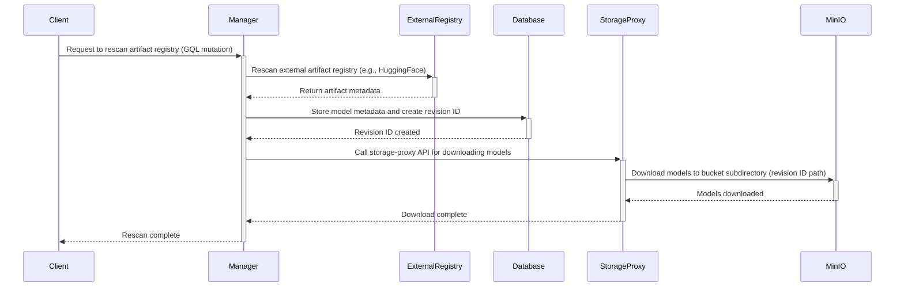

# 아티팩트 레지스트리 storage backend 로 MinIO 지원

Storage Proxy 에서 아티팩트 레지스트리의 storage backend 로 `MinIO` 를 지원한다.

## 동기

Storage Proxy 에 외부 storage 를 연결해 모델, 이미지, 패키지 등을 Backend.AI scanner 가 저장하고 접근하게 한다. storage backend 로 MinIO 를 사용한다.

# 사용 사례

1. client 가 GQL mutation 으로 아티팩트 레지스트리 재스캔을 manager 에 요청한다.

2. manager 가 외부 아티팩트 레지스트리(HuggingFace 나 외부 manager 등)를 재스캔하고, 모델의 metadata 를 database 에 저장한다.

3. 재스캔한 모델을 storage 로 다운로드하도록 storage-proxy API 를 호출한다.

4. 모델과 metadata file 을 bucket 의 revision ID 에 해당하는 하위 디렉터리 경로로 다운로드한다.



# database schema

## 아티팩트 레지스트리 storage mapping 테이블

아티팩트 레지스트리는 아티팩트와 MinIO bucket 경로의 mapping 정보를 저장할 database 테이블이 필요하다.

```sql
CREATE TABLE artifacts (
    id UUID PRIMARY KEY DEFAULT gen_random_uuid(),
    type VARCHAR(20) NOT NULL,  -- 'image', 'package', 'model'
    name VARCHAR(50) NOT NULL,
    storage_type VARCHAR(50) NOT NULL DEFAULT 'minio',  -- 'minio', 's3', etc.
    created_at TIMESTAMP DEFAULT NOW()
);

CREATE TABLE object_storage_backend (
    id UUID PRIMARY KEY DEFAULT gen_random_uuid(),
    artifact_id UUID NOT NULL REFERENCES artifacts(id),
    access_key TEXT NOT NULL,
    secret_key TEXT NOT NULL,
    endpoint TEXT NOT NULL,
)

CREATE TABLE association_artifact_storage (
    id UUID PRIMARY KEY DEFAULT gen_random_uuid(),
    artifact_id UUID NOT NULL REFERENCES artifacts(id),
    storage_object_id UUID NOT NULL REFERENCES storage_objects(id),
    created_at TIMESTAMP DEFAULT NOW(),
    UNIQUE(artifact_id, storage_object_id)
);

-- S3 compataible storage object data
-- (Since object storage that is not S3-compatible is not planned to be supported, we will use the name storage_object.)
CREATE TABLE storage_objects (
    id UUID PRIMARY KEY DEFAULT gen_random_uuid(),
    artifact_id UUID NOT NULL REFERENCES artifacts(id),
    object_key TEXT NOT NULL,  -- bucket path
    size_bytes BIGINT,
    checksum_sha256 VARCHAR(64),
    created_at TIMESTAMP DEFAULT NOW(),
    updated_at TIMESTAMP DEFAULT NOW(),
    UNIQUE(artifact_id, object_key)
);
```

# Storage Proxy 구현

사용 사례를 구현하려면 다음 구현을 추가해야 한다.

## MinIO 연동

Storage Proxy 에 아티팩트 레지스트리를 설정하는 service code 를 추가한다.
구현할 때 vfolder backend 로 동작하는 `BaseVolume`, `FsOpModel` 같은 구성 요소를 참고할 수 있다. 다만 아티팩트 레지스트리 storage 는 현재 vfolder 로 동작할 필요가 없으므로 불필요한 부분을 제거하고 인터페이스를 제대로 추상화한다.

`MinIO` 와의 통신은 `s3fs` 로 처리한다. `s3fs` bucket 을 storage host 의 file system 으로 마운트하고 다운로드와 업로드를 처리하는 `FsOpModel` 을 구현해야 한다.

## Storage Proxy 상태 관리

Storage Proxy 의 storage 상태를 추적해야 한다.

어떤 storage object 가 현재 마운트되었는지, 어떤 것이 아직 마운트되지 않았는지, 에러가 발생했는지 같은 storage 의 현재 상태를 Valkey 에 캐시하여 Storage Proxy 의 상태를 쉽게 확인하게 한다.

## API 명세

Storage Proxy 에 아티팩트 유형별 CRUD REST API 를 추가로 구현해야 한다.

### Storage Proxy REST API

Storage Proxy API 는 외부 source 의 content 를 관리하는 일반 storage 동작을 제공한다.

아래 REST API 는 요청 body 에 외부 registry 의 `type`, `endpoint`, `credentials` 를 포함해야 한다.

#### 외부 registry 에서 metadata 재스캔

외부 registry 의 metadata 를 재스캔한다. 재스캔한 metadata 는 *Manager* 로 전달된 뒤 database 에 저장된다.

```
POST /storages/{storage_type}/rescan
Content-Type: application/json

{
  "registry_type": "huggingface",
  "registry_url": "https://huggingface.co/gpt2",
  "artifact_type": "model",
  "artifact_name": "gpt-2",
  "revision": "main"
}

Response:
{
  "status": "success",
  "message": "Metadata rescanned successfully",
  "artifact_id": "123e4567-e89b-12d3-a456-426614174000",
  "revision_id": "abc123def456",
  "metadata": {
    "name": "gpt-2",
    "type": "model",
    "size": 548000000,
    "files": [
      "config.json",
      "pytorch_model.bin",
      "tokenizer.json"
    ],
    "last_modified": "2025-07-11T10:00:00Z"
  }
}
```

#### 외부 registry 에서 아티팩트 file 다운로드

외부 registry 를 재스캔하고 아티팩트 file 을 지정한 storage 로 다운로드한다.

```
POST /storages/{storage_type}/download
Content-Type: application/json

{
  "artifact_id": "123e4567-e89b-12d3-a456-426614174000",
  "revision_id": "abc123def456",
  "registry_type": "huggingface",
  "registry_url": "https://huggingface.co/gpt2",
  "target_bucket": "artifacts",
  "target_path": "models/gpt-2/abc123def456",
  "files": [
    "config.json",
    "pytorch_model.bin",
    "tokenizer.json"
  ]
}

Response:
{
  "task_id": "download_task_123",
  "status": "started",
  "message": "Download started to models/gpt-2/abc123def456"
}
```


#### download task 상태 조회

download task 의 상태를 반환한다.

```
GET /storages/{storage_type}/download/{task_id}

Response:
{
  "task_id": "download_task_123",
  "status": "completed",
  "progress": 100,
  "target_path": "models/gpt-2/abc123def456",
  "downloaded_files": [
    "config.json",
    "pytorch_model.bin",
    "tokenizer.json"
  ]
}
```

#### storage file 목록 조회

지정한 storage 의 특정 경로에 있는 file 을 나열해 응답으로 반환한다.

```
GET /storages/{storage_type}/list-files

Response:
{
  "path": "models/gpt-2/abc123def456",
  "size": 548000000,
  "files": [
    {
      "name": "config.json",
      "size": 1024,
      "last_modified": "2025-07-11T10:00:00Z"
    },
    {
      "name": "pytorch_model.bin",
      "size": 547998976,
      "last_modified": "2025-07-11T10:05:00Z"
    }
  ]
}
```

#### storage file 삭제

지정한 storage 의 특정 경로에 있는 file 을 삭제한다.

```
DELETE /storages/{storage_type}

Response: 204 No Content
```

# 참고

- [`s3fs` FAQ](https://github.com/s3fs-fuse/s3fs-fuse/wiki/FAQ)

- [`s3fs` options](https://github.com/s3fs-fuse/s3fs-fuse/wiki/Fuse-Over-Amazon#options)
