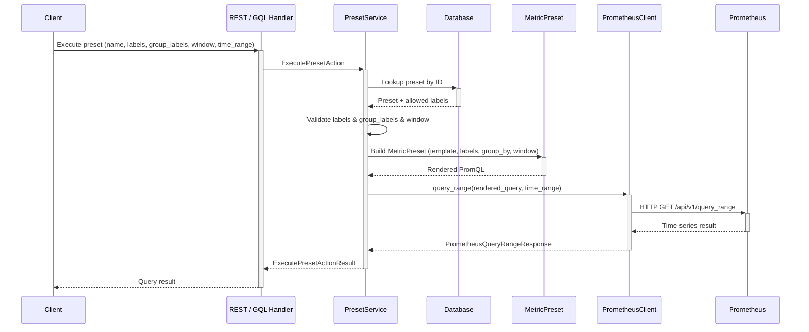

# 프로메테우스 쿼리 프리셋 시스템

## 관련 이슈

- JIRA: BA-4052
- JIRA: BA-4040 (epic: Prometheus Client Extraction and Querier Interface Abstraction)

## 동기

[BEP-1045](BEP-1045-prometheus-client-extraction-and-querier-interface-abstraction.md) 가 도입한 현재 설계에서 PromQL 템플릿은 서비스 계층에 하드코딩된다. 새 쿼리를 추가하려면 기반 Prometheus 지표가 이미 있어도 코드 변경, 리뷰, 릴리스 주기가 필요하다.

이 제안은 PromQL 템플릿을 데이터베이스에 저장하고 API 로 노출하는 **프로메테우스 쿼리 프리셋 시스템**을 도입한다. 관리자는 코드 배포 없이 실행 중에 쿼리 프리셋을 생성, 변경, 삭제할 수 있다. 인증된 사용자는 파라미터를 주입해 프리셋을 실행할 수 있다.

### 목표

- PromQL 템플릿 정의를 애플리케이션 코드에서 분리한다
- 관리자가 실행 중에 CRUD API 로 쿼리 프리셋을 관리하게 한다
- 기존 `MetricPreset` 인프라로 템플릿을 검증하고 렌더링하는 안전한 실행 API 를 제공한다
- `_escape_label_value()` 와 label 허용 목록으로 주입 안전성을 유지한다

## 현재 설계

[BEP-1045](BEP-1045-prometheus-client-extraction-and-querier-interface-abstraction.md) 는 재사용 가능한 Prometheus 구성 요소(`MetricPreset`, `PrometheusClient`, `MetricQuerier`)를 추출했지만, PromQL 템플릿 선택 로직은 서비스 계층에 그대로 하드코딩된다. 템플릿은 컴파일 시점에 `match` 문으로 선택되므로 새 쿼리 패턴에는 코드 변경과 재배포가 필요하다.

### 문제

- **템플릿 경직성**: 새 쿼리 패턴에는 코드 변경과 재배포가 필요하다
- **실행 중 관리 불가**: 관리자는 개발자 개입 없이 쿼리를 추가하거나 수정할 수 없다
- **label govern 규칙 없음**: 아무 label 이나 검증 없이 사용할 수 있고, 지표별로 어떤 label 을 필터하거나 그룹화할 수 있는지에 대한 개념이 없다

## 제안 설계

### DB 스키마

**테이블: `prometheus_query_presets`**

| column | 타입 | 제약 | 설명 |
|--------|------|------------|-------------|
| `id` | `UUID` | PK, 기본값 `uuid_generate_v4()` | 기본 키 |
| `name` | `VARCHAR(256)` | NOT NULL, UNIQUE | 사람이 읽는 프리셋 식별자 (실행 URL 에 사용) |
| `metric_name` | `VARCHAR(256)` | NOT NULL | Prometheus 지표 이름 (예: `backendai_container_utilization`) |
| `query_template` | `TEXT` | NOT NULL | `{labels}`, `{window}`, `{group_by}` placeholder 가 있는 PromQL 템플릿 |
| `time_window` | `VARCHAR(32)` | NULLABLE | 프리셋별 기본 window. NULL 이면 서버 설정 `metric.timewindow` 를 사용한다 |
| `options` | `JSONB` | NOT NULL, 기본값 `'{"filter_labels":[],"group_labels":[]}'` | `PydanticColumn(PresetOptions)` 로 저장하는 프리셋 옵션 |
| `created_at` | `TIMESTAMPTZ` | NOT NULL, 기본값 `now()` | 생성 시각 |
| `updated_at` | `TIMESTAMPTZ` | NOT NULL, 기본값 `now()` | 마지막 변경 시각 |

```python
class PresetOptions(BaseModel):
    filter_labels: list[str]
    group_labels: list[str]

    model_config = ConfigDict(frozen=True)
```

`PresetOptions` 래퍼 모델을 두면 스키마 마이그레이션 없이 향후 프리셋 수준 설정(예: 캐싱, rate limit)을 추가할 수 있다.

### API 설계

#### CRUD 엔드포인트 (SUPERADMIN 전용)

| 메서드 | 경로 | 설명 |
|--------|------|-------------|
| `POST` | `/resource/prometheus-query-presets` | 새 프리셋 생성 |
| `GET` | `/resource/prometheus-query-presets` | 모든 프리셋 조회 |
| `GET` | `/resource/prometheus-query-presets/{id}` | id 로 프리셋 조회 |
| `PATCH` | `/resource/prometheus-query-presets/{id}` | 프리셋 변경 |
| `DELETE` | `/resource/prometheus-query-presets/{id}` | 프리셋 삭제 |

**생성 요청:**

```json
{
  "name": "container_cpu_rate",
  "metric_name": "backendai_container_utilization",
  "query_template": "sum by ({group_by})(rate({metric_name}{{{labels}}}[{window}]))",
  "time_window": "5m",
  "options": {
    "filter_labels": ["container_metric_name", "kernel_id", "session_id", "value_type"],
    "group_labels": ["kernel_id", "session_id", "value_type"]
  }
}
```

**생성, 조회 응답:**

```json
{
  "id": "550e8400-e29b-41d4-a716-446655440000",
  "name": "container_cpu_rate",
  "metric_name": "backendai_container_utilization",
  "query_template": "sum by ({group_by})(rate({metric_name}{{{labels}}}[{window}]))",
  "time_window": "5m",
  "options": {
    "filter_labels": ["container_metric_name", "kernel_id", "session_id", "value_type"],
    "group_labels": ["kernel_id", "session_id", "value_type"]
  },
  "created_at": "2025-02-20T10:00:00Z",
  "updated_at": "2025-02-20T10:00:00Z"
}
```

#### 실행 엔드포인트 (인증된 모든 사용자)

| 메서드 | 경로 | 설명 |
|--------|------|-------------|
| `POST` | `/resource/prometheus-query-presets/{id}/execute` | id 로 프리셋 실행 |

**실행 요청:**

```json
{
  "labels": [
    {"key": "container_metric_name", "value": "cpu_util"},
    {"key": "kernel_id", "value": "abc-123"}
  ],
  "group_labels": ["kernel_id", "value_type"],
  "window": "5m",
  "time_range": {
    "start": "2025-02-20T09:00:00Z",
    "end": "2025-02-20T10:00:00Z",
    "step": "60s"
  }
}
```

**실행 응답:**

```json
{
  "status": "success",
  "data": {
    "result_type": "matrix",
    "result": [
      {
        "metric": [
          {"key": "kernel_id", "value": "abc-123"},
          {"key": "value_type", "value": "current"}
        ],
        "values": [[1708412400, "0.85"], [1708412460, "0.72"]]
      }
    ]
  }
}
```

`metric` 필드는 고정 필드 대신 key-value 항목 형태를 사용하므로 프리셋마다 다른 label 집합을 반환할 수 있다.

#### REST

**CRUD 타입:**

```python
class PresetOptions(BaseModel):
    filter_labels: list[str]
    group_labels: list[str]

class PrometheusQueryPresetCreate(BaseModel):
    name: str
    metric_name: str
    query_template: str
    time_window: str | None
    options: PresetOptions

class PrometheusQueryPresetModify(BaseModel):
    name: str | None
    metric_name: str | None
    query_template: str | None
    time_window: str | None
    options: PresetOptions | None
```

**실행 타입:**

```python
class MetricLabelEntry(BaseModel):
    key: str
    value: str

class ExecutePresetRequest(BaseModel):
    labels: list[MetricLabelEntry]
    group_labels: list[str]
    window: str | None
    time_range: QueryTimeRange

class PresetMetricResult(BaseModel):
    metric: list[MetricLabelEntry]
    values: list[tuple[Decimal, str]]

class PresetExecuteData(BaseModel):
    result_type: str
    result: list[PresetMetricResult]

class PresetExecuteResponse(BaseModel):
    status: str
    data: PresetExecuteData
```


#### GraphQL API

프리셋 시스템은 기존 Backend.AI 규약(`Node`/`Connection` 패턴, superadmin 연산의 `admin_` 접두사)을 따르는 Strawberry GraphQL 인터페이스도 노출한다.

**타입:**

```graphql
type PrometheusPresetOptionsGQL {
  filterLabels: [String!]!
  groupLabels: [String!]!
}

type PrometheusQueryPreset implements Node {
  id: ID!
  name: String!
  metricName: String!
  queryTemplate: String!
  timeWindow: String
  options: PrometheusPresetOptionsGQL!
  createdAt: DateTime!
  updatedAt: DateTime!
}
```

**admin 쿼리 (SUPERADMIN 전용):**

```graphql
type Query {
  adminPrometheusQueryPreset(id: ID!): PrometheusQueryPreset
  adminPrometheusQueryPresets(
    filter: PrometheusQueryPresetFilter
    orderBy: [PrometheusQueryPresetOrderBy!]
    first: Int, after: String, last: Int, before: String
    limit: Int, offset: Int
  ): PrometheusQueryPresetConnection!
}
```

**admin 뮤테이션 (SUPERADMIN 전용):**

```graphql
type Mutation {
  adminCreatePrometheusQueryPreset(input: CreatePrometheusQueryPresetInput!): CreatePrometheusQueryPresetPayload!
  adminModifyPrometheusQueryPreset(id: ID!, input: ModifyPrometheusQueryPresetInput!): ModifyPrometheusQueryPresetPayload!
  adminDeletePrometheusQueryPreset(id: ID!): DeletePrometheusQueryPresetPayload!
}
```

**실행 쿼리 (인증된 모든 사용자):**

```graphql
type MetricLabelEntryGQL {
  key: String!
  value: String!
}

type MetricResultValueGQL {
  timestamp: Float!
  value: String!
}

type MetricResultGQL {
  metric: [MetricLabelEntryGQL!]!
  values: [MetricResultValueGQL!]!
}

type PrometheusQueryResultGQL {
  status: String!
  resultType: String!
  result: [MetricResultGQL!]!
}

input QueryTimeRangeInput {
  start: DateTime!
  end: DateTime!
  step: String!
}

input MetricLabelEntryInput {
  key: String!
  value: String!
}

type Query {
  prometheusQueryPresetResult(
    name: String!
    labels: [MetricLabelEntryInput!]
    groupLabels: [String!]
    window: String
    timeRange: QueryTimeRangeInput!
  ): PrometheusQueryResultGQL!
}
```

`MetricLabelEntryGQL` 은 key-value 항목 형태를 사용하므로(`ImageV2LabelEntryGQL`, `ResourceOptsEntryGQL` 등과 같은 방식) 스키마를 변경하지 않고 프리셋마다 다른 label 집합을 반환할 수 있다. `QueryTimeRangeInput` 은 기존 `QueryTimeRange` Pydantic 모델에 대응한다. 실행 쿼리는 인증된 모든 사용자가 사용할 수 있고, 이 동작이 본질적으로 Prometheus 를 상대로 읽는 것이므로 Query 로 모델링한다.

#### CLI

CLI 는 기존 Backend.AI 의 Click 기반 규약을 따른다.

**admin CRUD (SUPERADMIN):**

```
backend.ai admin prometheus-query-preset list
backend.ai admin prometheus-query-preset info <ID>
backend.ai admin prometheus-query-preset add \
    --name <NAME> \
    --metric-name <METRIC> \
    --query-template <TEMPLATE> \
    [--time-window <WINDOW>] \
    [--options <JSON>]
    # --options example: '{"filter_labels": ["kernel_id", "container_metric_name"], "group_labels": ["kernel_id"]}'
backend.ai admin prometheus-query-preset modify <ID> [--name ...] [--query-template ...] [--options ...]
backend.ai admin prometheus-query-preset delete <ID>
```

**실행 (인증된 모든 사용자):**

```
backend.ai prometheus-query-preset execute <ID> \
    --start <ISO8601> \
    --end <ISO8601> \
    --step <STEP> \
    [--label container_metric_name=cpu_util] \
    [--label kernel_id=abc-123] \
    [--group-labels label1,label2] \
    [--window <WINDOW>]
```

`--label` 은 `key=value` 형식을 사용하는 반복 가능한 플래그다. 실행 명령은 인증된 모든 사용자가 사용할 수 있으므로 최상위(비 admin) 명령이다.

### 실행 흐름



**검증 규칙:**

- 요청의 각 label key 는 프리셋의 `options.filter_labels` 목록에 있어야 한다
- `group_labels` 의 각 항목은 프리셋의 `options.group_labels` 목록에 있어야 한다
- `window` 는 `^\d+[smhdw]$` 와 일치해야 한다(단일 단위 기간만 지원하고 `1h30m`, `500ms` 같은 복합 기간은 의도적으로 지원하지 않는다). 값이 없으면 프리셋의 `time_window`, 그다음 서버 설정 `metric.timewindow` 를 사용한다

### 보안

| 위협 | 완화 |
|--------|-----------|
| **label 값 주입** | `preset.py` 의 `_escape_label_value()` 를 재사용한다. `\`, `"`, `\n`, `\r` 를 이스케이프한다 |
| **임의 label key** | `{labels}` 에는 `options.filter_labels` 의 label 만, `{group_by}` 에는 `options.group_labels` 의 label 만 사용할 수 있다 |
| **window 형식 주입** | 치환 전에 `^\d+[smhdw]$` 정규식으로 검증한다 |
| **템플릿 수정** | CRUD 연산은 SUPERADMIN 역할로 제한한다 |
| **지표 이름 치환** | `{metric_name}` 은 사용자 입력이 아니라 프리셋의 `metric_name` 필드(DB 에 저장되고 관리자가 제어)에서 가져온다 |
| **쿼리 자원 고갈** | 서비스 계층에서 `time_range` 기간과 `step` 크기를 검증한다. 과도하게 큰 범위나 1초 미만 step 을 거부해 Prometheus 과부하를 방지한다 |


### 재사용하는 인프라

| 구성 요소 | 출처 | 사용 |
|-----------|------|-------|
| `MetricPreset` | `common/clients/prometheus/preset.py` | `render()`, `_escape_label_value()` 로 템플릿 렌더링 |
| `PrometheusClient` | `common/clients/prometheus/client.py` | `query_range()` 실행 |
| `QueryTimeRange` | `common/dto/clients/prometheus/request.py` | 실행의 시간 범위 파라미터 |

## 마이그레이션과 호환성

### 데이터베이스 마이그레이션

- 새 테이블 하나: `prometheus_query_presets` (`options` JSONB column 은 `PydanticColumn` 사용)
- Alembic 마이그레이션: `CREATE TABLE` 만 수행하고 기존 테이블은 수정하지 않는다
- 데이터 마이그레이션은 필요 없다

### 이전 호환성

- **깨지는 변경 없음**: 기존 `ContainerUtilizationMetricService` 는 하드코딩된 템플릿으로 계속 동작한다
- **additive only**: 새 REST 엔드포인트와 DB 테이블만 추가하고 기존 API 는 수정하지 않는다
- **향후 마이그레이션 경로**: 프리셋을 채운 뒤 `ContainerUtilizationMetricService._build_preset()` 이 하드코딩 템플릿 대신 repository 에서 프리셋을 조회하도록 리팩터링할 수 있다. 이 BEP 의 범위 밖이다.

## 참고

- [BEP-1045: Prometheus Client Extraction and Querier Interface Abstraction](BEP-1045-prometheus-client-extraction-and-querier-interface-abstraction.md)
- [Prometheus HTTP API — Range Queries](https://prometheus.io/docs/prometheus/latest/querying/api/#range-queries)
