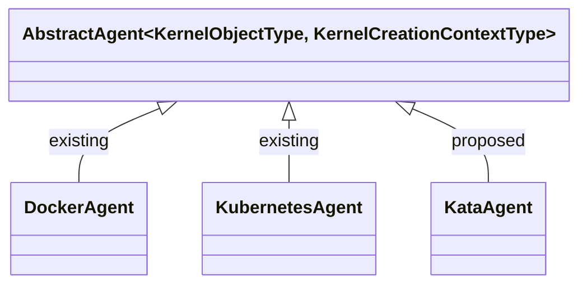
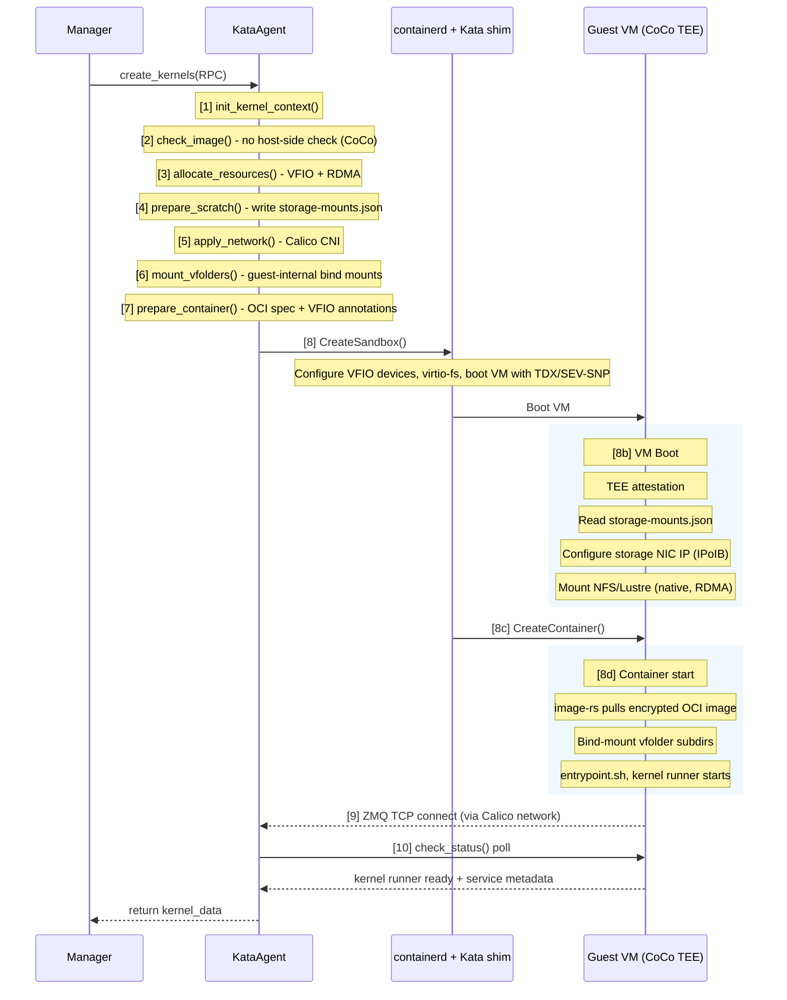

<!-- context-for-ai
type: master-bep
scope: Add Kata Containers as a third container backend (KataAgent) with CoCo by default, VFIO GPU passthrough, GPUDirect RDMA, and direct guest-side storage mounts
detail-docs: [configuration-deployment.md, kata-agent-backend.md, storage-compatibility.md, networking.md, vfio-accelerator-plugin.md, scheduler-integration.md, migration-compatibility.md]
key-constraints:
  - Full AbstractAgent implementation, NOT a RuntimeClass annotation
  - CoCo (Confidential Containers) by default; the host is always untrusted
  - Whole-GPU VFIO passthrough only, NO fractional GPU
  - DiscretePropertyAllocMap for cuda.device slot type
  - Must not break existing DockerAgent or KubernetesAgent deployments
  - VFolder storage via direct guest-side NFS/Lustre/WekaFS mount (native kernel client, preserves RDMA), NOT virtio-fs
  - Guest-side image pull via image-rs (host must not see image contents)
  - Monolithic attested guest rootfs with all drivers baked in
key-decisions:
  - KataAgent as independent backend, not a Docker runtime flag
  - CoCo by default; no non-CoCo Kata mode
  - VFIO passthrough for GPU, not nvidia-container-runtime in guest
  - New CUDAVFIOPlugin separate from existing CUDAPlugin
  - RDMAVFIOPlugin as non-schedulable co-plugin (auto-attaches co-located InfiniBand HCA)
  - Homogeneous scaling groups (one backend type per group)
  - VM memory overhead as agent-level deduction from available_slots
  - VFolder data via direct guest-side NFS/Lustre mount (native, RDMA-preserving); virtio-fs only for scratch/config
  - Storage topology visible in guest /proc/mounts (acceptable: same model as Docker; isolation via vfolder permissions, not mount concealment)
  - Calico CNI for inter-VM networking (multi-host, network policy); /etc/hosts for hostname resolution
  - DCGM Exporter + Node Exporter for metrics (containerd exec blocked by CoCo policy)
  - Agent-side volume mount config delivered via virtio-fs (storage-mounts.json in /home/config)
  - MNNVL (NVL72) deferred to separate BEP
implementation: 3 phases
-->

# Kata Containers 에이전트 backend

## 관련 문서

- Technical Report: [TR-2026-001](../docs/reports/kata-containers-feature-parity-analysis.md)

## 동기

Backend.AI 의 현재 컨테이너 backend(Docker, Kubernetes)는 격리를 위해 Linux namespace 와 cgroup 에 의존한다. 호스트 커널을 공유하므로 컨테이너 하나의 커널 취약점이 호스트 전체와 같은 호스트에 배치된 모든 워크로드를 침해할 수 있다. 신뢰할 수 없는 코드가 민감한 모델과 함께 실행되는 다중 테넌트 GPU 환경에는 부족하다.

Kata Containers 3.x 는 컨테이너마다 자체 guest 커널을 가진 경량 VM 을 실행하고 KVM 으로 하드웨어 수준 격리를 제공해 이 문제를 해결한다. Rust 기반 runtime 은 콜드 스타트 시간 125-500ms 를 달성한다(VMM 에 따라 다르며 최적화된 구성 기준). VMM 프로세스 오버헤드는 VM 당 15-60MB 이고(Cloud Hypervisor 약 15MB, QEMU 약 60MB), VM 당 호스트 메모리 총량은 이 오버헤드에 guest 에 구성한 메모리 할당을 합한 값이다. GPU 연산이 실제 경과 시간을 지배하는 AI/ML 워크로드에는 이 오버헤드를 감수할 수 있다.

GPU 워크로드에서는 VFIO(Virtual Function I/O) passthrough 가 IOMMU 를 통해 GPU 전체를 guest VM 에 직접 할당하므로 거의 native 에 가까운 연산 성능을 낸다. 이 방식은 개별 GPU 할당(`cuda.device`)과 자연스럽게 맞는다. 대상 워크로드가 강한 격리 보장과 함께 전용 GPU 자원을 요구하므로 분할 GPU 공유는 지원하지도 않고 필요하지도 않다.

또한 Kata 는 Confidential Containers(CoCo)와 TEE 하드웨어(Intel TDX, AMD SEV-SNP)와 통합되어, 호스트 운영자조차 메모리에 있는 모델 가중치나 학습 데이터에 접근할 수 없는 프라이버시 보존 AI 워크로드를 가능하게 한다.

## 문서 색인

| 문서 | 설명 | 단계 |
|----------|-------------|-------|
| [설정과 배포](BEP-1051/configuration-deployment.md) | `[kata]` 설정 섹션, 하이퍼바이저 선택, 호스트 요구 사항 | 1 |
| [KataAgent backend](BEP-1051/kata-agent-backend.md) | KataAgent, KataKernel, KataKernelCreationContext | 1 |
| [스토리지 호환성](BEP-1051/storage-compatibility.md) | VFolder 용 guest 측 직접 NFS/Lustre/WekaFS 마운트, scratch/config 용 virtio-fs, I/O 분석 | 1 |
| [네트워킹](BEP-1051/networking.md) | Calico CNI 통합, VM 간 네트워킹, 네트워크 정책, 호스트 이름 확인 | 1 |
| [VFIO 가속기 플러그인](BEP-1051/vfio-accelerator-plugin.md) | CUDAVFIOPlugin, IOMMU 그룹 탐지, 장치 passthrough | 2 |
| [스케줄러 통합](BEP-1051/scheduler-integration.md) | 에이전트 backend 추적, 자원 그룹 정책, VM 오버헤드 | 3 |
| [마이그레이션과 호환성](BEP-1051/migration-compatibility.md) | additive 롤아웃, 이전 버전과의 호환성, 롤백 계획 | 전체 |

## 설계 개요



KataAgent 는 Kata shim(`io.containerd.kata.v2`)을 사용하는 containerd 로 CoCo 가 활성화된 컨테이너를 관리한다. 모든 Kata VM 은 기본으로 TEE 보호(TDX/SEV-SNP)와 함께 실행되며 호스트는 항상 신뢰할 수 없다. 컨테이너 lifecycle 은 Docker 와 다르다: attestation 을 거치는 VM boot → `image-rs` 를 통한 guest 측 이미지 pull → guest 안에서 컨테이너 시작 순서다. GPU 장치는 VM 생성 시점에 VFIO passthrough 로 할당하고, IOMMU 를 통해 PCI 장치를 guest 주소 공간에 직접 바인딩한다. GPUDirect RDMA 를 위해 함께 배치된 InfiniBand HCA 를 자동으로 연결한다.

VFolder 스토리지를 guest VM 안에서 guest 자체의 NFS/Lustre/WekaFS 커널 클라이언트로 직접 마운트한다. 이렇게 하면 RDMA 데이터 경로를 유지하고 native I/O 처리량 100% 를 낸다. `/home/work` 는 guest VM 디스크(guest rootfs 의 일부)에 있는 디렉터리이고, vfolder 하위 디렉터리는 guest 측 NFS/Lustre 마운트에서 `/home/work/{vfolder}` 로 bind mount 한다. 에이전트는 `/home/config/`(virtio-fs 설정 채널)의 `storage-mounts.json` 으로 볼륨 마운트 스펙을 전달하고, guest prestart hook 이 이 파일을 읽어 컨테이너 시작 전에 마운트를 수행한다. 스토리지 토폴로지는 guest 의 `/proc/mounts` 에 보인다(Docker 와 같다. 격리는 마운트 정보를 숨기는 것이 아니라 Backend.AI 의 vfolder 권한 모델이 강제한다). virtio-fs 는 설정 디렉터리(`/home/config`, environ.txt, intrinsic-ports.json, storage-mounts.json 포함)에만 사용한다. 네트워크 트래픽은 TC filter 미러링을 사용하는 virtio-net 경로를 지난다. Kata 의 TC filter 는 호스트 측 veth 인터페이스와 guest 측 tap 장치 사이에서 트래픽을 투명하게 리다이렉트하므로 VM 은 CNI 계층에 투명하다. Calico CNI 는 다중 호스트 라우팅(BGP/VXLAN), IP 할당, 세션 간 격리를 위한 네트워크 정책 적용을 제공한다. 다중 컨테이너 세션의 정책 기반 클러스터 통신에는 Calico 엔드포인트 레이블링을 사용하고, 호스트 이름 확인은 `/etc/hosts` 기반으로 한다.

## 구성 요소 통합: Kata 커널 생성 흐름

이 절은 Backend.AI 가 Kata 커널을 생성할 때(CoCo 모드) 구성 요소가 주고받는 전체 흐름을 설명한다. DockerAgent 와 다른 단계에는 표시를 붙인다.

### 커널 생성 순서



### DockerAgent 와의 주요 차이

| 단계 | DockerAgent | KataAgent (CoCo) |
|---|---|---|
| [1] 컨텍스트 | `DockerKernelCreationContext` + aiodocker | `KataKernelCreationContext` + containerd gRPC |
| [2] 이미지 | 호스트 측 `docker.images.pull()` | 호스트 측 확인 없음, VM boot 뒤 guest 측 `image-rs` pull |
| [3] GPU | Docker `DeviceRequests` | VFIO `_kata_vfio_devices` + `clique_id` + 자동 연결 HCA |
| [4] scratch | environ.txt, resource.txt | 같음 + `storage-mounts.json` (볼륨 스펙과 storage NIC IP) |
| [6] VFolder | 호스트 bind mount 후 컨테이너 | guest 내부 bind mount (boot script 가 미리 마운트한 볼륨) |
| [7] 스펙 | Docker 컨테이너 설정 | OCI 스펙 + VFIO annotation + CoCo attestation 설정 |
| [8] 시작 | `docker.containers.create()` + `start()` | CreateSandbox → VM boot → TEE attestation → storage 마운트 → CreateContainer → 이미지 pull → entrypoint |
| [9-10] ZMQ | 같음 (호스트 네트워크를 지나는 ZMQ TCP) | 같음 (Calico 네트워크를 지나는 ZMQ TCP, kernel runner 는 VM 을 인식하지 않음) |

### 타임아웃 고려 사항

Kata 커널 생성은 Docker 보다 지연이 더 크다.

| 단계 | Docker | Kata (CoCo) |
|---|---|---|
| 이미지 pull | 호스트 측 Docker pull | guest 측 `image-rs` pull (TEE 안에서 VM boot 뒤) |
| 컨테이너 시작 | 약 1-2초 | VM boot(3-10초) + TEE attestation(약 1초) + storage 마운트(약 1-3초) + 이미지 pull |
| GPU 설정 | Docker DeviceRequests | VFIO passthrough + PCIe BAR 매핑 (다중 GPU 는 5-30초) |
| kernel runner 준비 | 약 2-5초 | 같음 (컨테이너 시작 뒤) |
| **합계** | **약 5-10초** | **약 15-60초** (GPU 수와 이미지 크기에 따라 다름) |

Kata 배포에서는 VM boot, TEE attestation, storage 마운트, guest 측 이미지 pull 지연을 감당하도록 `kernel_init_polling_timeout_sec` 와 `kernel_init_timeout_sec` 설정을 늘려야 한다.

## 구현 계획

> 모든 단계는 CoCo(Confidential Containers)를 기본값으로 전제한다. 호스트는 항상 신뢰할 수 없다. CoCo 가 아닌 Kata 모드는 없다.

### 단계 1: CoCo 에이전트 기반
- 단일 attested guest rootfs 빌드 파이프라인 (NVIDIA 드라이버, MLNX_OFED, storage client, krunner, DCGM/Node Exporter, storage 마운트 boot script)
- `KataConfig` Pydantic 모델과 `[kata]` 설정 섹션 (`storage-mounts.json` 용 볼륨 마운트 지점 포함)
- `KataAgent`, `KataKernel`, `KataKernelCreationContext` 클래스
- Kata shim(CoCo runtime class)을 사용하는 containerd gRPC API 기반 컨테이너 lifecycle
- CoCo 통합: TDX/SEV-SNP attestation, `image-rs` 를 통한 guest 측 이미지 pull, sealed secret 용 KBS
- CPU 전용 워크로드 지원 (GPU 는 아직 없음)
- guest 측 직접 NFS/Lustre/WekaFS 마운트로 VFolder 스토리지 제공 (native 커널 클라이언트, RDMA 유지). 에이전트가 `storage-mounts.json` 을 `/home/config/` 에 쓰고 guest boot script 가 마운트를 수행한다
- scratch/config 디렉터리에만 virtio-fs 사용 (`/home/config`, environ.txt, intrinsic-ports.json, storage-mounts.json 포함)
- 다중 호스트 VM 간 네트워킹(BGP/VXLAN)을 위한 Calico CNI 통합
- 세션 간 트래픽 격리를 위한 Calico 네트워크 정책 적용
- 클러스터 호스트 이름 확인을 위한 `/etc/hosts` 주입
- guest 안에서 실행하는 DCGM Exporter + Node Exporter 를 Calico 네트워크를 통해 Prometheus 가 수집한다

### 단계 2: VFIO GPU 와 InfiniBand passthrough
- IOMMU 그룹 탐지와 `max_gpus_per_vm` 안전 한도를 갖춘 `CUDAVFIOPlugin` 연산 plugin
- Kata VRA PCIe 토폴로지 복제(`switch-port` 모드, `clique-id` annotation)를 사용하는 VFIO 장치 바인딩과 passthrough 설정
- `cuda.device` 자원 슬롯 유형을 사용하는 `DiscretePropertyAllocMap`
- 스케줄 불가능한 co-plugin 인 `RDMAVFIOPlugin`: GPU 할당 시 함께 배치된 InfiniBand HCA 를 자동으로 연결
- GPUDirect RDMA 검증 (GPU 와 HCA 동시 passthrough, guest 의 `nvidia-peermem`)
- GPU 장치 attestation(H100+ CC 모드)과 HCA attestation(ConnectX-7+)

### 단계 3: 스케줄러 통합
- Alembic 마이그레이션으로 `AgentRow` 에 `backend` column 추가
- 동종 자원 그룹 정책 (그룹마다 backend 유형 하나)
- `available_slots` 에서 VM 메모리 오버헤드 계산
- 에이전트 heartbeat 프로토콜 확장
- manager API 로 노출하는 원격 attestation 엔드포인트

## 결정 기록

| 날짜 | 결정 | 이유 | 검토한 대안 |
|------|----------|-----------|------------------------|
| 2026-02-27 | RuntimeClass 가 아니라 전체 AbstractAgent backend | RuntimeClass 는 Kubernetes 전용이고, Kata lifecycle(VM boot, VSOCK, virtio-fs)은 Docker API 와 근본적으로 다르다. Backend.AI 에는 이미 backend 추상화가 있다 | DockerAgent 의 RuntimeClass 플래그, Docker `--runtime kata` 플래그 |
| 2026-02-27 | GPU 는 VFIO 전용, 분할 할당 없음 | VFIO 는 VM 경계에 맞는 하드웨어 격리를 제공한다. 분할 공유(MPS, hook 라이브러리)는 호스트 커널 드라이버 공유를 요구해 격리를 깬다. 대상 워크로드는 GPU 전체를 필요로 한다 | guest VM 안의 nvidia-container-runtime(복잡하고 드라이버 스택을 공유), MIG(NVIDIA 전용이고 구성이 제한적) |
| 2026-02-27 | 기존 CUDAPlugin 을 수정하지 않고 별도 CUDAVFIOPlugin 사용 | VFIO 는 Docker DeviceRequests 와 근본적으로 다른 설정(PCI 주소, IOMMU 그룹)이 필요하다. plugin 탐색은 둘을 독립적으로 유지해야 하고, 기존 plugin 에 조건 분기를 넣지 않아도 된다 | backend 를 인식하는 모드 플래그를 가진 단일 CUDAPlugin |
| 2026-02-27 | 동종 자원 그룹 | 스케줄링이 단순해진다. 그룹 안에서 backend 를 인식해 에이전트를 필터링할 필요가 없다. 기존 자원 그룹 방식이 이미 세션을 에이전트 풀로 라우팅한다 | `allowed_backends` 필터를 둔 혼합 backend 그룹, 세션별 backend 선호 플래그 |
| 2026-02-27 | VM 오버헤드를 에이전트 수준에서 차감 | 오버헤드는 예측 가능하고 VM 별로 설정할 수 있다. 등록 시점에 차감하면 사용자에게 보이는 자원 슬롯 의미를 변경하지 않으면서 스케줄러가 정확한 가용 용량을 본다 | 새 `kata.vm_overhead` 자원 슬롯 유형, 커널별 메모리 증량, 스케줄러의 여유 마진 |
| 2026-02-27 | 새 스토리지 인터페이스 없이 기존 Mount 추상화와 virtio-fs 재사용 | Kata shim 이 bind mount 를 virtio-fs 공유로 자동 변환한다. 에이전트는 같은 마운트 스펙을 전달하고 runtime 이 VM 경계를 투명하게 처리하므로 마운트 로직을 중복하지 않는다 | 새 `MountTypes.VIRTIO_FS` 유형(불필요한 추상화), 에이전트가 관리하는 virtiofsd(이득 없이 복잡해짐) |
| 2026-02-27 | Kata 에서 에이전트 소켓 전체 생략 | 에이전트 소켓(`/opt/kernel/agent.sock`)은 C 바이너리(jail pid 변환, `is-jail-enabled`)만 사용하는 ZMQ REP 소켓이고 Python kernel runner 는 사용하지 않는다. Kata 는 jail 을 생략하고 pid 변환도 의미가 없으므로(VM 경계가 pid 를 격리) 소켓, socat relay, handler 가 모두 불필요하다. 에이전트와 kernel runner 의 주 통신 채널(ZMQ PUSH/PULL)은 이미 TCP 기반이고 VM 경계를 그대로 통과한다 | TCP 대체(불필요하다. 에이전트 소켓은 접근할 수 없을 뿐 아니라 필요 없다), VSOCK(다른 문제를 푼다) |
| 2026-02-27 | ~~모든 스토리지 backend 에 virtio-fs 사용, guest 직접 마운트 없음~~ **대체됨 (2026-03-25)**: VFolder 데이터는 RDMA 를 유지하도록 guest 측 직접 NFS/Lustre 마운트(native 커널 클라이언트)를 사용하고, virtio-fs 는 scratch/config 에만 남긴다 | 원래 이유: vendor 의 Kata 통합이 없었고 CephFS 벤치마크가 virtio-fs 에 유리했다. virtio-fs 가 고성능 스토리지 backend 의 RDMA 데이터 경로를 깨므로 대체했다 | 없음 |
| 2026-02-27 | VM 간 네트워킹에 Calico CNI 사용 | 운영 배포에는 다중 호스트 네트워킹과 세션 간 트래픽 격리가 필요하다. Calico 는 BGP/VXLAN 라우팅과 네트워크 정책으로 둘을 제공하고 Kata 의 TC filter 와 투명하게 동작한다. 독립 실행형 containerd(etcd datastore)와 Kubernetes 를 지원하고 배포 방식 전반에서 CNI 계층이 일관된다 | CNI bridge plugin(단일 호스트 전용, 네트워크 정책 없음), Cilium(Kata 와 MTU 불일치 문제), Flannel(네트워크 정책 없음), Docker overlay(Docker 없이는 사용할 수 없음) |
| 2026-02-27 | 클러스터 호스트 이름 확인에 `/etc/hosts` 주입 | containerd 에서는 Docker 내장 DNS 를 사용할 수 없다. virtio-fs 로 전달하는 `/etc/hosts` 는 단순하고 즉시 적용되며 소규모 클러스터(컨테이너 2-8개)에 충분하다 | CoreDNS sidecar(무겁다), containerd 관리 DNS(사용할 수 없음), mDNS/Avahi(복잡하고 불안정) |
| 2026-03-03 | ~~krunner 바이너리를 virtio-fs 로 공유하고(단계 1) guest rootfs 에 포함(단계 2)~~ **대체됨 (2026-03-25)**: 기본 CoCo 는 첫날부터 모든 바이너리를 attested guest rootfs 에 포함하도록 요구한다(호스트를 신뢰할 수 없으므로 실행 파일을 virtio-fs 로 공유할 수 없다) | 원래 이유: 단계 1 의 단순함. CoCo 신뢰 모델이 신뢰할 수 없는 호스트에서 runtime 로딩하는 방식을 없애므로 대체했다 | 없음 |
| 2026-03-03 | Kata 의 entrypoint.sh 는 LD_PRELOAD, jail, agent.sock 을 생략 | runner 의 `entrypoint.sh` 는 libbaihook.so 로 `LD_PRELOAD` 를 설정하고(불필요하다. guest 커널이 정확한 sysconf 를 제공한다), `agent.sock` 의 소유자를 변경하고(불필요하다. 에이전트 소켓을 마운트하지 않는다), jail 경로를 참조한다. Kata 변형은 환경 변수 확인(`BACKENDAI_CONTAINER_BACKEND=kata`)이나 별도 entrypoint 파일로 이를 생략한다. 나머지 동작(사용자/그룹 생성, SSH 설정, dotfile, 비밀번호 생성, su-exec)은 같다 | 조건 없이 통합한 entrypoint(파일이 없으면 실패한다), 완전히 분리한 entrypoint(중복이 너무 많다) |
| 2026-03-03 | resource.txt 는 에이전트 복구용이며 kernel runner 는 읽지 않음 | `resource.txt` 에는 직렬화한 `KernelResourceSpec`(자원 슬롯 할당, 마운트 목록, 장치 매핑)이 들어 있다. 에이전트는 재시작 뒤 복구(`resources.py:887-910`, `scratch/utils.py:100-103`)와 자원 사용 추적에 이 파일을 읽는다. kernel runner 는 이 파일을 읽지 않는다. 자식 프로세스 환경 변수는 `environ.txt` 에서, ZMQ 와 서비스 포트 할당은 `intrinsic-ports.json` 에서 받는다. VM 하이퍼바이저가 VM 수준에서 자원 한도를 강제한다 | N/A (설계 선택이 아니라 사실 확인) |
| 2026-03-03 | 단일 컨테이너에는 containerd 클라이언트 API(`containers.v1`, `tasks.v1`), 다중 컨테이너에는 Sandbox API(`sandbox.v1`) 사용 | CRI `RuntimeService` 는 Kubernetes 전용이므로 Kubernetes 가 아닌 서비스가 사용하면 안 된다. `ctr` CLI 는 비동기 사용에 취약하다. containerd 클라이언트 gRPC API 가 올바른 프로그래밍 인터페이스다. VM 을 공유하는 다중 컨테이너 세션에는 Sandbox API(containerd v2 이상)의 `create_sandbox()` → `create_container(sandbox_id=...)` 가 필요하다. `containers.v1`/`tasks.v1` 만 사용하면 컨테이너마다 VM 이 하나씩 생긴다 | CRI `RuntimeService`(Kubernetes 전용), `ctr`/`kata-runtime` CLI(취약하고 비동기가 아님), `containers.v1`/`tasks.v1` 만 사용(컨테이너 간 VM 공유 불가) |
| 2026-03-03 | virtiofsd 는 마운트마다가 아니라 sandbox 마다 프로세스 하나 | Kata 는 sandbox 마다 virtiofsd 하나를 실행해 공유 디렉터리 트리를 제공한다. 개별 bind mount 는 별도 프로세스가 아니라 하위 디렉터리다. 혼합 스토리지 모델(읽기 전용 인프라에 virtio-blk 사용)은 virtiofsd 프로세스 수가 아니라 I/O 성능(정적 파일의 FUSE 오버헤드 회피) 때문이다 | N/A (Kata 구조 검토에 따른 사실 정정) |
| 2026-03-25 | VFolder 스토리지는 virtio-fs 가 아니라 guest 측 직접 NFS/Lustre 마운트(native 커널 클라이언트) | virtio-fs 는 FUSE 오버헤드를 추가하고 고성능 스토리지 backend(InfiniBand 기반 Lustre, WekaFS RDMA, GPFS)의 RDMA 데이터 경로를 깬다. 올바른 구조는 Docker 를 그대로 따른다. guest VM 안에서 guest 자체의 NFS/Lustre/WekaFS 커널 클라이언트로 **스토리지 볼륨**(예: `/mnt/vfstore`)을 직접 마운트해 RDMA 와 native 처리량 100% 를 유지한 뒤, 특정 vfolder 하위 디렉터리를 컨테이너에 bind mount 한다. DockerAgent 가 호스트에서 동작하는 방식과 같다. 에이전트는 볼륨 마운트 스펙(fs_type, server, export 경로, 마운트 옵션)을 담은 `storage-mounts.json` 을 `/home/config/`(virtio-fs 설정 채널)에 쓰고, guest boot script 가 이를 읽어 컨테이너 시작 전에 마운트한다. 스토리지 토폴로지는 guest `/proc/mounts` 에 보이며, Backend.AI 의 격리 모델이 Docker 와 같으므로 허용한다. 컨테이너 사용자는 마운트 정보를 볼 수 있지만 자기 디스크를 마운트할 수는 없다(`CAP_SYS_ADMIN` 과 mount 바이너리가 없다). 격리는 마운트 정보를 숨기는 것이 아니라 vfolder 권한이 강제한다. vfolder 데이터에 대한 이전 결정 "모든 스토리지 backend 에 virtio-fs 사용"(2026-02-27)을 대체하고, virtio-fs 는 scratch/config 디렉터리에만 남긴다 | 모든 스토리지에 virtio-fs(RDMA 를 없애고 FUSE 오버헤드를 추가한다), 토폴로지를 숨기는 FUSE shim(복잡해지고 단일 장애점이 생긴다. 마운트 정보를 숨길 필요가 없으므로 불필요하다), 9p/virtio-9p(virtio-fs 보다 성능이 나쁘다) |
| 2026-03-25 | Kata VRA 를 통한 GPUDirect RDMA: GPU 와 InfiniBand HCA 동시 passthrough 및 PCIe 토폴로지 복제 | 다중 노드 GPU 워크로드에는 GPUDirect RDMA(CPU 를 거치지 않는 GPU 와 NIC 간 직접 DMA)가 필요하다. Kata VRA 구조는 (1) `hotplug_vfio = "switch-port"` 로 guest 안에 호스트 PCIe switch 토폴로지를 복제하고, (2) `clique-id` CDI annotation 으로 GPU 와 NIC 를 P2P 용으로 묶고, (3) Direct Translated P2P 를 위한 ACS/ATS 를 구성해 이를 지원한다. guest 이미지에는 `nvidia-peermem` 을 포함한 전체 NVIDIA 와 MLNX_OFED 드라이버 스택이 있어야 한다. 구조적으로 가능하지만 Kata 에서 end-to-end 로 아직 검증되지 않았다(upstream 이슈 [#10796](https://github.com/kata-containers/kata-containers/issues/10796)). 노드 안 GPU-GPU P2P 용 NVLink/NVSwitch 는 NVLink 레지스터를 VFIO BAR 로 매핑해 동작한다 | RDMA 미지원(다중 노드 학습에 허용 불가), SR-IOV VF passthrough 만 사용(Kata 에서 현재 깨져 있다 [#11910](https://github.com/kata-containers/kata-containers/issues/11910)), GPUDirect 없는 userspace RDMA(CPU 병목) |
| 2026-03-25 | 모든 Kata 워크로드에 기본 CoCo | 호스트는 항상 신뢰할 수 없다. 모든 Kata VM 이 TEE 보호(TDX/SEV-SNP)와 함께 실행된다. 이로써 원래 4단계 계획이 줄어들고 CoCo 가 출발점이 된다. CoCo 와 비 CoCo 모드의 조건 분기를 없애고 여러 열린 질문을 해결한다(아래 참고) | 초기 개발용 비 CoCo Kata 모드(신뢰 모델을 미루지만 버릴 코드를 만든다), CoCo 선택 적용(항상 활성화해야 할 모드에 설정 복잡성을 추가한다) |
| 2026-03-25 | `image-rs` 를 통한 guest 측 이미지 pull (호스트 측 pull 없음) | 호스트를 신뢰할 수 없고 이미지 내용을 보면 안 된다. TEE 안의 `image-rs` 가 원격 attestation 뒤 KBS 에서 받은 키로 암호화된 이미지를 가져오고 복호화한다. 호스트 측 containerd pull 은 선택할 수 없다. 에이전트의 역할은 이미지 참조와 attestation 설정을 Kata shim 에 전달하고 kernel runner 의 ZMQ 연결을 기다리는 것으로 줄어든다. registry 자격 증명은 호스트가 아니라 attestation 을 거쳐야 풀리는 KBS 로 전달한다 | 호스트 측 containerd pull(CoCo 신뢰 모델을 깬다), IVSHMEM 을 통한 자격 증명(CoCo 에서 KBS 보다 표준성이 낮다) |
| 2026-03-25 | CUDAVFIOPlugin 은 현재 `generate_docker_args()` API 를 구현하고 `_kata_vfio_devices` 를 반환 | BEP-1016 은 Draft 이고 구현 일정이 없다. CoCo 는 plugin 인터페이스에 영향을 주지 않는다. VFIO 장치 할당은 guest 암호화와 무관한 호스트 측 동작이다. `_kata_vfio_devices` 규약은 향후 `WorkloadConfig` 필드에 그대로 대응한다. BEP-1016 의 `create_lifecycle_hook()` 이 준비되면 그때 옮긴다 | BEP-1016 대기(지연이 불확실하다), BEP-1051 의 일부로 BEP-1016 구현(범위가 커진다) |
| 2026-03-25 | `ScalingGroupOpts` 에 `backend` 필드를 두지 않고 관례상 동종 그룹 사용 | 기본 CoCo 는 kata/kata-confidential 구분을 없앤다. backend 유형은 Docker 와 Kata(항상 CoCo) 둘뿐이다. `AgentRow.backend` column 이 관리자에게 보이는 정보를 제공한다. CoCo 와 비 CoCo 구분이 없으므로 동종 그룹으로 충분하다 | `allowed_backends` 필드(단순해진 backend 모델에서 불필요한 방어), `attestation_policy` 필드(우선순위가 낮은 향후 옵션) |
| 2026-03-25 | 공유 IOMMU 그룹은 경고와 함께 제외하고 `max_gpus_per_vm` 안전 한도를 두며 TEE 제약을 실측으로 검증 | 대상 하드웨어는 IOMMU 그룹이 격리된 DGX/HGX(그룹당 GPU 하나)다. 서버 하드웨어에서 공유 그룹은 드물므로 `log.warning()` 과 함께 제외한다. 서로 다른 그룹의 GPU 여러 개는 지원한다. `max_gpus_per_vm` 설정(기본값 8)은 PCIe BAR 매핑 오버헤드로 인한 극단적인 VM boot 시간을 방지한다. TDX Connect, SEV-SNP ASID 와 다중 장치 VFIO 의 상호 작용은 대상 하드웨어에서 실측 검증이 필요하며 설계상 제약 요소는 아니다 | 공유 그룹용 원자적 장치 묶음(드문 경우를 위해 스케줄러를 복잡하게 변경), GPU 수 제한 없음(30분 이상 boot 위험) |
| 2026-03-25 | 단일 attested guest rootfs, 첫날부터 모든 드라이버 포함 | CoCo 신뢰 모델은 guest rootfs 가 attestation 체인에 포함되도록 요구한다. 그 측정값(hash)은 secret(KBS 키, 스토리지 자격 증명)을 내보내기 전에 원격 attestation 으로 검증한다. 신뢰할 수 없는 호스트에서 runtime 모듈을 로딩하는 방식은 없앤다. krunner 바이너리, NVIDIA 드라이버, MLNX_OFED, storage client, DCGM/Node Exporter, storage 마운트 boot script 를 모두 버전이 붙은 단일 이미지(`kata-rootfs-{version}.qcow2`)에 포함한다. KBS 의 attestation 측정값은 이미지를 다시 빌드할 때마다 갱신해야 한다 | attested 체인을 둔 계층형(점진 갱신이 가능하지만 attestation 이 복잡해진다), runtime 모듈 로딩(호스트를 신뢰할 수 없으므로 없앤다) |
| 2026-03-25 | InfiniBand HCA 는 장치 전체 passthrough 만 하고 SR-IOV 는 미룸 | CoCo attestation 은 PF(Physical Function)에 유리하다. guest 가 장치 attestation(ConnectX-7+)으로 PF 정체성을 직접 검증할 수 있다. SR-IOV VF attestation 은 성숙도가 낮고 VF passthrough 는 Kata 에서 현재 깨져 있다([#11910](https://github.com/kata-containers/kata-containers/issues/11910)). 장치 전체 passthrough 는 DGX/HGX 토폴로지(GPU 8개, HCA 8개)에 자연스럽게 맞는다 | SR-IOV VF passthrough(upstream 에서 깨져 있고 VF attestation 이 미성숙하다), SR-IOV 수정 대기(다중 노드 GPU 상호 연결을 차단한다) |
| 2026-03-25 | `storage-mounts.json` 으로 에이전트 측 볼륨 마운트 설정 전달 | `[kata]` 설정 섹션은 파일 시스템 유형과 마운트 옵션과 함께 스토리지 볼륨 마운트 지점을 나열한다. KataAgent 는 각 `VFolderMount.host_path` 를 가장 긴 접두사 일치로 설정된 볼륨에 맞추고, VM boot 전에 `storage-mounts.json` 을 `/home/config/`(virtio-fs 설정 채널)에 기록한다. guest boot script 가 이 파일을 읽어 NFS/Lustre 마운트를 수행한다. manager 나 storage proxy API 변경이 필요 없다. 에이전트가 스스로 완결된다. 대가는 스토리지 토폴로지 정보의 중복이다(storage proxy 설정과 수동으로 맞춰야 한다). 볼륨 마운트 지점은 자주 변하지 않는 인프라 수준 설정이다 | storage proxy API 확장(권위 있는 원천이지만 storage proxy 와 manager 변경이 필요하다), manager RPC 필드(단일 원천이지만 RPC 프로토콜이 달라진다) |
| 2026-03-25 | InfiniBand HCA passthrough 를 위한 스케줄 불가능한 co-plugin 으로 `RDMAVFIOPlugin` 사용 | DGX/HGX 하드웨어에서 모든 GPU 노드에는 함께 배치된 InfiniBand HCA 가 있다. RDMA 는 노드의 속성이지 따로 스케줄하는 자원이 아니다. plugin 은 HCA 를 탐지하고 IOMMU 그룹을 검증하지만 스케줄 가능한 자원 슬롯을 노출하지 않는다. GPU 가 할당되면 `KataKernelCreationContext` 가 일치하는 `clique_id` 로 함께 배치된 HCA 를 자동으로 연결한다. 스케줄러 변경이 필요 없다. MNNVL(NVL72)은 별도 BEP 가 필요하다 | 통합 `CUDAVFIOPlugin`(GPU 와 NIC 를 뒤섞고 이름이 오해를 일으킨다), 스케줄 가능한 별도 `RDMAVFIOPlugin`(대상 하드웨어에 항상 있는 자원 때문에 스케줄러가 복잡해진다) |
| 2026-03-25 | CoCo 정책이 `containerd exec` 를 차단하므로 GPU 지표는 Calico 네트워크를 통한 DCGM Exporter + Node Exporter 로 수집 | kata-agent 에는 호스트의 모든 tRPC API 호출을 평가하는 내장 OPA 정책 엔진(Regorus)이 있다. CoCo 정책(`allow-all-except-exec-process.rego`)은 `ExecProcessRequest` 를 차단하므로 호스트가 guest 안에서 명령을 실행할 수 없다. 그러나 CoCo 정책은 tRPC API 호출만 제어하고 네트워크 트래픽은 제어하지 않는다. DCGM Exporter(`:9400`)와 Node Exporter(`:9100`)는 attested rootfs 에 포함되어 guest 안에서 systemd 서비스로 실행되고, 표준 Calico 네트워크를 통해 Prometheus 가 수집한다. 순수 TCP/IP 이고 kata-agent 가 관여하지 않는다. VM 수준 cgroup 통계는 containerd task 지표 API 로 호스트에 계속 보인다 | CoCo 정책에서 exec 허용(신뢰 모델을 깬다), sysfs 를 통한 호스트 측 GPU 지표(GPU 가 vfio-pci 에 바인딩되면 사용할 수 없다), VSOCK 기반 지표 daemon(네트워크 경로가 동작하고 더 단순하므로 불필요하다) |

## 해결된 질문

> **설계 전제 (2026-03-25):** 모든 Kata Container 워크로드는 기본으로 CoCo(Confidential Containers)에서 실행된다. 호스트는 항상 신뢰할 수 없다. "비 CoCo Kata" 모드는 없다. 이 전제로 원래 4단계 계획이 줄어들고, CoCo 는 향후 단계가 아니라 출발점이 된다.

다음 질문은 기본 CoCo 전제와 앞선 설계 결정으로 해결됐다. 2026-03-25 날짜의 결정 기록 항목을 참고한다.

| # | 질문 | 해결 |
|---|----------|------------|
| Q1 | 이미지 pull, 호스트인가 guest 인가 | guest 측 `image-rs` pull 만 사용한다. 호스트를 신뢰할 수 없다. registry 자격 증명은 원격 attestation 뒤 KBS 로 전달한다 |
| Q2 | CoCo VM 의 지표 수집 | guest 안의 DCGM Exporter + Node Exporter 를 Calico 네트워크를 통해 Prometheus 가 수집한다. `containerd exec` 는 CoCo 정책이 차단한다 |
| Q3 | 다중 GPU IOMMU 검증 | 공유 그룹은 경고와 함께 제외하고 `max_gpus_per_vm` 안전 한도를 둔다. TEE 제약은 대상 DGX/HGX 하드웨어에서 실측으로 검증한다 |
| Q4 | BEP-1016 과의 관계 | 현재 `generate_docker_args()` 와 `_kata_vfio_devices` 를 사용하고 BEP-1016 이 준비되면 옮긴다. CoCo 는 별개다 |
| Q5 | ScalingGroupOpts 의 backend 필드 | 관례상 동종 그룹이다. 기본 CoCo 는 kata/kata-confidential 구분을 없앤다 |
| Q6 | CoCo bind mount 와 vfolder 스토리지 | guest 측 직접 NFS/Lustre 마운트(native 커널 클라이언트, RDMA 유지). 마운트 스펙은 `storage-mounts.json` 으로 전달한다 |
| Q9 | guest 기본 이미지 파이프라인 | 단일 attested rootfs 에 모든 드라이버를 포함한다. 신뢰할 수 없는 호스트에서 runtime 로딩하지 않는다 |
| Q10 | InfiniBand HCA, 장치 전체 대 SR-IOV | 장치 전체만 사용한다. PF attestation 이 더 단순하고 SR-IOV 는 upstream 에서 깨져 있으며 VF attestation 이 미성숙하다 |
| Q7 | InfiniBand HCA plugin 구조 | 스케줄 불가능한 co-plugin 인 `RDMAVFIOPlugin` 을 사용한다. GPU 할당 시 함께 배치된 HCA 를 자동으로 연결한다. HCA 가 있는 agent 에는 RDMA 가 암묵적으로 따른다. 스케줄러 변경이 필요 없다 |
| Q8 | 에이전트의 볼륨 마운트 지점 인식 | 에이전트 측 설정이다. `[kata]` 설정이 볼륨 마운트 지점을 나열한다. 에이전트가 `storage-mounts.json` 을 `/home/config/` 에 쓰고 guest boot script 가 볼륨을 마운트한다. manager/storage proxy 변경이 없다 |

### ~~Q2: CoCo VM 의 지표 수집~~ (해결됨)

GPU 와 컨테이너 지표는 guest VM 안에서 실행하는 **DCGM Exporter**(`:9400`)와 **Node Exporter**(`:9100`)로 수집하고, 표준 Calico 네트워크를 통해 Prometheus 가 수집한다.

**`containerd exec` 가 동작하지 않는 이유:** kata-agent 의 내장 OPA 정책 엔진(Regorus)이 호스트의 모든 tRPC API 호출을 평가한다. 권장 CoCo 정책(`allow-all-except-exec-process.rego`)은 `ExecProcessRequest` 를 차단하므로 호스트가 guest 안에서 명령을 실행할 수 없다. `ReadStreamRequest`(stdout/stderr)도 정책으로 제어할 수 있다. 정책은 attested guest rootfs 에 포함되며 호스트가 수정할 수 없다.

**네트워크 기반 수집이 동작하는 이유:** CoCo kata-agent 정책은 **tRPC API 호출**(exec, 파일 복사, 스트림 읽기)을 제어하고 **네트워크 트래픽**은 제어하지 않는다. VM 에는 Calico 가 할당한 IP 와 표준 TCP/IP 트래픽을 나르는 virtio-net 인터페이스가 있고, 이는 워크로드가 다른 네트워크 I/O 에 사용하는 것과 같은 경로다. guest 안의 Prometheus exporter 는 표준 포트에서 수신하고 Calico 네트워크로 접근할 수 있다. kata-agent 가 관여하지 않는 순수 네트워크 I/O 다.

```
Prometheus (infra)                       Guest VM (CoCo)
┌──────────────┐                        ┌──────────────────────────────┐
│ scrape       │── HTTP GET ──────────→ │ :9400  DCGM Exporter (GPU)  │
│ targets:     │   (Calico network,     │ :9100  Node Exporter (CPU,  │
│ - vm_ip:9400 │    virtio-net,         │         mem, disk, net)     │
│ - vm_ip:9100 │    standard TCP/IP)    │                              │
└──────────────┘                        │ kata-agent policy: N/A       │
                                        │ (network traffic bypasses    │
                                        │  tRPC policy engine)         │
                                        └──────────────────────────────┘
```

**지표 구조:**

| 지표 원천 | Exporter | 포트 | 제공 내용 |
|---|---|---|---|
| GPU | [DCGM Exporter](https://github.com/NVIDIA/dcgm-exporter) | `:9400` | GPU 사용률, 메모리 사용량, 온도, 전력, ECC 오류, NVLink 처리량 |
| CPU / 메모리 / 디스크 / 네트워크 | [Node Exporter](https://github.com/prometheus/node_exporter) | `:9100` | guest 에서 보이는 CPU, 메모리, 디스크 I/O, 네트워크 I/O. guest 커널이 VM 에 할당된 자원을 보므로 정확하다 |
| VM boot 시간 | 호스트 측(에이전트) | N/A | `create_task()` 와 첫 kernel runner ZMQ 연결 사이의 차이. 순수 호스트 측 측정이고 guest 협조가 필요 없다 |
| VM cgroup 통계 | 호스트 측(containerd) | N/A | containerd task 지표 API 가 VM 수준 cgroup 통계를 반환한다. 하이퍼바이저 프로세스를 반영하며 CoCo 정책이 허용한다 |

**guest 기본 이미지 추가 사항:** `dcgm-exporter` 와 `node_exporter` 바이너리를 attested guest rootfs 에 포함하고 systemd 서비스로 시작한다. DCGM Exporter 는 NVIDIA 드라이버와 DCGM 라이브러리가 필요하다(GPU 연산용으로 이미 이미지에 있다). Node Exporter 는 정적 바이너리 하나다(약 20MB).

**Backend.AI 통합:** 호스트 에이전트는 GPU 와 컨테이너별 세부 지표를 stats 파이프라인(`gather_container_measures()`)으로 수집하지 않는다. 대신 다음과 같이 동작한다.
- Prometheus 가 VM 의 Calico IP 에서 DCGM 과 Node Exporter 지표를 수집한다
- Backend.AI 의 모니터링/과금 시스템은 Prometheus(또는 Grafana)에서 읽는다. 기존 관측 인프라와 같은 방식이다
- 에이전트의 intrinsic plugin 은 호스트에서 볼 수 있는 지표(containerd task 지표의 VM cgroup 통계, VM boot 시간)만 보고한다

**보안 참고:** Prometheus 와 exporter 사이 네트워크 트래픽은 호스트 네트워크 스택(virtio-net + TC filter)을 지난다. GPU 사용률 지표는 워크로드 강도를 드러내지만 내용은 드러내지 않으므로 대부분의 CoCo 위협 모델에서 허용한다. 지표를 민감하게 보는 경우 KBS attestation 흐름으로 인증서를 발급해 exporter 에 TLS 를 활성화할 수 있다.

`containerd exec` 정책 발견 사항은 결정 기록(2026-03-25)을 참고한다.

### ~~Q7: InfiniBand HCA plugin 구조~~ (해결됨)

**결정:** 스케줄 불가능한 co-plugin 인 `RDMAVFIOPlugin` 을 사용한다(선택지 C). plugin 은 InfiniBand HCA(Mellanox vendor ID `0x15b3`, 장치 class `0x0207`, `vfio-pci` 에 바인딩)를 탐지하고 IOMMU 그룹을 검증하지만 스케줄 가능한 자원 슬롯을 노출하지 않는다. `CUDAVFIOPlugin` 이 GPU 를 할당하면 `KataKernelCreationContext` 가 RDMA plugin 에 함께 배치된 HCA(같은 PCIe root complex 또는 switch)를 조회하고, Kata VRA P2P 토폴로지 복제를 위해 일치하는 `clique_id` annotation 으로 자동 연결한다.

**이유:** 대상 하드웨어(DGX/HGX)에서 모든 GPU 노드에는 함께 배치된 InfiniBand HCA 가 있다. RDMA 능력은 노드의 속성이지 따로 스케줄하는 자원이 아니다. RDMA 를 암묵적으로 두면 스케줄러가 복잡해지지 않고(`cuda.device` 와 `rdma.device` 를 함께 할당할 필요가 없다) DGX/HGX 의 GPU 와 HCA 1:1 토폴로지에 맞으며 기존 스케줄링 로직을 변경하지 않아도 된다. HCA 가 없는 agent 는 자동 연결할 RDMA 장치가 없을 뿐이고 GPU 전용 워크로드는 그대로 동작한다.

**범위:** 기존 GPU 서버(HGX/DGX + InfiniBand)만 다룬다. 랙 규모 NVLink 시스템(NVL72)은 별도 BEP 가 필요하다. 아래 "향후: MNNVL 지원"을 참고한다.

### 향후: MNNVL 지원 (별도 BEP 필요)

랙 규모 NVLink 시스템(GB200 NVL72, Vera Rubin NVL72)은 **Multi-Node NVLink(MNNVL)** 를 사용하며, InfiniBand 기반 GPU 서버와 근본적으로 다른 상호 연결 구조다. BEP-1051 의 확장이 아니라 별도 BEP 가 필요하다.

**별도 BEP 가 필요한 이유:**

| 측면 | BEP-1051 (InfiniBand) | MNNVL (향후 BEP) |
|---|---|---|
| GPU 상호 연결 | InfiniBand(400 Gbps) | NVLink fabric(GPU 당 1.8 TB/s, IB 의 36배) |
| 격리 모델 | Kata VM + VFIO passthrough | IMEX 도메인(워크로드별 NVLink 파티션). VM 이 필요 없을 수 있다 |
| CC 신뢰 도메인 | VM 별(CPU TEE + GPU) | 랙 규모(GPU 72개 + NVLink 암호화 하드웨어) |
| 다중 노드 오케스트레이션 | VFIO 장치 할당 + clique-id | IMEX daemon lifecycle + Fabric Manager |
| 에이전트 구조 | KataAgent(containerd + Kata shim) | MNNVL 용 새 에이전트 유형 가능 |

**[NVIDIA k8s-dra-driver-gpu](https://github.com/NVIDIA/k8s-dra-driver-gpu) 소스 분석에서 확인한 주요 기술 사항:**

- **IMEX 는 독립 daemon**(`nvidia-imex`)이며 Kubernetes 전용이 아니다. systemd 서비스로 실행하고 `nodes.cfg`(peer IP 목록)와 `imexd.cfg` 로 설정한다. Backend.AI 가 직접 오케스트레이션할 수 있다.
- **Fabric Manager**(`nv-fabricmanager`)도 독립 실행된다. NVSwitch 토폴로지 설정으로 GPU 에 클러스터 UUID 와 NVLink clique ID 를 할당한다.
- **Clique ID 는 하드웨어에서 나온다.** 소프트웨어가 할당하는 것이 아니라 NVML `GetGpuFabricInfo()` 로 GPU 에서 읽는다. 형식은 `"clusterUUID.cliqueID"` 다.
- **노드당 IMEX 채널 2048개**(`/dev/nvidia-caps-imex-channels/channel0..2047`). 노드 간 GPU 메모리 import/export 를 위해 컨테이너에 장치 노드로 주입한다.
- **NVIDIA 의 DRA 와 ComputeDomains 는 이 독립 daemon 들을 감싸는 얇은 Kubernetes 래퍼다.** Backend.AI 는 Kubernetes 오케스트레이션 계층(ComputeDomain CR → DaemonSet → kubelet plugin)을 자체 세션 기반 IMEX lifecycle 관리로 대체한다.
- **fabric 수준의 GPU 분할은 없다.** NVLink fabric 은 clique 안에서 all-to-all 이다. 노드 간 그룹화는 "같은 clique 에서 노드 N개 선택"일 뿐이다. 노드별 GPU 분할(MIG)은 별개다.

**향후 MNNVL BEP 가 다룰 것:**
1. IMEX 도메인 관리를 위한 새 에이전트 유형 또는 KataAgent 확장
2. NVLink clique 토폴로지(같은 clique ID 를 공유하는 노드)를 인식하는 스케줄러
3. 세션 lifecycle 에 묶인 IMEX daemon lifecycle (peer 시작 → quorum 대기 → 채널 주입 → 정리)
4. NVL72 에 Kata VM 이 필요한지 여부(NVLink CC 와 IMEX 격리만으로 VM 경계 없이 충분할 수 있다)
5. 같은 시스템에서 MNNVL NVLink(GPU 트래픽)와 InfiniBand(스토리지 트래픽)의 상호 작용

### ~~Q8: 에이전트의 볼륨 마운트 지점 인식~~ (해결됨)

**결정:** 에이전트 측 설정을 사용한다(선택지 B). `[kata]` 설정 섹션은 파일 시스템 유형과 마운트 옵션과 함께 스토리지 볼륨 마운트 지점을 나열한다. KataAgent 는 각 `VFolderMount.host_path` 를 가장 긴 접두사 일치로 설정된 볼륨에 맞추고, VM boot 전에 `storage-mounts.json` 을 `/home/config/`(virtio-fs 설정 채널)에 기록한다. guest boot script 가 이 파일을 읽어 NFS/Lustre 마운트를 수행한다. vfolder bind mount 는 guest 안에 볼륨을 이미 마운트했으므로 guest 내부 bind mount 로 동작하고 OCI 컨테이너 스펙에 그대로 전달한다.

**이유:** manager 나 storage proxy API 변경이 필요 없다. 에이전트가 스스로 완결되고 배포마다 독립적으로 설정할 수 있다. storage proxy 와 에이전트는 보통 같은 호스트에 함께 배치되거나 배포에서 긴밀하게 묶이므로, 볼륨 마운트 설정을 에이전트의 `[kata]` 섹션에 두는 것이 운영상 자연스럽다. storage proxy 설정과 수동으로 맞춰야 한다는 대가는 볼륨 마운트 지점이 자주 변경되지 않고 세션별 상태가 아니라 인프라 수준 설정이므로 감수할 수 있다.

## 참고

- [BEP-1002: Agent Architecture](BEP-1002-agent-architecture.md): resource management and kernel runner patterns
- [BEP-1016: Accelerator Interface v2](BEP-1016-accelerator-interface-v2.md): lifecycle hook API proposal
- [BEP-1000: Redefining Accelerator Metadata](BEP-1000-redefining-accelerator-metadata.md): device metadata model
- [BEP-1044: Multi-Agent Device Split](BEP-1044-multi-agent-device-split.md): multi-agent GPU allocation
- [TR-2026-001: Kata Containers Feature Parity Analysis](../docs/reports/kata-containers-feature-parity-analysis.md)
- [Kata Containers Architecture](https://github.com/kata-containers/kata-containers/blob/main/docs/design/architecture/README.md)
- [Linux VFIO Documentation](https://docs.kernel.org/driver-api/vfio.html)
- [Calico CNI Plugin Configuration](https://docs.tigera.io/calico/latest/reference/configure-cni-plugins)
- [Calico Network Policy](https://docs.tigera.io/calico/latest/network-policy/get-started/calico-policy/calico-network-policy)
- [Kata VRA (Virtualization Reference Architecture)](https://github.com/kata-containers/kata-containers/blob/main/docs/design/kata-vra.md): GPU/accelerator passthrough design with GPUDirect P2P/RDMA support
- [NVIDIA GPUDirect RDMA Documentation](https://docs.nvidia.com/cuda/gpudirect-rdma/index.html)
- [MNNVL User Guide](https://docs.nvidia.com/multi-node-nvlink-systems/mnnvl-user-guide/overview.html): Multi-Node NVLink architecture, IMEX daemon, Fabric Manager
- [Enabling Multi-Node NVLink on Kubernetes](https://developer.nvidia.com/blog/enabling-multi-node-nvlink-on-kubernetes-for-gb200-and-beyond/): DRA driver, ComputeDomains concept (Kubernetes-native, but underlying daemons are standalone)
- [NVIDIA Confidential Computing](https://www.nvidia.com/en-us/data-center/solutions/confidential-computing/): Blackwell TEE-IO, NVLink encryption, rack-scale CC
