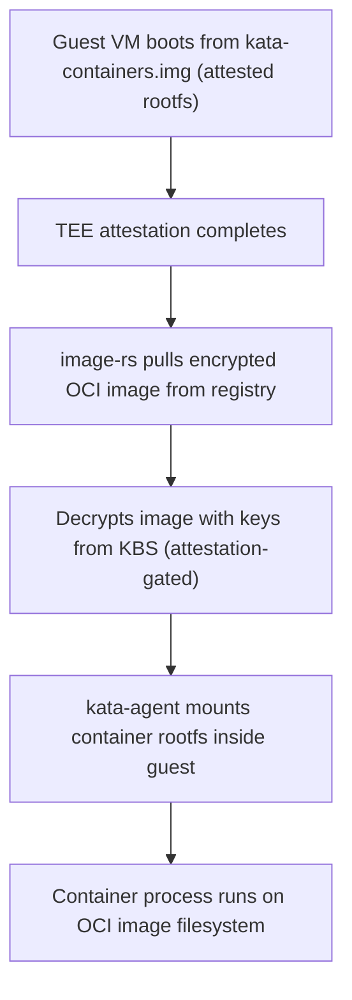

<!-- context-for-ai
type: detail-doc
parent: BEP-1051 (Kata Containers Agent Backend)
scope: Agent configuration schema for Kata backend and host deployment requirements
depends-on: []
key-decisions:
  - New [kata] section in agent unified config
  - Cloud Hypervisor as default hypervisor, QEMU as fallback
  - Config validated at agent startup with fail-fast on missing paths
-->

# BEP-1051: 설정과 배포

## 요약

이 문서는 하이퍼바이저 선택, VFIO 설정, VM 자원 기본값, 호스트 배포 전제 조건을 포함해 Kata backend 의 설정 스키마 추가 사항을 정의한다. `[kata]` 섹션은 에이전트 통합 설정(`src/ai/backend/agent/config/unified.py` 의 `AgentUnifiedConfig`)에 추가한다.

## 현재 설계

에이전트 backend 는 `local_config.agent_common.backend` 로 선택하고, 이 값은 `AgentBackend` enum(`src/ai/backend/agent/types.py:36`)을 읽는다. `get_agent_discovery()` 함수(`types.py:84`)가 backend 패키지를 동적으로 가져온다.

Docker 전용 설정은 `[container]` 섹션에 있다.

```toml
[container]
stats-type = "docker"
sandbox-type = "jail"
scratch-root = "/tmp/scratches"
```

현재 스키마에는 VM 이나 하이퍼바이저 설정이 없다.

## 제안 설계

### backend 선택

```toml
[agent]
backend = "kata"  # "docker" | "kubernetes" | "kata"
```

`backend = "kata"` 이면 에이전트가 `ai.backend.agent.kata` 를 가져오고 `KataAgentDiscovery` 를 인스턴스화한다.

### Kata 설정 섹션

```toml
[kata]
# --- Hypervisor ---
hypervisor = "cloud-hypervisor"  # "cloud-hypervisor" | "qemu" | "dragonball"

# --- VM Defaults ---
default-vcpus = 2               # Initial vCPUs per VM (hot-plugged as needed)
default-memory-mb = 2048        # Initial memory per VM in MB
vm-overhead-mb = 64             # Per-VM VMM process + guest kernel + kata-agent overhead (MB), deducted from host capacity

# --- Guest VM Image (NOT the container image — see note below) ---
kernel-path = "/opt/kata/share/kata-containers/vmlinux.container"
initrd-path = ""                # Empty = use rootfs image instead of initrd
rootfs-path = "/opt/kata/share/kata-containers/kata-containers.img"

# --- Storage ---
shared-fs = "virtio-fs"         # "virtio-fs" | "virtio-9p" (9p deprecated)
virtiofsd-path = "/opt/kata/libexec/virtiofsd"
virtio-fs-cache-size = 0        # DAX window in MB; 0 = disabled (recommended default)

# --- Networking ---
network-model = "tcfilter"      # "tcfilter" | "macvtap"

# --- VFIO ---
enable-iommu = true
hotplug-vfio = "root-port"      # "root-port" | "bridge-port" | "no-port"

# --- Containerd ---
containerd-socket = "/run/containerd/containerd.sock"
kata-runtime-class = "kata"     # RuntimeClass name registered in containerd

# --- Confidential Computing (CoCo-by-default) ---
confidential-guest = true       # CoCo is always enabled; no non-CoCo mode
guest-attestation = "tdx"       # "tdx" | "sev-snp" (required)
kbs-endpoint = "http://kbs.internal:8080"  # Key Broker Service for sealed secrets

# --- Storage (guest-side direct mount) ---
kernel-modules = ["nfs", "nfsv4"]  # Modules loaded during create_sandbox()
guest-hook-path = "/usr/share/oci/hooks"  # OCI prestart hook path in guest rootfs

[[kata.storage-mounts]]
fs-type = "nfs4"
source = "storage-server:/exports/vfstore"
mountpoint = "/mnt/vfstore"
options = "vers=4.1,rsize=1048576,wsize=1048576"

[[kata.storage-mounts]]
fs-type = "lustre"
source = "lustre-mgs@tcp:/scratch"
mountpoint = "/mnt/lustre"
options = ""

[kata.storage-nic]
device = "ib0"
address = "10.0.100.5/24"
gateway = "10.0.100.1"
```

### Guest VM 이미지와 컨테이너 이미지

Kata Containers 는 혼동하면 안 되는 **두 파일 시스템 계층**을 사용한다.

1. **Guest VM rootfs**(위의 `rootfs-path`): kata-agent, systemd, 필수 유틸리티만 담은 최소 mini-OS 이미지다. VM 의 boot 디스크다. 모든 VM 이 공유하고 읽기 전용이며, guest 안의 `/dev/pmem*` 장치에 DAX 로 마운트한다. 사용자의 컨테이너 이미지가 **아니다**. VM 템플릿에 해당하는 인프라 수준 자산이다.

2. **컨테이너 이미지**(예: `cr.backend.ai/stable/python-tensorflow:2.15-py312-cuda12.3`): 사용자가 선택하고 Backend.AI 이미지 관리 시스템이 해석하는 OCI 이미지다. CoCo 가 기본인 환경에서는 이미지를 **guest 안에서** `image-rs` 로 가져오고 복호화한다. 호스트를 신뢰할 수 없고 이미지 내용을 보면 안 되기 때문이다. registry 자격 증명은 원격 attestation 뒤 KBS(Key Broker Service)로 전달한다.



**CoCo 를 위한 이미지 관리 변경:** 이미지 registry 와 이미지 선택 흐름은 그대로다(manager 가 이미지 참조를 같은 방식으로 해석한다). pull 방식만 다르다. 호스트 측 containerd pull 대신 guest TEE 안의 `image-rs` 가 pull, 무결성 검증, 복호화를 맡는다. 에이전트는 호스트에서 이미지 존재를 확인할 수 없고, 이미지 참조를 Kata shim 에 전달한 뒤 kernel runner 의 ZMQ 연결을 기다린다.

### Pydantic 설정 모델

```python
class KataConfig(BaseConfigSchema):
    hypervisor: Literal["cloud-hypervisor", "qemu", "dragonball"] = Field(
        default="cloud-hypervisor",
        validation_alias=AliasChoices("hypervisor"),
    )

    # VM defaults
    default_vcpus: int = Field(
        default=2,
        validation_alias=AliasChoices("default_vcpus", "default-vcpus"),
    )
    default_memory_mb: int = Field(
        default=2048,
        validation_alias=AliasChoices("default_memory_mb", "default-memory-mb"),
    )
    vm_overhead_mb: int = Field(
        default=64,
        description="VMM process + guest kernel + kata-agent overhead (MB)",
        validation_alias=AliasChoices("vm_overhead_mb", "vm-overhead-mb"),
    )

    # Guest image
    kernel_path: Path = Field(
        default=Path("/opt/kata/share/kata-containers/vmlinux.container"),
        validation_alias=AliasChoices("kernel_path", "kernel-path"),
    )
    initrd_path: Path | None = Field(
        default=None,
        validation_alias=AliasChoices("initrd_path", "initrd-path"),
    )
    rootfs_path: Path = Field(
        default=Path("/opt/kata/share/kata-containers/kata-containers.img"),
        validation_alias=AliasChoices("rootfs_path", "rootfs-path"),
    )

    # Storage
    shared_fs: Literal["virtio-fs", "virtio-9p"] = Field(
        default="virtio-fs",
        validation_alias=AliasChoices("shared_fs", "shared-fs"),
    )
    virtiofsd_path: Path = Field(
        default=Path("/opt/kata/libexec/virtiofsd"),
        validation_alias=AliasChoices("virtiofsd_path", "virtiofsd-path"),
    )
    virtio_fs_cache_size: int = Field(
        default=0,
        validation_alias=AliasChoices("virtio_fs_cache_size", "virtio-fs-cache-size"),
    )

    # Networking
    network_model: Literal["tcfilter", "macvtap"] = Field(
        default="tcfilter",
        validation_alias=AliasChoices("network_model", "network-model"),
    )

    # VFIO
    enable_iommu: bool = Field(
        default=True,
        validation_alias=AliasChoices("enable_iommu", "enable-iommu"),
    )
    hotplug_vfio: Literal["root-port", "bridge-port", "no-port"] = Field(
        default="root-port",
        validation_alias=AliasChoices("hotplug_vfio", "hotplug-vfio"),
    )

    # Containerd
    containerd_socket: Path = Field(
        default=Path("/run/containerd/containerd.sock"),
        validation_alias=AliasChoices("containerd_socket", "containerd-socket"),
    )
    kata_runtime_class: str = Field(
        default="kata",
        validation_alias=AliasChoices("kata_runtime_class", "kata-runtime-class"),
    )

    # Confidential computing (CoCo-by-default)
    confidential_guest: bool = Field(
        default=True,
        description="CoCo is always enabled; no non-CoCo Kata mode",
        validation_alias=AliasChoices("confidential_guest", "confidential-guest"),
    )
    guest_attestation: Literal["tdx", "sev-snp"] = Field(
        default="tdx",
        description="TEE attestation type (required)",
        validation_alias=AliasChoices("guest_attestation", "guest-attestation"),
    )
    kbs_endpoint: str = Field(
        default="",
        description="Key Broker Service endpoint for sealed secrets and image decryption keys",
        validation_alias=AliasChoices("kbs_endpoint", "kbs-endpoint"),
    )

    # Storage (guest-side direct mount)
    storage_mounts: list[StorageMountSpec] = Field(
        default_factory=list,
        description="Storage volumes to mount inside the guest VM via native NFS/Lustre client",
        validation_alias=AliasChoices("storage_mounts", "storage-mounts"),
    )
    storage_nic: StorageNicSpec | None = Field(
        default=None,
        description="Storage network interface (VFIO passthrough IPoIB/Ethernet) IP configuration",
        validation_alias=AliasChoices("storage_nic", "storage-nic"),
    )

    # Guest hooks
    guest_hook_path: str = Field(
        default="/usr/share/oci/hooks",
        description="Path inside guest rootfs where OCI prestart hooks are scanned",
        validation_alias=AliasChoices("guest_hook_path", "guest-hook-path"),
    )
    kernel_modules: list[str] = Field(
        default_factory=lambda: ["nfs", "nfsv4"],
        description="Kernel modules to load inside guest during sandbox creation",
        validation_alias=AliasChoices("kernel_modules", "kernel-modules"),
    )


class StorageMountSpec(BaseConfigSchema):
    """A storage volume to mount directly inside the guest VM."""
    fs_type: str = Field(description="Filesystem type: nfs, nfs4, lustre, wekafs")
    source: str = Field(description="Mount source (e.g., 'storage-server:/exports/vfstore')")
    mountpoint: str = Field(description="Guest-side mount point (e.g., '/mnt/vfstore')")
    options: str = Field(default="", description="Mount options (e.g., 'vers=4.1,rdma')")


class StorageNicSpec(BaseConfigSchema):
    """Storage network interface IP configuration for guest VM."""
    device: str = Field(description="Guest-side network device name (e.g., 'ib0', 'eth1')")
    address: str = Field(description="IP address with prefix (e.g., '10.0.100.5/24')")
    gateway: str = Field(default="", description="Gateway address (optional)")
```

`AgentUnifiedConfig` 통합:

```python
class AgentUnifiedConfig(BaseConfigSchema):
    # ... existing fields ...
    kata: KataConfig | None = None  # Only present when backend = "kata"
```

### 시작 시 검증

`KataAgent.__ainit__()` 에서 다음을 검증한다.

1. `kernel_path` 가 있고 읽을 수 있다
2. `rootfs_path`(또는 `initrd_path`)가 있고 읽을 수 있다
3. `virtiofsd_path` 가 있고 실행할 수 있다
4. `containerd_socket` 이 있고 연결할 수 있다
5. containerd 설정에 Kata runtime class 등록
6. `enable_iommu` 이면 커널의 IOMMU 활성화(`/sys/class/iommu` 가 비어 있지 않다)
7. `vhost_vsock` 커널 모듈 로드

검증에 실패하면 실패 원인을 설명하는 에러 메시지와 함께 즉시 실패한다.

### 하이퍼바이저 비교

| 기능 | Cloud Hypervisor | QEMU | Dragonball |
|---------|-----------------|------|------------|
| boot 시간 | 약 125-200ms | 약 300-500ms | 약 100ms (추정, 공개 벤치마크 없음) |
| 메모리 오버헤드 | 약 15MB | 약 60MB | 약 10MB |
| VFIO passthrough | 예 | 예 | 예 |
| virtio-fs | 예 | 예 | 예 |
| CPU/메모리 hotplug | 예 | 예 | 예 |
| Confidential(TDX/SEV) | 예 | 예 | 아니오 |
| 코드 크기 | 약 50K LOC (Rust) | 약 2M LOC (C) | Rust (in-process) |
| 성숙도 | production | production | production (Alibaba) |

**기본값: Cloud Hypervisor**. 기능 완성도, 보안(Rust 코드베이스가 작다), 성능의 균형이 가장 좋다. QEMU 는 구형 하드웨어나 x86 이 아닌 아키텍처에서 confidential computing 을 할 때만 권장한다.

## 호스트 배포 요구 사항

### 커널과 하드웨어

- KVM 이 활성화된 Linux 커널 5.10 이상
- Intel VT-x/VT-d 또는 AMD-V/AMD-Vi(IOMMU)
- 커널 파라미터: `intel_iommu=on iommu=pt`(Intel) 또는 `amd_iommu=on iommu=pt`(AMD)
- 커널 모듈: `kvm`, `kvm_intel`/`kvm_amd`, `vfio`, `vfio_pci`, `vfio_iommu_type1`, `vhost_vsock`

### 소프트웨어

- Kata Containers 3.x (`kata-runtime`, guest kernel, guest rootfs/initrd)
- Kata shim(`io.containerd.kata.v2`)이 있는 containerd 1.7 이상
- virtiofsd (Kata 설치에 포함)

### containerd 설정

```toml
# /etc/containerd/config.toml
[plugins."io.containerd.grpc.v1.cri".containerd.runtimes.kata]
  runtime_type = "io.containerd.kata.v2"
  privileged_without_host_devices = true

  [plugins."io.containerd.grpc.v1.cri".containerd.runtimes.kata.options]
    ConfigPath = "/opt/kata/share/defaults/kata-containers/configuration.toml"
```

### VFIO GPU 바인딩

VFIO passthrough 에 사용할 GPU 는 `nvidia` 드라이버에서 바인딩을 해제하고 `vfio-pci` 에 바인딩해야 한다.

```bash
# Identify GPU PCI addresses
lspci -nn | grep -i nvidia

# Bind to vfio-pci (example for 0000:41:00.0)
echo "0000:41:00.0" > /sys/bus/pci/devices/0000:41:00.0/driver/unbind
echo "10de 2684" > /sys/bus/pci/drivers/vfio-pci/new_id

# Verify
ls -la /dev/vfio/
```

영구 바인딩에는 `driverctl` 이나 modprobe 설정을 사용한다.

## 구현 참고

- `KataConfig` 는 에이전트 시작 시 검증한다. 전제 조건이 충족되지 않으면 에이전트는 시작을 거부한다
- `generate-sample` CLI 명령은 주석과 함께 `[kata]` 섹션을 포함해야 한다
- 하이퍼바이저 바이너리 경로는 `kata-runtime env` 출력에서 자동으로 탐지할 수 있다
- `[container]` 섹션의 `scratch-root` 와 `port-range` 설정은 KataAgent 가 재사용한다
