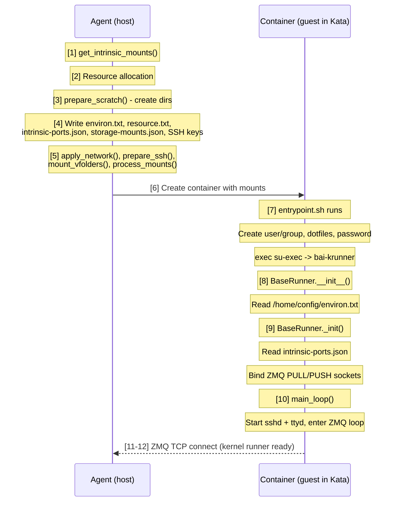
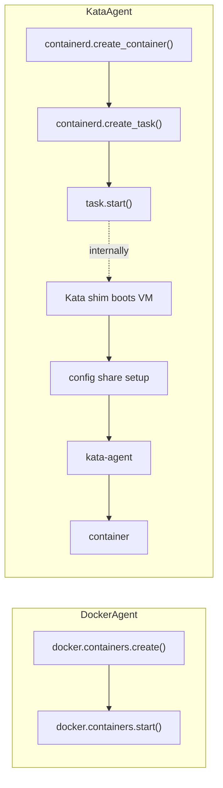

<!-- context-for-ai
type: detail-doc
parent: BEP-1051 (Kata Containers Agent Backend)
scope: KataAgent, KataKernel, KataKernelCreationContext implementation; kernel runner boot sequence in guest VM
depends-on: [configuration-deployment.md, storage-compatibility.md]
key-decisions:
  - Full AbstractAgent implementation with Kata-specific lifecycle
  - Container management via containerd gRPC with Kata shim
  - VFolder storage via direct guest-side NFS/Lustre mount (RDMA-preserving); virtio-fs only for scratch/config
  - All executables (krunner, Python libs) baked into attested guest rootfs (CoCo: host untrusted)
  - ZMQ TCP for agent↔kernel-runner communication (already TCP-based, works across VM boundary)
  - Agent socket (/opt/kernel/agent.sock) not needed for Kata (only used by jail/C binaries, both skipped)
  - entrypoint.sh requires Kata-specific variant (skip LD_PRELOAD/libbaihook, skip jail references)
-->

# BEP-1051: KataAgent backend

## 요약

KataAgent 는 Kata Containers 3.x 로 경량 VM 안의 컨테이너를 관리하는 세 번째 `AbstractAgent` 구현이다. Kata runtime shim 으로 컨테이너를 생성하기 위해 containerd 의 gRPC API 와 통신하고, Docker API 호출을 containerd 의 native 클라이언트 API(container, task, sandbox 서비스)로 대체한다.

## 현재 설계

### backend 추상화

기존 backend enum 과 동적 import 방식(`src/ai/backend/agent/types.py`)은 다음과 같다.

```python
class AgentBackend(enum.StrEnum):
    DOCKER = "docker"
    KUBERNETES = "kubernetes"
    DUMMY = "dummy"

def get_agent_discovery(backend: AgentBackend) -> AbstractAgentDiscovery:
    agent_mod = importlib.import_module(f"ai.backend.agent.{backend.value}")
    return cast(AbstractAgentDiscovery, agent_mod.get_agent_discovery())
```

`DockerAgent`(`src/ai/backend/agent/docker/agent.py`)는 `aiodocker` 로 컨테이너를 관리한다.
- `docker.containers.create(container_config)` 로 컨테이너를 생성한다
- `update_nested_dict(container_config, plugin_args)` 로 가속기 plugin 인자를 병합한다
- `docker.events.subscribe()` 로 이벤트를 감시한다
- Docker bind mount 로 스토리지를 공유한다(오버헤드가 없고 커널 VFS 를 직접 사용한다)

### 컨테이너 내부의 세 패키지 구조

Backend.AI 는 모든 컨테이너 안에서 소프트웨어 계층 세 개를 실행한다.

| 패키지 | 역할 | lifecycle |
|---------|------|-----------|
| `ai.backend.runner` (`entrypoint.sh` + 정적 바이너리) | Bootstrap: 사용자/그룹 설정, SSH 키, LD_PRELOAD, 비밀번호 생성 | 컨테이너 시작 시 한 번 실행하고 `exec` 로 주 프로그램을 실행한다 |
| `ai.backend.kernel` (`BaseRunner` 하위 클래스) | 장시간 실행 프로세스(`bai-krunner`): 에이전트에서 명령을 받아 사용자 코드를 실행하고 서비스를 관리한다 | 컨테이너 수명 동안 실행한다 |
| `ai.backend.agent` (호스트 측) | scratch 디렉터리에 설정 파일을 쓰고 ZMQ TCP 로 kernel runner 와 통신한다 | 호스트에서 실행한다 |

**Boot 순서:**



### /home/config 의 설정 파일

에이전트는 컨테이너 생성 전에 `scratch_dir/config/` 에 여러 파일을 기록한다. 이 파일들은 컨테이너 안의 `/home/config` 에 읽기 전용으로 마운트된다.

| 파일 | 기록하는 쪽 | 읽는 쪽 | 목적 |
|------|--------|--------|---------|
| `environ.txt` | 에이전트(`docker/agent.py:844-854`) | **kernel runner**(`BaseRunner.__init__`, 187번째 줄) | `key=value` 짝. 모든 하위 프로세스 실행에 사용하도록 `child_env` 와 `os.environ` 에 로드한다 |
| `resource.txt` | 에이전트(`docker/agent.py:856-867`) | **에이전트만**(복구: `resources.py:887-910`, `scratch/utils.py:100-103`) | 직렬화한 `KernelResourceSpec`. 자원 슬롯 할당, 마운트, 장치 매핑. kernel runner 는 읽지 않는다 |
| `intrinsic-ports.json` | 에이전트 | **kernel runner**(`BaseRunner._init`, 244번째 줄) | 서비스 이름을 포트에 매핑한다: `{"replin": 2000, "replout": 2001, "sshd": 2200, "ttyd": 7681}` |
| `ssh/id_cluster` | 에이전트 | **kernel runner**(`intrinsic.py:89-130`) | 다중 노드 세션에서 컨테이너 간 SSH 용 개인 키 |
| `ssh/id_cluster.pub` | 에이전트 | **kernel runner**(`intrinsic.py:130-140`) | `~/.ssh/authorized_keys` 에 추가하는 공개 키 |
| `ssh/port-mapping.json` | 에이전트 | **kernel runner**(`intrinsic.py:100-112`) | 클러스터 노드 SSH 포트 매핑. `~/.ssh/config` 에 기록한다 |
| `docker-creds.json` | 에이전트 | 컨테이너 bootstrap | Docker 전용이다. **Kata 에는 사용하지 않는다.** 이미지는 KBS 가 전달한 자격 증명으로 `image-rs` 가 guest 측에서 내려받는다 |
| `environ_base.txt` | 에이전트(백업 사본) | 에이전트(복구) | hot update diff 용 environ.txt 기준 사본 |
| `resource_base.txt` | 에이전트(백업 사본) | 에이전트(복구) | hot update diff 용 resource.txt 기준 사본 |

**Kata 의 핵심:** `environ.txt` 와 `intrinsic-ports.json` 은 kernel runner 프로세스가 시작하기 **전에** 있어야 한다. 초기화 중에 읽기 때문이다. `resource.txt` 는 에이전트(호스트 측)가 재시작 뒤 복구와 자원 사용 추적에만 읽고, guest runtime 으로 전달되지 않는다.

### 에이전트 소켓(agent.sock): Kata 에서 생략

Docker 에이전트 소켓(`/opt/kernel/agent.sock`)은 jail/C 바이너리(PID 변환, jail 상태)가 사용하는 ZMQ REP 소켓이다. **Kata 에는 사용하지 않는다.** jail sandbox 를 적용할 수 없고(VM 경계가 더 강하다) PID 변환도 의미가 없다(guest PID 는 격리된다). 에이전트와 kernel runner 의 주 통신(ZMQ PUSH/PULL)은 TCP 기반이고 Calico 네트워크를 변경 없이 통과한다.

## 제안 설계

### 패키지 구조

```
src/ai/backend/agent/kata/
├── __init__.py              # KataAgentDiscovery + get_agent_discovery()
├── agent.py                 # KataAgent + KataKernelCreationContext
├── kernel.py                # KataKernel
├── resources.py             # load_resources(), scan_available_resources()
├── intrinsic.py             # CPU/Memory compute plugins for Kata
└── containerd_client.py     # Async containerd gRPC client wrapper
```

### AgentBackend enum 확장

```python
# src/ai/backend/agent/types.py
class AgentBackend(enum.StrEnum):
    DOCKER = "docker"
    KUBERNETES = "kubernetes"
    KATA = "kata"           # NEW
    DUMMY = "dummy"
```

### KataAgentDiscovery

```python
# src/ai/backend/agent/kata/__init__.py
class KataAgentDiscovery(AbstractAgentDiscovery):
    def get_agent_cls(self) -> type[AbstractAgent[Any, Any]]:
        return KataAgent

    async def load_resources(self, etcd, local_config):
        return await load_resources(etcd, local_config)

    async def scan_available_resources(self, compute_device_types):
        return await scan_available_resources(compute_device_types)

    async def prepare_krunner_env(self, local_config):
        # CoCo: all krunner binaries and Python libraries are baked into
        # the attested guest rootfs. The host is untrusted and must not
        # be a source of executables. No Docker volumes or virtio-fs
        # binary sharing needed.
        return await prepare_krunner_env_kata(local_config)

def get_agent_discovery() -> AbstractAgentDiscovery:
    return KataAgentDiscovery()
```

### KataAgent

```python
class KataAgent(AbstractAgent[KataKernel, KataKernelCreationContext]):
```

주요 메서드 재정의는 다음과 같다.

**`__ainit__()`**: containerd 클라이언트를 초기화하고 Kata runtime 가용성을 검증한다.

```python
async def __ainit__(self):
    await super().__ainit__()
    kata_config = self.local_config.kata
    self._containerd = ContainerdClient(kata_config.containerd_socket)
    await self._containerd.connect()

    # Validate Kata runtime is registered
    runtime_info = await self._containerd.get_runtime_info(
        kata_config.kata_runtime_class
    )
    if not runtime_info:
        raise AgentError("Kata runtime not found in containerd")

    self._hypervisor = kata_config.hypervisor
    log.info("KataAgent initialized with hypervisor: {}", self._hypervisor)
```

**컨테이너 lifecycle**: DockerAgent 와의 핵심 차이다.



**`destroy_kernel()`**: containerd 로 중지하고 제거한다.

```python
async def destroy_kernel(self, kernel_id, container_id):
    await self._containerd.stop_task(container_id)
    await self._containerd.delete_task(container_id)
    await self._containerd.delete_container(container_id)
    # Kata shim automatically tears down VM when last container is removed
```

**이벤트 감시**: Docker 대신 containerd 이벤트를 구독한다.

```python
async def _handle_container_events(self):
    async for event in self._containerd.subscribe_events():
        if event.topic == "/tasks/exit":
            kernel_id = self._extract_kernel_id(event)
            await self._handle_kernel_exit(kernel_id, event.exit_status)
```

**에이전트 소켓 handler 없음**: `handle_agent_socket()` 을 시작하지 않는다. 이 handler 가 맡는 jail sandbox 와 PID 변환 동작은 VM 안에서 모두 의미가 없다. socat relay 컨테이너 의존성도 없어진다.

### KataKernelCreationContext

`DockerKernelCreationContext` 와 다른 주요 재정의는 다음과 같다.

**`prepare_scratch()`**: virtio-fs 로 공유할 디렉터리를 생성한다.

VM boot 디스크(`kata-containers.img`)는 kata-agent 만 담은 읽기 전용 공유 mini-OS 다. scratch 디렉터리는 목적이 다르고 세션별 설정과 작업 공간을 담는다.

- `/home/config`(RO): 에이전트가 쓴 설정 파일. entrypoint.sh 와 kernel runner 가 시작할 때 읽는다
- `/home/work`(RW): 사용자의 영구 작업 공간이자 vfolder 마운트 지점

```python
async def prepare_scratch(self):
    scratch_dir = self.scratch_root / str(self.kernel_id)
    config_dir = scratch_dir / "config"
    config_dir.mkdir(parents=True, exist_ok=True)
    (scratch_dir / "work").mkdir(parents=True, exist_ok=True)
```

**`write_config_files()`**: environ.txt 와 resource.txt 를 기록한다.

```python
async def write_config_files(self, environ, resource_spec):
    # environ.txt — consumed by BaseRunner.__init__() inside the guest.
    # Every key=value pair becomes part of the child process environment.
    with StringIO() as buf:
        for k, v in environ.items():
            buf.write(f"{k}={v}\n")
        for env in self.computer_docker_args.get("Env", []):
            buf.write(f"{env}\n")
        (self.config_dir / "environ.txt").write_bytes(buf.getvalue().encode("utf8"))

    # resource.txt — read only by the agent (host-side) for recovery.
    # The kernel runner does NOT read this file.
    with StringIO() as buf:
        resource_spec.write_to_file(buf)
        for dev_type, device_alloc in resource_spec.allocations.items():
            device_plugin = self.computers[dev_type].instance
            kvpairs = await device_plugin.generate_resource_data(device_alloc)
            for k, v in kvpairs.items():
                buf.write(f"{k}={v}\n")
        (self.config_dir / "resource.txt").write_bytes(buf.getvalue().encode("utf8"))

    # intrinsic-ports.json — consumed by BaseRunner._init__() for
    # ZMQ socket binding and service port assignment.
    ports = {
        "replin": self._repl_in_port,
        "replout": self._repl_out_port,
        "sshd": 2200,
        "ttyd": 7681,
    }
    (self.config_dir / "intrinsic-ports.json").write_bytes(
        json.dumps(ports).encode("utf8")
    )

    # storage-mounts.json — consumed by the guest prestart hook
    # (OCI hook at /usr/share/oci/hooks/prestart/setup-storage.sh).
    # Contains volume mount specs and storage NIC IP for the guest
    # boot script to configure before the container starts.
    kata_config = self.local_config.kata
    storage_config = {
        "storage_nic": (
            {
                "device": kata_config.storage_nic.device,
                "address": kata_config.storage_nic.address,
                "gateway": kata_config.storage_nic.gateway,
            }
            if kata_config.storage_nic
            else None
        ),
        "volumes": [
            {
                "fs_type": m.fs_type,
                "source": m.source,
                "mountpoint": m.mountpoint,
                "options": m.options,
            }
            for m in kata_config.storage_mounts
        ],
    }
    (self.config_dir / "storage-mounts.json").write_bytes(
        json.dumps(storage_config).encode("utf8")
    )
```

guest prestart hook(`/usr/share/oci/hooks/prestart/setup-storage.sh`, attested guest rootfs 에 포함)은 `create_container()` 중에 이 파일을 읽고 다음을 수행한다.
1. `ip addr add` 로 storage NIC IP(IPoIB 또는 Ethernet)를 설정한다
2. guest 커널의 native NFS/Lustre 클라이언트로 각 볼륨을 마운트한다
3. 그 뒤 지정한 마운트 지점에서 컨테이너 bind mount 로 볼륨을 사용할 수 있다

**`get_intrinsic_mounts()`**: Kata 에 불필요하거나 맞지 않는 마운트를 생략한다.

```python
async def get_intrinsic_mounts(self) -> Sequence[Mount]:
    mounts = []
    # KEEP: config dir via virtio-fs (host-originated config delivery)
    mounts.append(Mount(MountTypes.BIND, self.config_dir, Path("/home/config"),
                        MountPermission.READ_ONLY))
    # /home/work is on the guest disk (part of guest rootfs), NOT a virtio-fs mount.
    # VFolder subdirectories are bind-mounted into /home/work/{vfolder}
    # from guest-side NFS/Lustre mounts by the OCI prestart hook.
    # CHANGE: /tmp as guest-side tmpfs (no need to cross VM boundary)
    mounts.append(Mount(MountTypes.TMPFS, None, Path("/tmp"),
                        MountPermission.READ_WRITE))
    # SKIP: /home/work — already exists on guest disk
    # SKIP: timezone — baked into guest rootfs
    # SKIP: lxcfs — guest kernel provides accurate /proc and /sys
    # SKIP: agent.sock — only used by jail/C binaries, both skipped for Kata
    # SKIP: domain socket proxies — UDS cannot cross VM boundary
    # SKIP: deep learning samples — deprecated Docker volume
    return mounts
```

**`mount_krunner()`**: CoCo 에서는 아무것도 하지 않는다. 모든 실행 파일이 attested rootfs 에 있다.

```python
async def mount_krunner(self, resource_spec, environ):
    # CoCo-by-default: all krunner executables (su-exec, entrypoint.sh,
    # dropbearmulti, etc.) and Python libraries (ai.backend.kernel,
    # ai.backend.helpers) are baked into the attested guest rootfs.
    # The host is untrusted — no host→guest executable sharing via virtio-fs.
    #
    # SKIP: krunner binary mounts — already in guest rootfs
    # SKIP: Python library mounts — already in guest rootfs
    # SKIP: libbaihook.so + LD_PRELOAD — guest kernel provides accurate sysconf
    # SKIP: jail binary — VM boundary is stronger isolation
    # SKIP: accelerator LD_PRELOAD hooks — VFIO passthrough makes GPU
    #        natively visible in guest; no hook libraries needed
    pass
```

**`apply_accelerator_allocation()`**: plugin 에서 VFIO 장치 정보를 모은다.

```python
async def apply_accelerator_allocation(self):
    vfio_devices = []
    for dev_type, device_alloc in self.resource_spec.allocations.items():
        computer = self.computers[dev_type].instance
        plugin_args = await computer.generate_docker_args(None, device_alloc)
        # CUDAVFIOPlugin returns {"_kata_vfio_devices": [...]}
        if "_kata_vfio_devices" in plugin_args:
            vfio_devices.extend(plugin_args["_kata_vfio_devices"])
    self._vfio_devices = vfio_devices
```

**`spawn()`**: Kata runtime 으로 containerd 를 통해 컨테이너를 생성한다.

```python
async def spawn(self):
    container_config = {
        "image": self.image_ref,
        "runtime": {"name": "io.containerd.kata.v2"},
        "env": self.environ,
        "mounts": self._build_container_mounts(),  # config via virtio-fs + vfolder bind mounts (guest-internal)
        "labels": self._build_labels(),
        "annotations": {
            "io.katacontainers.config.hypervisor.hotplug_vfio_on_root_bus": "true",
            **self._build_vfio_annotations(),
        },
    }
    container = await self._containerd.create_container(
        container_id=str(self.kernel_id),
        config=container_config,
    )
    task = await self._containerd.create_task(container.id)
    await task.start()
    return container.id
```

### Kata 전용 entrypoint.sh

runner 의 `entrypoint.sh` 에는 Kata 전용 변형이 필요하다. Docker 판은 맞지 않거나 불필요한 여러 동작을 수행한다.

| 동작 | Docker | Kata | 이유 |
|-----------|--------|------|--------|
| 사용자/그룹 생성 | 예 | **예** | guest 안에서 같은 사용자 설정이 필요하다 |
| `LD_PRELOAD` → `/etc/ld.so.preload` | 예 | **아니오** | libbaihook.so 를 마운트하지 않는다. guest 커널이 정확한 sysconf 를 제공한다 |
| `chown agent.sock` | 예 | **아니오** | 에이전트 소켓을 마운트하지 않는다 |
| dotfile 추출 | 예 | **예** | 같은 사용자 환경 설정이 필요하다 |
| SSH 키 설정 | 예 | **예** | 같은 컨테이너 간 SSH 지원이 필요하다 |
| 비밀번호 생성 | 예 | **예** | 같은 세션 보안 모델이다 |
| `exec su-exec` | 예 | **예** | 사용자 UID/GID 로 같은 권한 강하를 한다 |

Kata 변형은 `LD_PRELOAD` 블록과 `chown agent.sock` 줄을 생략하고 나머지는 같다.

### KataKernel

```python
class KataKernel(AbstractKernel):
    container_id: ContainerId
    sandbox_id: str          # Kata sandbox (VM) identifier

    async def create_code_runner(self):
        # The agent↔kernel-runner communication channel is ZMQ TCP,
        # which already works across the VM boundary without modification.
        #
        # Docker: agent connects to tcp://localhost:{host_mapped_port}
        #         (Docker maps container port to a host port)
        # Kata:   agent connects to tcp://{guest_ip}:{container_port}
        #         (guest IP assigned by Calico CNI, reachable via TC filter)
        #
        # The kernel runner inside the guest binds:
        #   insock  = tcp://*:{repl_in_port}   (ZMQ PULL)
        #   outsock = tcp://*:{repl_out_port}   (ZMQ PUSH)
        # These ports come from /home/config/intrinsic-ports.json.
        return DockerCodeRunner(
            kernel_id=self.kernel_id,
            kernel_host=self._guest_ip,
            repl_in_port=self._repl_in_port,
            repl_out_port=self._repl_out_port,
            exec_timeout=self.exec_timeout,
            client_features=client_features,
        )

    async def check_status(self):
        status = await self._containerd.get_task_status(self.container_id)
        return status == "running"
```

`DockerCodeRunner` 클래스(또는 이름을 변경한 `CodeRunner` 기반)는 전송 수단이 TCP 위의 ZMQ 뿐이므로 재사용할 수 있다. `get_repl_in_addr()` 는 `tcp://{host}:{port}` 를 반환한다. 차이는 주소다. Docker 는 포트 매핑과 함께 `localhost` 를 사용하고 Kata 는 Calico 가 할당한 guest IP 로 포트에 직접 접근한다.

### ContainerdClient

containerd 의 gRPC API 를 감싸는 비동기 래퍼다. **단일 컨테이너 세션**에서는 표준 `containers.v1` / `tasks.v1` API 로 컨테이너마다 Kata sandbox(VM)를 하나씩 둔다. **다중 컨테이너 세션**(단일 호스트의 클러스터)에서는 containerd Sandbox API(`sandbox.v1`, containerd v2 이상)로 공유 sandbox 를 먼저 생성하고 그 안에 컨테이너를 추가한다.

```python
class ContainerdClient:
    def __init__(self, socket_path: Path):
        self._socket = socket_path

    async def connect(self): ...
    async def close(self): ...

    # Image operations
    async def list_images(self) -> list[ImageInfo]: ...
    async def pull_image(self, ref: str, auth: dict | None = None): ...

    # Sandbox operations (containerd v2+ Sandbox API)
    # Required for multi-container sessions sharing a single Kata VM.
    # Without the Sandbox API, each container creates a separate VM.
    async def create_sandbox(self, sandbox_id: str, runtime: str,
                             config: dict) -> SandboxInfo: ...
    async def stop_sandbox(self, sandbox_id: str): ...
    async def delete_sandbox(self, sandbox_id: str): ...

    # Container operations
    async def create_container(self, container_id: str, config: dict,
                               sandbox_id: str | None = None) -> ContainerInfo: ...
    async def delete_container(self, container_id: str): ...

    # Task operations (a "task" is a running process in containerd)
    async def create_task(self, container_id: str) -> TaskInfo: ...
    async def start_task(self, container_id: str): ...
    async def stop_task(self, container_id: str, timeout: int = 10): ...
    async def delete_task(self, container_id: str): ...
    async def get_task_status(self, container_id: str) -> str: ...

    # Exec (run command inside running container)
    async def exec_in_container(self, container_id: str,
                                command: list[str]) -> ExecResult: ...

    # Events
    async def subscribe_events(self) -> AsyncIterator[Event]: ...

    # Runtime info
    async def get_runtime_info(self, runtime_class: str) -> dict | None: ...
```

이 클라이언트는 `grpcio`(비동기에는 `grpclib`)로 containerd 의 Unix 소켓과 통신한다. proto 정의는 containerd API(`containerd.services.containers.v1`, `containerd.services.tasks.v1`, `containerd.services.sandbox.v1`)에서 가져온다.

**API 선택 이유:** containerd 클라이언트 API(`containers.v1`, `tasks.v1`, `sandbox.v1`)가 Kubernetes 가 아닌 서비스에 맞는 프로그래밍 인터페이스다. CRI `RuntimeService` 는 Kubernetes kubelet 의 API 이므로 직접 사용하면 안 된다. Kata shim v2 API(`containerd.runtime.v2.Task`)는 containerd 내부용이고 외부 클라이언트가 호출하지 않는다.

## 인터페이스 / API

| 클래스 | 확장 | 주요 책임 |
|-------|---------|-------------------|
| `KataAgent` | `AbstractAgent[KataKernel, KataKernelCreationContext]` | containerd 와 Kata shim 을 통한 컨테이너 lifecycle, 에이전트 소켓 handler 없음 |
| `KataKernel` | `AbstractKernel` | guest VM 컨테이너 상태, guest IP 로 ZMQ TCP code runner 연결 |
| `KataKernelCreationContext` | `AbstractKernelCreationContext` | 설정 파일 쓰기(environ.txt, resource.txt, intrinsic-ports.json), VFIO 장치 수집, 마운트 필터링(lxcfs, jail, agent.sock, libbaihook 생략) |
| `KataAgentDiscovery` | `AbstractAgentDiscovery` | plugin 로딩, 자원 스캔, krunner 환경 |
| `ContainerdClient` | (독립) | 비동기 containerd gRPC 래퍼 |

## 구현 참고

- Kata runtime 은 호스트에 설치해야 한다. 에이전트가 설치하지 않는다
- 이미지 형식: 표준 OCI 이미지를 그대로 사용할 수 있고 containerd 가 pull 과 unpack 을 맡는다
- `[container]` 섹션 설정(`scratch-root`, `port-range`)은 Docker 와 Kata backend 가 공유한다
- intrinsic CPU/메모리 plugin(`intrinsic.py`)은 Docker 판을 대부분 재사용할 수 있다. 주요 차이는 자원 한도가 컨테이너 프로세스가 아니라 VM(호스트 cgroup)에 적용된다는 점이다
- 로그 수집: containerd task 는 Docker 로그 스트림과 비슷하게 FIFO pipe 로 stdout/stderr 를 노출한다
- `entrypoint.sh` 에는 `LD_PRELOAD` 설정과 `agent.sock` chown 을 생략하는 Kata 변형이 필요하다. 기존 script 의 조건 분기(`BACKENDAI_CONTAINER_BACKEND=kata` 같은 환경 변수 확인)나 별도 entrypoint 파일로 둘 수 있다
- `DockerCodeRunner` 클래스는 Kata 에 그대로 재사용할 수 있다. 유일한 의존성인 ZMQ TCP 주소 지정이 localhost 대신 guest IP 로도 같게 동작한다
- `resource.txt` 는 에이전트 측 복구 일관성을 위해 `/home/config/` 에 쓰지만 kernel runner 는 절대 읽지 않는다. 하이퍼바이저가 VM 수준에서 자원 한도(vCPU, 메모리)를 강제하고, environ.txt 가 자원 메타데이터를 kernel runner 의 자식 환경에 전달한다
