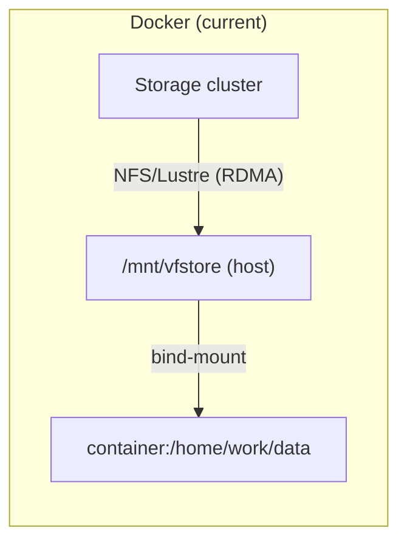
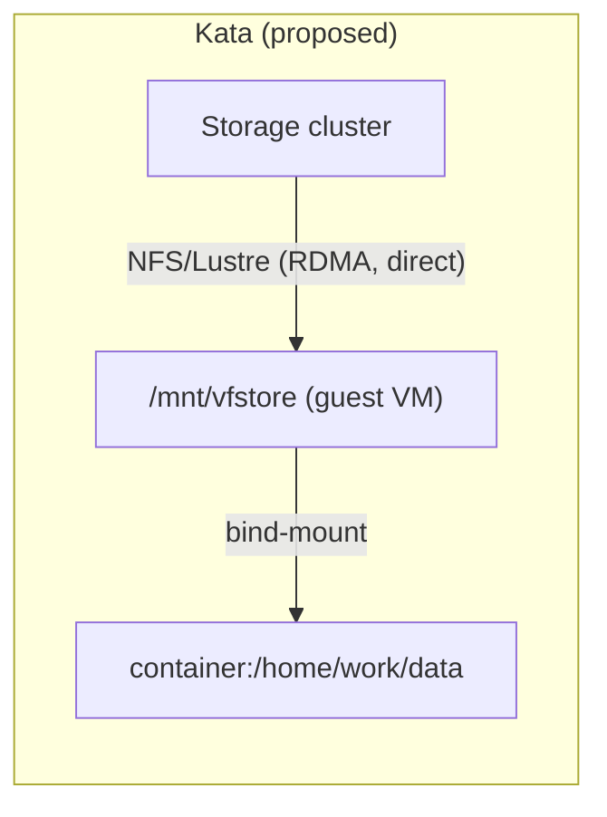

<!-- context-for-ai
type: detail-doc
parent: BEP-1051 (Kata Containers Agent Backend)
scope: Migration strategy and backward compatibility guarantees
depends-on: [kata-agent-backend.md, vfio-accelerator-plugin.md, scheduler-integration.md, configuration-deployment.md]
key-decisions:
  - All changes are additive; no existing behavior modified
  - Kata agents deployed alongside Docker agents in separate scaling groups
  - Rollback is trivial (remove Kata agents, keep schema)
  - VFolder storage via direct guest-side NFS/Lustre/WekaFS mount (native kernel client, RDMA-preserving; mirrors Docker's host-level mount model)
-->
# BEP-1051: 마이그레이션과 호환성

## 요약

KataAgent 도입은 기존 동작을 변경하지 않는 추가형 변경이다. enum 값, package, config section, 안전한 기본값을 가진 DB column 이 새로 생긴다. 기존 Docker 배포와 Kubernetes 배포는 영향을 받지 않는다. 이 문서는 배포 전략, 호환성 보장, 롤백 계획을 다룬다.

## 하위 호환성

### 호환성을 깨는 변경 없음

| 구성 요소 | 변경 | 기존 배포에 미치는 영향 |
|-----------|--------|-------------------------------|
| `AgentBackend` enum | `KATA = "kata"` 추가 | 없음. 기존 `DOCKER`/`KUBERNETES` 값은 그대로다 |
| `AgentRow` | `backend` column 추가 | 없음. 기존 row 는 모두 `server_default="docker"` 다 |
| 에이전트 heartbeat | `backend` field 추가 | 없음. field 가 없으면 manager 가 `"docker"` 를 기본값으로 둔다 |
| 가속기 플러그인 | `cuda_vfio` entry point 추가 | 없음. agent config 가 허용할 때만 적재한다 |
| 자원 그룹 | schema 변경 없음 | 없음. Kata 용 그룹을 새로 생성하고 기존 그룹은 그대로다 |
| Manager RPC | protocol 변경 없음 | 없음. `create_kernel` payload 는 같다 |
| 사용자 API | 변경 없음 | 없음. 사용자는 backend 가 아니라 자원 그룹을 고른다 |
| `AgentMeta` / `AgentInfo` | 기본값을 가진 `backend` field 추가 | 없음. 기본값 `"docker"` 가 기존 동작을 유지한다 |

### package 독립성

`ai.backend.agent.kata` package 를 새로 추가한다.

```
src/ai/backend/agent/
├── docker/          ← unchanged
├── kubernetes/      ← unchanged
├── dummy/           ← unchanged
└── kata/            ← new (only imported when backend="kata")
```

`ai.backend.accelerator.cuda_vfio` package 도 같은 방식으로 독립한다.

```
src/ai/backend/accelerator/
├── cuda_open/       ← unchanged (Docker agents continue using this)
└── cuda_vfio/       ← new (only loaded by Kata agents)
```

### config 호환성

`[kata]` config section 은 `[agent] backend = "kata"` 일 때만 읽는다. Docker agent 는 이 section 을 읽지 않는다. 기존 `agent.toml` 은 변경할 필요가 없다.

## 마이그레이션 절차

### 1단계: 인프라 준비

Backend.AI 변경을 배포하기 전에 다음을 준비한다.

1. **Kata 호스트 준비** (전용 장비 또는 기존 agent node 일부):
   - Kata Containers 3.x 설치 (`kata-runtime`, guest 커널, rootfs image)
   - containerd 에 Kata shim 구성 (`io.containerd.kata.v2`)
   - 커널에서 IOMMU 활성화 - `intel_iommu=on iommu=pt` (Intel) 또는 `amd_iommu=on iommu=pt` (AMD)
   - 커널 모듈 적재 - `vfio`, `vfio_pci`, `vfio_iommu_type1`, `vhost_vsock`
   - 대상 GPU 를 `vfio-pci` driver 에 바인딩
   - 확인 - `kata-runtime check` 통과, `/dev/vfio/` 에 group 장치 존재

2. **각 호스트에서 IOMMU group 확인**:
   ```bash
   for d in /sys/kernel/iommu_groups/*/devices/*; do
     echo "IOMMU Group $(basename $(dirname $(dirname $d))):" \
       "$(lspci -nns $(basename $d))"
   done
   ```
   GPU 마다 자기 IOMMU group 에 있는지, 아니면 audio companion 과만 group 을 공유하는지 확인한다.

### 2단계: Backend.AI 배포

1. **Alembic migration 실행**:
   - `agents.backend` column 추가, `server_default="docker"` 지정
   - 비파괴 변경이다. 기존 agent 가 온라인인 상태에서 실행할 수 있다
   - 기존 agent row 는 자동으로 `backend="docker"` 값을 갖는다

2. **변경한 manager 배포**:
   - manager 가 에이전트 heartbeat 의 새 `backend` field 를 받는다
   - 이 field 를 보내지 않는 agent 는 `"docker"` 를 기본값으로 사용한다 (하위 호환)

3. **Kata 자원 그룹 생성**:
   ```sql
   INSERT INTO scaling_groups (name, driver, ...) VALUES ('kata-gpu', 'static', ...);
   ```
   또는 admin API, WebUI 로 생성한다.

4. **준비한 호스트에 Kata agent 배포**:
   - `[agent] backend = "kata"` 와 `[kata]` section 을 담은 config 파일
   - agent 가 Kata 자원 그룹에 등록된다
   - 에이전트 heartbeat 에 `backend="kata"` 가 포함된다

### 3단계: 검증

1. **Agent 등록**: Kata agent 가 `agents` 테이블에 `backend="kata"` 로 나타나는지 확인한다:
   ```sql
   SELECT id, backend, scaling_group, available_slots FROM agents WHERE backend = 'kata';
   ```

2. **세션 생성**: Kata 자원 그룹을 대상으로 테스트 세션을 생성한다:
   - CPU 만 사용하는 세션 먼저 (1단계 검증)
   - GPU 하나를 사용하는 세션 (2단계 검증)
   - GPU 여럿을 사용하는 세션 (IOMMU group 이 허용할 때)

3. **GPU 확인**: Kata 세션 안에서 다음을 실행한다:
   ```bash
   nvidia-smi  # Should show passthrough GPU(s)
   python -c "import torch; print(torch.cuda.device_count())"
   ```

4. **스토리지 확인**: vfolder mount 에 접근할 수 있는지 확인한다:
   ```bash
   ls /home/work/  # Should show mounted vfolders
   echo "test" > /home/work/test.txt  # Write should succeed
   ```

5. **기존 Docker 세션**: 영향이 없는지 확인한다:
   - Docker 자원 그룹에서 세션을 생성한다. 이전과 같게 동작해야 한다
   - Docker 에이전트 heartbeat 를 확인한다. `backend="docker"` 이거나 값이 없어 기본값이 적용된다
   - Docker 그룹의 scheduler 동작이 변경되지 않았는지 확인한다

### 4단계: 점진적 배포

1. **작게 시작** - Kata agent 하나, 자원 그룹 하나, 내부 테스트만
2. **특정 project 와 user 를 Kata 자원 그룹에 배정**해 제한적으로 테스트한다
3. **모니터링**:
   - VM boot 시간 (목표: 500ms 미만)
   - 메모리 오버헤드 (`kata.vm-overhead-mb` config 와 일치해야 한다)
   - GPU 연산 성능 (VFIO 를 거치므로 native 에 가까워야 한다)
   - vfolder mount 의 I/O 성능 (guest 측 직접 NFS/Lustre)
4. **확장** - 확신이 쌓이면 Kata agent 를 더 추가한다

## 롤백 계획

모든 변경이 추가형이므로 롤백은 단순하다.

1. Kata 자원 그룹에서 **Kata agent 제거** (또는 `schedulable=false` 지정)
2. **user 와 project 를 Docker 자원 그룹으로 재배정**
3. 필요하면 **클러스터에서 Kata agent 를 완전히 제거**
4. **schema 롤백은 필요 없다** - `agents.backend` column 은 남는다 (Kata agent 를 제거하면 값이 모두 `"docker"` 다). Alembic migration 을 되돌릴 필요가 없다

Kata agent 를 배포하지 않으면 `backend` column, `AgentBackend.KATA` enum 값, `cuda_vfio` plugin 은 아무 동작도 하지 않는다. runtime 오버헤드도 동작 변경도 없다.

## 향후 확장성

### CoCo 구조 (1단계부터 내장)

CoCo(Confidential Containers)는 모든 Kata 워크로드에 기본으로 활성화된다. CoCo 가 아닌 Kata 모드는 없다. 다음은 향후 단계가 아니라 기본 구조의 일부다.

- Kata config 의 `confidential_guest = true` 와 `guest_attestation = "tdx"` (또는 `"sev-snp"`) 가 기본값이다
- `image-rs` 를 통한 guest 측 image pull - image 를 TEE 안에서 내려받고 복호화한다
- sealed secret 과 registry 자격 증명을 위한 KBS(Key Broker Service) 연동
- manager API 로 노출하는 remote attestation endpoint
- 모든 실행 파일을 attested guest rootfs 에 포함 - 호스트에서 guest 로 binary 를 공유하지 않는다

#### VFolder 스토리지: guest 측 직접 NFS/Lustre mount

virtio-fs 는 호스트 측에 FUSE 오버헤드를 추가하고, 고성능 스토리지 backend(InfiniBand 기반 Lustre, WekaFS RDMA, GPFS)의 RDMA 데이터 경로를 끊는다. Backend.AI 의 대상 배포는 RDMA 를 지원하는 network-attached storage 를 사용하므로 virtio-fs 는 vfolder 데이터 I/O 에 맞지 않는다.

올바른 구조는 Docker 를 그대로 따른다. guest VM 안에서 guest 자체의 NFS/Lustre/WekaFS 커널 클라이언트로 **스토리지 볼륨**을 직접 마운트하고(RDMA 유지, native 처리량 100%), 특정 vfolder 하위 디렉터리를 컨테이너에 바인드 마운트한다.





**mount 스펙과 스토리지 네트워크 config 가 guest 에 전달되는 경로:**

1. KataAgent 의 `[kata]` config 에 스토리지 볼륨 mount 지점(`[[kata.storage-mounts]]`)과 스토리지 NIC IP(`[kata.storage-nic]`)를 적는다. 전체 schema 는 [configuration-deployment.md](configuration-deployment.md)를 참고한다.
2. VM boot 전에 `KataKernelCreationContext.write_config_files()` 가 `storage-mounts.json` 을 `/home/config/` 에 기록한다 (virtio-fs config 채널이며 environ.txt, intrinsic-ports.json 과 같은 방식이다).
3. `create_sandbox()` 중에 Kata shim 이 `kernel-modules` config 에 지정한 커널 모듈(예: `["nfs", "nfsv4"]`)을 `modprobe` 로 적재하고, `guest_hook_path` 를 살펴 OCI prestart hook 을 찾는다.
4. `create_container()` 중에 OCI prestart hook(`/usr/share/oci/hooks/prestart/setup-storage.sh`, attested guest rootfs 에 포함)이 실행되어 다음을 수행한다.
   - virtio-fs 로 공유한 `/home/config/` 에서 `storage-mounts.json` 을 읽는다
   - `ip addr add` 로 스토리지 NIC IP 를 구성한다
   - guest 커널의 native NFS/Lustre 클라이언트로 각 스토리지 볼륨을 마운트한다
5. hook 이 끝나면 OCI container spec 의 bind mount(`/mnt/vfstore/<vfid>/subpath` → `/home/work/data`)가 guest 내부 bind mount 로 적용된다. Docker 와 같다.

**`storage-mounts.json` 형식:**

```json
{
  "storage_nic": {
    "device": "ib0",
    "address": "10.0.100.5/24",
    "gateway": "10.0.100.1"
  },
  "volumes": [
    {
      "fs_type": "nfs4",
      "source": "storage-server:/exports/vfstore",
      "mountpoint": "/mnt/vfstore",
      "options": "vers=4.1,rsize=1048576,wsize=1048576"
    }
  ]
}
```

**guest prestart hook** (`/usr/share/oci/hooks/prestart/setup-storage.sh`, attested rootfs 에 포함):

```bash
#!/bin/bash
# Baked into attested guest rootfs — tamper-proof under CoCo.
# Executed by kata-agent as an OCI prestart hook during create_container().
# Kernel modules (nfs, nfsv4, lustre) are already loaded by create_sandbox().

CONFIG="/run/kata-containers/shared/containers/*/rootfs/home/config/storage-mounts.json"
# Resolve the glob — virtio-fs shared directory has one container entry
CONFIG_FILE=$(ls $CONFIG 2>/dev/null | head -1)
[ -z "$CONFIG_FILE" ] && exit 0

# Configure storage NIC IP (IPoIB or Ethernet)
NIC_DEV=$(jq -r '.storage_nic.device // empty' "$CONFIG_FILE")
if [ -n "$NIC_DEV" ]; then
    NIC_ADDR=$(jq -r '.storage_nic.address' "$CONFIG_FILE")
    NIC_GW=$(jq -r '.storage_nic.gateway // empty' "$CONFIG_FILE")
    ip addr add "$NIC_ADDR" dev "$NIC_DEV" 2>/dev/null
    ip link set "$NIC_DEV" up
    [ -n "$NIC_GW" ] && ip route add default via "$NIC_GW" dev "$NIC_DEV" table 100
fi

# Mount each storage volume
jq -c '.volumes[]' "$CONFIG_FILE" | while read -r vol; do
    FS_TYPE=$(echo "$vol" | jq -r '.fs_type')
    SOURCE=$(echo "$vol" | jq -r '.source')
    MOUNTPOINT=$(echo "$vol" | jq -r '.mountpoint')
    OPTIONS=$(echo "$vol" | jq -r '.options // empty')
    mkdir -p "$MOUNTPOINT"
    if [ -n "$OPTIONS" ]; then
        mount -t "$FS_TYPE" -o "$OPTIONS" "$SOURCE" "$MOUNTPOINT"
    else
        mount -t "$FS_TYPE" "$SOURCE" "$MOUNTPOINT"
    fi
done
```

**스토리지 NIC IP 할당:** 스토리지 NIC(InfiniBand HCA 또는 전용 Ethernet NIC)는 장치 전체로 VM 에 VFIO passthrough 된다. 단일 테넌시 배포(agent node 마다 VM 하나, 1단계의 대상)에서 VM 은 호스트가 사용하던 고정 스토리지 IP 를 그대로 받는다. IP, subnet, gateway 는 agent 의 `[kata]` config 에 적고 `storage-mounts.json` 에 기록한다. 동적 IP 할당은 필요 없다. 스토리지 네트워크 토폴로지는 고정된 인프라 수준 구성이다. 향후 다중 테넌시(SR-IOV VF 로 node 마다 여러 VM)에서는 VF 마다 개별 IP 를 할당해야 하므로 DHCP 나 IP pool manager 가 필요하다. 이는 SR-IOV 지원과 함께 미룬다.

**스토리지 토폴로지 노출:** 컨테이너 사용자는 `/proc/mounts` 에서 mount 정보(서버 주소, export 경로)를 볼 수 있다. Docker 와 같은 격리 모델이므로 허용한다. Backend.AI 의 보안 경계는 vfolder 권한 모델(사용자는 권한이 있는 vfolder 에만 접근한다)이며 mount 정보를 숨기는 것이 아니다. 컨테이너 사용자는 자기 디스크를 마운트할 수 없다(`CAP_SYS_ADMIN` 이 없다).

**virtio-fs 를 계속 사용하는 대상:**
- scratch/config 디렉터리 - `/home/config` (environ.txt, intrinsic-ports.json, storage-mounts.json)
- 성능이 중요하지 않고 호스트에서 생성한 작은 config 데이터다

**guest VM 기본 이미지 요구 사항:**

Kata guest rootfs(또는 initrd)에는 Backend.AI 가 지원한다고 밝힌 모든 스토리지 backend 의 파일 시스템 클라이언트 driver 가 있어야 한다. build 시점 의존성이다. 기본 이미지는 관리하는 인프라 산출물이며 사용자가 제공하는 image 가 아니다.

| 스토리지 backend | 필요한 guest 커널 모듈, userspace | 비고 |
|-----------------|------------------------------------------|-------|
| NFS (VAST, NetApp, Pure, Dell EMC, Hammerspace) | `nfs`, `nfsv4` 커널 모듈, `mount.nfs` helper | 가장 보편적이다. 지원하는 backend 대부분을 포함한다 |
| Lustre (DDN EXAScaler) | `lustre` 커널 모듈 (out-of-tree, DKMS) | Lustre 서버 version 과 맞아야 한다. RDMA(o2ib)에는 OFED 가 필요하다 |
| WekaFS | `wekafs` 커널 모듈, userspace agent | 상용 제품이다. WekaFS 클라이언트 package 와 RDMA 용 DPDK 가 필요하다 |
| CephFS | `ceph` 커널 모듈 | native 커널 클라이언트다. NFS gateway 를 대신 사용할 수 있다 |
| GPFS (IBM Storage Scale) | `mmfs` 커널 모듈, userspace daemon | 상용 제품이다. 클러스터 멤버십 config 가 필요하다 |

기본 이미지 build pipeline 은 다음을 수행한다.

1. 최소 Linux rootfs 에서 시작한다 (표준 Kata guest rootfs 와 같다)
2. `/home/config/storage-mounts.json` 을 읽어 볼륨을 마운트하는 스토리지 mount boot script 를 systemd service 로 설치한다 (`Before=local-fs.target`)
3. 지원하는 모든 스토리지 backend 의 커널 모듈을 포함한다 (guest 커널 version 에 맞춰 컴파일)
4. 필요한 userspace helper(`mount.nfs`, `mount.lustre`, WekaFS agent 등)를 포함한다
5. 이미지에 version 을 붙인다 - `kata-rootfs-{krunner_version}-{storage_version}.qcow2`. driver 를 갱신할 때 원자적으로 교체할 수 있다

모든 배포에 모든 driver 가 필요한 것은 아니다. 기본 이미지에 backend 별 overlay 나 모듈 적재를 추가하는 방식으로 이미지 크기를 줄일 수 있지만, 처음에는 지원하는 클라이언트를 모두 담은 이미지 하나가 가장 단순하다.

**제약:**
- guest 커널에 스토리지 클라이언트 모듈이 있어야 한다 (위의 기본 이미지 build pipeline 으로 관리한다)
- network-attached storage 에만 적용된다. 호스트 로컬 스토리지는 여전히 virtio-fs 가 필요하다
- 상용 스토리지 클라이언트(WekaFS, GPFS)는 vendor 라이선스가 필요하고 guest 이미지 배포에 제약이 있을 수 있다

### BEP-1016 정합성

Accelerator Interface v2(BEP-1016)를 구현하면 다음을 수행한다.

- `CUDAVFIOPlugin.generate_docker_args()` 를 `create_lifecycle_hook()` 로 이관한다
- `WorkloadConfig` struct 가 `_kata_vfio_devices` 관례를 대체한다:
  ```python
  class WorkloadConfig:
      mounts: list[MountInfo]
      env_vars: dict[str, str]
      resource_data: dict[str, str]
      # VFIO devices expressed as mounts or a dedicated field
  ```
- `CUDAPlugin` 과 `CUDAVFIOPlugin` 이 같은 인터페이스를 구현한다
- 사용자 API 나 scheduler 는 변경하지 않는다

### 혼합 자원 그룹 (향후 선택지)

운영상 한 자원 그룹에 Docker agent 와 Kata agent 를 함께 두어야 하면 다음을 추가한다.

- `ScalingGroupOpts` 에 `allowed_backends: list[str]` 추가
- `AgentSelector` 에 backend 필터 추가:
  ```python
  candidates = [a for a in agents if a.backend in sgroup.allowed_backends]
  ```
- `SessionCreationSpec` 에 `preferred_backend` 추가 (선택, 사용자 지정)
- 첫 구현에서는 제안하지 않는다. 동종 그룹이 더 단순하고 충분하다

## 참고

- [설정과 배포](configuration-deployment.md) - 호스트 요구 사항 checklist
- [스케줄러 통합](scheduler-integration.md) - `AgentRow.backend` column 상세
- [Kata Containers 설치 가이드](https://github.com/kata-containers/kata-containers/blob/main/docs/install/README.md)
