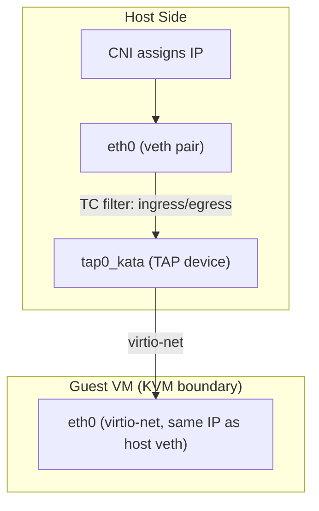
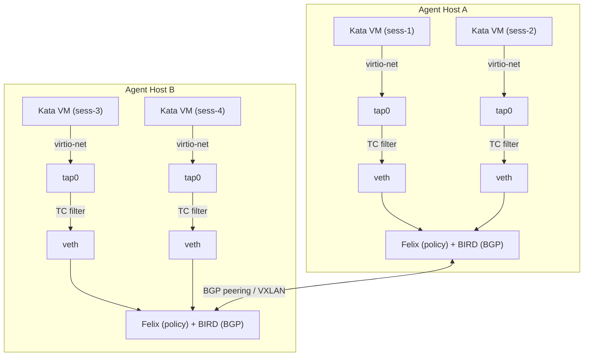

<!-- context-for-ai
type: detail-doc
parent: BEP-1051 (Kata Containers Agent Backend)
scope: Multi-container networking for Kata VMs — Calico CNI integration, inter-VM communication, network policy, service port exposure
depends-on: [kata-agent-backend.md, configuration-deployment.md]
key-decisions:
  - Calico CNI for inter-VM networking (multi-host routing, network policy enforcement)
  - TC filter mechanism provides transparent veth-to-tap redirection (Kata built-in)
  - DNS resolution via /etc/hosts injection (no Docker DNS available)
  - Service port exposure via host port mapping on tap interfaces
  - No host network mode support (architectural limitation of VM isolation)
  - Calico standalone mode with etcd datastore for non-Kubernetes deployments
-->
# BEP-1051: 다중 컨테이너 네트워킹

## 요약

Backend.AI 는 컨테이너들이 공유 bridge 네트워크와 hostname 기반 DNS 해석으로 통신하는 다중 컨테이너 세션(cluster)을 지원한다. KataAgent 에서는 컨테이너마다 VM 이 따로 있으므로 컨테이너 간 네트워킹이 VM 간 네트워킹이 된다. 이 문서는 Kata 의 네트워킹 모델을 분석하고, Calico CNI 를 필수 네트워킹 계층으로 정하며, 독립 실행 모드의 containerd 배포와 Kubernetes 배포 각각의 통합 설계를 다룬다.

## 현재 설계: DockerAgent 네트워킹

DockerAgent 는 컨테이너 간 통신에 Docker bridge 네트워크를 사용한다. 단일 컨테이너 세션에서는 기본 bridge 가 연결을 제공하고, service port(SSH, ttyd, Jupyter)는 설정한 범위(기본값 30000-31000)의 호스트 port 로 매핑된다. 다중 컨테이너 세션에서는 `create_local_network()` 로 cluster 마다 전용 bridge 를 생성하고(`src/ai/backend/agent/agent.py:3496`), 컨테이너가 cluster hostname 을 DNS alias 로 붙여 참여한다(`src/ai/backend/agent/docker/agent.py:680`). Docker 내장 DNS 가 이 hostname 을 해석해 컨테이너 간 통신을 처리한다.

Backend.AI 에는 네트워크 plugin 체계가 있다(`src/ai/backend/agent/plugin/network.py`). `AbstractNetworkAgentPlugin` 이 `join_network()`, `leave_network()`, `expose_ports()` 를 지원한다. 기본 plugin 은 다중 호스트용 Docker overlay 를 사용하는 `OverlayNetworkPlugin` 과 호스트 네트워크 모드용 `HostNetworkPlugin` 이다.

## Kata Containers 네트워킹 모델

### VM 별 네트워크 경로

Kata 는 TC(Traffic Control) filter 리다이렉션으로 호스트 측 네트워크 namespace 를 guest VM 에 투명하게 연결한다.



이 TC filter 방식은 Kata 의 기본값이며 추가 구성이 필요 없다. guest VM 의 `eth0` 은 CNI 가 호스트 측 veth 에 할당한 IP 를 그대로 받는다. 따라서 네트워크 인프라 입장에서 VM 은 투명하다.

### Sandbox 모델: VM 하나에 여러 컨테이너

Kata **sandbox** 는 VM 인스턴스 하나다. guest 안의 kata-agent 가 같은 sandbox 안에서 여러 컨테이너를 관리할 수 있다. 컨테이너마다 PID namespace 는 따로 있지만(libcontainer) **VM 의 네트워크 namespace 를 공유한다**. 같은 sandbox 안의 모든 컨테이너는 Kubernetes pod 와 같은 의미로 `localhost` 로 통신한다.

다중 컨테이너 sandbox 의 흐름은 다음과 같다.

1. CRI 가 sandbox 를 생성하면 Kata 가 VM 을 부팅하고 kata-agent 가 시작한다
2. CRI 가 `CreateContainer` 를 호출하면 kata-agent 가 기존 VM 안에 컨테이너를 생성한다 (image rootfs 는 virtio-fs 로 공유하거나 block 장치로 핫플러그한다)
3. `CreateContainer` 를 더 호출하면 같은 VM 에 컨테이너가 추가되고 네트워크를 공유한다

Backend.AI 의 **다중 컨테이너 세션**(cluster 모드)에서 이 대응 관계는 배포 모델에 따라 다르다.

- **단일 호스트 cluster**: 세션의 모든 컨테이너가 containerd Sandbox API(`sandbox.v1`, containerd v2 이상)로 Kata sandbox 하나(VM 하나)를 공유할 수 있다. agent 가 `create_sandbox()` 를 먼저 호출하고 `create_container(sandbox_id=...)` 로 컨테이너를 추가한다. 컨테이너는 `localhost` 와 VM 의 네트워크 namespace 를 공유한다. 참고: 표준 `containers.v1` / `tasks.v1` API 는 컨테이너마다 VM 을 하나씩 생성한다. 공유에는 Sandbox API 가 필요하다.
- **다중 호스트 cluster**: 호스트마다 Kata sandbox(VM)를 따로 실행한다. VM 간 컨테이너는 Calico CNI 로 통신한다. VM 마다 IP 가 따로 있고 VM 간 트래픽은 BGP/VXLAN 라우팅을 지난다. 분산 학습 워크로드의 예상 모델이다.

### Kata 가 기본으로 제공하는 것

| 기능 | 지원 | 비고 |
|---------|---------|-------|
| TC filter veth→tap 리다이렉션 | 기본 내장 (기본값) | CNI plugin 에 투명하다 |
| MACVTAP 모드 | 기본 내장 (legacy) | TC filter 의 대안이며 성능이 비슷하다 |
| virtio-net 장치 | 기본 내장 | guest 안의 반가상화 NIC |
| CNI plugin 호환성 | 전체 | Calico, Cilium, Flannel, bridge 와 동작한다 |
| 다중 컨테이너 sandbox | 지원 | 컨테이너가 kata-agent 를 거쳐 VM 네트워크 namespace 를 공유한다 |
| `--net=host` | **지원하지 않음** | VM 격리 때문에 호스트 네트워크에 접근할 수 없다 |
| `--net=container:<id>` | **지원하지 않음** | VM 사이에서 네트워크 namespace 를 공유할 수 없다 |
| Docker Compose 사용자 정의 네트워크 | **제한적** | Docker DNS service 와 완전히 호환되지 않는다 |

### Kata 가 제공하지 않는 것

Kata 는 **VM 간 네트워킹 해법을 내장하지 않는다**. VM 은 각각 독립된 네트워크 endpoint 다. VM 간 통신은 기반 CNI plugin 이 처리한다. Kubernetes 에서는 cluster 의 CNI 가 pod 간 네트워킹을 투명하게 처리한다. Kubernetes 가 없으면 호스트마다 CNI plugin 을 직접 구성해야 한다.

### CNI 호환성 평가

| CNI plugin | Kata 호환성 | 다중 호스트 | 네트워크 정책 | 평가 |
|------------|-------------------|------------|---------------|------------|
| **Calico** | TC filter 와 동작 | BGP / VXLAN / IPIP | 전체 (L3/L4) | **선택함**. 다중 호스트, 정책, 독립 실행을 모두 지원한다 |
| Cilium | Kata 와 [MTU 불일치](https://docs.cilium.io/en/stable/network/kubernetes/kata/) 문제가 있다 | VXLAN / Geneve | 전체 (L3/L4/L7) | Kata 와 MTU 문제가 있다. eBPF 는 Kubernetes 가 필요하다 |
| Flannel | TC filter 와 동작 | VXLAN | 없음 | 네트워크 정책이 없다. 다중 테넌트 격리에 부족하다 |
| CNI bridge | TC filter 와 동작 | **단일 호스트만** | 없음 | 개발, 테스트용이다 |

## 제안 설계: Calico CNI 통합

### Calico 를 고르는 이유

KataAgent 는 다음 이유로 Calico 를 CNI 네트워킹 계층으로 사용한다.

1. **다중 호스트 네트워킹**: 운영 배포는 여러 agent 호스트에 걸쳐 있다. Calico 는 BGP(direct peering 또는 route reflector)나 VXLAN overlay 로 호스트 간 라우팅을 제공하므로 다른 호스트의 컨테이너가 투명하게 통신한다.
2. **네트워크 정책 적용**: 다중 테넌트 GPU 환경에서는 서로 다른 사용자의 세션을 네트워크 수준에서 격리해야 한다. Calico 의 Felix agent 가 iptables/eBPF 규칙을 설정해 Kata VM 사이에 `NetworkPolicy` 방식 규칙을 적용하고, 허용되지 않은 세션 간 트래픽을 차단한다.
3. **Kata TC filter 투명성**: Calico 는 컨테이너 네트워크 namespace 에 veth pair 를 생성한다. Kata 의 TC filter 가 veth 의 트래픽을 tap 장치로 리다이렉트해 VM 안으로 전달한다. Calico 입장에서 Kata VM 은 일반 컨테이너와 구분되지 않으므로 별도 통합이 필요 없다.
4. **독립 실행 모드의 containerd 지원**: Calico 는 etcd 를 datastore 로 사용하는 비 Kubernetes 배포를 지원한다. 호스트마다 `calico-node` agent(Felix + BIRD)가 실행되고 containerd 가 Calico CNI plugin 을 호출한다. KataAgent 의 containerd 기반 구조와 맞는다.
5. **Kubernetes 호환성**: KataAgent 를 Kubernetes 에 배포하면 cluster 에 이미 설치된 Calico 가 네트워킹을 처리하므로 추가 구성이 필요 없다. 배포 방식 전반에서 같은 네트워킹 모델을 유지한다.

### Kata 와 Calico 구조



**Felix** 는 호스트마다 iptables 규칙을 설정해 Kata VM 사이의 네트워크 정책을 적용한다. **BIRD** 는 라우팅 정보를 교환해 호스트 A 의 VM 이 BGP 나 VXLAN 캡슐화로 호스트 B 의 VM 에 접근하게 한다.

### 배포 방식

#### 독립 실행 모드의 containerd (비 Kubernetes)

Calico 를 etcd 를 datastore 로 사용하는 독립 실행 모드로 실행한다.

**호스트별 구성 요소:**
- `calico-node` service (Felix + BIRD daemon)
- Calico CNI plugin binary (`/opt/cni/bin/calico`)
- Calico IPAM plugin binary (`/opt/cni/bin/calico-ipam`)

**인프라:**
- etcd cluster (Backend.AI 의 기존 etcd 를 공유하거나 따로 둔다)
- IP pool 과 네트워크 정책 관리를 위한 `calicoctl` CLI

**CNI 구성** (`/etc/cni/net.d/10-calico.conflist`):

```json
{
  "name": "kata-calico",
  "cniVersion": "1.0.0",
  "plugins": [
    {
      "type": "calico",
      "datastore_type": "etcdv3",
      "etcd_endpoints": "http://127.0.0.1:2379",
      "ipam": {
        "type": "calico-ipam",
        "assign_ipv4": "true"
      },
      "policy_type": "calico",
      "log_level": "info"
    },
    {
      "type": "portmap",
      "capabilities": {"portMappings": true},
      "snat": true
    }
  ]
}
```

**IP pool 구성** (`calicoctl` 사용):

```yaml
apiVersion: projectcalico.org/v3
kind: IPPool
metadata:
  name: kata-sessions
spec:
  cidr: 10.244.0.0/16
  ipipMode: Never
  vxlanMode: CrossSubnet    # VXLAN for cross-subnet, direct for same-subnet
  natOutgoing: true
  nodeSelector: all()
```

#### Kubernetes 배포

Calico 가 이미 설치된 Kubernetes cluster 에 KataAgent 를 배포하면 추가 CNI 구성이 필요 없다. 기존 Calico 가 다음을 처리한다.

- Calico IPAM 을 통한 IP 할당
- BGP 나 VXLAN 을 통한 노드 간 라우팅
- Felix 를 통한 네트워크 정책 적용

`create_local_network()` 는 아무 동작도 하지 않는다. KubernetesAgent 와 같다. Kubernetes Service 와 DNS 가 pod 간 탐색을 처리한다.

### 세션 격리를 위한 네트워크 정책

Calico 네트워크 정책이 세션 사이의 허용되지 않은 트래픽을 차단한다. agent 가 Kata VM 의 네트워크 endpoint 에 세션 메타데이터 label 을 붙이고, 기본 거부 정책이 세션을 서로 격리한다.

```yaml
# Default deny: sessions cannot reach other sessions
apiVersion: projectcalico.org/v3
kind: GlobalNetworkPolicy
metadata:
  name: default-deny-inter-session
spec:
  selector: has(ai.backend.session-id)
  types:
  - Ingress
  - Egress
  ingress:
  - action: Deny
    source:
      notSelector: ai.backend.session-id == "{{session_id}}"
  egress:
  - action: Allow   # Allow outbound (storage, internet)
```

```yaml
# Allow intra-cluster: containers in the same session can communicate
apiVersion: projectcalico.org/v3
kind: GlobalNetworkPolicy
metadata:
  name: allow-intra-session
spec:
  selector: has(ai.backend.session-id)
  order: 100
  types:
  - Ingress
  ingress:
  - action: Allow
    source:
      selector: ai.backend.session-id == "{{session_id}}"
```

참고: 위의 `{{session_id}}` placeholder 는 **template** 이다. Calico 는 정책 YAML 의 변수 치환을 지원하지 않는다. agent 가 실제 session id 를 직접 치환한 세션별 정책을 생성해 `calicoctl apply` 로 적용한다.

KataAgent 는 containerd 로 컨테이너를 생성할 때 이 label 을 붙이고, Calico 의 Felix agent 가 호스트의 iptables 에 규칙을 실시간으로 적용한다.

### 단일 컨테이너 세션

단일 컨테이너 세션에서는 Calico 가 연결을 제공한다.

1. containerd 가 컨테이너의 네트워크 namespace 를 생성할 때 Calico CNI plugin 을 호출한다
2. Calico 가 설정한 IP pool 에서 IP 를 할당하고 호스트에 route 를 설정한다
3. Kata 의 TC filter 가 Calico 가 생성한 veth 의 트래픽을 tap 장치로 리다이렉트한다
4. guest VM 이 Calico 가 할당한 IP 를 받고, 다른 호스트에서 BGP/VXLAN 으로 접근할 수 있다
5. service port 는 portmap CNI plugin 으로 노출된다

### 다중 컨테이너 세션 (cluster)

다중 컨테이너 세션에서는 cluster 의 모든 컨테이너가 같은 Calico IP pool 에서 IP 를 받고 같은 `session-id` label 을 갖는다. 네트워크 정책이 세션 내부 트래픽은 허용하고 세션 간 트래픽은 차단한다.

Calico 독립 실행 모드에서 `create_local_network()` 는 세션의 네트워크 정책 규칙이 적용되도록 한다.

```python
async def create_local_network(self, network_name: str) -> None:
    """Apply Calico network policy for inter-VM cluster communication."""
    session_id = network_name  # network_name is derived from session_id
    # Apply session-scoped network policy via calicoctl
    await self._apply_calico_policy(session_id)

async def destroy_local_network(self, network_name: str) -> None:
    """Remove session-scoped Calico network policy."""
    session_id = network_name
    await self._remove_calico_policy(session_id)
```

같은 cluster 안의 컨테이너는 IP 로 서로 접근할 수 있다. Hostname 해석은 `/etc/hosts` 주입으로 처리한다(아래 참고).

### DNS / Hostname 해석

Docker 는 컨테이너 간 이름 해석을 위한 내장 DNS 를 제공한다. 독립 실행 모드의 containerd 를 사용하는 Kata 에는 이 기능이 **없다**. KataAgent 가 hostname 해석을 직접 처리해야 한다.

**방식: `/etc/hosts` 주입**

cluster 의 모든 컨테이너를 생성해 IP 를 할당한 뒤, KataAgent 가 각 컨테이너의 scratch 디렉터리(virtio-fs 로 공유)에 `/etc/hosts` 항목을 기록한다.

```python
async def _inject_cluster_hosts(
    self,
    cluster_info: ClusterInfo,
    containers: dict[str, ContainerInfo],  # hostname → container info
) -> None:
    """Write /etc/hosts with cluster hostname mappings into each container."""
    hosts_entries = []
    for hostname, info in containers.items():
        hosts_entries.append(f"{info.ip_address}\t{hostname}")
    hosts_content = "\n".join([
        "127.0.0.1\tlocalhost",
        "::1\tlocalhost ip6-localhost ip6-loopback",
        *hosts_entries,
    ])
    for hostname, info in containers.items():
        hosts_path = info.scratch_dir / "config" / "hosts"
        hosts_path.write_text(hosts_content)
```

`/home/config/hosts` 파일을 guest 안의 `/etc/hosts` 로 bind mount 한다. 이때 virtio-fs 를 사용한다. DNS 서버 없이도 이름 해석이 바로 된다.

**검토한 대안인 CoreDNS sidecar** 는 cluster 별 DNS 로는 너무 무겁다. `/etc/hosts` 가 더 단순하고, Backend.AI cluster 의 적은 컨테이너 수(보통 2-8개)에 충분하다.

### Service port 노출

service port(SSH, ttyd, Jupyter 등)는 CNI portmap plugin(위 Calico conflist 에 포함)으로 컨테이너 port 를 호스트 port 에 매핑한다. portmap plugin 은 호스트 port 를 VM 의 Calico 할당 IP 로 전달하는 DNAT 규칙을 설정한다. 이는 표준 CNI 방식이고 Kata 의 TC filter 에 투명하다.

### 네트워크 plugin 호환성

| plugin | Docker | Kata | 비고 |
|--------|--------|------|-------|
| 기본 | Docker bridge API | Calico CNI | 다중 호스트 라우팅과 네트워크 정책 |
| Overlay | Docker overlay driver | Calico VXLAN 모드 | subnet 간 캡슐화 |
| Host | `--net=host` | **지원하지 않음** | VM 격리 때문에 불가능하다 |
| RDMA | 장치 mount | SR-IOV VF passthrough (향후) | 1단계 범위 밖 |

## 인터페이스 / API

| 추상화 | 위치 | Kata 를 위한 변경 |
|-------------|----------|-----------------|
| `create_local_network()` | `AbstractAgent` method | Calico 세션 범위 네트워크 정책 적용 |
| `destroy_local_network()` | `AbstractAgent` method | Calico 세션 범위 네트워크 정책 제거 |
| `apply_network()` | `KernelCreationContext` method | Calico endpoint label 지정, CNI 네트워크 구성 |
| `AbstractNetworkAgentPlugin` | `src/ai/backend/agent/plugin/network.py` | Kata 전용 Calico plugin 구현 |
| service port 매핑 | agent port pool | CNI portmap plugin 사용 |
| Calico endpoint label 지정 | KataAgent 에서 신규 | 정책 매칭을 위해 VM 에 session-id label 지정 |

## 구현 참고 사항

- **Calico 배포**: 독립 실행 모드에는 agent 호스트마다 `calico-node`(Felix + BIRD)와 etcd cluster 가 필요하다. etcd 는 Backend.AI 의 기존 etcd 가 있으면 공유하거나 따로 배포한다. Kubernetes 배포에서는 Calico 가 cluster CNI 로 이미 설치된 것으로 본다.
- **Calico CNI binary**: `/opt/cni/bin/` 에 `calico` 와 `calico-ipam` plugin 을 설치해야 한다. service port 노출에는 표준 CNI plugin 인 portmap 도 필요하다.
- **TC filter**: Kata 의 v1.6 부터 기본 네트워킹 모드다. 구성이 필요 없다. Kata shim 이 컨테이너 namespace 에서 veth 인터페이스를 감지하면 TC 규칙을 자동으로 설정한다. Calico 에 완전히 투명하다.
- **IP pool 크기**: 기본 `10.244.0.0/16` pool 은 IP 약 6만 5천 개를 제공한다. 동시 세션이 많은 대규모 배포에서는 IP pool 을 여러 개 두거나 더 큰 CIDR 을 사용한다.
- **네트워크 정책 lifecycle**: 세션 범위 Calico 네트워크 정책은 `create_local_network()` 에서 생성하고 `destroy_local_network()` 에서 제거한다. agent 는 `calicoctl` 이나 Calico Python 클라이언트 라이브러리로 Calico datastore(etcd 또는 Kubernetes API)와 통신한다.
- **Endpoint label 지정**: 정책 매칭을 위해 Kata VM 의 네트워크 endpoint 마다 `ai.backend.session-id`, `ai.backend.scaling-group`, `ai.backend.cluster-role` label 을 붙여야 한다. label 은 Calico 의 workload endpoint API 로 지정한다.
- Kubernetes 배포에서는 `create_local_network()` 가 아무 동작도 하지 않는다. KubernetesAgent 와 같다. cluster CNI 와 Kubernetes NetworkPolicy 가 pod 네트워킹을 처리한다.
- DockerAgent 의 `gwbridge_subnet` 감지와 `OMPI_MCA_btl_tcp_if_exclude` 로직은 MPI 워크로드를 지원하도록 Calico 의 host-local 인터페이스에 맞게 적용해야 한다.
- VSOCK 으로 VM 간 통신을 할 수 있다는 이론적 가능성은 있으나 사용자 워크로드에 socket 코드를 직접 넣어야 하고 hostname 기반의 투명한 네트워킹에는 현실적이지 않다. VM 마다 CID 가 다르다.

## 호스트 요구 사항 (Calico)

[configuration-deployment.md](configuration-deployment.md)의 Kata 호스트 요구 사항 외에 Calico 는 다음을 요구한다.

| 요구 사항 | 상세 |
|-------------|---------|
| `calico-node` service | Felix(정책 agent) + BIRD(BGP daemon), systemd unit 또는 컨테이너로 실행한다 |
| CNI plugin | `/opt/cni/bin/calico`, `/opt/cni/bin/calico-ipam`, `/opt/cni/bin/portmap` |
| CNI config | `/etc/cni/net.d/10-calico.conflist` |
| etcd (독립 실행 모드) | 모든 agent 호스트에서 접근할 수 있는 etcd v3 cluster |
| `calicoctl` | IP pool 과 네트워크 정책 관리 CLI |
| 네트워크 연결 | agent 호스트 사이 BGP peering(port 179) 또는 VXLAN(UDP 4789) |
| IP forwarding | `net.ipv4.ip_forward = 1` (보통 Kata 를 위해 이미 활성화된 상태다) |
