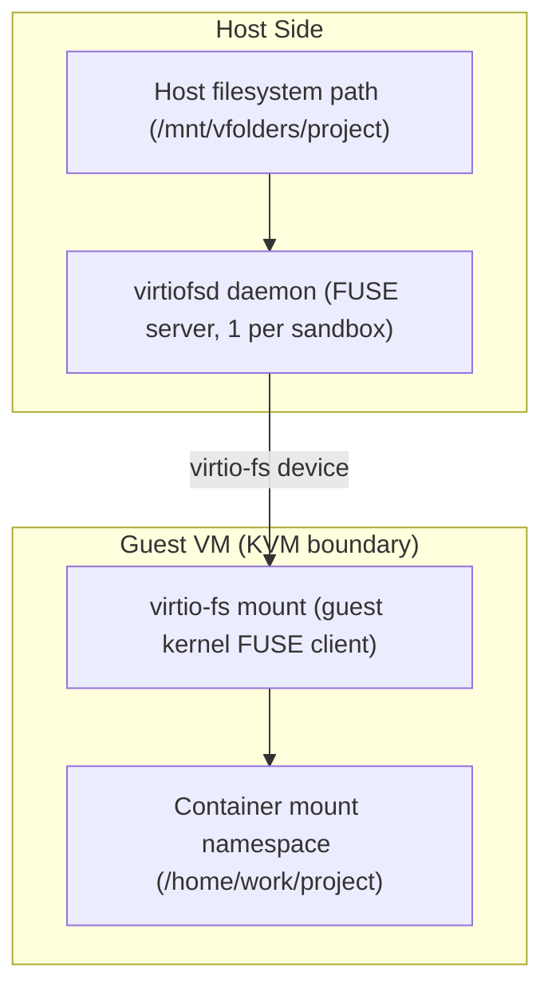
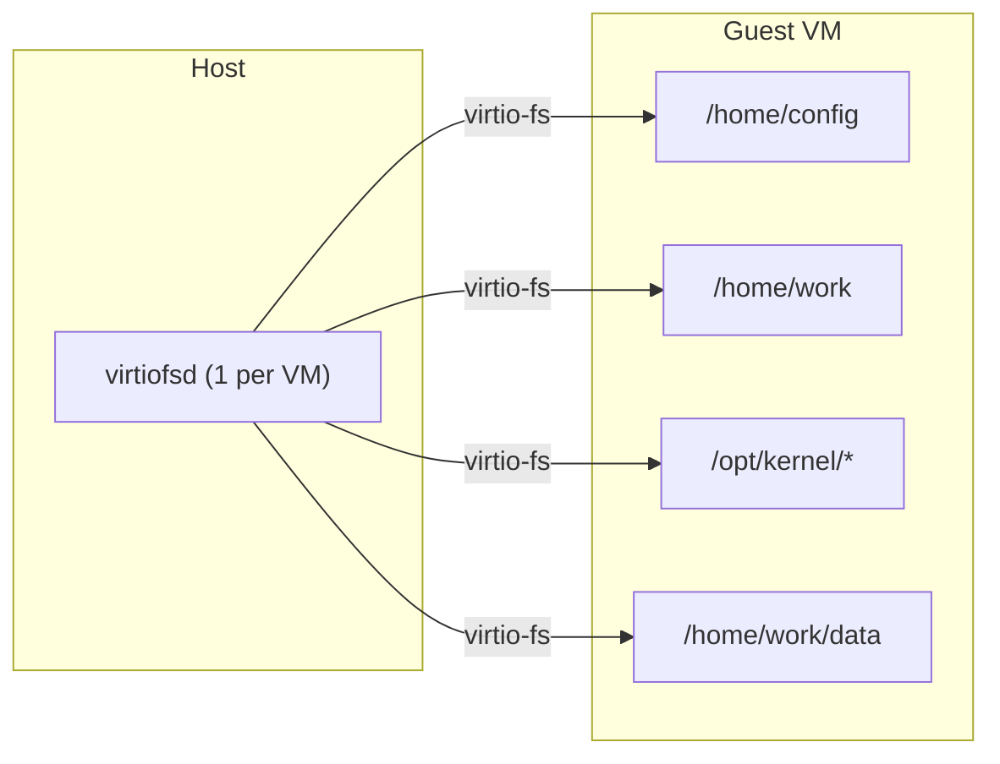
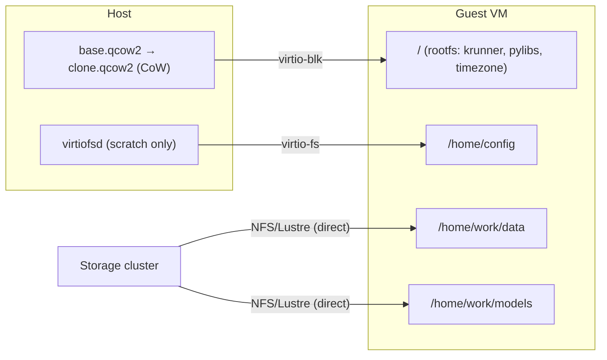

<!-- context-for-ai
type: detail-doc
parent: BEP-1051 (Kata Containers Agent Backend)
scope: Volume mount compatibility between host filesystem and Kata guest VM; intrinsic mount evaluation; storage I/O analysis
depends-on: [kata-agent-backend.md, configuration-deployment.md]
key-decisions:
  - VFolder data does NOT use virtio-fs (RDMA breakage); storage volumes mounted directly inside guest VM via native NFS/Lustre kernel client; container bind-mounts vfolder subdirs — same model as Docker
  - virtio-fs retained only for scratch/config directories (non-performance-critical, host-originated data)
  - Existing Mount abstraction (BIND, source, target, permission) reused unchanged for container-level bind mounts
  - lxcfs mounts skipped (guest kernel provides accurate /proc and /sys natively)
  - libbaihook.so LD_PRELOAD skipped (guest kernel provides accurate sysconf natively)
  - jail ptrace sandbox skipped (VM boundary is stronger isolation)
  - Agent socket skipped entirely (only used by jail/C binaries, both irrelevant for Kata)
  - /tmp uses guest-side tmpfs (no need to cross VM boundary)
  - Accelerator plugin mounts differ entirely (VFIO PCI passthrough replaces Docker DeviceRequests)
  - krunner binaries baked into attested guest rootfs (CoCo — host is untrusted, no virtio-fs sharing of executables)
-->
# BEP-1051: 스토리지와 볼륨 mount 호환성

## 요약

Backend.AI 의 기존 `Mount` 추상화(bind mount, source 경로, target 경로, 권한)는 컨테이너 수준에서 KataAgent 에 그대로 동작한다. 스토리지 mount 는 두 경로로 나뉜다. (1) VFolder 데이터는 guest VM 안에서 guest 자체의 NFS/Lustre/WekaFS 커널 클라이언트로 직접 마운트하고(RDMA 유지, native 처리량 100%), 컨테이너가 이 guest 측 mount 에서 vfolder 하위 디렉터리를 bind mount 한다. Docker 모델과 같다. (2) scratch/config 디렉터리(`/home/config`)는 성능이 중요하지 않은 호스트 발 config 데이터를 호스트에서 guest 로 공유하는 데 virtio-fs 를 사용한다. 새 스토리지 관리 인터페이스는 필요 없다. 이 문서는 mount 호환성 계층을 다루고, Kata 전용 처리가 필요한 mount 를 가려내며, I/O 성능 영향을 분석한다.

## 현재 설계: Docker bind mount 경로

`DockerAgent` 가 컨테이너를 생성할 때 모든 스토리지 mount 는 하나의 경로를 따른다.

```
Host filesystem ──(Linux bind mount)──→ Container mount namespace
```

Docker 컨테이너가 호스트 커널의 VFS 를 공유하므로 오버헤드가 없다. mount 스펙은 다음 순서로 흐른다.

1. manager 가 Storage Proxy(`get_mount_path()` RPC)로 `VFolderMount.host_path` 를 해석한다
2. agent 가 `Mount(MountTypes.BIND, host_path, kernel_path, permission)` 를 구성한다
3. `process_mounts()` 가 Docker API 형식으로 변환한다: `{"Type": "bind", "Source": "...", "Target": "..."}`
4. Docker 가 컨테이너 mount namespace 에 bind mount 를 생성한다

주요 file:
- `VFolderMount` type: `src/ai/backend/common/types.py:1299`
- `mount_vfolders()`: `src/ai/backend/agent/agent.py:557` (`AbstractKernelCreationContext` 에서 상속한다)
- `get_intrinsic_mounts()`: `src/ai/backend/agent/docker/agent.py:512`
- `process_mounts()`: `src/ai/backend/agent/docker/agent.py:764`

### Mount 목록 (DockerAgent)

| 분류 | mount 지점 | source | 종류 | 권한 |
|----------|---------------|--------|------|------|
| scratch workspace | `/home/config` | `scratch_dir/config` | BIND | RO |
| | `/home/work` | `scratch_dir/work` | BIND | RW |
| | `/tmp` | `scratch_dir_tmp` (tmpfs) | BIND | RW |
| 시간대 | `/etc/localtime`, `/etc/timezone` | 호스트 file | BIND | RO |
| lxcfs | `/proc/{cpuinfo,meminfo,stat,...}` | `/var/lib/lxcfs/proc/*` | BIND | RW |
| | `/sys/devices/system/cpu{,/online}` | `/var/lib/lxcfs/sys/...` | BIND | RW |
| agent IPC | `/opt/kernel/agent.sock` | agent Unix socket | BIND | RW |
| domain socket proxy | `{host_sock_path}` | `ipc_base_path/proxy/*.sock` | BIND | RW |
| core dump | `debug.coredump.core_path` | `debug.coredump.path` | BIND | RW |
| 딥러닝 sample | `/home/work/samples` | Docker volume `deeplearning-samples` | VOLUME | RO |
| krunner volume | `/opt/backend.ai` | distro/arch 별 Docker volume | VOLUME | RO |
| krunner binary | `/opt/kernel/{su-exec,entrypoint.sh,...}` | agent package resource (15개 이상 file) | BIND | RO |
| LD_PRELOAD hook | `/opt/kernel/libbaihook.so` | agent package resource | BIND | RO |
| jail sandbox | `/opt/kernel/jail` | agent package resource | BIND | RO |
| Python 라이브러리 | `/opt/backend.ai/.../ai/backend/{kernel,helpers}` | agent package resource | BIND | RO |
| 가속기 hook | `/opt/kernel/{hook}.so` | compute plugin 경로 | BIND | RO |
| VFolder | `/home/work/{vfolder}` | NFS/CephFS/local 경로 | BIND | RO/RW |

컨테이너 하나당 총 **20-30개 이상의 mount** 다 (가속기와 vfolder 수에 따라 다르다).

## 제안 설계: virtio-fs 호환성 계층

### Kata 가 bind mount 를 처리하는 방식

Kata runtime class 로 containerd 를 거쳐 컨테이너를 생성하면 Kata shim 이 bind mount 스펙을 virtio-fs 공유로 **자동** 변환한다.



Kata shim 이 이 변환을 내부에서 처리한다.

1. OCI runtime config 에서 bind mount 스펙을 읽는다
2. virtiofsd 가 호스트 디렉터리를 제공하도록 구성한다
3. guest 안에서 kata-agent 가 virtio-fs 공유를 마운트한다
4. kata-agent 가 target 경로로 컨테이너 mount namespace 를 생성한다

**`Mount` 추상화는 변경하지 않는다.** `KataKernelCreationContext.process_mounts()` 가 같은 `Mount(BIND, source, target, permission)` 객체를 containerd 에 전달하고, 나머지는 Kata shim 이 처리한다.

### KataAgent process_mounts() 구현

```python
async def process_mounts(self, mounts: Sequence[Mount]) -> None:
    """Convert Backend.AI mounts to containerd mount specs.

    For Kata containers, bind mounts are automatically translated
    to virtio-fs shares by the Kata shim — we just pass them through
    as standard OCI bind mounts.
    """
    oci_mounts = []
    for mount in mounts:
        if mount.type == MountTypes.BIND:
            oci_mounts.append({
                "destination": str(mount.target),
                "source": str(mount.source),
                "type": "bind",
                "options": self._build_mount_options(mount),
            })
        elif mount.type == MountTypes.TMPFS:
            oci_mounts.append({
                "destination": str(mount.target),
                "type": "tmpfs",
                "options": ["nosuid", "nodev", "size=65536k"],
            })
    self._container_mounts.extend(oci_mounts)
```

### Kata 를 위한 intrinsic mount 평가

mount 마다 근본 차이를 기준으로 평가한다. Docker 컨테이너는 호스트 커널을 공유하지만 Kata VM 은 KVM 안에서 별도 guest 커널을 실행한다. 이 차이로 어느 호스트 측 자원이 보이는지, 어느 커널 인터페이스를 공유하는지, 어떤 IPC 가 경계를 넘어 동작하는지가 달라진다.

#### 그대로 동작하는 mount (KEEP)

**scratch config 디렉터리** (`/home/config` RO): agent 가 호스트에서 생성하고 Kata shim 이 virtio-fs 로 공유한다. `/home/config` 에는 컨테이너 시작 전에 agent 가 기록한 세션별 config file 이 있다.

**작업 디렉터리** (`/home/work` RW): guest VM 자체 디스크(guest rootfs 의 일부)에 있는 디렉터리다. virtio-fs mount 가 **아니다**. vfolder 하위 디렉터리를 guest 측 NFS/Lustre mount 에서 `/home/work/{vfolder}` 로 bind mount 한다. `/home/config` 에는 다음이 있다.
- `environ.txt`: `BaseRunner.__init__()` 가 읽어 자식 프로세스 환경(`child_env` 와 `os.environ`)을 채운다
- `intrinsic-ports.json`: `BaseRunner._init()` 가 읽어 ZMQ socket 바인딩과 intrinsic service port 할당에 사용한다
- `resource.txt`: **agent**(호스트 측)만 읽어 복구와 자원 추적에 사용한다. kernel runner 는 읽지 않는다
- `ssh/`: cluster SSH key 와 port 매핑. kernel runner 의 `init_sshd_service()` 가 읽는다

`/home/work` 는 사용자의 영구 작업 공간이자 vfolder mount 지점이다. Kata 설계에서 이 경로는 기반 스토리지 시스템(NFS/Lustre/WekaFS)을 VM 안으로 **guest 측에서 직접 마운트**해 제공한다. guest 커널 자체의 파일 시스템 클라이언트가 스토리지 볼륨을 마운트하고(RDMA 유지), 컨테이너는 guest 파일 시스템에서 vfolder 하위 디렉터리를 bind mount 한다. Docker 의 호스트 수준 mount 모델과 같다.

**시간대 file** (`/etc/localtime`, `/etc/timezone`): 호스트 시간대와 함께 attested guest rootfs 에 포함한다. guest rootfs 는 관리하는 인프라 이미지이므로 시간대 구성은 build 시점에 정한다.

**VFolder mount** (`/home/work/{vfolder}`): 사용자 스토리지는 virtio-fs 로 노출하지 **않는다**. RDMA 를 끊고 고성능 스토리지 backend 에 FUSE 오버헤드를 추가하기 때문이다. 대신 guest 안에서 NFS/Lustre/WekaFS 커널 클라이언트로 스토리지 볼륨을 native 로 마운트한다. 컨테이너는 이 guest 측 경로에서 vfolder 하위 디렉터리를 bind mount 한다. 컨테이너 수준에서는 같은 `Mount(BIND, host_path, target, permission)` 스펙을 사용하지만 `host_path` 는 guest 에 보이는 경로(예: `/mnt/vfstore/<vfid>/subpath`)다. mount 스펙은 `/home/config/` 의 `storage-mounts.json`(virtio-fs config 채널)으로 guest 에 전달한다.

**krunner binary** (`/opt/kernel/su-exec`, `entrypoint.sh`, `dropbearmulti`, `sftp-server`, `tmux`, `ttyd` 등)와 **Python 라이브러리**(`ai.backend.kernel`, `ai.backend.helpers`): 모든 실행 file 과 라이브러리를 **attested guest rootfs 에 포함**한다. CoCo 가 기본인 환경에서 호스트는 신뢰할 수 없고 실행 file 의 출처가 될 수 없다. virtio-fs 로 호스트에서 guest 로 binary 를 공유하지 않는다. 이 file 은 guest rootfs 의 정해진 경로(`/opt/kernel/`, `/opt/backend.ai/lib/...`)에 있다.

#### 방식이 달라지는 mount (CHANGE)

**`/tmp` tmpfs**: Docker 에서 `/tmp` 는 호스트 측 tmpfs 를 bind mount 해 제공한다. Kata 에서 호스트 tmpfs 를 virtio-fs 로 VM 경계 너머에 공유하면 일시 데이터에 불필요한 오버헤드가 생긴다. guest 측 tmpfs 를 사용한다: `Mount(TMPFS, None, "/tmp", RW)`. guest RAM 안에 할당되고 VM 경계를 넘지 않는다.

**krunner volume** (`/opt/backend.ai`): 미리 build 한 Python runtime 환경(distro 에 맞춘 libc, interpreter, package)을 담은 Docker named volume 이다. Docker named volume 은 containerd 에서 사용할 수 없다. **1단계**: krunner 를 호스트 디렉터리에 풀고 virtio-fs bind mount 로 공유한다(투명 변환). **운영**: guest rootfs 이미지에 포함한다(시작이 빠르고 virtio-fs 공유를 하나 줄인다. krunner 를 갱신하면 다시 빌드해야 한다).

**core dump mount**: Docker 에서는 컨테이너 프로세스가 호스트 커널을 공유하므로 호스트 커널의 `/proc/sys/kernel/core_pattern` 이 적용된다. agent 가 호스트의 coredump 디렉터리를 bind mount 해 dump 가 호스트 파일 시스템에 남게 한다. Kata 에서는 **guest 커널**이 자기 `core_pattern` 을 가진다. 호스트 측 구성은 guest 프로세스에 영향을 주지 않는다. guest core dump 를 수집하려면 guest 커널의 `core_pattern` 이 guest 로컬 경로(예: guest 디스크의 `/home/work/.coredumps`)에 기록하도록 구성한다. 우선순위는 낮다.

#### 건너뛰는 mount (SKIP)

다음은 모두 Docker 전용 방식이며 Kata VM 모델에서 필요 없거나 호환되지 않는다.

- **agent socket** (`/opt/kernel/agent.sock`): jail/C binary 용 ZMQ REP socket 이다(PID 변환, jail 상태). 해당 없음. jail 을 사용하지 않고 VM 경계가 PID 를 격리한다. agent 와 kernel runner 의 주 채널(ZMQ PUSH/PULL)은 TCP 기반이며 Calico 네트워크를 지나 동작한다.
- **lxcfs** (`/proc/cpuinfo`, `/proc/meminfo` 등): 호스트 커널을 공유하는 Docker 컨테이너에 cgroup 범위 `/proc` 를 제공한다. 필요 없다. guest 커널의 `/proc` 가 이미 VM 에 할당된 자원을 보여 준다.
- **`libbaihook.so`** (LD_PRELOAD): `sysconf()` 를 후킹해 cgroup 범위 CPU 수를 반환한다. 필요 없다. guest 커널이 이미 VM 의 vCPU 수를 반환한다.
- **`jail` sandbox** (`/opt/kernel/jail`): ptrace 기반 system call tracer 다. 중복이다. VM 경계(KVM)가 더 강한 격리 계층이다.
- **domain socket proxy**: service 컨테이너를 위한 호스트 측 Unix socket 접근이다. UDS 는 VM 경계를 넘을 수 없다.
- **딥러닝 sample volume**: 폐기한 Docker named volume 이다. containerd 에서 사용할 수 없다.

#### 전혀 다른 mount (DIFFERENT)

**가속기 plugin mount**: Docker 에서 `CUDAPlugin` 은 hook `.so` file 을 bind mount 로 주입하고(`LD_PRELOAD` 에 추가) NVIDIA Container Toolkit 용 Docker `DeviceRequests` 를 생성한다. VFIO passthrough 를 사용하는 Kata 에서는 이를 전부 대체한다.
- `LD_PRELOAD` GPU hook 이 없다. VFIO PCI passthrough 로 GPU 가 VM 안에 native 로 보인다
- `CUDAVFIOPlugin` 은 Docker `DeviceRequests` 가 아니라 Kata shim 에 전달할 VFIO 장치 구성(PCI 주소, IOMMU group)을 생성한다
- `nvidia-smi` 와 CUDA 가 passthrough GPU 로 guest 안에서 native 로 동작한다
- 자세한 내용은 [vfio-accelerator-plugin.md](vfio-accelerator-plugin.md)를 참고한다

### Mount 호환성 표

| mount | Docker | Kata | 판정 |
|-------|--------|------|---------|
| `/home/config` (scratch) | bind mount | virtio-fs | **KEEP**. 같은 스펙 |
| `/home/work` (workspace) | bind mount | guest 디스크 디렉터리 | **CHANGE**. guest rootfs 에 있고 virtio-fs 가 아니다 |
| `/tmp` (tmpfs) | 호스트 tmpfs bind | guest 측 tmpfs | **CHANGE**. `TMPFS` type |
| `/etc/localtime`, `/etc/timezone` | bind mount | virtio-fs | **KEEP**. 같은 스펙 |
| lxcfs `/proc/*`, `/sys/*` | bind mount | 해당 없음 | **SKIP**. guest 커널이 제공한다 |
| `libbaihook.so` + `LD_PRELOAD` | bind mount | 해당 없음 | **SKIP**. guest 커널이 제공한다 |
| `jail` sandbox | bind mount | 해당 없음 | **SKIP**. VM 이 더 강한 격리다 |
| `/opt/kernel/agent.sock` | Unix socket (jail/C binary 전용) | 해당 없음 | **SKIP**. jail 을 건너뛰고 VM 에서 PID 변환은 해당 없다 |
| domain socket proxy | Unix socket | 해당 없음 | **SKIP**. 이후 단계로 미룬다 |
| core dump 경로 | 호스트 core_pattern | guest core_pattern | **CHANGE**. guest 측 구성 |
| krunner volume (`/opt/backend.ai`) | Docker volume | virtio-fs / rootfs | **CHANGE**. Docker volume 이 없다 |
| 딥러닝 sample | Docker volume | 해당 없음 | **SKIP**. legacy, 폐기 |
| krunner binary (15개 이상 file) | bind mount | virtio-fs | **KEEP**. 같은 스펙 |
| Python 라이브러리 (`kernel`, `helpers`) | bind mount | virtio-fs | **KEEP**. 같은 스펙 |
| 가속기 hook | plugin `.so` | VFIO PCI 구성 | **DIFFERENT**. 새 plugin |
| VFolder | bind mount | guest 측 NFS/Lustre bind mount | **CHANGE**. virtio-fs 가 아니고 guest 커널 클라이언트로 마운트한다 |

### I/O 성능 특성

#### 처리량 (native 대비)

Red Hat virtio-fs mailing list, Kata Containers issue, Proxmox 커뮤니티 테스트의 benchmark 자료다.

| 워크로드 | virtio-fs (DAX 없음) | virtio-fs (DAX) | virtio-9p | 출처 |
|----------|-------------------|-----------------|-----------|--------|
| 순차 읽기 (psync, 4K) | 98 MB/s | 660 MB/s | 99 MB/s | Red Hat ML |
| 순차 읽기 (mmap, thread 4개) | ~219 MB/s | 2,849-3,107 MB/s | 140 MB/s | LWN RFC |
| 순차 쓰기 (psync) | ~98 MB/s | 487 MB/s | — | Red Hat ML |
| 임의 4K 읽기 IOPS | 36.2k | 64.2k | — | Proxmox |
| 임의 4K 쓰기 IOPS | 15.5k | 21.4k | — | Proxmox |
| 큰 file 임의 R/W (4 GB) | 211 / 70.6 MB/s | — | 43 / 14 MB/s | Kata #2815 |

**native 호스트 성능 대비** (tuned, kernel 6.11 이상, `cache=never`, `direct-io=1`):

| 워크로드 | native 대비 | 비고 |
|----------|-------------|-------|
| 순차 읽기 | 85-95% (DAX) | 큰 순차 읽기에는 DAX 가 중요하다 |
| 순차 쓰기 | 75-85% (DAX) | 쓰기에는 `cache=none` 이 `cache=always` 보다 낫다 |
| 임의 4K 읽기 | ~85% (tuned) | 25.4k 대 29.8k IOPS (Proxmox 6.11) |
| 임의 4K 쓰기 | ~85% (tuned) | 13.7k 대 16.1k IOPS |
| 메타데이터 (file 생성) | ~50-70% (추정) | 9p 보다 3.7배 빠르다 (714 대 194 file/초) |
| 디렉터리 목록 | ~60-80% (추정) | caching 시 9p 보다 6.7배 빠르다 (13.5k 대 2k file/초) |

#### DAX: 중요한 주의 사항

DAX 는 호스트 page cache 를 guest 메모리에 직접 매핑해 순차 워크로드에서 native 에 가까운 읽기 성능을 낸다. 다만 다음 제약이 있다.

1. **DAX thrashing**: working set 이 DAX window 크기를 넘으면 성능이 **치명적으로 떨어진다**. Kata #2138 은 임의 워크로드에서 DAX 를 활성화했을 때 3.6k IOPS, 비활성화했을 때 252k IOPS 를 측정했다. VM 이 page 를 계속 메모리로 가져오고 내보내면서 DAX 매핑이 thrashing 된다.

2. **DAX window 크기**: DAX chunk 2 MB 마다 guest page descriptor 32 KB 가 필요하다. 16 GB window 는 page descriptor 오버헤드로 약 256 MB 를 소비한다 (device memory 이며 VM RAM 사용량에 포함되지 않는다). window 가 작으면 thrashing 이 생기고, 크면 호스트 메모리 예약이 낭비된다.

3. **작은 file 불이익**: 32 KB 미만 file 에는 DAX 를 사용하지 않는다. 2 MB chunk 마다 32 KB page descriptor 오버헤드가 이득보다 크다. Linux 5.17 이상은 file 별 DAX(`dax=inode`)를 지원해 큰 file 에만 DAX 를 선택적으로 활성화한다.

**권장**: **DAX 를 기본으로 비활성화한다** (`kata.toml` 의 `virtio_fs_cache_size = 0`). AI/ML 워크로드는 큰 순차 읽기(학습 데이터 적재, DAX 가 유리하다)와 많은 임의 I/O(checkpoint, Python import, pip install, DAX 가 해롭다)를 번갈아 수행한다. 임의 I/O 에서 DAX thrashing 이 주는 손실이 순차 읽기에서 DAX 없이 잃는 처리량보다 훨씬 크다. 큰 순차 읽기가 지배적인 I/O 패턴이 확인된 워크로드에만 DAX 를 활성화한다.

#### 호스트 측 오버헤드

Kata 는 bind mount 단위가 아니라 **sandbox(VM)마다 `virtiofsd` 프로세스 하나**를 실행한다. virtiofsd 는 공유 최상위 디렉터리(`/run/kata-containers/shared/sandboxes/<SANDBOX>/`)를 제공하고 그 아래에 모든 컨테이너 mount 가 있다. 개별 bind mount 는 이 공유 tree 안의 하위 디렉터리다.

| 자원 | virtiofsd 하나 (VM 1개) | VM 10개 |
|----------|---------------------|--------|
| 메모리 (RSS) | idle 시 ~15 MB | ~150 MB |
| 부하 시 heap | 5-6 MB | ~50-60 MB |
| file descriptor | 부하가 크면 최대 80k | FD 압박 누적 |
| 공유 메모리 | VM RAM 크기 (hypervisor 와 공유하며 이중 계산하지 않는다) | VM 별 |

CPU 효율이 좋은 `virtiofsd` Rust 구현을 legacy C 구현 대신 권장한다. 대부분 워크로드에는 `--thread-pool-size=1` 을 사용한다. 기본값 64 thread 는 lock 경합으로 IOPS 를 약 27% 떨어뜨린다.

**mount 수 영향**: virtiofsd 는 sandbox 마다 공유하므로 krunner binary mount 15개 이상이 프로세스를 더 생성하지 않는다. 다만 하나의 디렉터리 mount 로 합치면 OCI mount 스펙이 단순해지고 guest 안에서 kata-agent 의 mount 준비 시간이 줄어든다.

#### AI/ML 워크로드 영향 평가

| 단계 | I/O 패턴 | 지배 요인 | virtio-fs 영향 |
|-------|-------------|-----------------|-----------------|
| 데이터 적재 | vfolder 에서 큰 순차 읽기 | 처리량 | native 의 85-95% (DAX 없이 충분하다. NVMe/SSD 가 먼저 포화된다) |
| 학습 | GPU 연산, I/O 는 적다 | GPU | 무시할 수준. I/O 가 critical path 에 없다 |
| checkpoint | 큰 순차 쓰기 | 처리량 | native 의 75-85% |
| pip install / import | 작은 file 메타데이터 연산 다수 | 지연 | native 의 50-70% (세션 시작 때 한 번 드는 비용) |
| Jupyter notebook | 작은 임의 R/W | 지연 | native 의 ~85% (tuned) |

일반적인 AI/ML 워크로드에서는 GPU 연산이 실제 시간을 지배한다. virtio-fs 오버헤드는 데이터 적재(학습 실행 첫 몇 분)와 세션 시작(pip install, Python import)에 몰린다. 학습이 시작되면 처리량은 스토리지 I/O 가 아니라 GPU 사용률이 정한다.

## 인터페이스 / API

새 스토리지 인터페이스를 도입하지 않는다. 기존 추상화를 재사용한다.

| 추상화 | 위치 | Kata 를 위한 변경 |
|-------------|----------|-----------------|
| `VFolderMount` | `src/ai/backend/common/types.py:1299` | 없음 |
| `MountTypes` | `src/ai/backend/common/types.py:612` | 없음 |
| `Mount` | `src/ai/backend/agent/resources.py:843` | 없음 |
| `MountPermission` | `src/ai/backend/common/types.py:603` | 없음 |
| `mount_vfolders()` | agent method | 그대로 재사용 |
| `get_intrinsic_mounts()` | agent method | override: lxcfs, agent socket, domain socket proxy, 딥러닝 sample 을 건너뛰고 guest 측 tmpfs 를 사용한다 |
| `mount_krunner()` | agent method | override: libbaihook.so 와 LD_PRELOAD, jail 을 건너뛰고 krunner Docker volume 을 bind mount 로 변환하며 가속기 LD_PRELOAD hook 을 건너뛴다 |
| `process_mounts()` | agent method | override: Docker API 형식 대신 OCI mount 형식을 생성한다 |

## 구현 참고 사항

- virtiofsd daemon 은 Backend.AI agent 가 아니라 Kata shim 이 관리한다. KataAgent 에 virtiofsd lifecycle 코드가 필요 없다.
- virtio-fs 공유는 sandbox(VM)마다 구성한다. 같은 Kata sandbox 의 여러 컨테이너는 같은 virtio-fs 인스턴스를 공유한다. Backend.AI 는 세션 하나에 컨테이너 하나를 사용하므로(컨테이너마다 sandbox 하나) 1:1 대응이다.
- file 소유권(UID/GID)은 virtio-fs 경계를 넘어 유지된다. `kernel_uid` / `kernel_gid` 설정이 예상대로 동작한다.
- mount 한 디렉터리 안의 symbolic link 가 virtio-fs 에서 정상 동작한다.
- file locking(flock, fcntl)은 virtio-fs 에서 동작하지만 호스트에 이미 마운트한 분산 파일 시스템(CephFS, NFS)에서는 의미가 다를 수 있다.
- `KataKernelCreationContext.mount_krunner()` 는 krunner binary mount 15개 이상을 하나의 디렉터리 mount 로 합치는 것이 좋다 (예: `runner/` 디렉터리 전체를 `/opt/kernel/` 에 bind mount). OCI mount 스펙이 단순해지고 guest 안에서 kata-agent 의 mount 준비 시간이 줄어든다. virtiofsd 는 mount 단위가 아니라 sandbox 마다 공유하지만 mount 항목이 적으면 guest 측 준비 오버헤드가 줄어든다. Docker 는 기존 컨테이너 파일 시스템에 binary 를 배치하기 위해 file 별 mount 를 사용한다. Kata 는 guest rootfs 를 목적에 맞게 build 하므로 디렉터리 mount 를 사용할 수 있다.
- `ContainerSandboxType` config 는 Kata 에 해당하지 않는다. 항상 `DOCKER`(no-op sandbox)를 사용하거나 `VM` type 을 도입한다. Kata 에 `JAIL` 은 사용하지 않는다.
- **VFolder 데이터는 virtio-fs 를 사용하지 않는다.** virtio-fs 는 FUSE 오버헤드를 추가하고 고성능 스토리지 backend(IB 기반 Lustre, WekaFS RDMA, GPFS)의 RDMA 데이터 경로를 끊는다. 대신 guest VM 안에서 guest 자체의 NFS/Lustre/WekaFS 커널 클라이언트로 스토리지 볼륨을 직접 마운트한다(RDMA 유지, native 처리량 100%). agent 가 volume mount 스펙을 담은 `storage-mounts.json` 을 `/home/config/`(virtio-fs config 채널)에 기록하고, guest boot script 가 이를 읽어 컨테이너 시작 전에 mount 를 수행한다. 그다음 vfolder 하위 디렉터리를 컨테이너에 bind mount 한다. Docker 의 호스트 수준 mount 모델과 같다. 스토리지 토폴로지는 guest 의 `/proc/mounts` 에 보인다(허용한다. Docker 와 같은 격리 모델이다. 사용자는 mount 정보를 볼 수 있지만 자기 디스크를 마운트할 수 없다). virtio-fs 는 scratch/config 디렉터리(`/home/config`)에만 남긴다. 전체 구조는 [migration-compatibility.md](migration-compatibility.md)의 "VFolder Storage" 절을 참고한다.

## guest VM 의 직접 스토리지 접근

### 동기

Backend.AI 는 12개 이상의 스토리지 backend(`vfs`, `xfs`, `netapp`, `dellemc-onefs`, `weka`, `gpfs`, `cephfs`, `vast`, `exascaler`, `purestorage`, `hammerspace` 등)를 지원하며, 각각 다른 protocol 로 agent 호스트에 vfolder 를 노출한다. 채택한 설계는 guest VM 안에서 guest 자체의 NFS/Lustre/WekaFS 커널 클라이언트로 **스토리지 볼륨을 직접 마운트**하고(RDMA 유지), vfolder 하위 디렉터리를 `/home/work/{vfolder}` 로 컨테이너에 bind mount 한다. 이 절은 이 결정에 이르게 된 분석과, vfolder 데이터 I/O 에 virtio-fs 를 배제한 이유를 다룬다.

### 스토리지 provider protocol 조사

| provider | 클라이언트 protocol | VM native 클라이언트 가능 여부 | 비고 |
|----------|----------------|---------------------------|-------|
| VAST | NFS v3/v4 | 가능 (guest 의 NFS 클라이언트) | 순수 NFS 장비다. vendor 전용 VM 통합이 없다 |
| NetApp ONTAP | NFS v3/v4/v4.1 | 가능 (guest 의 NFS 클라이언트) | NFS 로 KVM 환경을 지원한다. Kata 전용 지원은 없다 |
| Weka | NFS v3/v4.1 또는 WekaFS POSIX | NFS 는 가능, WekaFS 는 불가 | WekaFS native 클라이언트는 VM 에 SR-IOV NIC passthrough 를 요구해 너무 복잡하다 |
| Pure Storage FlashBlade | NFS v3 | 가능 (guest 의 NFS 클라이언트) | 표준 NFS 장비다. vendor 전용 VM 통합이 없다 |
| Dell EMC PowerScale (OneFS) | NFS v3/v4/v4.2 | 가능 (guest 의 NFS 클라이언트) | 표준 NFS 다. VMware VM 에 대한 guest OS mount 를 문서화한다 |
| Hammerspace | NFS (pNFS/FlexFiles) | 가능 (guest 의 NFS 클라이언트) | 메타데이터 조정 계층이다. VM 과 컨테이너 환경을 지원한다 |
| CephFS | 커널 ceph 클라이언트 또는 NFS gateway | 가능 (guest 의 커널 ceph 클라이언트) | guest 의 native 클라이언트는 virtio-fs 처리량의 약 46% 를 낸다 (아래 benchmark 참고) |
| Lustre (DDN EXAScaler) | Lustre 커널 클라이언트 | 가능하나 복잡하다 | guest rootfs 에 Lustre 커널 모듈이 필요하다. Kata 통합 사례가 없다 |
| GPFS (IBM Storage Scale) | GPFS 커널 클라이언트 또는 NFS gateway | 가능하나 복잡하다 | K8s 용 CSI driver 가 있다. native 클라이언트는 클러스터 멤버십을 요구한다 |
| XFS / VFS (로컬) | 로컬 파일 시스템 | 불가 | 로컬 스토리지는 호스트에 붙어 있어 guest 직접 접근이 해당하지 않는다 |

### virtio-fs 가 기본으로 옳은 이유

Kata project 는 호스트-guest file 공유에 네트워크 protocol 대신 virtio-fs 를 명시적으로 선택했다.

> "These techniques [shared memory, DAX mapping] are not applicable to network file systems since the communications channel is bypassed by taking advantage of shared memory on a local machine."

**호스트 로컬 스토리지**(XFS, 로컬 NVMe)에서는 virtio-fs 가 명확히 빠르다. 호스트와 guest 프로세스 사이 공유 메모리를 사용해 네트워크 stack 오버헤드를 없앤다.

초기 Kata RFC([kata-containers/runtime#279](https://github.com/kata-containers/runtime/issues/279))는 9p(virtio-fs 의 전신) 대신 NFS-over-VSOCK 을 검토했다. 최적화한 NFS 가 9p 보다 raw R/W 성능이 17-35배 높았지만, DAX 를 사용하는 virtio-fs 가 이 방식을 대체했고 NFS-over-VSOCK 커널 patch 는 upstream 에 반영되지 않았다.

### 네트워크 스토리지의 이중 hop 분석

**이미 network-attached** 인 스토리지(NFS, CephFS 등)에서 현재 설계는 이중 hop 을 만든다.

```
Storage cluster ──(NFS/CephFS)──→ Host mount ──(virtio-fs)──→ Guest mount
```

guest 직접 mount 는 hop 하나를 없앤다.

```
Storage cluster ──(NFS/CephFS)──→ Guest mount (directly)
```

그러나 Proxmox 의 CephFS 테스트 benchmark 는 virtio-fs passthrough 가 여전히 guest 직접 mount 보다 빠르다고 보여 준다.

| 경로 | 쓰기 (MiB/s) | 읽기 (MiB/s) |
|------|---------------|--------------|
| 호스트 CephFS → virtio-fs → guest | 2145 | 3488 |
| guest native ceph 클라이언트 → cluster | 984 | 1601 |

virtio-fs 경로가 이긴다. 호스트 측 ceph 클라이언트가 호스트 page cache 를 활용하고 DAX 매핑이 이 cache 를 guest 와 직접 공유하기 때문이다. 자원이 제한된 guest 커널 안에서 별도 ceph 클라이언트(자체 cache, 네트워크 연결, OSD 상호작용)를 실행하는 오버헤드를 피한다.

NFS 기반 provider 는 NFS 클라이언트가 ceph 클라이언트보다 가벼워 비교가 덜 명확하지만, virtio-fs 의 공유 메모리 이점은 여전히 적용될 가능성이 크다.

### guest 직접 mount 의 현실적인 장벽

기술적으로 가능해도 guest 직접 NFS mount 에는 현실적인 문제가 크다.

1. **guest 커널 구성**: 기본 Kata guest 커널에는 NFS 클라이언트 모듈이 없다. `CONFIG_NFS_FS=y`, `CONFIG_NFS_V4=y` 로 빌드한 커널이 필요하다. Kata [issue #10509](https://github.com/kata-containers/kata-containers/issues/10509)는 NFS 지원을 추가한 뒤에도 자동 volume mount 가 오류 없이 실패하고 수동 mount 만 동작한다고 기록한다.

2. **네트워크 연결**: guest 가 스토리지 cluster 에 접근할 네트워크가 있어야 한다. virtio-fs 모델에서는 호스트만 스토리지 네트워크에 접근하면 된다. guest 네트워크는 컨테이너 워크로드의 필요로 제한된다.

3. **자격 증명 관리**: NFS export, CephFS keyring, Lustre/GPFS 클라이언트 구성을 guest 안에 준비해야 한다. 보안 모델과 충돌한다. 특히 guest 구성 surface 를 줄이는 것이 중요한 confidential computing 에서 그렇다.

4. **mount lifecycle**: Backend.AI agent 가 mount lifecycle(scratch 디렉터리 생성, config file 기록, 정리)을 관리한다. virtio-fs 에서는 이 호스트 측 관리가 투명하게 동작한다. guest 직접 mount 는 agent 가 kata-agent 나 containerd exec 로 guest 안에서 mount 를 조정해야 한다.

5. **Storage Proxy 연동**: Backend.AI 의 Storage Proxy 가 vfolder 의 `host_path` 를 해석한다. 이 경로는 호스트 로컬이다. guest 직접 mount 는 guest 가 스토리지 경로를 직접 해석해야 하고 Storage Proxy 를 완전히 우회한다.

### 권장

**VFolder 데이터에는 guest 측 직접 mount 를 사용하고 virtio-fs 는 scratch/config 에만 남긴다.** CoCo 기본 신뢰 모델과 맞고 RDMA 성능을 유지한다.

- VFolder 데이터는 guest VM 안에서 native NFS/Lustre/WekaFS 커널 클라이언트로 마운트해 RDMA 를 end-to-end 로 유지하고 native 처리량 100% 를 낸다
- 컨테이너는 guest 파일 시스템에서 vfolder 하위 디렉터리를 bind mount 한다. Docker 와 같은 모델이다
- virtio-fs 는 성능이 중요하지 않은 호스트 발 경로(scratch/config 디렉터리)에만 남긴다. FUSE 오버헤드를 감수할 수 있고 호스트에서 guest 로 config file 을 전달하기가 단순해진다
- 스토리지 토폴로지는 guest 의 `/proc/mounts` 에 보인다. Docker 와 같은 격리 모델이므로 허용한다(vfolder 권한이 접근을 통제하며 mount 정보를 숨기지 않는다)

앞의 virtio-fs 성능 분석(DAX, 처리량 benchmark)은 scratch/config mount 의 I/O 특성을 이해하는 배경으로 유효하지만, 최종 설계에서 **virtio-fs 는 VFolder 데이터 I/O 에 사용하지 않는다**.

## VM 별 복제 디스크: 혼합 스토리지 모델

### 동기

virtiofsd 가 mount 단위가 아니라 sandbox 마다 프로세스 하나로 실행되지만, 모든 것에 virtio-fs 를 사용하는 모델에는 I/O 성능 영향이 있다. 읽기 전용 인프라 mount(krunner binary, Python 라이브러리, 시간대 file)에 대한 모든 file 연산이 runtime 에 바뀌지 않는데도 FUSE protocol 로 VM 경계를 넘는다. block 장치(virtio-blk)는 guest 커널이 FUSE 오버헤드 없이 직접 접근하므로 읽기 전용 content 에 native 에 가까운 I/O 를 제공한다.

일반 VM hypervisor(VMware, Proxmox, OpenStack)는 다르게 해결한다. VM 마다 template 디스크 이미지를 복제하고 guest 가 이를 로컬 block 장치로 마운트한다. Kata Containers 는 **qcow2 CoW(Copy-on-Write) 복제**와 **virtio-blk 장치 passthrough**로 비슷한 모델을 지원한다.

### Kata 의 block 장치 선택지

**qcow2 CoW 복제**: 기본 이미지에서 즉시 thin clone 디스크를 생성한다. `qemu-img create -f qcow2 -b base.qcow2 -F qcow2 clone.qcow2` 는 10ms 미만에 끝나고 크기가 거의 0 인 file 을 생성하며, guest 가 새 데이터를 기록할 때만 커진다. 읽기는 기본 이미지로 넘어간다. QEMU 와 Cloud Hypervisor 모두 다단 backing chain 을 지원한다.

**devicemapper snapshotter**: containerd 의 devicemapper snapshotter 는 OCI image layer 마다 thin provision 방식 block 장치로 저장한다. Kata shim 이 이를 `virtio-blk` 장치로 guest VM 에 붙인다. guest 안의 kata-agent 가 devicemapper 로 layer 를 조립한다. 컨테이너 rootfs 에 virtiofsd 가 필요 없다.

**EROFS snapshotter** (containerd 2.1 이상): OCI image layer 마다 읽기 전용 EROFS(Enhanced Read-Only File System) blob 으로 저장하고 `virtio-blk` 로 guest 에 노출한다. EROFS 는 ext4/xfs overlay 보다 압축률이 좋고 메모리 오버헤드가 낮아 읽기 위주 컨테이너 워크로드에 최적화한다.

### 두 모델 비교

**모델 A: 모든 것에 virtio-fs** (참고용. vfolder 에 채택한 모델이 아니다)



**모델 B: VM 별 복제 디스크 + 선택적 virtio-fs** (혼합)



### trade-off 분석

| 항목 | 모델 A (virtio-fs 만) | 모델 B (혼합) |
|-----------|-------------------------|-------------------|
| 호스트 메모리 오버헤드 | VM 당 ~15 MB (virtiofsd 1개) | VM 당 ~15 MB (같다. 남은 공유에 virtiofsd 1개) |
| 읽기 전용 I/O 성능 | FUSE 경로로 native 의 85-95% | native 에 가깝다 (virtio-blk, 직접 block I/O) |
| 임의 4K IOPS | native 의 ~85% (tuned) | rootfs 는 native 에 가깝고 vfolder 는 ~85% |
| 양방향 공유 | native (virtio-fs 고유) | virtio-fs mount(scratch, vfolder)에만 해당 |
| config 주입 | 호스트 경로에 기록하면 guest 에 보인다 | 호스트 경로에 기록해도 virtio-fs mount 에만 보인다 |
| VM 당 디스크 공간 | 없음 (호스트 경로 공유) | thin clone 오버헤드 (CoW 쓰기에 VM 당 ~100-500 MB) |
| 시작 복잡도 | 낮음 (Kata shim 이 처리) | 중간 (template 관리, clone lifecycle) |
| 이미지 갱신 배포 | 즉시 (호스트 file 이 바로 반영) | template 재빌드와 clone 재생성이 필요하다 |

### 핵심 제약: 양방향 file 공유

Backend.AI 구조는 agent 가 컨테이너 생성 **뒤에** scratch 디렉터리에 config file(environ.txt, resource.txt, SSH key, 가속기 config)을 기록하고 kernel runner 가 시작할 때 이를 읽는 방식에 기댄다. 따라서 **양방향** 호스트-guest file 공유가 필요하다.

1. agent 가 호스트의 `scratch_dir/config/environ.txt` 에 기록한다
2. kernel runner 가 guest 안의 `/home/config/environ.txt` 를 읽는다
3. 사용자가 guest 안의 `/home/work/` 에 file 을 기록한다
4. VFolder 동기화가 호스트의 `scratch_dir/work/` 에서 그 file 을 읽는다

block 장치(qcow2 clone, virtio-blk)는 **guest 로컬**이다. VM 이 boot 한 뒤 호스트가 offline 이미지 조작 없이 기록할 수 없다. 따라서 읽기 전용 인프라 mount 에 어떤 모델을 고르든 scratch 디렉터리와 vfolder 는 virtio-fs 에 남아야 한다.

### 권장 혼합 방식

**읽기 전용 인프라**(VM rootfs, 컨테이너 image, krunner binary, Python 라이브러리)에는 block 장치를, **config 전달**(scratch/config 디렉터리)에는 virtio-fs 를, **vfolder 데이터**에는 guest 측 직접 NFS/Lustre mount 를 사용한다.

| mount 분류 | 전송 | 이유 |
|---------------|-----------|-----------|
| VM boot rootfs | virtio-pmem (기존) | Kata 기본값. 읽기 전용 공유 기본 이미지 |
| 컨테이너 OCI image | virtio-blk (devicemapper/EROFS) | 읽기 전용 layer. 가장 큰 virtiofsd 공유를 없앤다 |
| krunner + Python 라이브러리 | guest rootfs template 에 포함 **또는** virtio-blk overlay | virtio-fs 공유 15개 이상을 없앤다 |
| 시간대 | guest rootfs template 에 포함 | 정적 config 다. runtime 변경이 없다 |
| scratch 디렉터리 (`/home/config`) | virtio-fs | config 전달에 양방향 공유가 필요하다 |
| VFolder | **guest 측 직접 NFS/Lustre mount** | RDMA 를 유지한다. virtio-fs 가 아니다 |

virtiofsd 는 이미 sandbox 마다 프로세스 하나이므로 혼합 모델이 프로세스 수를 줄이지는 않는다. 이득은 **I/O 성능**이다. 읽기 전용 인프라 content 를 FUSE protocol 대신 직접 block I/O 로 제공한다.

### 구현 고려 사항

- **Template lifecycle**: krunner binary, Python 라이브러리, DCGM/Node Exporter, 스토리지 mount script 를 담은 guest rootfs template 은 이 구성 요소를 갱신할 때 다시 빌드해야 한다. version 을 붙인 template 이름(`kata-rootfs-{version}.qcow2`)으로 원자적으로 교체할 수 있다.
- **devicemapper 구성**: 호스트에 전용 thin pool(LVM thin provisioning 또는 loopback 장치)이 필요하다. containerd 의 devicemapper snapshotter 가 pool 을 관리하지만 초기 설정은 기본 overlayfs snapshotter 보다 복잡하다.
- **EROFS 사용 가능성**: containerd 2.1 이상과 `nydus-snapshotter` plugin 이 필요하다. EROFS 지원은 성숙 중이며 대부분 배포판에서 아직 기본이 아니다.
- **1단계 스토리지 모델**: VFolder 는 첫날부터 guest 측 직접 NFS/Lustre mount 를 사용한다(RDMA 필요). virtio-fs 는 scratch/config 디렉터리(`/home/config`)에만 사용한다. krunner binary 와 Python 라이브러리는 attested guest rootfs 에 포함한다(CoCo, 호스트를 신뢰하지 않는다). block 장치 혼합 모델(컨테이너 rootfs 에 virtio-blk)은 향후 최적화다.
