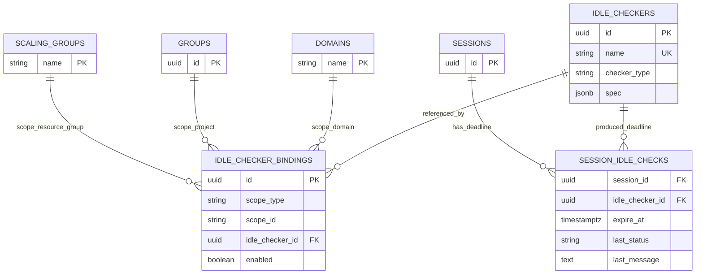
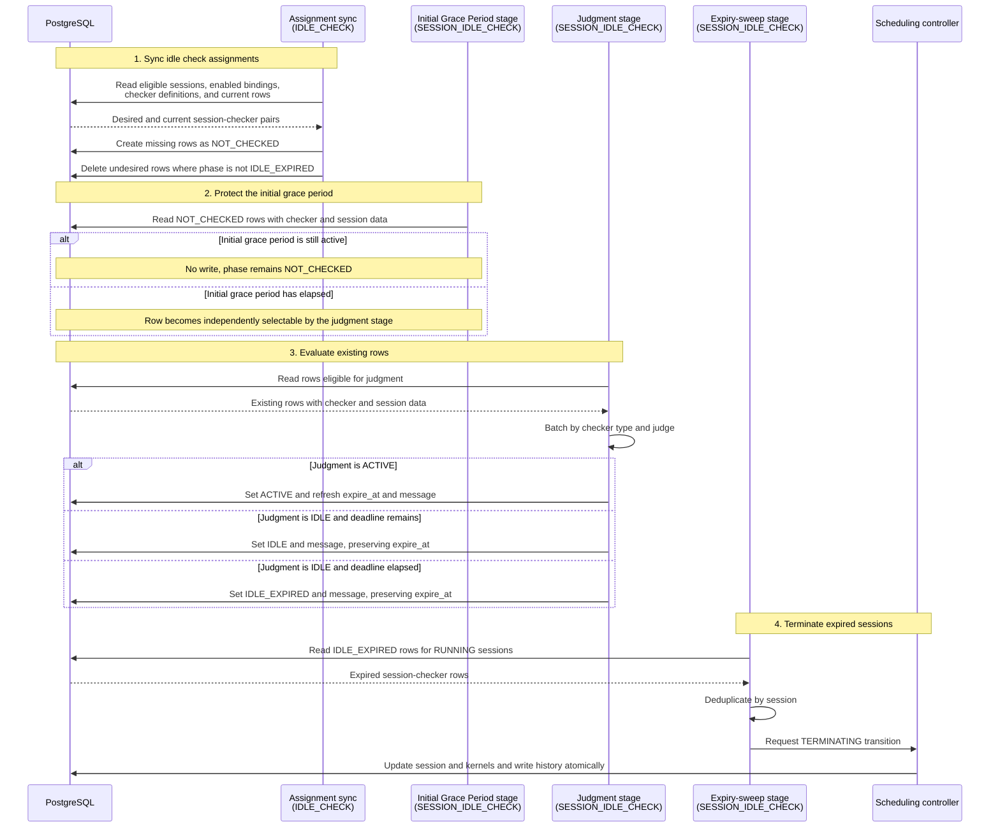

# BEP-1054: reconciler 기반 유휴 검사기

## 동기

Backend.AI Manager 의 유휴 검사기는 지금 `manager/idle.py` 에 있고, 전용 `IdleCheckerHost` 와 `GlobalTimer` 가 구동한다. 스케줄링, 배포, 라우팅이 sokovan coordinator 와 reconciler 패턴으로 옮겨가는 동안 유휴 검사는 별도 timer 와 event 경로에 남아 있고, 구조적인 문제가 몇 가지 있다.

1. **sokovan lifecycle 에서 떨어져 있다.** 유휴 검사는 나머지 lifecycle 이 모여가는 일반 reconciler 흐름 대신 자체 timer 와 `DoIdleCheckEvent` 연결로 실행된다.
2. **유휴 검사기가 일급 객체가 아니다.** 지금 검사기는 Python class 와 config key 묶음이다. 검사기 spec 하나(예: "GPU 가 30분 동안 저사용")를 정의해 여러 도메인, 프로젝트, 자원 그룹에서 재사용할 방법이 없다.
3. **설정이 흩어져 있다.** global 설정은 `config.idle`, keypair 별 값은 keypair resource policy, 런타임과 보고 상태는 Valkey 에 있다. 어느 설정이 어느 session 에 적용되는지 추적하기 어렵다.
4. **판정, I/O, 보고가 얽혀 있다.** 검사기가 Valkey 를 읽고 tick 사이 상태를 쌓고 보고를 인라인으로 기록하므로 시험하고 확장하기 어렵다.
5. **사용률이 legacy live-stat 모양에 묶여 있다.** 사용률 유휴는 agent 가 내보내는 Prometheus 지표를 window 로 집계해 도출할 수 있어야 한다.

이 제안은 유휴 검사를 sokovan reconciler stage 로 옮기고 유휴 검사기를 재사용 가능한 DB 객체로 승격한다. 각 스코프는 별도 association row 로 검사기를 적용한다.

### 목표

- 유휴 검사를 할당 동기화, 최초 유예 기간 처리, 판정, 만료 sweep 의 별도 sokovan reconciler stage 로 실행한다. 일반 Source → Handler → Applier 흐름을 따른다.
- 유휴 검사기를 어떤 스코프에도 독립적인 일급 재사용 DB 객체로 모델링한다.
- 스코프 적용(도메인 / 프로젝트 / 자원 그룹)을 전용 association 테이블로 표현한다.
- 사용률 판정을 agent 가 내보내는 Prometheus 지표로 구동한다.
- 검사기 I/O 와 판정을 유형별 batch 계약 하나 뒤에 두고 보고는 검사기 밖에 둔다. 검사별 예상 정리 시각과 최신 판정을 DB(Valkey 아님)에 저장해 sweep 판단과 클라이언트 보고의 단일 기준으로 삼는다.
- session 이 언제 정리될 예정인지 검사기별로, 그리고 session 수준 집계로 노출한다. Valkey remaining-time 보고를 대체한다.
- session scheduling history 에 일반 유휴 검사 timeout 메시지를 기록한다. 검사기별 상태와 메시지는 유휴 검사 보고 API 로 노출한다.

### 비목표

- 각 검사기의 구체적인 판정 규칙(timeout 계산, threshold 비교, 지표 이름)은 구현 사항이며 범위 밖이다.
- legacy keypair resource policy 의 유휴 설정을 backfill 하거나 fallback 하는 것은 범위 밖이다. reconciler 기반 유휴 검사기는 자기 spec 만 사용한다.

## 현재 설계

유휴 검사는 `IdleCheckerHost.start()` → `GlobalTimer` → `DoIdleCheckEvent` → `do_idle_check()` 로 실행된다. tick 마다 live kernel/session row 를 읽고, inference session 을 제외하고, access key 별 keypair resource policy 를 읽고, 등록된 모든 검사기를 각 session 에 실행한다. 검사기 하나라도 유휴를 보고하면 terminate event 를 낸다.

이 제안에서 중요한 성질은 두 가지다.

- **session 우선 순회.** host 가 session 을 읽고 각 session 에 모든 검사기를 실행한다. 검사기 정의에서 시작하지 않는다.
- **검사기는 데이터가 아니라 코드다.** 검사기는 DB 로 식별할 수 있는 spec 이 아니라 class 와 config 다. 설정은 `config.idle`, keypair resource policy, Valkey live/stat 상태에 흩어져 있다.

### 한계

- 검사기 spec 은 DB 신원이 없어 스코프 간에 재사용할 수 없다.
- binding 별 활성화/비활성화를 표현할 곳이 없다.
- 검사기별 config 모양이 단일 경계에서 검증되지 않는다.
- 사용률이 legacy Valkey live-stat 모양에 묶여 있다.
- 보고 기록이 tick 중에 인라인으로 일어나 판정과 보고가 묶인다.

## 제안 설계

### 개요

재설계는 두 가지 생각에 기반한다.

1. **유휴 검사가 sokovan reconciler stage 가 된다.** `Source` 가 평가할 것을 모으고, `Handler` 가 stage 작업을 진행하며, `Applier` 는 해당하는 경우 stage 소유의 결과를 기록한다. 다른 reconciler stage 와 같은 모양이다. 유휴 검사 할당 동기화는 기존 session-checker row 의 lifecycle 과 분리하고, 만료된 판정에 대한 조치는 그 판정을 만드는 일과 분리한다(*reconciler stage* 참조). sweep 은 Handler 에서 스케줄링 controller 로 교차 도메인 session 전이를 위임하고 Applier 는 no-op 으로 둔다.
2. **유휴 검사기가 일급 DB 객체가 된다.** 검사기는 재사용 가능하고 스코프에 독립적인 spec 이다. 적용 여부와 위치는 검사기를 도메인, 프로젝트, 자원 그룹에 묶는 별도 association row 로 표현한다.

### 데이터 모델

테이블 세 개다. 검사기는 자기 스코프를 갖지 않고, association 테이블이 스코프 관계 전체를 가지며, session 별 결과 테이블이 적용된 검사기마다 session 을 다음에 정리할 시점을 기록한다.

#### `idle_checkers`: 재사용 검사기 spec

| column | type | 설명 |
|---|---|---|
| `id` | UUID, PK | 재사용 검사기의 신원 |
| `name` | string | 사람이 읽는 이름 |
| `description` | string, nullable | 선택 설명 |
| `checker_type` | string | `session_lifetime` / `network_timeout` / `utilization` |
| `initial_grace_period_seconds` | integer | 첫 판정 전 지연 |
| `spec` | JSONB | 검사기 유형별 설정 payload |
| `created_at` / `modified_at` | timestamptz | |

검사기는 의도적으로 **스코프가 없다**. `owner_scope_*` column 을 갖지 않는다. 검사기는 여러 스코프에 묶을 수 있는 정의이고, 스코프에 독립적이기 때문에 spec 하나를 어디서나 재사용할 수 있다. `checker_type` 은 검색과 검증을 위한 최상위 column 이고 `spec` payload 는 그 값에 따라 해석한다.

#### `idle_checker_bindings`: 스코프와 검사기의 association

| column | type | 설명 |
|---|---|---|
| `id` | UUID, PK | |
| `scope_type` | string | `domain` / `project` / `resource_group` |
| `scope_id` | string | 도메인 이름 / 프로젝트 id / 자원 그룹 이름 |
| `idle_checker_id` | UUID, FK → `idle_checkers.id` | 묶인 검사기 |
| `enabled` | bool | 이 binding 이 참여하는지 |
| `created_at` / `modified_at` | timestamptz | |

binding 은 `(scope_type, scope_id) → idle_checker` 간선 하나다. **검사기의 column 이 아니라 이 association 테이블이 "이 검사기가 이 스코프에 적용된다"를 표현하는 유일한 곳이다.** 관계를 분리해 두는 것이 검사기를 진짜 일급 객체로 만든다. 같은 검사기를 여러 스코프에 묶을 수 있고, 한 스코프가 여러 검사기를 묶을 수 있으며, binding 마다 자기 `enabled` flag 를 가진다.

RBAC `association_scopes_entities` 를 재사용하지 않고 전용 association 테이블을 두는 이유는 유휴 적용에 자체 `enabled` flag 와 향후 binding 수준 메타데이터(예: 우선순위)가 필요하고, 유휴 적용 의미를 RBAC 권한 의미와 섞지 않기 위해서다.

#### `session_idle_checks`: session 별 예상 정리 시각과 최신 판정

유휴 검사 할당 동기화 stage 가 실행 중인 session 과 그에 적용된 검사기마다 row 하나를 만든다. 이후 stage 는 이 테이블을 작업 큐로 사용하고 **그 검사기가 session 을 다음에 정리할 시점**과 최신 lifecycle phase 를 기록한다. sweep stage 가 이 row 에 조치하고, 클라이언트는 유휴 검사 보고 API 로 읽으며, scheduling history 는 검사기별 보고를 중복하지 않고 유휴 검사 timeout 이 종료를 trigger 했다고 기록한다.

| column | type | 설명 |
|---|---|---|
| `session_id` | UUID, FK → `sessions.id` (ON DELETE CASCADE) | 평가한 session |
| `idle_checker_id` | UUID, FK → `idle_checkers.id` (ON DELETE CASCADE) | 이 deadline 을 낸 검사기 |
| `expire_at` | timestamptz, nullable | 이 검사기가 session 을 정리할 예정 시각. 검사기가 유예 기간 중이거나 아직 deadline 을 정할 수 없으면 `NULL` |
| `last_status` | string | 현재 lifecycle phase: `NOT_CHECKED`, `ACTIVE`, `IDLE`, `IDLE_EXPIRED` |
| `last_message` | text | 최신 판정과 함께 반환하는 사람이 읽는 사유 |
| `updated_at` | timestamptz | 최신 판정을 저장한 시각 |

기본 키는 `(session_id, idle_checker_id)` 이고 session × 적용 검사기마다 row 하나다. `expire_at` 은 **예상 정리 시각이지 종료 시각이 아니다**. 이 기한이 지나면 판정 stage 가 row 를 `IDLE_EXPIRED` 로 표시하고 sweep stage 가 실제 `TERMINATING` 전이를 수행할 수 있다. `idle_checkers` 로의 FK 가 각 결과를 그 결과를 가진 검사기에 연결하므로 `SessionIdleCheck` node 가 자기 검사기를 참조할 수 있고, 삭제된 검사기의 row 는 cascade 로 제거된다.

phase 의 뜻은 다음과 같다.

| phase | 뜻 |
|---|---|
| `NOT_CHECKED` | binding 이 적용되지만 검사기가 아직 유효한 판정을 내지 않았다 |
| `ACTIVE` | 최신 판정이 활동을 찾아 예상 정리 deadline 을 갱신했다 |
| `IDLE` | 최신 판정이 session 을 유휴로 판단했지만 저장한 deadline 이 아직 지나지 않았다 |
| `IDLE_EXPIRED` | session 이 유휴이고 저장한 deadline 이 지났다. 소유권이 sweep stage 로 넘어갔다 |

#### scope ID 규칙

| `scope_type` | `scope_id` |
|---|---|
| `domain` | 도메인 이름 |
| `project` | 프로젝트 id |
| `resource_group` | 자원 그룹(scaling group) 이름 |

`scope_id` 는 다형 string key 다. 스코프 존재 여부는 DB 수준 foreign key 가 아니라 기록 경로에서 검증한다.

#### ERD



### 검사기 spec 모델

`spec` column 은 **자유 형식 JSON 이 아니다**. row 의 `checker_type` 이 모양을 고정하는 typed 다형 payload 를 담는다. 두 계층이 이를 표현한다.

- **`ABCColumn`: 일반적이고 재사용 가능한 다형 JSONB column.** 유휴 전용이 아니다. load/write 계약(JSONB dict ↔ typed object)을 만족하는 값을 저장하고 읽을 때 typed object 로 복원한다. 유휴 검사가 첫 사용처이지만, 이 column type 은 다형이고 검증된 config 를 저장하는 어떤 테이블도 받치도록 만든 것이다.
- **`IdleCheckerABC`: column 이 담는 유휴 전용 payload.** load 시 `checker_type` discriminator 로 구체 spec(`session_lifetime` / `network_timeout` / `utilization`)에 dispatch 하고, 모든 검사기가 구현하는 동작 계약을 선언한다. 런타임 신호를 어떻게 batch load 하고 자기 할당을 어떻게 평가하는지이며, 각 결정은 `is_active`, 예상 `expire_at`, 그 session 에 대한 메시지를 담는다.

개념적으로(계약만 다룬다. 본문은 구현 사항이다):

```text
ABCColumnPayload                  # storage contract ABCColumn speaks to
  load(raw)  -> payload           # JSONB dict   -> typed object
  write()    -> raw               # typed object -> JSONB dict

IdleCheckerABC(ABCColumnPayload)  # the value stored in idle_checkers.spec
  load(raw)  -> concrete spec     # dispatch by checker_type discriminator
  judge(assignments) -> decisions  # batched I/O -> is_active + expire_at + message
```

이로써 세 가지를 얻는다.

- **검증 경계 하나.** 알 수 없거나 잘못된 spec 은 load 에서 거부되므로 `idle_checkers` row 가 자기 `checker_type` 이 해석할 수 없는 payload 를 담을 수 없다.
- **설정이 검사기와 함께 있다.** `checker_type` 마다 모든 검사기가 이해해야 하는 공유 column 모양 대신 자기 spec field 를 가진다.
- **schema 변경 없이 확장.** 새 `checker_type` 은 `IdleCheckerABC` subtype 을 추가할 뿐이고 테이블과 column 은 그대로다.

`judge` 는 이 계약의 동작 절반이다. 이를 구동하는 orchestration 은 아래 *검사기가 가진 런타임 상태* 에서 설명한다.

### reconciler stage

유휴 검사는 reconciler stage 네 개를 사용한다. 첫 stage 는 binding 에서 적용 가능성을 조정하고, 나머지 stage 는 스코프를 다시 해석하지 않고 기존 `session_idle_checks` row 에서 동작한다.

| stage | reconciler category | source 축 | 책임 |
|---|---|---|---|
| 유휴 검사 할당 동기화 | `IDLE_CHECK` | 스코프, binding, 검사기, session | 현재 적용 가능성에 맞게 `session_idle_checks` row 를 생성하고 제거한다 |
| 최초 유예 기간 | `SESSION_IDLE_CHECK` | 기존 `session_idle_checks` row | 새로 생성한 row 를 최초 유예 기간 동안 `NOT_CHECKED` 로 유지한다 |
| 판정 | `SESSION_IDLE_CHECK` | 기존 `session_idle_checks` row | 검사기를 실행하고 row 를 `ACTIVE`, `IDLE`, `IDLE_EXPIRED` 로 전이한다 |
| 만료 sweep | `SESSION_IDLE_CHECK` | 기존 `IDLE_EXPIRED` row | 해당 session 을 `TERMINATING` 으로 전이한다 |

category 는 별도 history 축이다. 할당 동기화는 `IDLE_CHECK` 에 기록하고, 기존 session-checker row 의 lifecycle 은 `SESSION_IDLE_CHECK` 에 기록한다. 최초 유예 기간, 판정, sweep stage 는 후자 category 안에서 서로 다른 reconciler phase 를 사용한다.

**1. 유휴 검사 할당 동기화 stage**: 어떤 검사기가 지금 어떤 session 에 적용되는지 구체화한다.

- **Source**: 대상이 되는 실행 중 session 의 스코프와 활성 binding 을 해석하고, 원하는 `(session_id, idle_checker_id)` 집합을 기존 row 와 비교한다.
- **Handler**: 생성할 row 와 binding 이 더 이상 적용되지 않는 row 를 산출한다.
- **Applier**: 없는 row 를 `NOT_CHECKED` 로 생성하고 더 이상 필요 없는 row 를 삭제한다. 이미 `IDLE_EXPIRED` 인 row 는 제외한다.

`IDLE_EXPIRED` 제외는 Source snapshot 뿐 아니라 삭제 연산 자체에서도 강제한다. Source 가 읽은 뒤 동시에 만료된 row 를 할당 동기화가 삭제하지 않게 한다. session 이나 검사기 자체를 제거하는 일은 여전히 영구 삭제 경계다. 기존 foreign key cascade 가 `session_idle_checks` row 를 제거할 수 있고, 만료된 row 도 포함한다.

binding 이 비활성화되거나 제거되면 만료되지 않은 row 를 삭제한다. 나중에 binding 을 다시 활성화하면 새 `NOT_CHECKED` row 를 만들고 최초 유예 기간을 다시 시작한다. `IDLE_EXPIRED` row 는 binding 변경으로 초기화되지 않고 sweep stage 가 계속 맡는다.

**2. 최초 유예 기간 stage**: 새로 적용된 session 이 검사기의 최초 유예 기간이 지나기 전에 판정되지 않게 보호한다.

- **Source**: 기존 `NOT_CHECKED` row 를, 최초 유예 기간이 아직 적용되는지 판단하는 데 필요한 검사기와 session 데이터와 함께 읽는다.
- **Handler / Applier**: 지연 동안 row 를 `NOT_CHECKED` 로 둔다. 지연이 지난 row 는 판정 stage 대상이 된다. stage 간에 in-memory 상태를 전달하지 않는다.

**3. 판정 stage**: 대상이 되는 기존 row 에 검사기 구현을 실행한다.

- **Source**: 판정 대상인 `session_idle_checks` row 를 검사기 정의와 session 데이터와 함께 읽는다. 스코프 binding 을 해석하지 않는다. row 생성과 제거는 할당 동기화에만 속한다.
- **Handler**: batch 를 검사기 유형으로 pivot 하고 각 검사기의 batch `judge` 계약을 호출한다. 검사기가 가진 외부 읽기는 이 계약 뒤에서 일어난다. Handler 는 각 `is_active` 결정을 결정 deadline 을 사용해 `ACTIVE`, `IDLE`, `IDLE_EXPIRED` 저장 판정으로 변환한다.
- **Applier**: 확정된 판정을 기존 row 에만 적용하고 `expire_at`, `last_status`, `last_message` 를 변경한다. 이 stage 는 없는 row 를 insert 하지 않는다.

**4. 만료 sweep stage**: 만료된 판정이 나타내는 session 을 종료한다.

- **Source**: `IDLE_EXPIRED` 인 `session_idle_checks` row 를 `RUNNING` session 과 join 해 읽는다. 자원 그룹별 순회나 검사기 실행이 필요 없다. 한 session 의 만료 row 가 여러 개여도 유휴 검사 보고 API 로 계속 볼 수 있고, session 자체는 최대 한 번 전이한다.
- **Handler**: row 를 session 으로 중복 제거한 뒤 session ID 를 스케줄링 controller 의 공통 종료 연산에 전달한다. 이때 idle-timeout lifecycle 사유와 일반 유휴 검사 timeout history 메시지를 함께 준다. 연산은 기존 scheduler 종료 lifecycle 을 따르고, 이미 종료 중이거나 terminal 인 session 은 건너뛴다.
- **Applier**: no-op. Handler 가 유휴 검사 소유의 저장 결과를 적용하는 대신 상태를 변경하는 연산을 session scheduling 도메인에 위임한다.

row 가 `IDLE_EXPIRED` 가 되면 할당 동기화도 판정도 그것을 변경하지 않는다. sweep 은 런타임 신호나 검사기 적용 가능성을 다시 평가하지 않는다. 판정 주기는 런타임 변경과 지난 deadline 이 얼마나 빨리 반영되는지를 정하고, sweep 주기는 `IDLE_EXPIRED` 가 저장된 뒤 종료가 얼마나 늦게 일어날 수 있는지를 정한다.

### Source 조회 방향

스코프 해석은 **유휴 검사 할당 동기화** stage 에만 속한다. 일반 reconciler 위에 있고 tick 당 fetch 한 번이며 자원 그룹별이 아니다. 그래도 그 Source 는 session 을 **자원 그룹별로** 읽는다. scheduler coordinator 가 이미 사용하는 패턴(`ScheduleCoordinator` 가 scaling group 을 순회하며 `get_sessions_for_handler(scaling_group, …)` 로 각각 읽는다)을 따른다. 최초 유예 기간, 판정, sweep Source 는 `session_idle_checks` 에서 시작하고 이 작업을 반복하지 않는다.

**자원 그룹마다 Source 는:**

1. 그룹에서 시작 시각이 기록된, 유휴 검사 대상 실행 중 session 을 읽는다.
2. 그 session 들이 속한 서로 다른 스코프를 모은다: 자원 그룹, 각자의 프로젝트, 각자의 도메인.
3. 그 스코프에 붙은 활성 `idle_checker_bindings` 만(검사기 spec 과 함께) 읽는다.
4. 각 session 의 effective 검사기 집합을 자기 스코프의 binding 으로 구성한다.

**왜 session 우선이고 자원 그룹별인가:**

- **일관성.** 새 global 질의 대신 scheduler coordinator 의 자원 그룹별 읽기 모양을 재사용한다. 유휴 stage 는 자체 읽기를 한다(일반 reconciler 에 그대로 공유할 fetch 가 없다). 다만 같은 모양을 유지한다.
- **검사기 load 최소화.** 실행 중 session 이 있는 스코프에 묶인 검사기만 읽는다. 없는 스코프는 조회하지 않는다.
- **global scan 없음.** tick 마다 모든 binding 을 스캔하지 않는다.

**왜 binding 우선이 아닌가**. 활성 binding 을 모두 스캔하고 결합 scope predicate 를 만든 뒤 묶인 모든 스코프의 session 을 fetch 하는 방식은:

- tick 마다 global binding 스캔을 강제하고,
- 실행 중 session 이 실제로 어디에 있든 묶인 모든 스코프의 session 을 읽는다. scheduler 가 이미 사용하는 자원 그룹별 읽기 패턴에서 벗어난다.

### scope 해석

각 session 은 정확히 세 후보 스코프에 대응하며, 명시적으로 계산한다.

```text
resource_group: the session's resource group
project:        the session's project
domain:         the session's domain
```

RBAC scope-chain 순회는 사용하지 않는다. 자원 그룹은 여러 도메인과 프로젝트에 연결될 수 있으므로 부모 관계를 따라가면 session 과 무관한 검사기가 붙을 수 있다.

session 의 **effective 검사기**는 자기 자원 그룹, 프로젝트, 도메인에 붙은 활성 binding 의 합집합이다. handler 는 구현된 모든 검사기를 평가하고, 각 검사기가 그 session 에 대한 자기 `expire_at` 을 내며 별도 `session_idle_checks` row 로 저장한다. 그 deadline 중 가장 이른 것이 session sweep 시점을 정하므로 한 session 은 여전히 최대 한 번 종료된다.

#### scope 간 매칭

session 은 동시에 세 스코프에 속하고 각 스코프가 여러 binding 을 가질 수 있으므로 매칭 경우가 셋이다. 셋 모두 규칙 하나로 줄어든다. **합집합을 취하고 검사기로 중복을 제거하고 모든 검사기를 평가하며 각 검사기의 `expire_at` 을 자기 row 로 기록한다.**

- **스코프마다 다른 검사기.** 도메인에 묶인 `network_timeout`, 프로젝트에 묶인 `utilization`, 자원 그룹에 묶인 다른 검사기가 모두 적용된다. effective 집합은 합집합이고 모든 검사기가 자기 `expire_at` row 를 낸다.
- **여러 스코프에 걸친 같은 검사기.** `idle_checker_id` 하나가 session 의 도메인과 프로젝트 양쪽에 묶일 수 있다. 검사기 id 로 중복을 제거해 **하나의** effective 검사기로 해석하고 그 session 에 한 번 평가한다.
- **한 스코프에 묶인 여러 검사기.** 스코프 하나(예: 자원 그룹 하나)가 여러 binding 을 가질 수 있고, binding 마다 자기 row 와 `enabled` flag 를 가진다. 활성 검사기가 모두 참여한다. 같은 `checker_type` 정의가 여러 개면 구현 호출 하나로 batch 한다.

`enabled = false` 인 binding 은 원하는 합집합에서 뺀다. 따라서 할당 동기화가 그 binding 의 만료되지 않은 `session_idle_checks` row 를 제거한다. `IDLE_EXPIRED` row 는 binding 이 비활성화되거나 제거된 뒤에도 sweep 을 위해 남긴다.

### 검사기가 가진 런타임 상태

판정 Source 는 Valkey 나 Prometheus 를 읽으려고 중앙에서 검사기 유형으로 분기하지 않는다. Handler 가 할당을 검사기 유형으로 묶고 구현마다 tick 당 한 번 호출한다. 각 검사기가 자기 batch 외부 읽기와 내부 판정 재료를 가진다. 공개 계약은 할당과 판정만 노출한다. 이렇게 하면 질의 모양이 검사기 안에 머물고 preparer 상태를 orchestration 계층에 노출하지 않는다.

### 검사기 유형

| `checker_type` | 다음일 때 종료한다 | 런타임 신호 |
|---|---|---|
| `session_lifetime` | 시작한 session 이 최대 수명보다 오래 실행됐다. 0 이면 정의를 비활성화한다 | 없음(session 시작 시각) |
| `network_timeout` | interactive session 이 timeout 을 넘어 접근도 활성 연결도 없었다 | 마지막 접근과 활성 연결 신호 |
| `utilization` | 유예 기간 뒤 session 의 자원 사용률이 window 동안 threshold 아래에 머문다 | window 사용률 지표 |

각 검사기의 정확한 판정 규칙은 구현 사항이며 여기서 의도적으로 정하지 않는다. 스코프 하나가 같은 `checker_type` 의 검사기를 여러 개 묶을 수 있다.

검사기 spec 은 reconciler 기반 유휴 판정의 유일한 설정 원천이다. Source 와 검사기 구현은 `keypair_resource_policies.idle_timeout` 이나 `keypair_resource_policies.max_session_lifetime` 을 읽지 않는다. 그 legacy 값은 fallback 값도 암묵적 기본값도 아니다. 검사기 적용 여부는 스코프 binding 만 정하고, threshold 나 수명은 spec 만 정한다.

### Prometheus 기반 사용률

사용률은 legacy Valkey live-stat 모양이 아니라 agent 가 내보내는 Prometheus 지표를 window 로 집계해 평가한다. 구체적인 지표 이름과 label 집합은 agent 지표 설계와 함께 정한다. 이렇게 하면 사용률 판정이 legacy stat 누적 경로에서 분리되고 지표 pipeline 과 함께 발전할 수 있다.

### 종료 처리

**sweep** stage 의 Handler 는 container 를 죽이거나 최종 `TERMINATED` 전이를 수행하지 않는다. deadline 이 지난 session 을 기존 scheduler 종료 lifecycle 로 `TERMINATING` 으로 표시하도록 스케줄링 controller 에 요청한다. 이 lifecycle 은 이미 종료 중이거나 terminal 인 session 에 멱등이다. sweep Applier 는 no-op 이다. 그러면 기존 session scheduler coordinator 가 자원 그룹별로 `TERMINATING` session 을 읽고 지금처럼 agent 종료를 진행한다.

공통 종료 연산은 선택적인 scheduling-history 메시지를 받고 기본값은 `mark_terminating success` 다. sweep 은 일반 유휴 검사 timeout 메시지를 준다. 실제로 전이한 모든 session 에 대해 session 상태 변경, kernel 상태 변경, scheduling-history 기록이 원자적으로 일어난다. 검사기별 `last_status` 와 `last_message` 는 `session_idle_checks` 에 남고 scheduling history 에 중복되지 않고 유휴 검사 보고 API 로 노출된다.

일반 reconciler 의 엔티티별 retry 분류(`decisions()`)는 이 stage 들이 의도적으로 사용하지 않는다. row 변경 집합도 만료 session 목록도 retry 가능한 엔티티별 결과 집합이 아니다. stage 는 분류 경로를 비워 둔다.

### deadline 저장과 보고

검사별 예상 정리 시각은 countdown 이 아니라 **절대 timestamp** 로 `session_idle_checks.expire_at` 에 저장한다. 남은 시간은 읽을 때 `expire_at - now` 로 도출한다(기한이 지나면 음수다). 최신 status 와 message 를 함께 저장하고 `updated_at` 에 그 판정을 저장한 시각을 기록한다. 절대 timestamp 는 countdown 을 tick 시키려고 기록할 필요가 없고 refresh tick 사이에 어긋나지 않는다.

이 DB 기반 보고는 이전에 검사기별로 `session.{session_id}.idle_checker.{checker_id}.remaining` 아래 발행하던 **Valkey remaining-time 보고를 대체한다**. 그 Valkey 경로와 `IdleCheckerHost.get_idle_check_report` 는 폐기한다. `session_idle_checks` 가 sweep 판단과 클라이언트 remaining time 의 단일 기준이다.

### GraphQL 노출

`session_idle_checks` 는 Strawberry `SessionV2` API 로 노출해 클라이언트가 session 수준 집계를 읽고 검사기별 기여를 자세히 볼 수 있게 한다.

- **`SessionIdleCheck` node**: `session_idle_checks` row 마다 하나. 묶인 `idle_checker`(id / name / `checker_type`), `expire_at`, 도출한 `remaining_seconds`(읽을 때 계산하는 `expire_at - now`), `last_status`, `last_message`, `updated_at` 을 담는다. `SessionV2` 에서 접근할 수 있다.
- **`SessionV2.idle_expire_at`**: session 의 null 이 아닌 `expire_at` 값의 `min` 이다. session 이 정리될 예정인 가장 이른 시각이다. 적용된 검사기 중 deadline 이 있는 것이 없으면 `NULL` 이다.

이 field 는 `api/gql/session/types.py` 의 `SessionV2GQL` 에 추가한다. legacy Graphene module 은 Valkey 보고를 읽던 옛 `Session.idle_checks` JSONString 을 제거할 때만 참조한다. 그곳에는 새 API 표면을 추가하지 않는다.

### stage 순서

각 stage 는 자기 reconciliation tick 으로 독립적으로 실행되고 PostgreSQL 을 인계 경계로 사용한다. 어떤 stage 도 in-memory 결과를 다음 stage 에 직접 전달하지 않는다.




## 열린 질문

- 사용률 `and` / `or` threshold 의미를 legacy 동작과 맞추는 방안과 다시 정의하는 방안 사이의 선택에 대한 결정이 필요하다.

## 참고

- `src/ai/backend/manager/idle.py`
- `src/ai/backend/manager/sokovan/reconciler/base.py`
- `src/ai/backend/manager/sokovan/stages/factory.py`
- `src/ai/backend/manager/models/idle_checker/row.py` (새 `session_idle_checks` 테이블)
- `src/ai/backend/manager/api/gql/session/types.py` (새 `SessionV2` 유휴 검사 노출)
- `src/ai/backend/manager/api/gql_legacy/session.py` (legacy `Session.idle_checks` 제거만)
- `docs/superpowers/specs/2026-06-17-first-class-idle-checker-design.md`
- [BEP-1029: Sokovan Observer Handler](BEP-1029-sokovan-observer-handler.md)
- [BEP-1050: Prometheus Query Preset System](BEP-1050-prometheus-query-preset-system.md)
