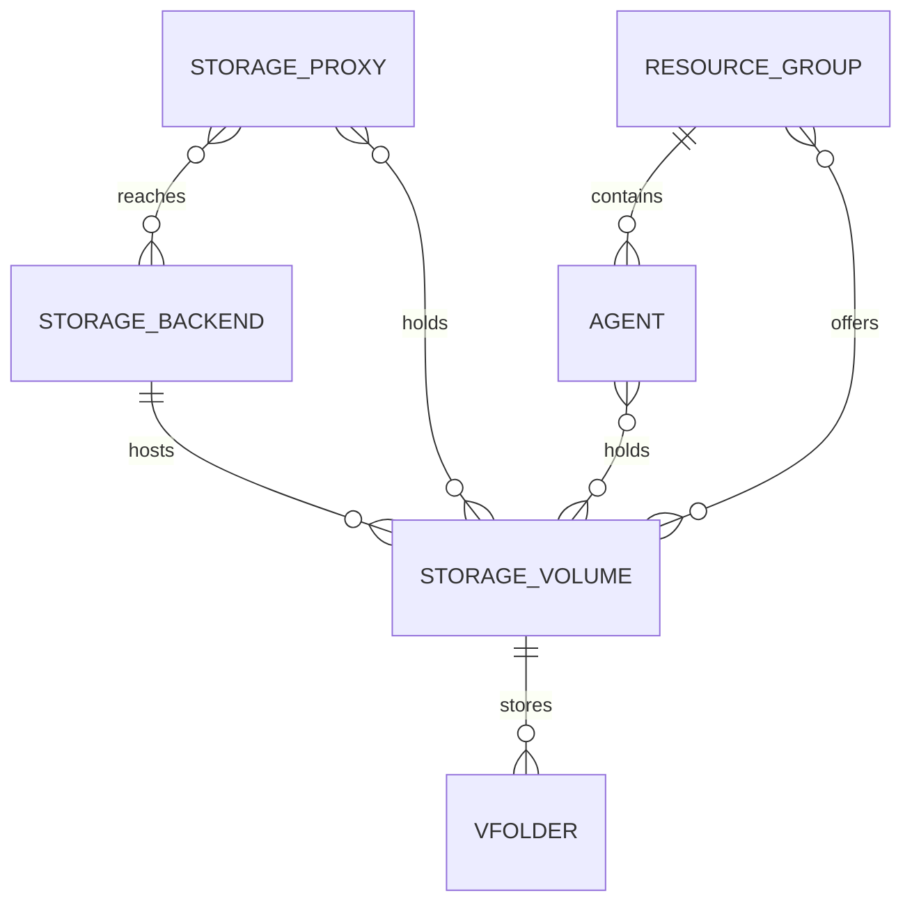

<!-- context-for-ai
type: bep
scope: Normalize storage backends, volumes, and which services hold them into the database
key-constraints:
  - Storage proxy identity and address stay in the service catalog, never in a dedicated table
  - Volume and backend identity is an operator-assigned id declared in each service's configuration, never a name or an inferred path
  - Service state lives in the service catalog; storage state lives on relationships, never on a volume or a backend
  - Mounts are never recorded in the manager database; a volume implementation owns its mounts and reports one volume state per service
key-decisions:
  - Heartbeat upserts volumes by id; backends are inserted only when absent
  - Agents and storage proxies run the same volume implementation from the same volume declaration
upstream: BEP-1046 (service catalog)
-->

# Storage Proxy 개선

## 관련 이슈

- JIRA Epic: BA-7620 (스토리지 백엔드와 볼륨 정규화 기반 작업)
- JIRA: BA-7630 (storage proxy registration payload)
- 관련 Epic: BA-4313 (DB 기반 서비스 카탈로그를 사용하는 통합 서비스 디스커버리)

## 동기

Storage Proxy 와 volume 정보가 서로 맞지 않는 세 곳에 흩어져 있고, 어느 곳도 기본적인 운영 질문에
응답하지 못한다.

| 문제 | 결과 |
|---------|-------------|
| Proxy 연결 설정이 etcd 에 있고 manager bootstrap 때 한 번 읽는다 | proxy 를 추가하거나 변경하려면 manager 를 재시작해야 한다 |
| Volume 은 각 proxy 의 TOML 파일에만 있다 | manager 가 모든 proxy 를 호출하지 않고는 volume 을 나열할 수 없다 |
| `vfolders.host` 는 `"proxy:volume"` 문자열이다 | 참조 무결성이 없다. proxy 이름을 변경하거나 제거하면 vfolder 가 조용히 깨진다 |
| 어느 backend appliance 가 volume 을 제공하는지 기록이 없다 | appliance 가 고장 났을 때 어느 volume 이 영향을 받는지 알 수 없다 |
| `GET /volumes` 는 proxy 의 설정을 그대로 반환한다 | storage 가 사라진 volume 과 정상 volume 을 구분할 수 없다 |

목표는 모든 연결이 row 이고, 서비스 생존 여부가 한 곳에서 오며, manager 가 database 에서 "어느
volume 이 있고, 누가 제공하며, 정상인가"에 응답하는 정규화 모델이다.

## 현재 설계

| 영역 | 지금 있는 곳 | 상태 |
|------|---------------------|--------|
| Proxy 주소, secret, TLS, timeout | etcd `volumes/proxies/<name>/` | ➕ 옮길 것 |
| Proxy 생존 여부 | 서비스 카탈로그 (`service_catalog`), 등록 경로 비활성 | ✅ 있음, 사용 안 함 |
| Volume 목록 | 각 proxy 의 TOML `[volume.<name>]`, 실행 중 `GET /volumes` 로 읽음 | ➕ 정규화할 것 |
| Backend appliance | 표현 없음. volume 마다 backend *type* 문자열만 있음 | ➕ 추가할 것 |
| Volume 과 자원 그룹 | 표현 없음. 모든 자원 그룹이 모든 volume 을 사용할 수 있음 | ➕ 추가할 것 |
| vfolder 와 volume | `vfolders.host` 문자열 | ➕ 정규화할 것 |

서비스 카탈로그(`service_catalog`, `service_catalog_endpoint`)는 heartbeat, 상태, role/scope 로
key 로 사용하는 endpoint 를 갖추고 이미 있고, 모든 컴포넌트가 publisher 를 함께 배포한다. 이 BEP 는
카탈로그를 다시 정의하지 않고 그 위에 구축한다. BEP-1046 을 본다.

## 제안 설계

### 엔티티 모델

스토리지 백엔드는 storage appliance 하나다. 스토리지 볼륨은 그 위의 논리 볼륨이고 운영자가 지정한
id 로 식별한다. Storage Proxy 와 에이전트 모두 volume 을 보유한다. 둘 다 같은 volume 선언에서 같은
volume 구현을 실행하고, 그 구현이 필요한 mount 를 소유한다. volume 하나는 한 서비스의 여러 mount 로
뒷받침될 수 있고 Hammerspace 에서는 사용자마다 하나이므로, 연결은 mount 하나가 아니라 서비스가
volume 을 보유하는 단위다. 자원 그룹은 자기 에이전트에 스케줄된 세션에 volume 묶음을 제공한다.

위의 모든 다대다 연결은 자기 데이터를 가진다.

| 연결 | 담는 데이터 | 정하는 주체 |
|--------------|---------|--------|
| Storage Proxy, 스토리지 백엔드 | 이 proxy 에서 appliance 가 응답하는지 | Proxy probe |
| Storage Proxy, 스토리지 볼륨 | volume 구현이 보고하는 대로 이 proxy 에서 volume 을 사용할 수 있는지 | Proxy 선언과 volume 구현 |
| 에이전트, 스토리지 볼륨 | volume 구현이 보고하는 대로 이 에이전트에서 volume 을 사용할 수 있는지 | 에이전트 선언과 volume 구현 |
| 자원 그룹, 스토리지 볼륨 | 이 그룹에 volume 을 제공하는지 | 관리자 |

Storage Proxy 와 에이전트는 storage 전용 record 가 아니다. 서비스다. 식별자, 주소, 상태가 서비스
카탈로그에 있고, 이 제안은 그것에 매달리는 storage 전용 연결만 추가한다.

에이전트, volume 연결은 어느 에이전트가 volume 을 보유하는지 기록한다. 그 연결이 배치를 제약하는지는
이 문서의 범위 밖이다.

### 식별자

스토리지 볼륨과 스토리지 백엔드는 각각 **id (UUID)** 로 식별한다. 운영자가 지정하고, 그것을
선언하는 모든 서비스의 설정에 기록한다. 두 서비스가 같은 id 를 선언하면 같은 volume 또는 같은
backend 를 선언한 것이고, 그 선언이 시스템이 가진 동일성의 유일한 증거다. 이름은 사람이 읽는
레이블로 남고 참조를 건드리지 않고 변경할 수 있다.

이름도 경로도 식별자가 될 수 없다. 이름은 지금 proxy 마다 scope 가 있으므로 두 proxy 의 같은 설정
section key 가 무관한 storage 를 의미할 수 있다. 경로는 한 host 의 로컬 mount 지점이다. 같은
export 를 서로 다른 두 경로에 mount 해도 여전히 volume 하나이고, 무관한 로컬 disk 둘을 같은 경로에
mount 하면 volume 둘이다.

### 상태 관리

**Storage Proxy 와 에이전트의 상태는 서비스 카탈로그로 관리한다.** 둘 다 거기에 등록하고 heartbeat
를 보내며, 서비스가 살아 있는지는 거기서만 응답한다. `agents` 테이블은 scheduling 이 반드시 필요로
하는 것만 유지하고, 에이전트 상태의 나머지는 카탈로그 record 에 속한다. 그 경계가 정확히 어디인지는
BEP-1046 에서 정한다.

**storage 상태에 관한 나머지는 연결에 속한다. 스토리지 백엔드도 스토리지 볼륨도 자기 상태를
가지지 않는다.**

| 대상 | 관리하는 상태 | 위치 |
|---------|--------------|-------|
| Storage Proxy, 에이전트 | ✅ 생존 여부 | 서비스 카탈로그. heartbeat 와 오래된 record 스윕에서 얻는다 |
| Storage Proxy, 스토리지 백엔드 | ✅ 이 proxy 에서 appliance 에 접근할 수 있는가 | 연결 |
| Storage Proxy, 스토리지 볼륨 | ✅ 이 proxy 에서 volume 을 사용할 수 있는가 | 연결 |
| 에이전트, 스토리지 볼륨 | ✅ 이 에이전트에서 volume 을 사용할 수 있는가 | 연결 |
| 자원 그룹, 스토리지 볼륨 | 관리자가 활성화, 비활성화하는 값. 건강 상태가 아니다 | 연결 |
| 스토리지 백엔드 자체 | ❌ 관리하지 않음 | 없음 |
| 스토리지 볼륨 자체 | ❌ 관리하지 않음 | 없음 |

스토리지 백엔드에는 전체 판정이 없다. 그 volume 을 보유한 서비스만 각자의 네트워크 경로로 appliance
에 접근할 수 있고, 그 관찰을 하나의 값으로 합치려면 임의의 규칙이 필요하다. proxy 넷 중 하나에
접근할 수 있는 것은 정상도 비정상도 아니다. 소비자가 연결별 상태를 읽고 스스로 판단한다.

같은 이유로 volume 에도 상태가 없다. 어떤 서비스도 보고하지 않는 volume 은 비정상이 아니라 서비스
연결이 없을 뿐이고, 그 위의 vfolder 는 mount 할 수 없다. record 는 그와 무관하게 유지하므로 vfolder
는 유효한 참조를 유지한다.

서비스, volume 연결의 상태는 그 서비스의 volume 구현이 보고하는 volume 상태다. 구현이 mount 를
소유하고 그것에서 상태 하나를 도출한다. mount 하나인 volume 은 그 mount 의 상태를 보고하고, mount
여럿인 volume 은 자기 규칙을 적용한다. 어느 mount 에든 문제가 있으면 문제를 보고하는 식이다. mount
자체는 manager database 에 절대 기록하지 않는다. Hammerspace 에서 volume 은 사용자마다 mount 를
하나 얻으므로 mount 마다 record 를 두면 volume 수가 아니라 사용자 수에 따라 늘어난다.

volume 검사와 backend 검사는 서로 독립적으로 실패하므로 구분한다. vendor appliance 가 관리 API 에
응답하는데 한 proxy 의 네트워크 mount 가 조용히 끊어질 수 있다.

| 검사 | 담당 | 찾는 것 |
|-------|----------|---------|
| volume 초기화 때 저장한 값과 `st_dev` 비교 | volume 구현, mount 별 | mount 가 끊겨 경로가 아래 디렉터리로 되돌아갔는지 |
| timeout 을 둔 executor 안의 `statvfs` | volume 구현, mount 별 | 죽은 네트워크 mount. timeout 자체가 신호다 |
| volume 이름을 담은 marker file | volume 구현, mount 별 | 경로가 선언한 것과 다른 storage 를 제공하는지 |
| `get_hwinfo()` | Storage Proxy | backend appliance 자체 |

mount 검사 셋은 지금의 단일 mount 구현이 volume 상태를 도출하는 방식이다. 다른 구현은 mount 를
다르게 검사할 수 있다. 서비스 밖으로 나가는 것은 그 구현이 보고하는 volume 상태뿐이다.

각 probe 는 자기 주기 loop 에서 실행되고, 마지막 결과를 측정 시각과 함께 서비스 메모리에 남긴다.
heartbeat 가 그 snapshot 을 전달한다. probe 주기와 heartbeat 주기는 독립적으로 유지되므로 느리거나
멈춘 probe 가 heartbeat 를 지연시키지 않고 정상 서비스를 죽은 것처럼 보이게 하지도 않는다. 모든
항목이 검사 시각을 가지므로 서비스는 별도의 unknown 상태를 보고하지 않는다. manager 가 최신 것과
오래된 것을 스스로 판단하고, 아직 probe 하지 않은 volume 도 상태 없이 선언된 채로 있다.

probe 는 volume 별로 독립적으로 실행한다. 죽은 네트워크 mount 는 system call 에서 블록되고, 한 loop
에서 volume 을 차례로 조회하는 방식이면 하나가 나머지 probe 를 지연시킬 수 있다. timeout 난 probe 는 이전 시도가 끝나지
않은 동안 재시도하지 않는다. await 를 취소해도 executor thread 가 해제되지 않기 때문이다.

volume 실패는 에이전트에 기록하지 않는다. 알림 규칙을 통해 관리자에게 도달한다.

### record 생성과 변경

등록은 heartbeat 가 이끌므로 새로 설치할 때 수동 설정이 필요 없고, 이후에도 모든 것을 관리자가
변경할 수 있다. 서비스는 추가만 한다. 제거하는 주체는 manager 뿐이다.

**서비스가 시작해 초기화를 마친다.** 서비스 카탈로그에 등록하고, heartbeat 로 자기가 사용하도록 설정된 backend
와 보유한 volume 을 각각 volume 구현이 보고하는 상태와 함께 선언한다. 그러면 manager 가 다음을
한다.

- 그 id 의 record 가 **없을 때만** 스토리지 백엔드 record 를 추가하므로 관리자가 제공한 연결 정보는
  그대로 유지된다.
- 스토리지 볼륨을 id 로 upsert 하고 backend 에 연결한다. 선언한 backend id 를 찾을 수 없으면 에러를
  log 로 남기고 volume 을 연결하지 않은 채 둔다.
- 서비스의 backend, volume 연결을 생성하고, 첫 보고 전까지 상태를 비워 둔다.

서비스 설정의 모든 volume 과 backend 는 id 를 가진다. id 가 빠진 선언은 생성된 id 로 등록되지 않고
거부되므로, 어느 record 가 존재하는지는 항상 운영자의 선택이다. 연결 정보와 자격 증명은 heartbeat 로
전달하지 않는다. 공유 event bus 를 지나기 때문이다.

**heartbeat 가 정상적으로 도착한다.** 카탈로그가 이를 기록한다. 서비스의 연결을 지금 보고한 내용과
맞춰 조정한다. 새로 선언한 volume 은 연결을 얻고, 더 이상 선언하지 않는 volume 은 연결을 삭제하지
않고 분리로 표시한다. backend 와 volume record 는 volume upsert 외에는 건드리지 않는다.

**heartbeat 가 도착하지 않는다.** heartbeat 를 놓친 것이 서비스가 사라졌다는 증거는 아니다. event
bus 가 지연되거나, 메시지를 버리거나, 서비스 자체는 계속 동작하는데 publisher 와 분리될 수 있다.
그래서 manager reconciler 가 마지막 heartbeat 가 기준을 지난 카탈로그 record 를 조회해, 그 서비스를
상대로 판단하기 전에 **직접 probe 한다.** 응답하는 서비스는 record 를 갱신하고 volume 을 다시
검증한다. probe 에 실패한 서비스만 비정상으로 표시한다. 이것은 나이만으로 record 를 비정상으로
표시하는 BEP-1046 의 수동적인 오래된 record 스윕을 확장한다.

서비스가 내려간 것으로 확인되면 그 연결은 그대로 두되 더 이상 사용 가능하게 취급하지 않으므로, 이
서비스만 보유한 volume 위의 vfolder 는 mount 할 수 없다. 다른 정상 서비스가 여전히 보고하는 volume
은 완전히 사용할 수 있다. volume 상태를 연결별로 두는 이유가 이것이다.

**서비스가 등록 해제한다.** database 에서 삭제하는 것은 없다. 카탈로그 record 가 등록 해제 상태로
옮겨가고 manager 가 그 서비스의 storage 연결을 분리로 표시한다. 어느 서비스가 어느 volume 을
보유했는지 기록이 남고, 복귀한 서비스는 아무것도 없는 데서 다시 생성되지 않고 다시 붙는다. backend
와 volume record 는 그대로 유지된다. vfolder 가 참조하므로 영구 삭제되는 것은 없다.

**관리자가 조작한다.** 자원 그룹이 어느 volume 을 제공하는지는 이 방법으로만 정하고, manager 가 가진
backend 연결 정보 사본도 마찬가지다. volume 을 생성하거나 변경하는 API 는 없다. volume 은 서비스가
선언하기 때문에 존재한다. 다만 관리자는 volume 하나를 소프트 삭제할 수 있다. 소프트 삭제된 volume 은 새 vfolder
생성에서 제외되지만 기존 참조는 모두 유효하다. 계속 선언하는 서비스가 그 volume 을 되살리지 않는다.

| record | 생성 | 변경 | 제거 |
|--------|-----------|-----------|-----------|
| 스토리지 백엔드 | 처음 선언한 heartbeat | 관리자 | 없음 |
| 스토리지 볼륨 | 처음 선언한 heartbeat | heartbeat | 관리자, 삭제만 |
| Storage Proxy, backend | heartbeat | probe 결과 | 삭제하지 않음. 등록 해제 때 manager 가 분리로 표시 |
| Storage Proxy, volume | heartbeat | heartbeat, 보고된 volume 상태 | 삭제하지 않음. 서비스가 등록 해제하거나 선언을 멈추면 분리로 표시 |
| 에이전트, volume | heartbeat | heartbeat, 보고된 volume 상태 | 삭제하지 않음. 서비스가 등록 해제하거나 선언을 멈추면 분리로 표시 |
| 자원 그룹, volume | 관리자 | 관리자 | 관리자 |
| vfolder, volume | vfolder 생성 | 없음 | vfolder 와 함께 |

### 호출 흐름

에이전트와 Storage Proxy 는 같은 volume 구현을 실행한다. 에이전트 설정에 volume 선언을 추가하기만 하면
에이전트가 그 volume 을 보유한다. mount 확보, 경로 해석, volume 상태 도출은 구현이 맡고, 두 서비스는
그 위에 노출하는 것만 다르다.

**Storage Proxy**

| 시점 | 호출 대상 | 목적 |
|------|-------|---------|
| 시작할 때, 이후 주기적으로 | event bus | 자기 backend 와 보유한 volume 을 선언하는 heartbeat. 각 volume 은 메모리에 있는 최신 volume 상태를 함께 보낸다 |
| 주기적으로, volume 별로 독립 | 자기 mount | volume 구현이 실행하는 volume 상태 검사. 결과는 메모리에 두고 다음 heartbeat 에 담긴다 |
| 주기적으로 | backend appliance | `get_hwinfo()`. 이 proxy 에서 appliance 에 접근할 수 있는지 확인한다. 역시 메모리에 둔다 |
| manager 의 요청 시 | 없음 | volume 검증 endpoint 를 제공한다. **신규**. 기존 volume 목록은 설정을 그대로 반환할 뿐 volume 이 준비됐는지 응답하지 못한다 |
| client 의 요청 시 | 없음 | 기존 vfolder 파일 API 를 변경 없이 제공한다 |

**Agent**

| 시점 | 호출 대상 | 목적 |
|------|-------|---------|
| 시작할 때, 이후 주기적으로 | event bus | 보유한 volume 을 선언하는 heartbeat. 각 volume 은 최신 volume 상태를 함께 보낸다. **신규**. 에이전트에는 지금 volume 개념이 없다 |
| 주기적으로, volume 별로 독립 | 자기 mount | volume 구현이 실행하는 volume 상태 검사. 결과는 메모리에 두고 다음 heartbeat 에 담긴다 |
| 세션 준비 시, 세션이 vfolder 를 mount 할 때 | 자기 volume 구현 | 각 vfolder 의 volume 을 이 에이전트에서 사용할 수 있는지와 vfolder 경로가 그 아래에 있는지 검사한 뒤 bind 할 host 경로를 해석한다. 둘 중 하나라도 실패하면 준비도 실패한다. **신규**. 지금은 manager 가 proxy 에 물어 경로를 준다 |

**Manager**

| 시점 | 호출 대상 | 목적 |
|------|-------|---------|
| heartbeat 마다 | 자기 database | 카탈로그 record 와 storage 연결을 기록한다. heartbeat 가 전달한 probe 결과를 포함한다 |
| proxy 주소가 필요할 때마다 | 자기 database | role 과 scope 로 서비스 카탈로그를 조회한다. 이전에 etcd 에 있던 주소를 대체한다 |
| 주기적으로, heartbeat 가 오래된 record 에 대해 | 서비스 자체 | 내려갔다고 선언하기 전에 직접 probe 한다 |
| heartbeat 가 도착하지 않았을 때 | Storage Proxy | 요청 시 volume 을 검증한다. 평소 상태는 heartbeat 로 오므로 이 endpoint 는 heartbeat 가 멈춘 경우를 위한 것이다 |
| vfolder 생성, 삭제, 클론, quota 변경 시 | Storage Proxy | 변경 없이 기존 manager 용 API 를 호출한다. proxy 는 vfolder 의 volume 에서 고르지 vfolder 에서 읽지 않는다 |
| 세션 시작 시 | 자기 database | 각 vfolder 의 volume id 를 에이전트에 전달한다. **신규**. manager 가 더 이상 proxy 에 host 경로를 묻지 않는다 |

vfolder 는 volume 을 지정하고 더 이상 proxy 를 지정하지 않으므로 manager 가 호출마다 proxy 를 하나
고른다. 사용 가능한 proxy 는 그 volume 과의 연결이 붙어 있고 살아 있다고 보고됐으며 카탈로그 record
가 정상인 proxy 다. manager 가 호출하는 각 API 는 자기 완결적이고 사용 가능한 proxy 는 모두 같은
파일을 보므로 어느 하나가 서비스해도 되고 호출 사이에 affinity 를 두지 않는다. 사용 가능한 proxy 가
없으면 그 호출은 volume 이름을 담은 에러로 실패한다. vfolder 와 그 데이터는 온전하고 아무것도 거기에
도달하지 못하며, 이는 vfolder 가 없는 상황과 다른 조건이다.

**관리자와 사용자**

| 시점 | 호출 대상 | 목적 |
|------|-------|---------|
| appliance 연결 정보나 자격 증명 등록 | manager | 스토리지 백엔드에 대한 mutation |
| volume 을 자원 그룹에 제공하거나 비활성화 | manager | 자원 그룹 연결에 대한 mutation |
| volume 생성 또는 변경 | 없음 | API 없음. volume 은 서비스가 선언하기 때문에 존재하고, 관리자는 삭제만 할 수 있다 |
| vfolder 내용 읽기나 기록 | Storage Proxy | 변경 없이 기존 vfolder API 를 호출한다 |

## 이전과 호환

| 단계 | 비고 |
|------|------|
| Proxy 연결 설정이 etcd 에서 manager 설정 파일로 이동 | TOML loader 가 etcd volume loader 보다 우선해야 한다. 그렇지 않으면 파일 값이 조용히 무시된다 |
| volume 과 backend record 를 CLI 명령으로 실행 중인 Storage Proxy 에서 가져온다 | etcd 에는 volume 이나 backend 데이터가 없다. 각 proxy 의 설정 파일에만 있다. 이 명령은 각 proxy 가 보고하는 것을 읽어 record 와 연결을 기록하므로, 운영자가 모든 proxy 가 새 heartbeat 로 upgrade 되기를 기다리지 않아도 된다 |
| CLI 가 찾은 모든 volume 과 backend 에 id 를 지정하고, 운영자가 그 id 를 각 proxy 설정에 기록한다 | 지금 설정에는 id 가 없다. proxy 설정을 갱신할 때까지 그 선언은 거부되므로, 지정 결과를 보고 미리 연습한 뒤 적용한다 |
| `vfolders.host` 를 volume 참조로 분리한다 | 더 이상 존재하지 않는 volume 을 지정한 host 도 row 를 받으므로 참조가 유효하게 유지된다 |
| 에이전트 설정이 보유한 volume 의 volume 선언을 얻는다 | 지금 에이전트에는 volume 개념이 없다. 선언을 가질 때까지 volume 을 보유하지 않고 그 위의 어떤 세션도 vfolder 를 mount 할 수 없다 |
| `resource_group_storage_volumes` 를 모든 자원 그룹과 모든 volume 으로 seed 한다 | 지금 자원 그룹은 volume 에 제약을 두지 않는다. seeding 이 그것을 유지한다. 이것이 없으면 이전 후 어떤 세션도 아무것도 mount 할 수 없다 |

데이터 이전은 Alembic migration 이 아니라 manager CLI 명령으로 실행하므로 dry run 으로 연습하고
반복할 수 있다. Alembic 은 schema 를 생성하고 삭제할 뿐이다.

`vfolders.storage_volume_id` 는 nullable 이다. 정확히 unmanaged vfolder 에서 null 이고, 그 vfolder
는 `unmanaged_path` 를 가지며 volume 을 거치지 않고 그 host 경로를 직접 bind 한다. 나머지 vfolder
는 모두 volume 참조를 가진다.

## 구현 계획

| 단계 | 내용 |
|-------|---------|
| 1 | 이 BEP, 새 테이블, volume 과 backend 상태 검사 및 그 검사가 반영하는 상태 변경 |
| 2 | proxy 와 에이전트의 heartbeat payload, 에이전트의 volume 구현, manager 쪽 record 생성, 검증과 조정 |
| 3 | 관리자 API, 설정 이동, etcd 은퇴, 알림 규칙 유형 |

## 결정 기록

| 날짜 | 결정 | 근거 |
|------|----------|-----------|
| 2026-09-04 | Storage Proxy 에 테이블을 두지 않고 서비스 카탈로그를 record 로 삼는다 | proxy 도 다른 서비스와 마찬가지로 하나의 서비스이고 생존 여부를 이미 거기서 추적한다 |
| 2026-09-09 | volume 과 backend 의 식별자는 운영자가 지정한 id 다 | 이름은 proxy 마다 scope 가 있고 경로는 host 의 속성이다. 둘 다 안정적인 참조가 아니며, vfolder 는 이름이 변경되어도 같은 storage 를 계속 지정해야 한다 |
| 2026-09-04 | Storage Proxy 와 에이전트의 상태는 서비스 카탈로그로 관리한다 | 서비스가 살아 있는지 한 곳에서 응답한다. `agents` 테이블은 scheduling 이 필요로 하는 것만 유지한다 |
| 2026-09-04 | 건강 상태는 연결에 속한다 | 같은 appliance 라도 한 서비스에서는 접근되고 다른 서비스에서는 아닐 수 있다 |
| 2026-09-04 | backend 나 volume 에 전체 판정을 두지 않는다 | 서비스별 관찰을 하나의 값으로 합치려면 임의의 규칙이 필요하고, 소비자는 이미 연결별 상태를 가진다 |
| 2026-09-04 | heartbeat 는 volume 을 upsert 하지만 backend 는 추가만 한다 | volume 은 proxy 가 완전히 기술한다. backend 자격 증명은 그렇지 않고 유지돼야 한다 |
| 2026-09-04 | 자격 증명은 heartbeat 로 전달하지 않는다 | event bus 는 event 를 소비하는 모든 컴포넌트가 읽을 수 있다 |
| 2026-09-04 | 오래된 서비스는 내려갔다고 선언하기 전에 probe 한다 | heartbeat 를 놓친 것은 죽은 서비스가 아니라 지연된 event bus 일 수 있다 |
| 2026-09-05 | probe 결과는 별도 health event 가 아니라 heartbeat 에 담긴다 | 판단할 payload 와 주기가 하나로 줄고, heartbeat 는 이미 event 다 |
| 2026-09-04 | 서비스와 그 연결은 삭제로 표시한다 | 복귀한 서비스가 다시 붙고, 어느 서비스가 어느 volume 을 보유했는지 record 가 남는다 |
| 2026-09-04 | volume 실패는 에이전트 상태를 기록하지 않고 알림을 발생시킨다 | 에이전트 상태의 소유자를 하나로 유지하고 운영자가 대응을 고르게 한다 |
| 2026-09-09 | 관리자는 volume 을 삭제할 수 있지만 영구 삭제는 할 수 없다 | 새 vfolder 에서 volume 을 제외하는 것은 운영상 필요다. 이미 그 위에 있는 vfolder 는 유효한 참조를 유지한다 |
| 2026-09-09 | 세션 mount 는 그대로 둔다 | 커널별 mount 식별자는 별도 질문이고, 여기서 정규화하면 이 제안이 storage 밖으로 넓어진다 |
| 2026-09-22 | 서비스, volume 연결은 서비스가 volume 을 보유한다는 뜻이지 mount 한다는 뜻이 아니다 | volume 하나가 한 서비스의 여러 mount 로 뒷받침될 수 있다. Hammerspace 는 사용자마다 mount 를 추가한다 |
| 2026-09-22 | volume 상태는 volume 구현이 mount 에서 도출한다 | mount 하나인 volume 은 그 mount 의 상태를 보고하고, mount 여럿인 volume 은 자기 규칙을 적용한다 |
| 2026-09-22 | mount 는 manager database 에 절대 기록하지 않는다 | Hammerspace 에서 그 수가 사용자에 따라 늘고, mount 마다 record 를 두면 같은 방식으로 늘어난다 |
| 2026-09-22 | 에이전트와 Storage Proxy 는 같은 선언에서 같은 volume 구현을 실행한다 | 에이전트가 자기 host 경로를 해석하므로 manager 가 세션 시작 시 proxy 에 경로를 묻지 않는다 |
| 2026-09-22 | 에이전트는 세션 준비 시 volume 상태와 vfolder 경로를 검증한다 | heartbeat 의 상태는 snapshot 이다. bind 시점의 검사가 깨진 mount 에서 세션이 시작되지 않게 한다 |

## 열린 질문

1. 생존 여부를 카탈로그에서 읽게 된 뒤 `agents` 에 남는 column. 원칙은 정해졌고, 정확한 경계를 긋는 일은 BEP-1046 의 열린 질문 2 다.

## 참고

- [BEP-1046: Unified Service Discovery with DB-backed Service Catalog](BEP-1046-unified-service-discovery.md): 이 제안이 기반으로 삼는 서비스 카탈로그, heartbeat, endpoint 모델
- [BEP-1047: Resource Slot DB Normalization](BEP-1047-resource-slot-db-normalization.md): 설정에서 registry 를 정규화한 선례
- [BEP-1065: Encrypted Secret-Key Storage](BEP-1065-encrypted-secret-key-storage.md): backend appliance 의 자격 증명 저장
