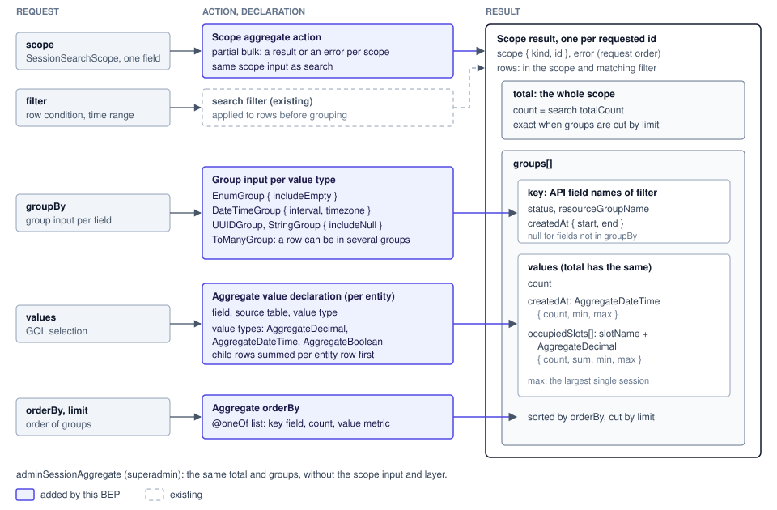

# 집계 ops

## 목표

집계 연산을 스코프별 집계 ops 로 구조화해 API 들에 같은 방식으로 제공합니다.

| 목표 | 현재 | 완료 기준 | 관련 이슈 |
|---|---|---|---|
| 여러 스코프의 집계를 한 요청으로 조회 | 집계 ops 없음 (`repositories/ops/v2/read.py` 는 search 만) | 스코프 여러 개를 쿼리 하나로, 스코프마다 값 또는 에러 | BAI-120 |
| search 와 같은 filter, total 이 totalCount 와 일치 | 집계가 search 의 filter 를 받지 않음 | 같은 scope, filter 에서 `total.count` 와 totalCount 가 같음 | BAI-120 |
| 값 type 별 group 기준 | group 기준 선언 없음 | filter 와 같은 field 이름으로 groupBy 와 결과 key 제공 | BAI-120, BA-8746 |
| 값 type 별 공통 결과 형태 | 공통 집계 결과 type 없음 | 세션, 자원 그룹 사용량이 같은 값 type 사용 | BAI-120 |
| 계산 방식과 무관한 API | 집계 계산이 조회 코드에 직접 있음 | 계산 방식이 measure 안에만 있음 | BAI-120 |

## 목표가 아닌 것

- 집계 값 저장 테이블: 성능 측정 뒤 다음 Epic
- 기간 사용량: usage bucket 조회가 맡음
- having, 수치 구간 group (`DecimalGroup`), median, percentile, avg: avg 는 이후 추가
- 서버의 빈 시간 구간 채우기: 클라이언트가 key 의 start, end 로 채움
- search orderBy 를 집계 orderBy 형태로 전환: 후속 제안, 선언은 `SearchOrder.apply` 에 nulls 추가
- 자원 그룹 용량 (사용률의 분모): 자원 그룹 API 가 제공
- `mySessionAggregate`: 필요할 때 추가

## 설계

### 결과 계층

집계는 search 와 같은 scope 입력으로 스코프를 먼저 정하고, 스코프 안에서 filter, groupBy, 값, orderBy 를 요청합니다. total 은 스코프 전체의 값이라 groups 를 limit 으로 잘라도 정확하고, count 는 search 의 totalCount 와 같습니다. total 과 groups 는 `GROUPING SETS` 쿼리 하나로 계산합니다.

| API | 입력 | 결과 | 권한 |
|---|---|---|---|
| `scopedSessionAggregates`, `POST /v2/sessions/scoped/aggregate` | `scope: SessionSearchScope!` (field 하나), filter, groupBy, orderBy, limit | id 마다 `{ scope, error, total, groups }`, 요청 순서 | partial bulk: 스코프마다 검사 |
| `adminSessionAggregate`, `POST /v2/sessions/aggregate` | filter, groupBy, orderBy, limit | `{ total, groups }` | `superadmin_required` |

| 결과 field | 의미 |
|---|---|
| `scope` | 스코프 종류와 id |
| `total` | 스코프 전체의 값 |
| `groups[].key` | groupBy 에 넣은 field 의 값. 넣지 않은 field 는 null |
| `groups[]` 의 값 field | total 과 같은 값 field |

기각한 대안: 평평한 row 목록에는 스코프별 에러와 total 을 담을 항목이 없습니다.

### groupBy 와 orderBy

groupBy 는 filter 처럼 field 마다 값 type 별 group input 을 받고, field 이름은 filter, 결과 key 와 같습니다. 시간 범위는 filter 가 정하고 `DateTimeGroup` 은 interval 과 timezone 만 받으며, 구간은 반열린 구간입니다. 집계 orderBy 는 field 하나를 받는 @oneOf input 의 목록이고 목록 순서가 우선순위입니다.

| group type | 인자 | 세션 field |
|---|---|---|
| `EnumGroup` | `includeEmpty`: 0건인 enum 값도 반환 | status, sessionType, result |
| `DateTimeGroup` | `interval`, `timezone` | createdAt, terminatedAt |
| `UUIDGroup`, `StringGroup` | `includeNull`: null 을 group 하나로 반환 | resourceGroupName, projectId, userUuid |
| `ToManyGroup` | 대상 field 의 group type. row 가 여러 group 에 들어감 | kernels 의 agent |

| orderBy 항목 | 예 |
|---|---|
| key field | `{ status: ASC }` |
| count | `{ count: DESC }` |
| 값 field 의 지표 | `{ occupiedSlots: { slotName: "cuda.shares", sum: DESC } }` |

기각한 대안: enum 목록 groupBy 는 시간 구간 인자를 받을 수 없어 `CREATED_AT_DAY` 같은 값이 늘어납니다.

### 집계 값과 값 type

`AggregateValue { count }` 를 기반으로 순서 있는 값은 min, max 를, 수량은 sum 을 추가합니다. 값 field 의 count 는 값이 null 이 아닌 row 수입니다. 자식 테이블 값은 엔티티 row 단위로 먼저 합하므로 `occupiedSlots` 의 max 는 가장 큰 세션 하나의 점유량입니다.

| 값 type | field |
|---|---|
| `AggregateDateTime` | count, min, max |
| `AggregateDecimal` | count, sum, min, max. 정수 합계도 Decimal |
| `AggregateBoolean` | count, trueCount, falseCount |

| 세션 field | 값 type, 출처 |
|---|---|
| `createdAt`, `terminatedAt` | `AggregateDateTime`, `sessions` |
| `isPreemptible` | `AggregateBoolean`, `sessions` |
| `occupiedSlots` | slot_name 별 `AggregateDecimal`, `resource_allocations` 의 활성 자원 할당 |

기각한 대안: enum 값 개수를 담는 값 type 은 `EnumGroup` 으로 묶은 결과와 같아 두지 않습니다.

### 계산과 선언

계산 방식(지금은 읽을 때 계산)은 repository 의 measure 에만 있고 action, DTO, GQL 에는 나타나지 않습니다. 엔티티는 `models/{entity}/aggregate_fields.py` 의 `{Entity}AggregateFields` 에 group 칸과 값 칸을 선언하고, column 과 이름은 `{Entity}SearchableFields` 의 field 를 참조합니다. to-many 값은 row 마다 subquery 를 실행하지 않고 join 과 `GROUP BY` 한 번으로 계산합니다.

| 선언, 구성 요소 | 내용 |
|---|---|
| group 칸 | 값 type 별 group. 민감한 값, Text, JSON, 배열 column 은 비움 |
| 값 칸 | 값 type, 출처 테이블, 집계 값 정렬 |
| 스코프 Target | `to_condition()` 외에 (scope_id, row_id) 쌍 select. 소유 column 이 아니라 RBAC 경로 |
| `ToManyCorrelation` | EXISTS 외에 (row_id, 자식 값) 쌍 select. `ToManyGroup` 이 사용 |
| 세션 nested | kernels 아래 `resource_allocations` 추가 (깊이 2) |

기각한 대안: `SearchableField` 에 칸을 추가하면 선언 978개를 모두 고치거나 빈 칸 기본값을 둬야 합니다.

## 영향

- 기존 사용량 API (구현 순서 3, 4단계): 응답 형태 유지, 내부 계산만 변경
- 스코프 소속 기준 (3, 4단계): share 로 연결된 세션도 포함해 기존 값과 달라질 수 있음
- `activeResourceOverview` 의 세션 수 (4단계): 활성 자원 할당 커널 기준이라 filter 조정
- 일관성: measure 별 쿼리를 REPEATABLE READ 트랜잭션 하나에서 실행
- 상한: 요청 스코프 수, groupBy field 수, group 수의 상한은 config

## 구현 순서

1. 기반: 값 type, group type, 집계 orderBy, measure, 집계 값 선언, action shape 2종
2. 세션 집계 조회: `adminSessionAggregate`, `scopedSessionAggregates`
3. 자원 그룹 사용량 이전: 자원 그룹이 같은 값 type 사용
4. 기존 스코프 사용량 조회 대체: 기존 조회가 집계 ops 사용, 중복 occupancy 계산 제거
5. 감사 로그 집계: BA-8746 의 시간 구간 × 상태, 엔티티별 실패 개수

## 참고

- `src/ai/backend/manager/models/specs/search/AGENTS.md`: search field 선언 규칙
- `src/ai/backend/manager/models/virtual_entity/queries.py`: 스코프 경로
- `src/ai/backend/common/dto/manager/query.py`: 값 type 별 filter
