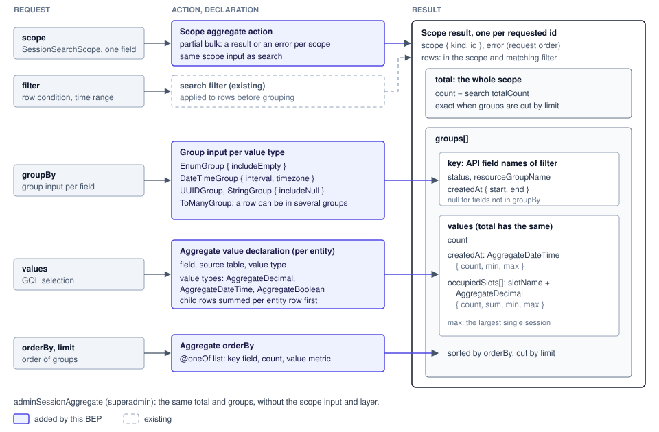

# Aggregate Ops

## Goals

Structure aggregate operations as per-scope aggregate ops and provide them to APIs in one way.

| Goal | Current | Done when | Related issue |
|---|---|---|---|
| Aggregates of several scopes in one request | No aggregate ops (`repositories/ops/v2/read.py` has search only) | Several scopes in one query, a value or an error per scope | BAI-120 |
| The filter of search, a total that matches totalCount | Aggregates do not take the search filter | `total.count` equals totalCount for the same scope and filter | BAI-120 |
| Group keys per value type | No group key declaration | groupBy and the result key use the field names of the filter | BAI-120, BA-8746 |
| A shared result shape per value type | No shared aggregate result type | Sessions and resource group usage use the same value types | BAI-120 |
| An API independent of how values are computed | Aggregate computation sits in the read code | The computation lives only in measures | BAI-120 |

## Non-goals

- A table that stores aggregate values: the next epic, after performance measurement
- Usage over a period: the usage bucket queries cover it
- having, numeric range groups (`DecimalGroup`), median, percentile, avg: avg is added later
- Filling empty time buckets on the server: the client fills them from the key's start and end
- Moving search orderBy to the aggregate orderBy shape: a follow-up proposal, adding nulls to `SearchOrder.apply`
- Resource group capacity (the denominator of utilization): the resource group API provides it
- `mySessionAggregate`: added when needed

## Design

### Result hierarchy

An aggregate first sets the scope with the same scope input as search, and requests filter, groupBy, values and orderBy within it. total holds the values of the whole scope, so it stays exact when limit cuts groups, and its count equals the totalCount of search. One `GROUPING SETS` query computes total and groups.

| API | Input | Result | Permission |
|---|---|---|---|
| `scopedSessionAggregates`, `POST /v2/sessions/scoped/aggregate` | `scope: SessionSearchScope!` (one field), filter, groupBy, orderBy, limit | `{ scope, error, total, groups }` per id, in request order | partial bulk: checked per scope |
| `adminSessionAggregate`, `POST /v2/sessions/aggregate` | filter, groupBy, orderBy, limit | `{ total, groups }` | `superadmin_required` |

| Result field | Meaning |
|---|---|
| `scope` | Scope kind and id |
| `total` | Values of the whole scope |
| `groups[].key` | Values of the fields in groupBy. Fields not in groupBy are null |
| Value fields of `groups[]` | The same value fields as total |

Rejected: a flat row list has no item for a per-scope error and total.

### groupBy and orderBy

groupBy takes a group input per value type for each field, as the filter does, and the field names match the filter and the result key. The filter sets the time range, `DateTimeGroup` takes only interval and timezone, and buckets are half-open. Aggregate orderBy is a list of @oneOf inputs that each take one field, and the list order is the priority.

| Group type | Arguments | Session fields |
|---|---|---|
| `EnumGroup` | `includeEmpty`: also return enum values with no rows | status, sessionType, result |
| `DateTimeGroup` | `interval`, `timezone` | createdAt, terminatedAt |
| `UUIDGroup`, `StringGroup` | `includeNull`: return null as one group | resourceGroupName, projectId, userUuid |
| `ToManyGroup` | The group type of the target field. A row can be in several groups | agent of kernels |

| orderBy item | Example |
|---|---|
| Key field | `{ status: ASC }` |
| count | `{ count: DESC }` |
| Metric of a value field | `{ occupiedSlots: { slotName: "cuda.shares", sum: DESC } }` |

Rejected: an enum list groupBy cannot take time bucket arguments, so values such as `CREATED_AT_DAY` multiply.

### Aggregate values and value types

On top of `AggregateValue { count }`, ordered values add min and max, and quantities add sum. The count of a value field is the number of rows whose value is not null. Values of child tables are summed per entity row first, so the max of `occupiedSlots` is the occupancy of the largest single session.

| Value type | Fields |
|---|---|
| `AggregateDateTime` | count, min, max |
| `AggregateDecimal` | count, sum, min, max. An integer sum is a Decimal too |
| `AggregateBoolean` | count, trueCount, falseCount |

| Session field | Value type, source |
|---|---|
| `createdAt`, `terminatedAt` | `AggregateDateTime`, `sessions` |
| `isPreemptible` | `AggregateBoolean`, `sessions` |
| `occupiedSlots` | `AggregateDecimal` per slot_name, active allocations in `resource_allocations` |

Rejected: a value type holding counts per enum value gives the same result as grouping by `EnumGroup`.

### Computation and declarations

How values are computed (today, on read) lives only in the repository's measures and does not appear in actions, DTOs or GQL. An entity declares group slots and value slots in `{Entity}AggregateFields` in `models/{entity}/aggregate_fields.py`, and takes columns and names from the fields of `{Entity}SearchableFields`. A to-many value is computed with one join and `GROUP BY`, not with a subquery per row.

| Declaration, component | Content |
|---|---|
| Group slot | Group per value type. Empty for sensitive values and Text, JSON and array columns |
| Value slot | Value type, source table, ordering by aggregate value |
| Scope Target | A (scope_id, row_id) pair select besides `to_condition()`. The RBAC path, not the owner column |
| `ToManyCorrelation` | A (row_id, child value) pair select besides EXISTS. Used by `ToManyGroup` |
| Session nested | Add `resource_allocations` under kernels (depth 2) |

Rejected: adding slots to `SearchableField` means changing all 978 declarations or giving empty slots a default.

## Impact

- Existing usage APIs (implementation steps 3 and 4): the response shape stays, only the computation changes
- Scope membership (steps 3 and 4): sessions reached by a share are included, so values can differ from today
- `activeResourceOverview` session count (step 4): counted on kernels with active allocations, so the filter changes
- Consistency: the queries of the measures run in one REPEATABLE READ transaction
- Limits: the number of requested scopes, groupBy fields and groups is capped by config

## Implementation Order

1. Foundation: value types, group types, aggregate orderBy, measures, aggregate value declarations, 2 action shapes
2. Session aggregate queries: `adminSessionAggregate`, `scopedSessionAggregates`
3. Resource group usage migration: resource groups use the same value types
4. Replace the existing scope usage queries: they use aggregate ops, and the duplicated occupancy computation is removed
5. Audit log aggregates: time bucket by status and failure count per entity from BA-8746

## References

- `src/ai/backend/manager/models/specs/search/AGENTS.md`: search field declaration rules
- `src/ai/backend/manager/models/virtual_entity/queries.py`: scope paths
- `src/ai/backend/common/dto/manager/query.py`: filters per value type
