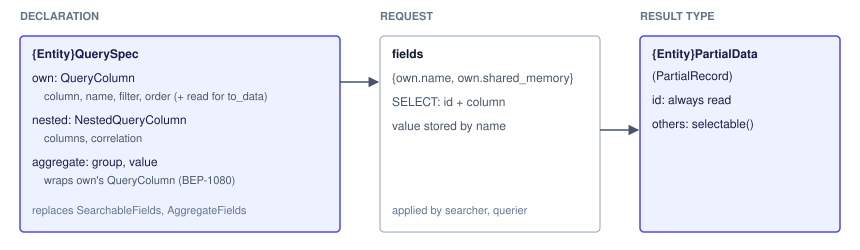
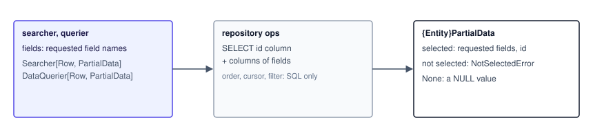
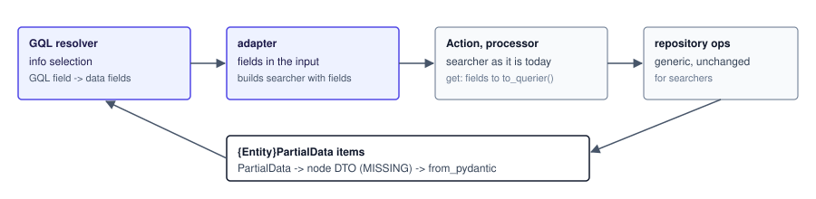
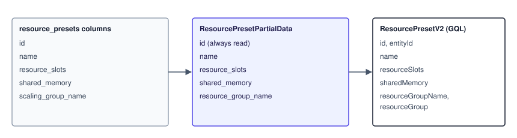

# 요청한 필드만 조회

## 목표

searcher 와 querier 가 GQL 이 요청한 필드의 column 만 조회하고 결과를 `PartialRecord` 로 반환합니다.

| 목표 | 현재 | 완료 기준 | 관련 이슈 |
|---|---|---|---|
| `QuerySpec` 선언 | `{Entity}SearchableFields` 의 항목이 자기 이름을 모름 (`models/specs/search/field.py`) | 모든 엔티티가 `{Entity}QuerySpec` 을 사용하고 `QueryColumn.name` 으로 결과 생성 | BAI-751 |
| 요청한 필드의 column 만 SELECT | `sa.select(Row)`, `sa.select(row_class)` 로 모든 column (`repositories/ops/v2/read.py`) | SQL 의 SELECT 목록이 id 와 요청한 필드의 column 만 포함 | BAI-751 |
| 결과를 `PartialRecord` 로 반환 | `to_data(row)` 가 Data 전체 생성 (`models/specs/searcher.py`, `querier.py`) | 요청하지 않은 필드를 읽으면 `NotSelectedError` | BAI-751 |
| GQL 요청 필드를 조회 필드로 전달 | GQL resolver 가 selection 을 읽지 않음 (`api/gql/`) | GQL 요청의 필드만 SELECT | BAI-751 |
| 자원 프리셋 적용 | 적용한 엔티티 없음 | `adminResourcePresetsV2`, `adminResourcePresetV2` 가 요청한 필드만 조회 | BAI-751 |

## 목표가 아닌 것

- 집계: BEP-1080 (집계 ops, BAI-120) 이 다룹니다
- column 이 하나가 아닌 derived field: 그 필드를 가진 엔티티를 적용할 때 정합니다
- `nested` 필드: 다른 엔티티의 필드는 그 엔티티의 DataLoader 가 조회합니다
- `FieldQuerier`, `BulkFieldQuerier`, `OwnedFieldQuerier`: field row 적용 때 정합니다
- REST v2: 기존 searcher, querier 와 node DTO 로 모든 필드를 조회합니다
- DataLoader (`batch_load_by_ids`): batch 안의 key 마다 요청이 다를 수 있어 모든 필드를 조회합니다

## 설계

### QuerySpec 선언

엔티티는 `models/{entity}/query_spec.py` 의 `{Entity}QuerySpec` 하나에 조회에 쓰는 column 을 선언하고, `{Entity}SearchableFields` 와 BEP-1080 의 `{Entity}AggregateFields` 는 이 선언으로 대체합니다. `QueryColumn` 의 계약은 `column`, `name`, `filter`, `order` 이고, `read(row)` 는 기존 Data 를 만드는 `to_data(row)` 와 함께 남았다가 정리 단계에서 제거합니다. 결과 type 은 `data/{entity}/types.py` 의 `{Entity}PartialData(PartialRecord)` 이고 id 가 아닌 필드는 `selectable()` 입니다.

| 섹션 | 항목 | 사용 |
|---|---|---|
| `own` | `QueryColumn` (`SearchableField` 대체) | 요청값, condition, order, `to_data` |
| `nested` | `NestedQueryColumn` (`NestedSearchableField` 대체) | to-many, to-one condition |
| `linked` | FK 가 상대 엔티티 쪽에 있는 membership, usage 의 id 조건 | condition. 상대 엔티티 읽기 권한 검사 |
| `aggregate` | `own` 의 `QueryColumn` 을 감싸는 group 항목, 집계 값 항목 | groupBy, 집계 값 (BEP-1080) |

| `QueryColumn` | 의미 |
|---|---|
| `column` | SELECT 하는 Row 의 column |
| `name` | 선언한 속성 이름. 요청값과 `{Entity}PartialData` 의 필드 이름 |
| `filter`, `order` | condition, order 생성. 지원하지 않으면 `None` |
| `read(row)` | ORM row 의 값 조회. `to_data(row)` 와 함께 구현 순서 7단계에서 제거 |

기각한 대안: `SearchableFields` 이름 유지는 요청값, groupBy, 집계 값을 담는 선언의 이름이 검색만 나타냅니다.

### searcher, querier 의 결과

searcher, querier 는 필드 선언을 적용하는 계층입니다. 범위, pagination 과 함께 `fields` 를 받아 id 와 `fields` 의 column 만 SELECT 하고, 결과의 `column` 값을 `name` 으로 담아 `{Entity}PartialData` 를 생성합니다. order, cursor 조건, filter 는 ORDER BY, WHERE 에만 쓰고 SELECT 에 추가하지 않으며, ops 의 search 메서드는 `TData` 에 대해 generic 이라 변경하지 않습니다.

| spec | SELECT | 결과 |
|---|---|---|
| `Searcher[TRow, {Entity}PartialData]` | `build_select()` 가 id 와 `fields` 의 column 만 | `SearcherResult[{Entity}PartialData]` |
| `DataQuerier[TRow, {Entity}PartialData]` | ops 가 id 와 querier `fields` 의 column 만 | `{Entity}PartialData` |

| 항상 조회하는 id 의 근거 | 위치 |
|---|---|
| GQL resolver 가 `node.id` 로 cursor 생성 | `api/gql/resource_preset/resolver.py` |
| `EntityData.entity_id()` 와 node 의 `entity_id` | `data/resource_preset/types.py` |
| `query_bulk_data` 가 id column 으로 결과를 매핑 | `repositories/ops/v2/read.py` |

기각한 대안: 기존 Data 를 `PartialRecord` 로 변경하면 모든 필드를 읽는 service 와 adapter 의 `_data_to_node` 가 `NotSelectedError` 를 냅니다.

### GQL 요청 필드 전달 경로

GQL resolver 는 `info` 의 selection 에서 node 의 최상위 필드를 읽어 data field 이름으로 변환하고 adapter input 에 담습니다. adapter 는 filter 를 conditions 로 변환하는 것처럼 그 이름을 `own` 의 `QueryColumn` 으로 변환해 searcher 를 생성하고, 결과 `{Entity}PartialData` 를 공통 converter 로 node DTO 로 변환합니다. 선택하지 않은 필드는 DTO 에서 `MISSING` 이고 GQL type 은 지금처럼 `from_pydantic` 으로 생성하며, get Action 은 `fields` 를 `to_querier()` 에 전달합니다.

| GQL field | data field |
|---|---|
| snake_case 이름이 같은 field | 같은 이름의 data field |
| `id`, `entityId` | `id` |
| 다른 data field 로 값을 조회하는 resolver field | 그 resolver 가 읽는 data field. `resourceGroup` → `resource_group_name` |

기각한 대안: Action 에 별도 field 를 두면 generic service 와 ops 메서드가 모두 그 field 를 전달해야 합니다.

### 첫 적용 엔티티: 자원 프리셋

자원 프리셋은 `ResourcePresetSearchableFields` (대체 후 `ResourcePresetQuerySpec`) 에 `own` 만 있고 필드 5개가 모두 `resource_presets` 의 column 하나에 대응합니다. GQL v2 의 search, get resolver 가 adapter 를 거쳐 `ResourcePresetSearcher`, `ResourcePresetQuerier` 를 사용하고, resolver field `resourceGroup` 이 다른 data field 로 값을 조회하는 경우를 포함합니다.

| 자원 프리셋 | 근거 |
|---|---|
| 필드 5개, column 하나씩 | `models/resource_preset/searchable_fields.py` |
| search, get 의 searcher, querier | `models/resource_preset/searchers.py`, `queriers.py` |
| GQL v2 resolver | `adminResourcePresetsV2`, `adminResourcePresetV2` |
| resolver field | `resourceGroup` 이 `resource_group_name` 으로 조회 |

## 영향

- 성능: 자원 프리셋 GQL search, get 의 SELECT 가 id 와 요청한 필드의 column 으로 줄어듭니다
- 호환성: REST v2, DataLoader, service 는 기존 Data 를 그대로 사용합니다
- 이름 대체: 파일럿 뒤 도메인 단위로 옮기며 search 동작과 SQL 은 같습니다

## 구현 순서

1. 기반 타입: `QuerySpec`, `QueryColumn` 을 기존 선언과 나란히 추가
2. 결과 spec 과 searcher, querier: `{Entity}PartialData`, 요청한 column 만 SELECT
3. 집계 선언: Aggregator 가 `QuerySpec.aggregate` 의 groupBy 항목 사용
4. GQL 요청 필드 연결: GQL resolver 의 selection 이 adapter, searcher, querier 까지 전달
5. 파일럿: 자원 프리셋, 세션을 옮기고 partial 조회와 aggregate 확인
6. 일괄 대체: 나머지 엔티티를 도메인 단위로 옮긴 뒤 `SearchableFields` 제거
7. 정리: 모든 조회가 `{Entity}PartialData` 로 옮겨진 뒤 `read`, `to_data` 제거

## 참고

- [BEP-1080 집계 ops](BEP-1080-aggregate-ops.ko.md)
- `src/ai/backend/common/data/partial.py`: `PartialRecord`
- `models/specs/search/AGENTS.md`: 필드 선언 규칙
- `models/specs/search/KNOWLEDGE.md`: field cap 이 선언에 요구하는 것
