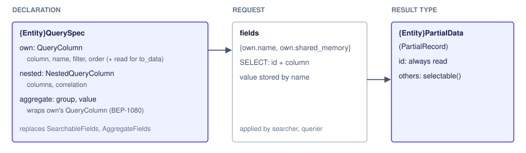
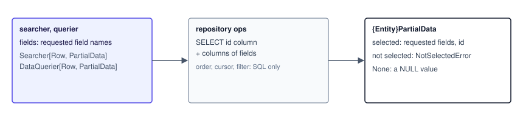
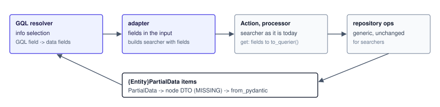
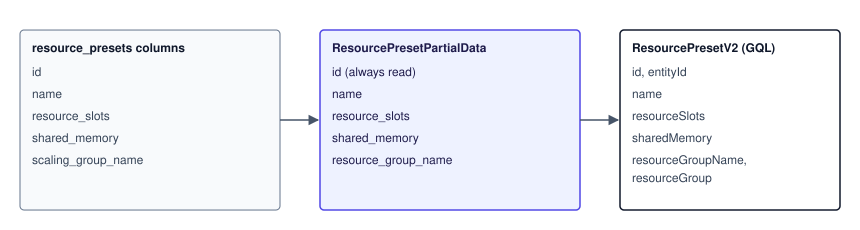

# Requested Field Read

## Goals

Searchers and queriers read only the columns of the fields GQL requested and return the result as a `PartialRecord`.

| Goal | Current | Done when | Related issue |
|---|---|---|---|
| `QuerySpec` declaration | Items of `{Entity}SearchableFields` do not know their names (`models/specs/search/field.py`) | Every entity uses `{Entity}QuerySpec`, and results are built by `QueryColumn.name` | BAI-751 |
| SELECT only the requested columns | `sa.select(Row)`, `sa.select(row_class)` read every column (`repositories/ops/v2/read.py`) | The SELECT list holds only the id and the requested columns | BAI-751 |
| Return a `PartialRecord` | `to_data(row)` builds the whole Data (`models/specs/searcher.py`, `querier.py`) | Reading a field not requested raises `NotSelectedError` | BAI-751 |
| Pass GQL requested fields to the read | GQL resolvers do not read the selection (`api/gql/`) | Only the fields of the GQL request are selected | BAI-751 |
| Apply to resource presets | No entity applies it | `adminResourcePresetsV2`, `adminResourcePresetV2` read only the requested fields | BAI-751 |

## Non-goals

- Aggregates: BEP-1080 (aggregate ops, BAI-120)
- Derived fields without exactly one column: decided when an entity with one applies
- `nested` fields: the entity owning them reads them through its DataLoader
- `FieldQuerier`, `BulkFieldQuerier`, `OwnedFieldQuerier`: decided when field rows apply
- REST v2: reads every field through the existing searchers, queriers and node DTOs
- DataLoader (`batch_load_by_ids`): keys in a batch may request different fields, so it reads all

## Design

### QuerySpec declaration

An entity declares the columns it is queried by in one `{Entity}QuerySpec` in `models/{entity}/query_spec.py`, which replaces `{Entity}SearchableFields` and the `{Entity}AggregateFields` of BEP-1080. The contract of `QueryColumn` is `column`, `name`, `filter` and `order`; `read(row)` stays with `to_data(row)`, which builds the existing Data, until the cleanup step removes both. The result type is `{Entity}PartialData(PartialRecord)` in `data/{entity}/types.py`, and every field other than the id is `selectable()`.

| Section | Items | Used for |
|---|---|---|
| `own` | `QueryColumn` (replaces `SearchableField`) | Requested fields, conditions, orders, `to_data` |
| `nested` | `NestedQueryColumn` (replaces `NestedSearchableField`) | To-many and to-one conditions |
| `linked` | membership and usage id conditions whose FK sits on the other entity | Conditions; READ check on the other entity |
| `aggregate` | Group items and aggregate value items wrapping a `QueryColumn` of `own` | groupBy, aggregate values (BEP-1080) |

| `QueryColumn` | Meaning |
|---|---|
| `column` | The Row column to SELECT |
| `name` | The declared attribute name; the name of the requested field and of the `{Entity}PartialData` field |
| `filter`, `order` | Build conditions and orders; `None` when not supported |
| `read(row)` | Reads the value from an ORM row; removed with `to_data(row)` in step 7 |

Rejected: keeping the name `SearchableFields` names a declaration holding requested fields, groupBy and aggregate values after search only.

### Searcher and querier results

Searchers and queriers are the layer that applies the declaration. Along with the scope and pagination they take `fields`, SELECT only the id and the columns of `fields`, and build `{Entity}PartialData` by putting each `column` value of the result under its `name`. Orders, cursor conditions and filters go only into ORDER BY and WHERE, not into the SELECT list, and the ops search methods are generic over `TData`, so they do not change.

| Spec | SELECT | Result |
|---|---|---|
| `Searcher[TRow, {Entity}PartialData]` | `build_select()` selects only the id and the columns of `fields` | `SearcherResult[{Entity}PartialData]` |
| `DataQuerier[TRow, {Entity}PartialData]` | The ops select only the id and the columns of the querier's `fields` | `{Entity}PartialData` |

| Why the id is always read | Where |
|---|---|
| GQL resolvers build cursors from `node.id` | `api/gql/resource_preset/resolver.py` |
| `EntityData.entity_id()` and the node's `entity_id` | `data/resource_preset/types.py` |
| `query_bulk_data` maps results by the id column | `repositories/ops/v2/read.py` |

Rejected: turning the existing Data into a `PartialRecord` makes services and the adapter's `_data_to_node`, which read every field, raise `NotSelectedError`.

### Path of GQL requested fields

A GQL resolver reads the top-level node fields from the selection in `info`, maps them to data field names and puts them in the adapter input. The adapter turns those names into `QueryColumn`s of `own`, as it turns filters into conditions, builds the searcher, and converts the resulting `{Entity}PartialData` into the node DTO with the common converter. A field not selected is `MISSING` in the DTO, GQL types are still built with `from_pydantic`, and a get Action passes `fields` to `to_querier()`.

| GQL field | Data field |
|---|---|
| A field with the same snake_case name | The data field of that name |
| `id`, `entityId` | `id` |
| A resolver field reading another data field | The data field the resolver reads; `resourceGroup` → `resource_group_name` |

Rejected: a separate field on the Action would have to be passed through every generic service and ops method.

### First entity: resource presets

Resource presets have only `own` in `ResourcePresetSearchableFields` (`ResourcePresetQuerySpec` after the replacement), and each of their five fields maps to one column of `resource_presets`. The GQL v2 search and get resolvers go through the adapter to `ResourcePresetSearcher` and `ResourcePresetQuerier`, and the resolver field `resourceGroup` reads another data field.

| Resource presets | Ground |
|---|---|
| Five fields, one column each | `models/resource_preset/searchable_fields.py` |
| Searcher and querier of search and get | `models/resource_preset/searchers.py`, `queriers.py` |
| GQL v2 resolvers | `adminResourcePresetsV2`, `adminResourcePresetV2` |
| Resolver field | `resourceGroup` reads `resource_group_name` |

## Impact

- Performance: the SELECT of resource preset GQL search and get shrinks to the id and the requested columns
- Compatibility: REST v2, DataLoaders and services keep using the existing Data
- Renaming: entities move per domain after the pilots; search behavior and SQL stay the same

## Implementation Order

1. Base types: add `QuerySpec` and `QueryColumn` alongside the existing declarations
2. Result spec, searchers, queriers: `{Entity}PartialData`, SELECT only requested columns
3. Aggregate declarations: Aggregators use the groupBy items of `QuerySpec.aggregate`
4. GQL requested fields: the resolver selection reaches the adapter, searcher and querier
5. Pilots: move resource presets and sessions, verify partial reads and aggregates
6. Bulk replacement: move the other entities per domain, then remove `SearchableFields`
7. Cleanup: remove `read` and `to_data` once every read returns `{Entity}PartialData`

## References

- [BEP-1080 Aggregate Ops](BEP-1080-aggregate-ops.md)
- `src/ai/backend/common/data/partial.py`: `PartialRecord`
- `models/specs/search/AGENTS.md`: declaration rules
- `models/specs/search/KNOWLEDGE.md`: what field caps require of the declaration
