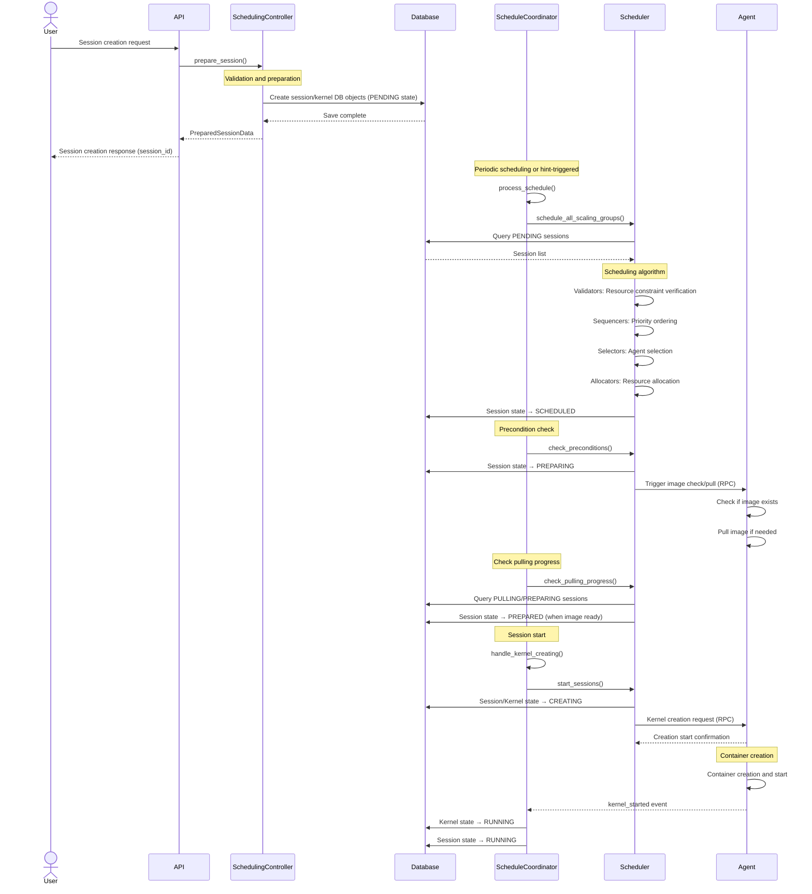
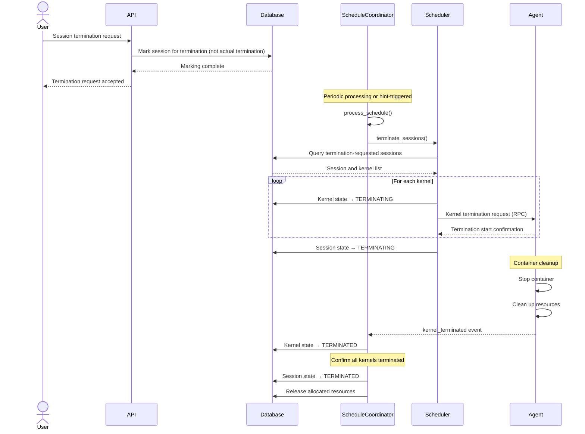
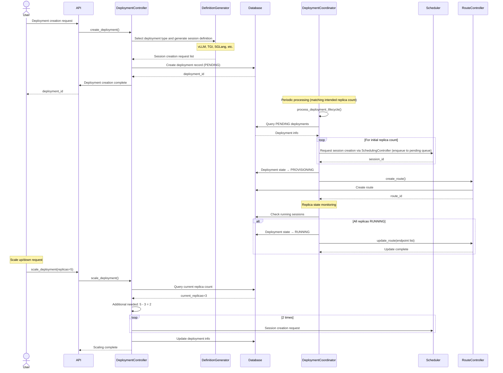

# Sokovan

← [Back to Manager](../README.md#manager-architecture-documentation) | [Architecture Overview](../../README.md#manager)

## Overview

Sokovan is the orchestration layer of Backend.AI. It coordinates session scheduling, deployment management and route management.

**Key Responsibilities:**
- **Session Scheduling**: creating, starting and terminating sessions on user request
- **Deployment Management**: deployment and scaling of long-running services, including model serving
- **Route Management**: network routing and health checks for deployed services

## Architecture

Sokovan has a three-tier architecture:

```
┌────────────────────────────────────────────────────────────────────────────────────┐
│                          SokovanOrchestrator                                       │
│                        (Top-level Orchestrator)                                    │
│                                                                                    │
│                   - Creates and manages 3 Coordinators                             │
│                   - Schedules periodic tasks                                       │
│                   - Provides common dependencies (events, locks)                   │
│                                                                                    │
└──────────────────────────────────────┬─────────────────────────────────────────────┘
                                       │
         ┌─────────────────────────────┼─────────────────────────────┐
         │                             │                             │
         ▼                             ▼                             ▼
┌───────────────────────────┐  ┌──────────────────────────┐  ┌──────────────────────────┐
│                           │  │                          │  │                          │
│   ScheduleCoordinator     │  │  DeploymentCoordinator   │  │    RouteCoordinator      │
│                           │  │                          │  │                          │
│                           │  │                          │  │                          │
│     Session lifecycle     │  │   Deployment lifecycle   │  │    Route lifecycle       │
│       coordination        │  │      coordination        │  │      coordination        │
│                           │  │                          │  │                          │
│                           │  │                          │  │                          │
└─────────────┬─────────────┘  └────────────┬─────────────┘  └────────────┬─────────────┘
              │                             │                             │
              │                             │                             │
              ▼                             ▼                             ▼
┌───────────────────────────┐  ┌──────────────────────────┐  ┌──────────────────────────┐
│                           │  │                          │  │                          │
│  Scheduler                │  │  DeploymentController    │  │   RouteController        │
│      +                    │  │                          │  │                          │
│  SchedulingController     │  │                          │  │                          │
│                           │  │                          │  │                          │
│                           │  │   Actual deployment      │  │   Actual route           │
│  Actual scheduling logic  │  │   control logic          │  │   control logic          │
│                           │  │                          │  │                          │
│                           │  │                          │  │                          │
└───────────────────────────┘  └──────────────────────────┘  └──────────────────────────┘
```

### Roles by Layer

#### 1. Orchestrator Layer (SokovanOrchestrator)

SokovanOrchestrator is the top-level entry point of the system. It creates and initializes the three Coordinator instances, and defines and registers the periodic tasks (TaskSpec). It also manages shared dependencies such as EventProducer and SchedulingController, and governs the lifecycle of the system.

**Main Components:**

*Coordinator Layer:*
- **ScheduleCoordinator**: session scheduling coordination
- **DeploymentCoordinator**: deployment management coordination
- **RouteCoordinator**: route management coordination

*Controller Layer:*
- **SchedulingController**: session validation and preparation before creation

*Common Infrastructure:*
- **EventProducer**: system event publication

#### 2. Coordinator Layer

A coordinator runs the internal processing flow of one domain: sessions, deployments or routes.

**Periodic Operation Mechanism**

A coordinator runs two cycle loops:

- **Short-cycle loop**: runs on hints and performs work only when a hint is set. When an event occurs (session creation, kernel event and so on), a hint flag is set and the work runs promptly in the next loop.
- **Long-cycle loop**: always performs work regardless of hints. It covers a missed hint, and periodic retries keep the system from hanging.

A hint flag is set when an event occurs. The short-cycle loop reads the hint and performs the work, then clears the hint. Work runs on the periodic loop, so a request does not start the work immediately.

**Role of State-based Handlers**

A coordinator reads the current state of a resource (session, deployment or route) and runs the Handler for that state. The Handler performs the work the current state requires. On success it transitions to the next state; on failure it transitions to an error state or a retry-waiting state.

**Controller vs Coordinator**

The controller and the coordinator have distinct roles:

- **Controller**: the only entry point that can change the state of sessions, deployments and the like.
  - Performs only the initial work (enqueue, mark and so on). It does not perform the actual operation.
  - It changes state to trigger the coordinator.
  - Example: session creation request → validate, then save to the DB in PENDING state
  - Example: session termination request → mark for termination only
- **Coordinator**: performs the actual work of the internal processing flow.
  - Runs on a periodic trigger or a hint.
  - Example: PENDING session → schedule and create the kernel → transition to RUNNING
  - Example: termination-marked session → terminate the kernel and clean up the resources

A coordinator runs the periodic tasks of its domain, selects and runs the handler for the current state, and delegates the actual work to a scheduler or engine. It transitions the state according to the result.

**Coordinator Roles by Domain:**

- **ScheduleCoordinator**
  - scheduling coordination for pending sessions
  - processing kernel events (pulling, creating, running, terminated and so on)
  - image pulling coordination
  - session state transition management

- **DeploymentCoordinator**
  - processing coordination for deployment lifecycle stages
  - replica management coordination
  - integration with RouteController

- **RouteCoordinator**
  - processing coordination for route lifecycle stages
  - health check execution coordination

#### 3. Controller/Engine Layer

Controllers and engines perform the actual business logic:

- **Scheduler**
  - querying pending sessions and running the scheduling algorithms
  - resource constraint verification through Validators
  - priority determination through Sequencers
  - agent selection through Selectors
  - resource allocation through Allocators
  - handling session start, termination and retry

- **SchedulingController**
  - pre-validation of session creation requests
  - preparation of the data needed for scheduling
  - calculation of the resource requirements
  - selection of the appropriate resource group

- **DeploymentController**
  - deployment creation, update and deletion
  - session definition generation per deployment type through Definition Generators
  - replica count management

- **RouteController**
  - route creation, update and deletion
  - endpoint management
  - traffic routing configuration

## Main Processing Flows

### Session Creation and Start

Session creation and start separate the roles of the controller and the coordinator:

- **SchedulingController** (external request handling)
  - validation and preparation of the session creation request
  - create the session and kernel DB objects in PENDING state on validation success (enqueue)
  - does not run the scheduling logic or create kernels on the agent

- **ScheduleCoordinator** (internal processing flow)
  - query PENDING sessions and perform scheduling
  - request kernel creation on scheduling success
  - manage kernel state transitions (PULLING → RUNNING)
  - transition the session to RUNNING when all kernels are RUNNING

The sequence below shows the complete flow from the session creation request to execution. See the [Scheduler documentation](scheduler/README.md) for details.



**Step-by-step Explanation:**

When a user requests session creation through the API, SchedulingController validates and prepares the request. Validators verify the cluster size, the mount paths and the like. Preparers prepare the internal data, the cluster configuration and the mount configuration. ResourceCalculator calculates the required resources, and ScalingGroupResolver selects a resource group. If validation fails, the API returns an error immediately.

If validation passes, a session row is created in PENDING state and the generated session_id is returned.

ScheduleCoordinator runs scheduling periodically. It queries the sessions in PENDING state and verifies the resource constraints with Validators (user and project quotas and so on). It determines the priority with Sequencers (FIFO, DRF and so on), selects the optimal agents with Selectors, and allocates and reserves resources with Allocators. On success, it transitions the session and kernel states to SCHEDULED.

After scheduling, check_preconditions() transitions the sessions to PREPARING and triggers the image check and pull on the selected agents. The agent checks whether the required container image exists locally and pulls it if needed.

check_pulling_progress() periodically checks whether all images are ready. When image pulling completes for all kernels of a session, it transitions the session to PREPARED.

When the preconditions are satisfied, start_sessions() transitions the sessions to CREATING and requests kernel creation from the agents with the image name, the resource slots, the environment variables and the like.

The agent creates and starts the container from the already pulled image, then publishes a kernel_started event.

When ScheduleCoordinator receives kernel_started events from all kernels, it transitions the kernel states to RUNNING. When all kernels are in RUNNING state, it transitions the session state to RUNNING as well.

### Session Termination

Session termination also separates the roles of the controller and the coordinator:

- **API/Controller** (external request handling)
  - receives the session termination request and only marks the session for termination
  - does not terminate kernels or clean up resources
  - returns the response immediately for asynchronous processing

- **ScheduleCoordinator** (internal processing flow)
  - queries termination-marked sessions and performs the termination
  - calls the kernel termination RPC on the agents
  - manages kernel state transitions (TERMINATING → TERMINATED)
  - transitions the session to TERMINATED and releases the resources when all kernels are TERMINATED



**Step-by-step Explanation:**

When a user request or a system policy requests termination, the API sets a termination flag on the session and returns a response immediately (asynchronous processing).

The scheduler periodically queries termination-requested sessions and sends termination requests for all kernels of the session. It transitions the kernel states to TERMINATING and the session state to TERMINATING as well.

The agent terminates the container and cleans up the related resources (volumes, network and so on).

ScheduleCoordinator receives kernel_terminated events and transitions the kernel states to TERMINATED. When all kernels are in TERMINATED state, it transitions the session state to TERMINATED and releases the allocated resources (DB update).

### Deployment Creation and Scaling



**Step-by-step Explanation:**

A deployment creation request includes the deployment type (vllm, tgi, sglang and so on), the model path and name, the resource requirements and the initial replica count.

DeploymentController selects the Definition Generator for the deployment type. The generator creates session creation requests with the image, the resources, the environment variables and the like.

DeploymentController saves the deployment row in PENDING state and returns the generated deployment_id.

DeploymentCoordinator requests session creation for the initial replica count through SchedulingController to enqueue the sessions to the pending queue. The scheduler places each session, and the deployment state transitions to PROVISIONING.

RouteController creates a route for the deployment and registers it with the app proxy coordinator. It prepares the endpoint configuration.

The app proxy performs periodic health checks on the registered routes, and the manager periodically reads the results.

The coordinator periodically checks the replica session status. When the health checks of all replicas pass, it transitions the deployment state to RUNNING and updates the endpoint list in RouteController.

During scaling, it compares the current replica count with the target replica count, creates new sessions if the count is insufficient, and terminates old sessions if the count is in excess.

## Dependencies

Sokovan depends on these infrastructure components:

**PostgreSQL**: persistence of sessions, kernels, deployments, routes and agent states

**Valkey**: agent state cache and event streams

**etcd**: global configuration sharing

**app proxy**: deployment route registration and health check execution

## Directory Structure

```
sokovan/
├── scheduler/                 # Session scheduling
│   ├── validators/            # Resource constraint verification
│   ├── sequencers/            # Priority ordering
│   ├── selectors/             # Agent selection
│   └── allocators/            # Resource allocation
│
├── deployment/                # Deployment management
│   ├── revision_draft/        # Revision draft reader + merge helpers
│   └── route/                 # Routing management
│
└── scheduling_controller/     # Session validation and preparation
    ├── validators/            # Request validation
    ├── preparers/             # Data preparation
    └── calculators/           # Resource calculation
```

## State Transitions

### Session/Kernel State Transitions

```
PENDING → SCHEDULED → PREPARED → CREATING → RUNNING → TERMINATING → TERMINATED
   ↓           ↓           ↓          ↓          ↓
CANCELLED     └──────── TERMINATING ─────────────┘
```

**Session State Transition Conditions and Processing:**

| Current State | Next State | Transition Trigger | Responsible Component | On Failure |
|----------|----------|------------|--------------|------------|
| PENDING | SCHEDULED | scheduling success (agent allocation complete) | Scheduler | CANCELLED (on validation failure) |
| PENDING | CANCELLED | user cancellation request or pending timeout exceeded | API/Handler | - |
| SCHEDULED | PREPARED | image preparation complete | Scheduler | TERMINATING (on preparation failure) |
| SCHEDULED | TERMINATING | user termination request or system policy | API/Scheduler | - |
| PREPARED | CREATING | kernel creation RPC call success | Scheduler | TERMINATING (on RPC failure) |
| PREPARED | TERMINATING | user termination request or system policy | API/Scheduler | - |
| CREATING | RUNNING | `kernel_started` event received (all kernels) | ScheduleCoordinator | TERMINATING (on kernel creation failure) |
| CREATING | TERMINATING | user termination request or system policy | API/Scheduler | - |
| RUNNING | TERMINATING | user termination request or system policy | API/Scheduler | - |
| TERMINATING | TERMINATED | all kernel `kernel_terminated` events received | ScheduleCoordinator | TERMINATED (after forced termination) |

**Independent Kernel State Management:**

Kernels manage state independently of sessions. Multiple kernels can belong to one session (multi-kernel session), and the session state is derived from all kernel states:
- Session RUNNING: all kernels are in RUNNING state
- Session TERMINATING: one or more kernels failed, or termination is requested
- Session TERMINATED: all kernels are in TERMINATED state

**Failure Handling:**

- **PREPARED failure**: transition to TERMINATING on image preparation failure
- **CREATING failure**: transition to TERMINATING on kernel creation failure
- **Failure cases**: image not found, insufficient permission, configuration error, resource shortage

### Deployment State Transitions

```
PENDING → PROVISIONING → RUNNING → DESTROYING → TERMINATED
```

**Deployment State Transition Conditions and Processing:**

| Current State | Next State | Transition Trigger | Responsible Component | On Failure |
|----------|----------|------------|--------------|------------|
| PENDING | PROVISIONING | replica session creation start | DeploymentCoordinator | maintain PROVISIONING (retry) |
| PROVISIONING | RUNNING | all replica sessions' health checks satisfied | ReplicaHandler | maintain PROVISIONING (retry) |
| RUNNING | RUNNING | scale up/down request processing | ScalingHandler | maintain RUNNING (partial failure allowed) |
| RUNNING | DESTROYING | user deletion request | API/DeploymentController | - |
| DESTROYING | TERMINATED | all replica sessions terminated | DestroyingHandler | TERMINATED (after forced termination) |

**Replica Recovery Policy:**
- On replica session failure: create a new replica automatically
- Partial availability: the deployment stays in RUNNING when at least one replica passes the health check (degraded mode)

### Route State Transitions

```
PENDING → PROVISIONING → RUNNING → TERMINATING → TERMINATED
                ↓           ↓
              ERROR ←───────┘
```

**Route State Transition Conditions and Processing:**

| Current State | Next State | Transition Trigger | Responsible Component | On Failure |
|----------|----------|------------|--------------|------------|
| PENDING | PROVISIONING | route configuration creation start | RouteCoordinator | ERROR (configuration validation failure) |
| PROVISIONING | RUNNING | at least one healthy endpoint confirmed | ProvisioningHandler | ERROR (health check failure) |
| RUNNING | RUNNING | endpoint addition and removal (on deployment scaling) | RunningHandler | maintain RUNNING |
| RUNNING | TERMINATING | deployment deletion or user request | RouteController | - |
| TERMINATING | TERMINATED | route configuration deletion complete | TerminatingHandler | TERMINATED (after forced deletion) |

**Health Check Policy:**
- Healthy determination: 2 consecutive successful responses
- Unhealthy determination: 3 consecutive failed responses
- Unhealthy endpoints: removed from the routing list automatically
- Recovery: added back to the routing list on a successful health check

## Troubleshooting

### Common Issues

#### 1. Session Stays in PENDING State for Long Time

**Symptoms**: the session stays in PENDING state for more than 10 minutes after creation

**Causes**:
- insufficient available agents in the resource group
- agent resource shortage
- resource quota exceeded

**Diagnosis**:
- **Check session history**: check the session history on the session detail page to identify the reason for the persistent PENDING state
- **Resource group status**: check the agent count and status in the resource group
- **Resource availability**: check the available resources per agent

**Resolution**:
1. Add agents to the resource group.
2. Check and recover the agent status.
3. Adjust the resource quotas.

#### 2. Kernel Stuck in PULLING State

**Symptoms**: the kernel stays in PULLING state for an extended period

**Causes**:
- image registry access failure
- agent disk space shortage
- network connection issues

**Diagnosis**:
- **Check session history**: check the image pulling events and the error messages
- **Agent status**: check the disk usage and network status of the agent

**Resolution**:
1. Verify the image registry connection.
2. Free up agent disk space.
3. Wait for the automatic retry on timeout.

## Sokovan Component Documentation

Detailed documentation for each Sokovan component:

### Core Components
- **[Scheduler](./scheduler/README.md)**: core scheduling engine for session placement and resource allocation
  - session scheduling algorithm implementation
  - resource matching and agent selection
  - session state transitions and lifecycle management

- **[Scheduling Controller](./scheduling_controller/README.md)**: validation and preparation logic for scheduling
  - session creation validation rules
  - resource requirement preparation
  - image and environment preparation

- **[Deployment Controller](./deployment/README.md)**: deployment lifecycle management
  - deployment creation and scaling
  - service endpoint management
  - deployment health monitoring

### Related documents
- [Manager Overview](../README.md): manager component architecture and responsibilities
- [Services Layer](../services/README.md): business logic patterns and implementation
- [Repositories Layer](../repositories/README.md): data access patterns and query optimization
