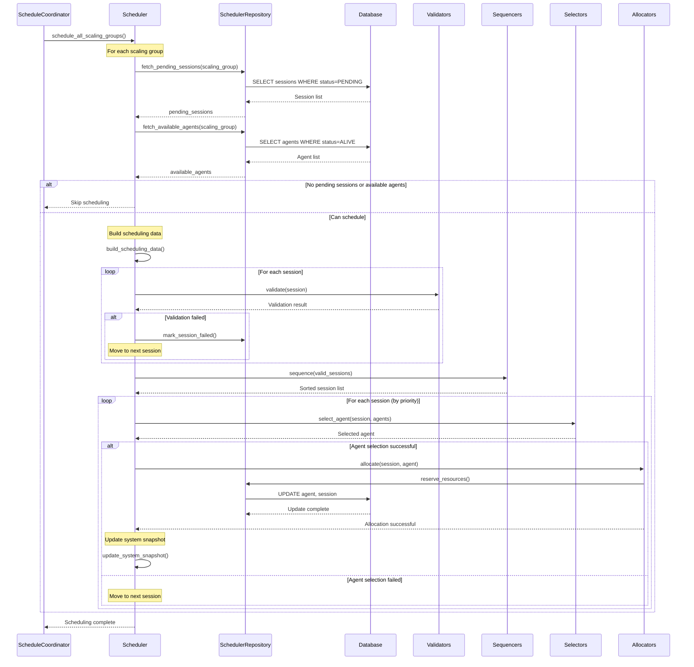
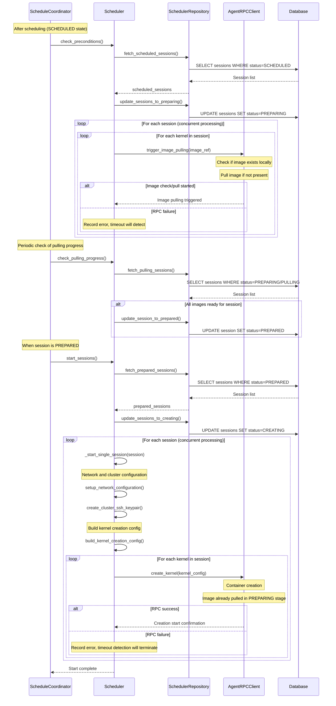
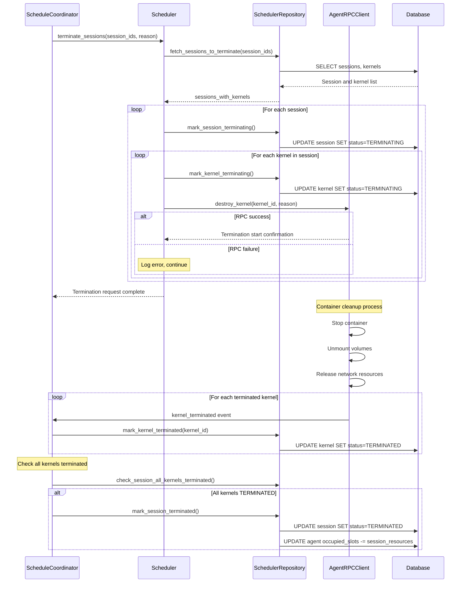

# Scheduler

← [Back to Sokovan](../README.md#sokovan-component-documentation) | [Manager](../../README.md#manager-architecture-documentation) | [Architecture Overview](../../../README.md#manager)

## Overview

The scheduler is the core module for session scheduling in Backend.AI. It places pending sessions on appropriate agents and manages the full lifecycle of sessions.

**Key Responsibilities:**
- **Session Scheduling**: places waiting sessions on available agents
- **Resource Constraint Validation**: verifies that the requested resources satisfy the system constraints
- **Lifecycle Management**: handles session start, termination and timeout detection
- **State Transition Management**: tracks kernel state transitions (SCHEDULED → PREPARING → PULLING → PREPARED → CREATING → RUNNING → TERMINATING → TERMINATED)

## Architecture

```
┌────────────────────────────────────────────┐
│        ScheduleCoordinator                 │
│  - Orchestrates scheduling operations      │
│  - Manages state-specific handlers         │
│  - Processes and distributes events        │
└──────────────┬─────────────────────────────┘
               │
    ┌──────────┼──────────┐
    │          │          │
    ▼          ▼          ▼
┌─────────┐ ┌─────────┐ ┌─────────┐
│Scheduler│ │Handlers │ │ Kernel  │
│         │ │         │ │ State   │
│         │ │         │ │ Engine  │
└────┬────┘ └────┬────┘ └─────────┘
     │           │
     │           ├─── lifecycle/    (Session lifecycle)
     │           ├─── promotion/    (Status promotion)
     │           ├─── maintenance/  (Cleanup and sweep)
     │           └─── kernel/       (Kernel-level handlers)
     │
     └─── Provisioner (Session provisioning plugins)
          │
          ├─── Validators   (Resource constraint validation)
          ├─── Sequencers   (Priority determination)
          ├─── Selectors    (Agent selection)
          └─── Allocators   (Resource allocation)
```

## Directory Structure

```
scheduler/
├── coordinator.py          # ScheduleCoordinator - top-level orchestrator
├── scheduler.py            # Scheduler - scheduling engine
├── factory.py              # Component factory
├── types.py                # Type definitions
├── results.py              # Result types
├── exceptions.py           # Exception definitions
│
├── provisioner/            # Session provisioning plugins
│   ├── validators/         # Resource constraint validation
│   ├── sequencers/         # Priority determination (FIFO, LIFO, DRF)
│   ├── selectors/          # Agent selection strategies
│   └── allocators/         # Resource allocation
│
├── handlers/               # State-specific handlers
│   ├── lifecycle/          # Session lifecycle (schedule, start, terminate)
│   ├── promotion/          # Session status promotion (pulling, creating, terminating progress)
│   ├── maintenance/        # Cleanup and sweep operations
│   └── kernel/             # Kernel-level handlers (stale kernel sweep)
│
├── hooks/                  # Status-based transition hooks
├── kernel/                 # Kernel state management
└── recorder/               # Event recording
```

## Dependencies

The scheduler depends on these infrastructure components:

**PostgreSQL**: persists session, kernel, agent and resource group states

**Valkey**: caches agent states and event streams

**etcd**: shares global configuration

## Major Components

### ScheduleCoordinator

ScheduleCoordinator is the top-level orchestrator for session scheduling and the central hub of the scheduler layer. It runs the scheduling tasks periodically and calls the handler for the current session state. It receives and processes the kernel events from agents (image pull start, complete and failure, kernel creation, running and termination, and so on) and coordinates image pulling across multiple agents.

**Key Dependencies:**
- **Scheduler**: runs the actual scheduling logic
- **SchedulingController**: pre-validation and preparation before session creation
- **KernelStateEngine**: manages kernel state transitions
- **SchedulerRepository**: database access
- **State-specific Handlers**: handle the session states (PENDING, SCHEDULED, PREPARING, RUNNING, TERMINATING and so on)

**Key Methods:**

#### `process_schedule()`
Schedules pending sessions.

```python
async def process_schedule(self) -> None:
    """
    Process pending sessions for scheduling.
    """
```

**Processing Flow:**
1. Run ScheduleSessionsHandler
2. Call the scheduler's schedule_all_scaling_groups()
3. Process the scheduling results

#### `handle_kernel_pulling()`
Processes image pulling events.

```python
async def handle_kernel_pulling(
    self,
    agent_id: AgentId,
    event_name: str,
    image: str,
    *,
    image_ref: str | None = None,
    error_msg: str | None = None,
) -> None:
```

**Processing Cases:**
- `image_pull_started`: image pulling started
- `image_pulled`: image pulling succeeded
- `image_pull_failed`: image pulling failed

#### `handle_kernel_creating()`, `handle_kernel_running()`, `handle_kernel_terminated()`
Process kernel lifecycle events.

### Scheduler

The scheduler is the engine that runs the scheduling algorithms. It queries pending sessions and places them on available agents. It provides an extensible scheduling mechanism through a plugin system so that scheduling policies and algorithms can change. It starts and terminates sessions, checks progress during image pulling and kernel creation, and detects timeouts through the coordinator's failure classification.

**Key Plugins and Dependencies:**
- **SessionValidator**: validates whether the resources satisfy the system constraints (user, project and domain quotas, concurrent execution limits and so on)
- **SessionSequencer**: determines the scheduling priority of pending sessions (FIFO, LIFO, DRF and so on, applicable per resource group)
- **AgentSelector**: selects the optimal agent for the session (configurable per resource group)
- **SessionAllocator**: allocates resources on the selected agents and writes them to the database
- **SchedulerRepository**: database access
- **AgentRPCPool**: RPC communication with agents
- **HookRegistry**: runs the status-based transition hooks

**Core Methods:**

#### `schedule_all_scaling_groups()`
Schedules pending sessions for all resource groups.

```python
async def schedule_all_scaling_groups(self) -> None:
    """
    Schedule sessions for all scaling groups.
    """
```

#### `terminate_sessions()`
Terminates sessions.

```python
async def terminate_sessions(
    self,
    session_ids: Sequence[SessionId],
    *,
    reason: str,
    forced: bool = False,
) -> None:
```

#### `start_sessions()`
Starts the scheduled sessions.

```python
async def start_sessions(self) -> None:
    """
    Start scheduled sessions by creating kernels on agents.
    """
```

## Scheduling Processing Flow

### Complete Scheduling Process



**Step-by-step Explanation:**

The complete scheduling process has five stages. In the first stage, the scheduler queries pending sessions and available agents by resource group. It retrieves the sessions in PENDING state from the resource group and the agents in ALIVE state that belong to the same resource group. If there is no pending session or no available agent, it skips scheduling for that resource group.

In the second stage, it builds the data needed for scheduling. It queries the current resource usage and the available resources of each agent and analyzes the resource requirements of each pending session. It reads the resource group configuration (scheduling policy, resource limits and so on) and combines this information into an in-memory snapshot of the current state of the entire system.

In the third stage, the Validator plugins validate each session. They check the resource quotas configured per user, project and domain, the concurrent session count limits, and confirm that the inter-session dependencies are satisfied. A session that fails validation is marked as failed immediately and excluded from the later stages.

In the fourth stage, the Sequencer plugin determines the priority of the sessions that passed validation. It sorts the sessions by the policy configured in the resource group (FIFO, LIFO, DRF and so on) and decides which session to process first.

In the fifth stage, the scheduler processes each session in the sorted order. The Selector plugin selects the optimal agent based on the resource requirements of the session and the available resources of the agents. When an agent is selected, the Allocator plugin allocates the resources on that agent, changes the session state to SCHEDULED and creates the kernel rows in PREPARING state. After each successful allocation, it updates the in-memory system snapshot with the latest resource state for the next session.

### Session Start Flow



**Step-by-step Explanation:**

The session start flow has three phases: precondition check, pulling progress check and session start.

**Phase 1: Precondition Check (SCHEDULED → PREPARING)**

In the first phase, check_preconditions() queries the sessions in SCHEDULED state and their kernels. For each session, it transitions the session state to PREPARING and triggers the image check and pull on the selected agents. The agent checks whether the required container image exists locally and starts pulling it if it does not. This phase ensures that all required images are available before kernel creation.

**Phase 2: Pulling Progress Check (PREPARING → PREPARED)**

In the second phase, check_pulling_progress() periodically queries the sessions in PREPARING or PULLING state. For each session, it checks whether the images of all kernels are ready. When all images of a session are pulled and ready, it transitions the session state to PREPARED. This phase monitors the image pulling progress and advances a session when it is ready.

**Phase 3: Session Start (PREPARED → CREATING)**

In the third phase, start_sessions() queries the sessions in PREPARED state, which passed the precondition check and have all images ready. For a multi-kernel session, it generates SSH key pairs for inter-node communication and configures cluster-dedicated networks. It builds all information needed for kernel creation: image references, resource slots, environment variables, volume mounts and network settings.

It calls the agent's create_kernel RPC for each kernel with the prepared configuration. Because the images were pulled in the PREPARING phase, the agent can create and start the containers immediately without another image pull. It can create multiple kernels concurrently. When the RPC calls succeed, the kernels transition to CREATING, and when all kernels of a session start successfully, the session transitions to RUNNING.

### Session Termination Flow



**Step-by-step Explanation:**

The session termination flow has five stages and runs asynchronously. In the first stage, it queries the sessions requested for termination and all kernels of those sessions from the database and checks the current state of each session and kernel.

In the second stage, it marks the states to show that termination is in progress. It changes the session state to TERMINATING and the state of each kernel of the session to TERMINATING. It writes these state changes to the database immediately so that other components can see that the session and its kernels are terminating.

In the third stage, it calls the destroy_kernel RPC of the agent that runs each kernel. The forced flag selects forced or normal termination. If an RPC fails, it logs the error and continues with the next kernel, so a failure of some kernels does not block the whole termination.

The fourth stage runs on the agent. The agent sends SIGTERM to the container for a normal termination and waits for the configured timeout. If the container does not terminate within the timeout, the agent sends SIGKILL to force termination. After the container terminates, the agent unmounts the mounted volumes and releases the allocated network resources.

In the fifth stage, it handles termination completion. When kernel cleanup completes, the agent publishes a kernel_terminated event, and ScheduleCoordinator updates the kernel state to TERMINATED. When all kernels of a session are in TERMINATED state, it changes the session state to TERMINATED and decreases the agent's occupied_slots to release the allocated resources.

## Provisioner Plugin System

The scheduler provides an extensible plugin architecture through the `provisioner/` package, so that administrators can change or extend scheduling policies and algorithms. Each plugin type defines an interface, and an administrator can implement and use a custom plugin.

> **Note:** All provisioning plugins are in `scheduler/provisioner/`. For the documentation of each plugin type, see the [Provisioner README](./provisioner/README.md).

### Validators

A Validator plugin validates whether the resources a session requests satisfy the system constraints.

**Basic Interface:**
```python
class SessionValidator(abc.ABC):
    @abc.abstractmethod
    async def validate(
        self,
        session: SessionWorkload,
        context: ValidationContext,
    ) -> None:
        """
        Validate the session against resource constraints.
        Raises SessionSchedulingError if validation fails.
        """
```

**Key Implementations:**

#### KeypairResourceLimitValidator

KeypairResourceLimitValidator validates the resource usage limit per keypair. It queries the resources the user currently uses and checks whether the configured quota would be exceeded by the additional resources of the new session request. If the quota is exceeded, it stops scheduling by raising a SessionSchedulingError.

#### GroupResourceLimitValidator

GroupResourceLimitValidator validates the resource usage limit per project. It checks whether the sum of the resource usage of all users in a project is within the project quota.

#### DomainResourceLimitValidator

DomainResourceLimitValidator validates the resource usage limit per domain. It verifies that the domain-wide resource usage does not exceed the domain quota.

#### ConcurrencyValidator

ConcurrencyValidator validates the concurrent session count limits. It checks the concurrent session count configured per user, project or domain and compares it with the running session count to decide whether a new session can start.

#### DependenciesValidator

DependenciesValidator validates the inter-session dependencies. When one session depends on another (for example, the main container depends on a sidecar container), it checks whether the dependency target session exists and is in RUNNING state. If the dependency is not satisfied, it defers the session start.

### Sequencers

A Sequencer plugin determines the scheduling order of the pending sessions that passed validation. A resource group can configure a different Sequencer to apply the priority policy that fits its characteristics.

**Basic Interface:**
```python
class WorkloadSequencer(abc.ABC):
    @abc.abstractmethod
    def sequence(
        self,
        sessions: Sequence[SessionWorkload],
        context: SequencingContext,
    ) -> Sequence[SessionWorkload]:
        """
        Sort sessions by priority.
        """
```

**Key Implementations:**

#### FIFOSequencer (First In First Out)

FIFOSequencer sorts by session creation time. The earliest created session has the highest priority; it sorts ascending by the `created_at` timestamp.

#### LIFOSequencer (Last In First Out)

LIFOSequencer sorts in reverse creation order. The most recently created session has the highest priority, which is useful in some special cases.

#### DRFSequencer (Dominant Resource Fairness)

DRFSequencer calculates priority from resource fairness. It first calculates each user's dominant resource (the resource type the user uses most) and gives higher priority to the sessions of users with lower dominant resource utilization. This distributes system resources fairly among users. It applies FIFO to the sessions of the same user.

### Selectors

A Selector plugin selects the optimal agent to run a session. A resource group can apply a different selection strategy according to its characteristics or operating goal.

**Basic Interface:**
```python
class AgentSelector(abc.ABC):
    @abc.abstractmethod
    def select(
        self,
        session: SessionWorkload,
        agents: Sequence[AgentInfo],
        context: SelectionContext,
    ) -> AgentId | None:
        """
        Select the best agent for the session.
        Returns None if no suitable agent is found.
        """
```

**Key Implementations:**

#### ConcentratedSelector (Concentrated Placement)

ConcentratedSelector concentrates resource usage to maximize efficiency. It first filters the agents with enough available resources for the session request. Among them, it prefers the agents with high current resource utilization, and when utilization is equal, the agents with the smaller total resource capacity. This strategy maximizes resource utilization and minimizes the number of idle agents.

#### DispersedSelector (Dispersed Placement)

DispersedSelector distributes resources across multiple agents for high availability. Among the agents with enough available resources, it prefers the agents with low current resource utilization, and when utilization is equal, the agents with the larger total resource capacity. This strategy minimizes the impact of one agent failure and distributes load evenly across agents.

#### RoundRobinSelector (Round Robin)

RoundRobinSelector selects agents in sequence. After filtering the agents with enough available resources, it cycles through them with an internal counter. This strategy is simple and its distribution is predictable.

### Allocators

An Allocator plugin allocates the session resources on the agent selected by the Selector. It keeps allocation atomic and consistent through database transactions.

**Basic Interface:**
```python
class SchedulingAllocator(abc.ABC):
    @abc.abstractmethod
    async def allocate(
        self,
        session: SessionWorkload,
        agent: AgentInfo,
        context: AllocationContext,
    ) -> AllocationResult:
        """
        Allocate resources for the session on the agent.
        """
```

**Key Implementations:**

#### RepositoryAllocator

RepositoryAllocator allocates resources through the database. It starts a transaction and queries the agent's current resource state with a SELECT FOR UPDATE query, which also takes the row lock. This prevents another scheduling process from allocating resources on the same agent at the same time.

After it confirms that the resources are still sufficient, it changes the session state to SCHEDULED and creates a row for each kernel in PREPARING state. It increases the agent's occupied_slots by the resources the session requests. If all operations succeed, it commits the transaction; if an error occurs midway, it rolls back automatically to keep the data consistent.

RepositoryAllocator controls concurrency with the row lock of SELECT FOR UPDATE and the transaction isolation level, and protects consistency with the automatic rollback on allocation failure.

### Hooks

Hooks are status-based extension points that run custom logic when a session transitions to a specific state. The hook system is organized by target status, and each hook handles the logic of its session type internally.

**Architecture:**
```
HookRegistry
    └── get_hook(SessionStatus) → Optional[StatusTransitionHook]
            │
            ├── SessionStatus.RUNNING → RunningTransitionHook
            │       ├── Update occupied_slots
            │       ├── Execute batch startup (BATCH sessions)
            │       └── Create inference routes (INFERENCE sessions)
            │
            └── SessionStatus.TERMINATED → TerminatedTransitionHook
                    └── Delete inference routes (INFERENCE sessions)
```

**Basic Interface:**
```python
class StatusTransitionHook(ABC):
    """
    Hook interface for status-based transition logic.
    """

    @abstractmethod
    async def execute(self, session: SessionWithKernels) -> None:
        """
        Execute hook logic for the session transitioning to this status.
        Raises exception on failure to block the transition.
        """
```

**Key Implementations:**

#### RunningTransitionHook

RunningTransitionHook runs when a session transitions to RUNNING. It performs three operations:
1. **occupied_slots update**: updates the agent's occupied resource slots
2. **Batch execution**: for BATCH sessions, triggers the startup command
3. **Inference route creation**: for INFERENCE sessions, creates the routing entries in the deployment system

#### TerminatedTransitionHook

TerminatedTransitionHook runs when a session transitions to TERMINATED. It handles the cleanup operations:
1. **Inference route deletion**: for INFERENCE sessions, removes the routing entries from the deployment system

**HookRegistry:**

HookRegistry provides a hook by SessionStatus. The coordinator calls `get_hook(status)` for a transition and runs the hook when it exists. Every hook blocks: a failure prevents the status transition.

## State-Specific Handlers

ScheduleCoordinator uses several handlers for the session states. Each handler performs the work needed for its target state or situation. The handlers are in four categories under `handlers/`:

### Lifecycle Handlers (`handlers/lifecycle/`)

Handlers for the core session lifecycle operations.

#### ScheduleSessionsHandler
Schedules pending sessions by calling the scheduler's schedule_all_scaling_groups() method for all resource groups.

#### StartSessionsHandler
Starts the scheduled sessions by calling the scheduler's start_sessions() method, which begins kernel creation for the sessions in SCHEDULED state.

#### TerminateSessionsHandler
Terminates sessions. It queries the sessions with termination requests from the database and calls the scheduler's terminate_sessions() method to send the termination RPC to the agents.

### Promotion Handlers (`handlers/promotion/`)

Handlers that promote a session to the next status based on progress checks.

#### PromoteToPreparedPromotionHandler
Promotes a session from PULLING to PREPARED when all images are pulled and ready.

#### PromoteToRunningPromotionHandler
Promotes a session from CREATING to RUNNING when all kernels started successfully.

#### PromoteToTerminatedPromotionHandler
Promotes a session from TERMINATING to TERMINATED when all kernels are cleaned up.

#### DetectTerminationPromotionHandler
Detects a running session that needs termination and promotes it to TERMINATING.

### Maintenance Handlers (`handlers/maintenance/`)

Handlers for cleanup and maintenance operations.

#### SweepSessionsHandler
Cleans up old sessions. It queries the sessions that have waited for a long time and cancels or cleans them by the configured policy. This removes the sessions that hold resources but are not in use.

### Kernel Handlers (`handlers/kernel/`)

Handlers for kernel-level operations that run independently of the session lifecycle.

#### SweepStaleKernelsKernelHandler
Sweeps the stale kernels that are in RUNNING state but no longer exist on their agents. It checks kernel presence via agent RPC and terminates a kernel that no longer runs on its assigned agent.

## Kernel State Engine

### KernelStateEngine

KernelStateEngine manages kernel state transitions. It updates the kernel state, validates a transition and keeps the related session state in sync with the kernel state changes.

**Key Methods:**

#### `mark_kernel_pulling()`

mark_kernel_pulling() transitions the kernel to PULLING. The scheduler calls it when the agent starts the container image pull, with the kernel ID and the transition reason.

```python
async def mark_kernel_pulling(
    self,
    kernel_id: KernelId,
    reason: str,
) -> bool:
```

#### `mark_kernel_running()`

mark_kernel_running() transitions the kernel to RUNNING. It is called when the container starts successfully on the agent, with the kernel ID, the transition reason and the created kernel information (container ID, network information and so on).

```python
async def mark_kernel_running(
    self,
    kernel_id: KernelId,
    reason: str,
    creation_info: KernelCreationInfo,
) -> bool:
```

#### `mark_kernel_cancelled()`

mark_kernel_cancelled() transitions the kernel to CANCELLED. It is called when a cancellation request arrives before the kernel start, with the kernel ID, the session ID and the cancellation reason. It has special handling that transitions the session itself to CANCELLED when all kernels of the session are in CANCELLED state.

```python
async def mark_kernel_cancelled(
    self,
    kernel_id: KernelId,
    session_id: SessionId,
    reason: str,
) -> bool:
```

#### `mark_kernel_terminated()`

mark_kernel_terminated() transitions the kernel to TERMINATED. It is called when the container terminates on the agent, with the kernel ID, the termination reason and optionally the container exit code.

```python
async def mark_kernel_terminated(
    self,
    kernel_id: KernelId,
    reason: KernelLifecycleEventReason,
    exit_code: Optional[int] = None,
) -> bool:
```

## State Transition Details

### Session State Transitions

Sessions follow these transition paths:

```
PENDING → SCHEDULED → PREPARING → PREPARED → CREATING → RUNNING → TERMINATING → TERMINATED
   ↓
CANCELLED
```

**Transition Condition Details:**

| Current State | Next State | Transition Trigger | Responsible Component | Failure Handling |
|----------|----------|------------|--------------|------------|
| PENDING | SCHEDULED | scheduling success, agent allocation complete | Scheduler | CANCELLED (validation failure) |
| PENDING | CANCELLED | user cancellation request, timeout | ScheduleCoordinator | - |
| SCHEDULED | PREPARING | precondition check started, image pull triggered | Scheduler | ERROR (RPC failure) |
| PREPARING | PREPARED | all images pulled and ready | Scheduler | CANCELLED (pulling failure) |
| PREPARED | CREATING | kernel creation RPC started | Scheduler | ERROR (RPC failure) |
| CREATING | RUNNING | all kernels in RUNNING state | KernelStateEngine | TERMINATING (partial failure) |
| RUNNING | TERMINATING | termination request received | Scheduler | - |
| TERMINATING | TERMINATED | all kernels TERMINATED | KernelStateEngine | - |

**Key Rules:**
- Only PENDING can transition directly to CANCELLED.
- After SCHEDULED, the session must reach TERMINATED through TERMINATING.
- Image pulling happens in the PREPARING phase before kernel creation.
- A failure in PREPARING or CREATING treats the whole session as TERMINATING.

### Kernel State Transitions

Kernels follow these transition paths:

```
SCHEDULED → PREPARING → PULLING → PREPARED → CREATING → RUNNING → TERMINATING → TERMINATED
   ↓
CANCELLED
```

**Transition Condition Details:**

| Current State | Next State | Transition Trigger | Responsible Component | Failure Handling |
|----------|----------|------------|--------------|------------|
| SCHEDULED | PREPARING | session scheduled, kernel allocated | Scheduler | - |
| PREPARING | PULLING | image pull RPC triggered | Scheduler | TERMINATING on timeout |
| PULLING | PREPARED | image pulling complete | Agent → Event | TERMINATING on timeout |
| PREPARED | CREATING | kernel creation RPC started | Scheduler | TERMINATING on timeout |
| CREATING | RUNNING | container created and started | Agent → Event | TERMINATING on timeout |
| SCHEDULED | CANCELLED | cancellation request before image pull | KernelStateEngine | - |
| PREPARING | CANCELLED | cancellation request during image pull trigger | KernelStateEngine | - |
| PULLING | CANCELLED | cancellation request during image pulling | KernelStateEngine | - |
| PREPARED | CANCELLED | cancellation request before kernel creation | KernelStateEngine | - |
| CREATING | CANCELLED | cancellation request during kernel creation | KernelStateEngine | - |
| RUNNING | TERMINATING | termination RPC called | Scheduler | - |
| TERMINATING | TERMINATED | container cleanup complete | Agent → Event | force terminate |

**Timeout Policies:**

The coordinator's `_classify_failures` detects a stuck session by the timeout threshold:

| Status | Timeout | Action on Timeout |
|--------|---------|-------------------|
| PREPARING | 15 minutes | transition to TERMINATING |
| PULLING | 15 minutes | transition to TERMINATING |
| CREATING | 10 minutes | transition to TERMINATING |

**PENDING scheduling failure** (max retries exceeded):
- A session that exceeds the maximum scheduling retries (SERVICE_MAX_RETRIES) is deprioritized.
- Its priority is lowered and it returns to PENDING for re-scheduling with the lower priority.

**Termination failure** (TERMINATING stage):
- Force termination (SIGKILL) after the timeout

## Troubleshooting

### 1. Session Stuck in PENDING State

**Symptoms**:
- the session stays in PENDING state for a long time

**Causes**:
- insufficient available agents in the resource group
- agent resource shortage
- resource quota exceeded

**Diagnosis**:
- **Check session history**: review the session history on the session detail page to identify the cause of the persistent PENDING state
- **Resource group status**: check the agent count and state in the resource group
- **Resource availability**: check the available resources per agent

**Resolution**:
1. Add agents to the resource group.
2. Check and recover the agent state.
3. Adjust the resource quotas.

### 2. Kernel Stuck in PULLING State

**Symptoms**:
- the kernel stays in PULLING state for a long time

**Causes**:
- image registry access failure
- agent disk space shortage
- network connection issues

**Diagnosis**:
- **Check session history**: review the image pulling events and the error messages
- **Agent state**: check the agent disk usage and network state

**Resolution**:
1. Verify the image registry connection.
2. Free agent disk space.
3. The session is terminated after the timeout (15 minutes); the user can retry.

### 3. Kernel Fails in PREPARING/CREATING

**Symptoms**:
- kernel creation fails
- the session transitions to TERMINATING after the timeout

**Causes**:
- container image errors
- agent resource shortage
- session configuration errors

**Diagnosis**:
- **Check session history**: review the kernel creation failure reasons and the error messages
- **Image validity**: verify that the image in use is correct
- **Agent state**: check the agent resource state

**Resolution**:
1. Validate and fix the image.
2. Review the session configuration (environ, mounts and so on).
3. Secure agent resources.
4. Retry session creation after fixing the issues.

### 4. Session Termination Not Completing

**Symptoms**:
- stuck in TERMINATING state
- resources not released

**Causes**:
- no agent RPC response
- container force termination failure

**Diagnosis**:
- **Check session history**: review the termination progress and the failure reasons
- **Agent connection state**: check the agent connection state and responsiveness

**Resolution**:
1. Wait for the automatic force termination after the timeout.
2. Check and recover the agent connection state.
3. Clean up the session manually if necessary.

## Parent Document
- [Sokovan Overall Architecture](../README.md)

## Related documents
- [Deployment Architecture](../deployment/README.md)
- [SchedulingController Architecture](../scheduling_controller/README.md)
