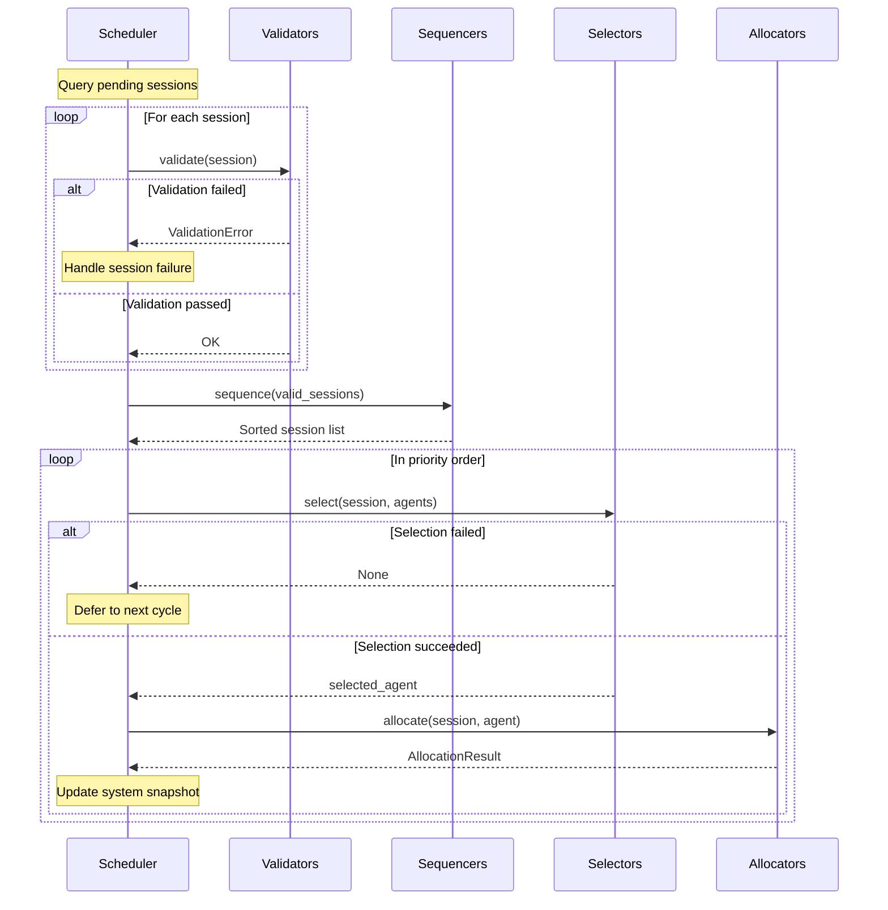

# Provisioner

← [Back to Scheduler](../README.md)

## Overview

Provisioner is the package that provides the core plugin system for session scheduling. It has four plugin types that form the provisioning pipeline which places pending sessions on appropriate agents.

**Key Responsibilities:**
- **Resource Constraint Validation**: verify that sessions meet the system constraints
- **Priority Determination**: decide the scheduling order
- **Agent Selection**: select the optimal agents
- **Resource Allocation**: perform the resource allocation

## Architecture

```
                    ┌─────────────────┐
                    │ Pending Session │
                    └────────┬────────┘
                             │
                             ▼
┌────────────────────────────────────────────────────┐
│                   Validators                        │
│  Verify resource quotas, concurrency limits,        │
│  dependencies, etc.                                 │
│  (Session scheduling stops on failure)              │
└────────────────────────────────────────────────────┘
                             │
                             ▼ (Sessions that passed validation)
┌────────────────────────────────────────────────────┐
│                   Sequencers                        │
│  Sort by priority according to FIFO, LIFO, DRF     │
│  policies                                           │
└────────────────────────────────────────────────────┘
                             │
                             ▼ (In sorted order)
┌────────────────────────────────────────────────────┐
│                   Selectors                         │
│  Select agent using concentrated/dispersed/         │
│  round-robin strategies                             │
└────────────────────────────────────────────────────┘
                             │
                             ▼ (Selected agent)
┌────────────────────────────────────────────────────┐
│                   Allocators                        │
│  Map session to agent, create kernels,              │
│  record resource occupancy                          │
└────────────────────────────────────────────────────┘
                             │
                             ▼
                    ┌─────────────────┐
                    │ Scheduled Session│
                    └─────────────────┘
```

## Directory Structure

```
provisioner/
├── __init__.py
├── README.md
│
├── validators/          # Resource constraint validation
│   ├── validator.py     # Base classes
│   ├── exceptions.py    # Validation exceptions
│   ├── keypair_resource_limit.py
│   ├── group_resource_limit.py
│   ├── domain_resource_limit.py
│   ├── user_resource_limit.py
│   ├── concurrency.py
│   ├── dependencies.py
│   └── ...
│
├── sequencers/          # Priority determination
│   ├── sequencer.py     # WorkloadSequencer base class
│   ├── fifo.py          # First-In-First-Out
│   ├── lifo.py          # Last-In-First-Out
│   └── drf.py           # Dominant Resource Fairness
│
├── selectors/           # Agent selection
│   ├── selector.py      # AgentSelector base class
│   ├── exceptions.py    # Selection exceptions
│   ├── concentrated.py  # Concentrated placement
│   ├── dispersed.py     # Dispersed placement
│   ├── roundrobin.py    # Round-robin
│   └── ...
│
└── allocators/          # Resource allocation
    ├── allocator.py     # SchedulingAllocator base class
    └── repository_allocator.py  # DB-based allocation
```

## Plugin Types

### 1. Validators

Validates the resource constraints before sessions are scheduled.

**Execution Point:** first stage of the scheduling pipeline

**Behavior:**
- All Validators run in sequence.
- If one fails, the session is excluded from scheduling.
- The failure reasons are recorded and communicated to users.

**Key Implementations:**
| Validator | Description |
|-----------|-------------|
| KeypairResourceLimitValidator | resource quota validation per keypair |
| GroupResourceLimitValidator | resource quota validation per project |
| DomainResourceLimitValidator | resource quota validation per domain |
| UserResourceLimitValidator | resource quota validation per user |
| ConcurrencyValidator | concurrent session count limit validation |
| DependenciesValidator | inter-session dependency validation |
| PendingSessionCountLimitValidator | pending session count limit validation |
| PendingSessionResourceLimitValidator | pending session resource limit validation |
| ReservedBatchSessionValidator | reserved batch session validation |

Details: [validators/README.md](./validators/README.md)

### 2. Sequencers

Determines the scheduling order of the sessions that passed validation.

**Execution Point:** after the Validators pass

**Behavior:**
- uses the Sequencer configured for the resource group
- receives the session list and returns it sorted by priority

**Key Implementations:**
| Sequencer | Description |
|-----------|-------------|
| FIFOSequencer | earlier created sessions first (First-In-First-Out) |
| LIFOSequencer | later created sessions first (Last-In-First-Out) |
| DRFSequencer | priority from resource fairness (Dominant Resource Fairness) |

Details: [sequencers/README.md](./sequencers/README.md)

### 3. Selectors

Selects the optimal agent to run a session.

**Execution Point:** for each session in the order the Sequencer returns them

**Behavior:**
- uses the Selector configured for the resource group
- selects an agent that meets the session requirements from the agent list
- on selection failure, defers the session to the next scheduling cycle

**Key Implementations:**
| Selector | Description |
|----------|-------------|
| ConcentratedSelector | maximize utilization by concentrating resources |
| DispersedSelector | ensure high availability by dispersing resources |
| RoundRobinSelector | sequential agent rotation |

Details: [selectors/README.md](./selectors/README.md)

### 4. Allocators

Allocates the resources on the agent selected by the Selector.

**Execution Point:** immediately after the Selector selects an agent

**Behavior:**
- atomic allocation through database transactions
- changes the session status to SCHEDULED
- creates the kernel rows
- updates the agent's occupied_slots

**Key Implementations:**
| Allocator | Description |
|-----------|-------------|
| RepositoryAllocator | resource allocation through a DB transaction |

Details: [allocators/README.md](./allocators/README.md)

## Scheduling Pipeline Flow



## Writing Custom Plugins

### Validator Example

```python
from ai.backend.manager.sokovan.scheduler.provisioner.validators.validator import ValidatorRule
from ai.backend.manager.sokovan.scheduler.provisioner.validators.exceptions import SchedulingValidationError

class CustomValidator(ValidatorRule):
    async def validate(
        self,
        session: SessionWorkload,
        system_snapshot: SystemSnapshot,
    ) -> None:
        if not self._check_custom_condition(session):
            raise SchedulingValidationError(
                "Custom validation failed",
                session_id=session.session_id,
            )
```

### Sequencer Example

```python
from ai.backend.manager.sokovan.scheduler.provisioner.sequencers.sequencer import WorkloadSequencer

class CustomSequencer(WorkloadSequencer):
    def sequence(
        self,
        sessions: Sequence[SessionWorkload],
        context: SequencingContext,
    ) -> Sequence[SessionWorkload]:
        return sorted(sessions, key=lambda s: self._custom_priority(s))
```

### Selector Example

```python
from ai.backend.manager.sokovan.scheduler.provisioner.selectors.selector import AgentSelector

class CustomSelector(AgentSelector):
    def select(
        self,
        session: SessionWorkload,
        agents: Sequence[AgentInfo],
        context: SelectionContext,
    ) -> AgentId | None:
        for agent in agents:
            if self._matches_custom_criteria(session, agent):
                return agent.agent_id
        return None
```

## Configuration

Each plugin is configured per resource group:

```python
# In scaling group configuration
scaling_group_config = {
    "scheduler": "fifo",           # Sequencer selection
    "scheduler_opts": {
        "agent_selector": "dispersed",  # Selector selection
    },
}
```

## Related documents

- [Scheduler README](../README.md) - Overall scheduler architecture
- [validators/README.md](./validators/README.md) - Validator details
- [sequencers/README.md](./sequencers/README.md) - Sequencer details
- [selectors/README.md](./selectors/README.md) - Selector details
- [allocators/README.md](./allocators/README.md) - Allocator details
