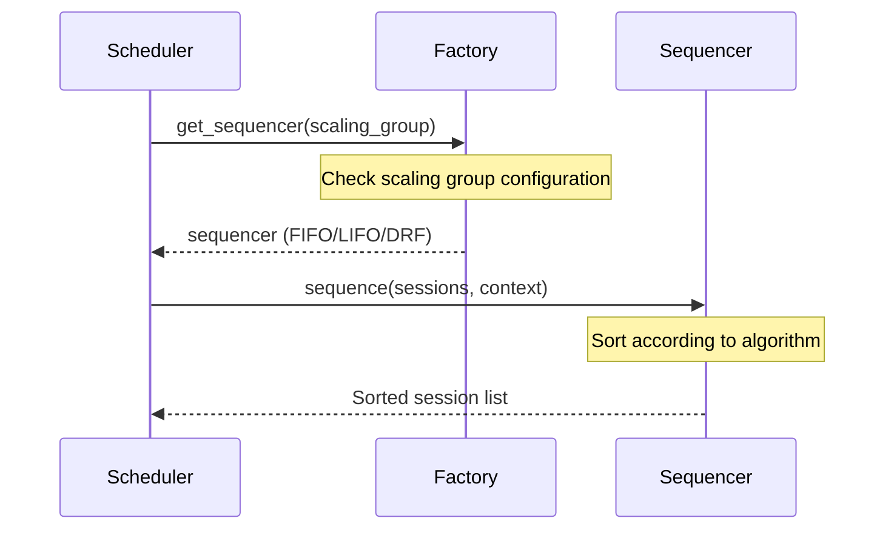

# Sequencers

← [Back to Provisioner](../README.md) | [Scheduler](../../README.md)

## Overview

Sequencers are plugins that determine the scheduling order of the pending sessions that passed validation. A resource group can apply a different policy, which controls the resource allocation order through session priority.

**Key Responsibilities:**
- determining the priority of pending sessions
- fair resource distribution
- custom policy per resource group

## Architecture

```
┌───────────────────────────────────────┐
│       Validated Session List          │
│   [Session A, Session B, Session C]   │
└─────────────────┬─────────────────────┘
                  │
                  ▼
┌───────────────────────────────────────┐
│          WorkloadSequencer            │
│   (Selected based on scaling group)   │
└─────────────────┬─────────────────────┘
                  │
        ┌─────────┼─────────┐
        │         │         │
        ▼         ▼         ▼
   ┌────────┐ ┌────────┐ ┌────────┐
   │  FIFO  │ │  LIFO  │ │  DRF   │
   └────────┘ └────────┘ └────────┘
                  │
                  ▼
┌───────────────────────────────────────┐
│         Sorted Session List           │
│   [Session B, Session A, Session C]   │
└───────────────────────────────────────┘
```

## Core Classes

### WorkloadSequencer (Abstract Base)

Base class of all Sequencers.

```python
class WorkloadSequencer(abc.ABC):
    @abc.abstractmethod
    def sequence(
        self,
        workloads: Sequence[SessionWorkload],
        context: SequencingContext,
    ) -> Sequence[SessionWorkload]:
        """
        Sort the session list by priority.

        Args:
            workloads: List of sessions to sort
            context: Context information needed for sorting

        Returns:
            Session list sorted by priority
        """
        pass
```

## Implementations

### FIFOSequencer (First-In-First-Out)

Schedules earlier-created sessions first.

**Algorithm:**
- sort ascending by the `created_at` timestamp
- the longest waiting session has the highest priority

**Use Cases:**
- when a fair waiting order is required
- general work queue processing

```python
class FIFOSequencer(WorkloadSequencer):
    def sequence(
        self,
        workloads: Sequence[SessionWorkload],
        context: SequencingContext,
    ) -> Sequence[SessionWorkload]:
        return sorted(workloads, key=lambda w: w.created_at)
```

**Sorting Example:**
```
Input:  [Session(created=10:03), Session(created=10:01), Session(created=10:02)]
Output: [Session(created=10:01), Session(created=10:02), Session(created=10:03)]
```

### LIFOSequencer (Last-In-First-Out)

Schedules later-created sessions first.

**Algorithm:**
- sort descending by the `created_at` timestamp
- the most recently requested session has the highest priority

**Use Cases:**
- when the latest request needs priority
- interactive workloads where real-time response is important

```python
class LIFOSequencer(WorkloadSequencer):
    def sequence(
        self,
        workloads: Sequence[SessionWorkload],
        context: SequencingContext,
    ) -> Sequence[SessionWorkload]:
        return sorted(workloads, key=lambda w: w.created_at, reverse=True)
```

**Sorting Example:**
```
Input:  [Session(created=10:03), Session(created=10:01), Session(created=10:02)]
Output: [Session(created=10:03), Session(created=10:02), Session(created=10:01)]
```

### DRFSequencer (Dominant Resource Fairness)

Determines priority based on resource fairness.

**Algorithm:**
1. Calculate each user's dominant resource (the resource type the user uses most).
2. Give higher priority to the sessions of users with lower dominant resource usage.
3. Apply FIFO among the sessions of the same user.

**Dominant Resource Calculation:**
```
User A: CPU 50% used, Memory 30% used → Dominant = CPU (50%)
User B: CPU 20% used, Memory 60% used → Dominant = Memory (60%)

→ User A's session gets priority (lower dominant resource usage)
```

**Use Cases:**
- fair resource distribution in a multi-user environment
- preventing resource monopolization by specific users
- cluster utilization optimization

```python
class DRFSequencer(WorkloadSequencer):
    def sequence(
        self,
        workloads: Sequence[SessionWorkload],
        context: SequencingContext,
    ) -> Sequence[SessionWorkload]:
        # Calculate dominant resource per user
        user_dominant = self._calculate_dominant_resources(context)

        # Sort by dominant resource usage
        return sorted(
            workloads,
            key=lambda w: (
                user_dominant.get(w.access_key, 0.0),  # Primary: dominant resource
                w.created_at,  # Secondary: creation time (FIFO)
            )
        )
```

**Sorting Example:**
```
Input:
  - Session A (User1, dominant=0.5, created=10:01)
  - Session B (User2, dominant=0.3, created=10:02)
  - Session C (User1, dominant=0.5, created=10:03)

Output:
  - Session B (dominant=0.3) ← Highest priority
  - Session A (dominant=0.5, created=10:01)
  - Session C (dominant=0.5, created=10:03)
```

## Selection Flow



## Writing Custom Sequencers

### 1. Inherit WorkloadSequencer

```python
from ai.backend.manager.sokovan.scheduler.provisioner.sequencers.sequencer import WorkloadSequencer

class PrioritySequencer(WorkloadSequencer):
    """Priority field-based sorting"""

    def sequence(
        self,
        workloads: Sequence[SessionWorkload],
        context: SequencingContext,
    ) -> Sequence[SessionWorkload]:
        return sorted(
            workloads,
            key=lambda w: (
                -w.priority,      # Primary: priority (higher value first)
                w.created_at,     # Secondary: creation time (FIFO)
            )
        )
```

### 2. Apply Composite Sorting Criteria

```python
class WeightedSequencer(WorkloadSequencer):
    """Weight-based composite sorting"""

    def __init__(self, wait_time_weight: float = 0.5, resource_weight: float = 0.5):
        self._wait_time_weight = wait_time_weight
        self._resource_weight = resource_weight

    def sequence(
        self,
        workloads: Sequence[SessionWorkload],
        context: SequencingContext,
    ) -> Sequence[SessionWorkload]:
        now = datetime.now()

        def calculate_score(w: SessionWorkload) -> float:
            wait_time = (now - w.created_at).total_seconds()
            resource_size = sum(w.requested_slots.values())

            # Higher score for longer wait time and smaller resource request
            return (
                self._wait_time_weight * wait_time +
                self._resource_weight * (1 / resource_size)
            )

        return sorted(workloads, key=calculate_score, reverse=True)
```

### 3. Register in Factory

```python
def get_sequencer(self, scheduler_name: str) -> WorkloadSequencer:
    match scheduler_name:
        case "fifo":
            return FIFOSequencer()
        case "lifo":
            return LIFOSequencer()
        case "drf":
            return DRFSequencer()
        case "priority":
            return PrioritySequencer()  # Add custom
        case _:
            return FIFOSequencer()
```

## Configuration

Configure the Sequencer per resource group:

```python
# Scaling group configuration
scaling_group = {
    "name": "default",
    "scheduler": "fifo",  # Choose from "fifo", "lifo", "drf"
}
```

**Configuration Options:**

| Option | Description | Default |
|--------|-------------|---------|
| `fifo` | First-In-First-Out - Guarantees waiting order | ✓ |
| `lifo` | Last-In-First-Out - Prioritizes latest requests | |
| `drf` | Resource fairness-based | |

## Performance Considerations

- Sorting is O(n log n).
- Consider the sorting cost with many pending sessions.
- DRF needs additional resource usage calculations.

## Related documents

- [Provisioner README](../README.md)
- [Scheduler README](../../README.md)
- [DRF Algorithm Paper](https://cs.stanford.edu/~matei/papers/2011/nsdi_drf.pdf)
